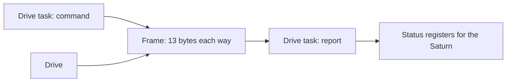
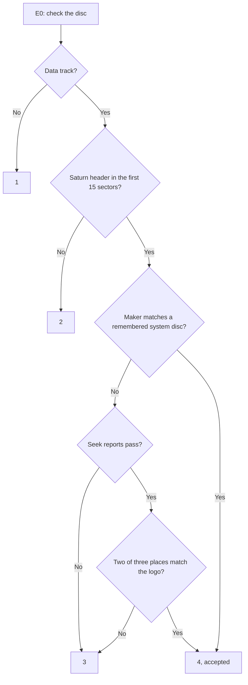

# Sega Saturn CD-block SH-1 firmware

The CD block is the Saturn's CD subsystem, built around a Hitachi SH-1 (SH7034) with its own
firmware ROM, sector buffer and host interface. The firmware runs the optical drive, filters and
buffers sectors, and answers the host commands issued from the SH-2 side. This page is a
self-contained overview of it: startup, task structure, host commands, sector buffering, the drive,
disc authentication and the extension loaders.

No ROM content is included. Everything here describes revision CDB105 (SHA-1
`eb8393058f324e922c11b43709b64fc6ca94ab86`). [Firmware revisions](docs/firmware-revisions.md) lists
the other known revisions and what changed in each. Where the Saturn's own BIOS matters, it is
BIOS 1.01a, MPR-17933 (SHA-1 `faa8ea183a6d7bbe5d4e03bb1332519800d3fbc3`), and BIOS addresses are
its ROM addresses.

The [CD block emulator][emulator] runs your dump on an emulation of the CD block's SH-1 board. It
is a separate repository, included here as the `emulator/` submodule, and holds the example code
and the `ring/` and `payload/` scripts. Clone with `--recurse-submodules --remote-submodules`, or
run `git submodule update --init --remote` in a clone. Either checks out the latest commit of the
emulator's `main` branch, which is the version these guides go with. The scripts run as they are.
The emulator and its example code need a build of the emulator, SH binutils to assemble the
examples, and your dump in `emulator/dumps/`, where their commands look for it
([quick start][emulator-quick-start], [running the examples][emulator-examples-running]).

## Documents

### CD-block firmware

The firmware's modules, keyed by ROM address. The ROM sits at address 0 and holds big-endian SH-1
code. Each module guide opens with a short summary of what the module does. Structure comes first,
as the map of the firmware. The kernel follows: the other guides use its tasks, messages and traps.

The guides name routines and tables by the labels of the [annotation files](#ghidra-annotations),
with the address beside them, as in `task_select_ready` (`0x10a8`). The flag bytes they name have
labels too, such as `drive_read_flags` for the read flags at `0x0f0002a7`.

| Document | Contents |
| --- | --- |
| [Structure](docs/cdblock/structure.md) | Lifecycle, module index, memory map, startup, the remaining tasks, the exception handlers and the serial monitor |
| [Kernel](docs/cdblock/kernel.md) | Tasks, scheduling, messages, locks and timers |
| [Host commands](docs/cdblock/host-commands.md) | IRQ6 entry, dispatch, responses and the described commands |
| [Sector buffer](docs/cdblock/sector-buffer.md) | Sector completion, filters, connections and partitions, the Saturn's buffer settings, copy and move |
| [Sector reads](docs/cdblock/sector-reads.md) | How sectors come from the decoder: sector pulse, DMA, position and error checks, retries |
| [Subcode](docs/cdblock/subcode.md) | R-W subcode: collecting the packs, correcting them and sending them to the Saturn |
| [Data transfer](docs/cdblock/data-transfer.md) | How data moves to and from the Saturn: the transfer start, the DMA end interrupt, End Data Transfer, and the sector commands that task 12 serves |
| [Drive](docs/cdblock/drive.md) | The drive link, reports, commands, the drive task and the timing it allows |
| [Disc authentication](docs/cdblock/disc-authentication.md) | The disc check, stage by stage |
| [File system](docs/cdblock/file-system.md) | The ISO 9660 commands: directories, the file table and reading files |
| [Extensions](docs/cdblock/extensions.md) | Disc and expansion loaders, MPEG card requests, extension hooks |
| [Decoder](docs/cdblock/decoder.md) | The extension decoder: control flow, arithmetic, reversibility |
| [Bugs and oddities](docs/cdblock/bugs-and-oddities.md) | Behavior that looks unintended or surprising, the code nothing in the ROM reaches and the messages no ROM code posts, each with the guide that describes it |

### MPEG card firmware

The MPEG card's ROM holds code for the CD block's SH-1, which the firmware loads as an extension.
The firmware places the decoded code at `0x0907b000`.

| Document | Contents |
| --- | --- |
| [SH-1 code](docs/mpeg-card/sh1-code.md) | The card's code by address: decoding, the layout, the entry table and which entries run card code, the firmware interface |
| [MPEG commands](docs/mpeg-card/commands.md) | Which MPEG commands run card code, the card's handlers and the image and sector jobs |
| [Video and audio](docs/mpeg-card/video-and-audio.md) | How the card's entries start the video and audio transfers, mark pictures, keep timestamps and switch streams |
| [Task 8's handlers](docs/mpeg-card/task-8.md) | The card's code in the MPEG task: its status events, picture starts and updates, intervals, the video and audio sector feeds, packet headers and changes |
| [Task 9's card work](docs/mpeg-card/task-9.md) | The card's code in task 9: the preparation of new connections with the picture search, and the image and sector jobs in the card's memory |
| [Bugs and oddities](docs/mpeg-card/bugs-and-oddities.md) | Behavior in the card's code that looks unintended or surprising, each with the guide that describes it |

### Executing SH-1 code from the SH-2

How a card extension of one's own could run work for the SH-2, and what the firmware does to it.

| Document | Contents |
| --- | --- |
| [Firmware mechanisms](docs/sh1-execution/mechanisms.md) | Proposed computation through a card extension: loading, jobs, preemption, buffer ownership and remaining constraints |
| [Card extension lifecycle](docs/sh1-execution/lifecycle.md) | What activation, stops, resets, reloads and accepted discs leave of a loaded card extension, and the order a game follows |
| [Example code][emulator-examples] | Proof-of-concept extensions in SH-1 assembly with scenarios that run them on the emulator, what they have run on, and what turning one into card firmware takes. In the emulator's repository |

### Other

The board, the SH-1 chip, the MPEG cards, the revisions of both firmwares and sources.

| Document | Contents |
| --- | --- |
| [Board](docs/board.md) | How the SH-1 is wired: memory areas, clock and reset, the interface chip and its registers, the drive, the audio output, the main board and MPEG card connectors and the test pads |
| [SH7034 notes](docs/sh7034.md) | Chip facts from the SH7032/SH7034 hardware manual, with page references |
| [MPEG cards](docs/mpeg-cards.md) | The known cards and their ROMs, boards, the ROM layout, and how the card works with the CD block |
| [Firmware revisions](docs/firmware-revisions.md) | Known revisions, what changed in each, checksum, address crosswalk |
| [MPEG firmware revisions](docs/mpeg-firmware-revisions.md) | The two versions of the card's code: the shared NTSC code, the PAL changes, the decoded layout and an address crosswalk |
| [References](docs/references.md) | Host command names, Sega documentation, historical reports, prior work |

## Scripts

Small scripts that run what the guides describe. Scripts that need the firmware's tables read them
from your own dump. The Python scripts use the standard library only and take `--help`, and each
one's folder holds example files, except `logo/` and `revision/`, which read only your dump, and
`payload/`, whose inputs are your own dumps and builds of the [example code][emulator-examples].
The `ring/` and `payload/` scripts are in the [emulator's repository][emulator], the `emulator/`
submodule, beside the harness that uses them.

| Path | Contents |
| --- | --- |
| [`emulator/scripts/ring/`][emulator-ring] | `ring.py` replays the disc authentication checks on seek answers and raw sectors, and `make.py` builds sectors for the sector checks from your dump |
| [`scripts/logo/`](scripts/logo/) | `logo.py` prints the SEGA logo bitmap the sector checks compare with, from your dump |
| [`scripts/subcode/`](scripts/subcode/) | `subcode.py` decodes R-W subcode packs as task 2 does, beside a textbook decoder |
| [`scripts/correction/`](scripts/correction/) | `correct.py` runs task 1's sector correction on a sector you damage |
| [`scripts/directory/`](scripts/directory/) | `directory.py` builds the file system's table from an ISO 9660 image and runs the file system commands on it, and `make.py` builds example images |
| [`scripts/drive-link/`](scripts/drive-link/) | `link.py` decodes frames of the drive link written as text |
| [`scripts/revision/`](scripts/revision/) | `revision.py` names a dump's revision and maps addresses between revisions |
| [`emulator/scripts/payload/`][emulator-payload] | `payload.py` encodes and decodes extension payloads as the [decoder](docs/cdblock/decoder.md) describes, builds a card ROM from code and decodes the code from a card ROM |

The commands in this README and in the guides run from this folder, with your dump saved in it as
`cdb105.bin`. Every script that reads the dump takes its path as an argument, so a dump kept
elsewhere works with its own path. [References](docs/references.md#prior-community-work) points to
the published dumping methods. For example, `revision.py` names the revision of the dump:

```
python scripts/revision/revision.py cdb105.bin
```

## Hardware

- The CD block has a 20 MHz SH-1 ([Sega CPU overview][SEGA-CPU]), 512 KB of buffer RAM, the 64 KB
  firmware ROM and an interface that connects it to the rest of the Saturn ([Sega CD
  overview][SEGA-CD]).
- The optical drive is a separate unit with its own electronics for the laser, the signal and the
  motors. The firmware sends it commands and receives its reports over a serial line.
- The Saturn's main processors cannot reach the CD block's RAM directly. They talk to it through
  four command registers and move data through a transfer register.
- Earlier boards use a separate interface chip from the YGR019 family. YGR022 combines the
  interface, the SH-1 and the ROM in one chip.
- The interface chip raises the SH-1's two external interrupts: one when the Saturn writes a
  command, one when a sector or a frame of subcode arrives from the drive. It also requests the DMA
  transfers for sectors and for the Saturn's data. The drive link, a de-emphasis output for the
  audio and the MPEG card's signals use SH-1 pins directly ([board](docs/board.md)).
- CDB106 boards take a 21-pin or a 20-pin drive. A board pin marks the 20-pin drive, and CDB106
  reads it at power-on to set up the interface chip
  ([firmware revisions](docs/firmware-revisions.md#drive-strap)).
- MPEG video playback needs the optional MPEG card.

## How the firmware is organized

- The firmware fills about 50 KB of its 64 KB ROM. The rest is unused, apart from a small page near
  the end that stays at the same address in every revision (see [extension code](#extension-code)).
- After power-on the firmware clears its RAM, tests its memory and the interface chip and adds up
  the ROM. A test pad on the board, grounded at power-on, selects a diagnostic mode instead: the
  firmware sends the test results as two bytes, then runs a serial monitor at 9600 bps that reads
  and writes memory. It reads only a copyright notice from the ROM and never writes the SH-1's own
  RAM or registers ([serial monitor](docs/cdblock/structure.md#serial-monitor)).
- Most exceptions the firmware does not expect, such as an illegal instruction or an interrupt it
  never enables, restart it as at power-on. The others return at once, and a DMA address error
  stops all DMA before it returns. Nothing in normal operation raises any of them
  ([exceptions](docs/cdblock/structure.md#exceptions)).
- The rest of the firmware runs as tasks: small programs that each wait for a message, do their
  piece of work and wait again. Eleven tasks start. Ten wait for messages, and the last one idles
  whenever no other task has work. Their IDs run from 1 to 14 with gaps: IDs 3 and 11 have no task,
  and their task records serve as the transfer lock and the sector lock. ID 10 has no task
  either ([kernel](docs/cdblock/kernel.md#tasks)).
- A scheduler picks which task runs. Locks keep two tasks from changing the same buffer records at
  once, and timers let a task give up after a deadline.
- The kernel also has services that no ROM code uses, such as a send that waits for the reply and a
  lock attempt that does not wait. Loaded extensions can still call them
  ([kernel](docs/cdblock/kernel.md#send-and-reply)).
- Work comes from outside: commands from the Saturn, sectors from the disc, reports from the drive
  and timer interrupts. Each one becomes a message to the task that handles it.

| Task | Role |
| --- | --- |
| 1 | Repairs the sectors with errors that task 5 sends it when error correction is on |
| 2 | R-W subcode: corrects each pack the decoder interrupt collects and sends packs to the Saturn |
| 4 | Sets up the sector buffer at startup, then carries out the Saturn's filter settings and selector resets, and works out sizes and frame searches |
| 5 | Sector reads: takes each sector from the decoder, checks its position and errors, and passes good sectors through the filters into a partition |
| 6 | Drive control: commands to the drive, its reports, and the status the Saturn sees |
| 7 | Disc requests: disc authentication and the file system |
| 8 | MPEG task: its message handlers run mostly through the card extension's table, into card code |
| 9 | MPEG card requests: card checks, card extension loading and `E2` |
| 12 | Sector data commands `61..64`: sends a partition's sectors to the Saturn or takes sectors from it |
| 13 | Copies or moves a partition's sectors through a filter for the Saturn |
| 14 | Writes the `CDBLOCK` signature at startup, then idles |

## Commands from the Saturn

- Commands arrive through an interrupt. The firmware reads the four command registers, runs the
  handler for that command and writes its response back into them.
- Simple commands are answered inside the interrupt handler. Longer operations are posted to a
  task, and the host polls for the outcome: `E0` starts disc authentication, for example, and `E1`
  returns its result.
- While an `E0` or `E2` request is running, only command `05` is accepted.
- The first byte of every response but `FF`'s is the status: the drive's state, such as pause or
  play, with one flag for "wait", a command that cannot run now, and one that requests a data
  transfer. A command that moves the drive is answered at once with status 0, busy. The drive task
  then carries it out, and its status follows the drive's reports.
- Get TOC, Get Subcode, Get File Info, Get Sector Data and Get and Delete Sector Data open a data
  transfer to the Saturn, and Put Sector Data one from it. Until the Saturn closes it with End Data
  Transfer, every further data command is answered with the wait flag.
- A data transfer runs on a DMA channel that feeds the transfer register, one block of words or
  one sector after another, while the SH-1 goes on with other work. End Data Transfer stops the
  channel and answers how many words moved ([data transfer](docs/cdblock/data-transfer.md)).
- The reset request of Initialize CD Block restarts every task except the drive task and the idle
  task, as after power-on. That cancels pending timers and frees a data transfer the Saturn never
  closed. The drive task keeps the table of contents and the drive's state.

| Command | Name | What the firmware does |
| --- | --- | --- |
| `00` | Get CD Status | Returns the cached status |
| `01` | Get Hardware Info | Returns the hardware flag from the startup checks, the firmware version (1 in CDB105), version bytes that loaded extensions set and a drive information byte from the TOC read |
| `02` | Get TOC | Passes the request to task 6, the drive task, which sends the table of contents, 204 words |
| `03` | Get Session Info | Returns the number of sessions and the end of the disc, or a session's first track and start. On a disc of more than one session the number reads 0, and the end is the furthest lead-out start that the lead-in announces ([the TOC](docs/cdblock/drive.md#the-toc)) |
| `04` | Initialize CD Block | Sets the standby time and other settings, then asks the drive task to pause. With its reset bit it restarts the tasks first |
| `05` | Open Tray | Passes the request to the drive task, which sends the drive command `0c` |
| `06` | End Data Transfer | Stops the data transfer and returns how many words moved |
| `10` | CD Play | Sets a range to play and a repeat count, then starts reading |
| `11` | CD Seek | Seeks to a track or a position, pauses, or stops the disc |
| `12` | CD Scan | Scans forward or backward |
| `20` | Get Subcode | With type 0, sends the current position from the subcode, 5 words. With type 1, sends the next corrected pack of R-W subcode, 12 words ([R-W subcode](#r-w-subcode)) |
| `30` | Set CD Device Connection | Chooses the filter that sectors from the disc enter first, or none |
| `31` | Get CD Device Connection | Returns that filter |
| `32` | Get Last Buffer | Returns the partition the last sector went into |
| `40..48` | Set and Get Filter Range, Set and Get Filter Subheader Condition, Set and Get Filter Mode, Set and Get Filter Connection, Reset Selector | Set or read a filter's frame range, subheader condition, mode and outputs, or empty partitions and reset filters and connections. Task 4 carries out the settings |
| `50..56` | Get Buffer Size, Get Sector Number, Calculate Actual Size, Get Actual Size, Get Sector Info, Execute FAD Search, Get FAD Search Results | Return the free space, a partition's count, the words a get would send, or a sector's position and subheader, or find a sector by its frame address (FAD), its position on the disc. Task 4 computes the size and the search |
| `60` | Set Sector Length | Sets how much of each sector a get sends and a put writes, from the data bytes alone to the whole 2352-byte sector |
| `61..64` | Get, Delete, Get and Delete, and Put Sector Data | Pass the request to task 12. Get sends a partition's sectors to the Saturn, Put takes sectors from the Saturn and files them through a filter, Delete frees them |
| `65..67` | Copy Sector Data, Move Sector Data, Get Copy Error | Task 13 copies a partition's sectors, or moves the sectors themselves, through a filter into other partitions. Get Copy Error reports whether that failed |
| `70..75` | Change Directory, Read Directory, Get File System Scope, Get File Info, Read File, Abort File | Pass the request to task 7, which reads directories into a table of up to 254 files and reads files into a partition. Get File System Scope answers from the table ([file system](#file-system)) |
| `E0` | Authenticate Device | Starts disc authentication, or the MPEG card checks and card load |
| `E1` | Get Authentication Result | Returns the disc or MPEG card result |
| `E2` | Get MPEG ROM | With a card extension loaded, copies pages of the card ROM into the sector buffer |
| `90..AF` | MPEG commands | Run through the loaded card extension's table, except `93`, `AE` and `AF`. On the known cards 16 of them run card code and 13 run firmware routines |
| `FF` | None | Diagnostics: echoes its arguments, or returns the two startup diagnostic words and the ROM sum |
| `07..0F`, `13..1F`, `21..2F`, `33..3F`, `49..4F`, `57..5F`, `68..6F`, `76..7F`, `8x`, `Bx`, `Cx`, `Dx`, `E3..EF`, `F0..FE` | None | Rejected with status `ff` |


Command names follow Sega's CD library. The library has no function for group E, so `E0` and `E2`
keep an emulator's names and `E1` is named for what it returns
([references](docs/references.md#host-command-map)).

## Sector buffering

- Sectors read from the disc land in a buffer with room for 202 raw sectors. Sega's documentation
  gives the buffer as 200 sectors, and the firmware treats it as full at 200
  ([references](docs/references.md#sega-documentation)).
- On the way in, each sector passes through filters. A filter can select sectors by their position
  on the disc and by the subheader of Mode 2 sectors, and sends each sector into one of 24
  partitions, separate queues that the Saturn reads from.
- Sectors reach the partitions only while a delivery gate is open. The gate is closed after
  power-on, and disc authentication opens it.
- The Saturn takes sectors out with Get Sector Data and frees them with Delete Sector Data, or
  both at once with Get and Delete. Task 12 runs these as data transfers of one sector after
  another ([sector commands](docs/cdblock/data-transfer.md#sector-commands)).
- Put Sector Data works the other way: the Saturn writes sectors into free slots, and task 12 files
  them through a filter as if they came from the disc.
- The Saturn sets up the filters and their outputs itself, and can empty a partition or reset every
  filter and connection. Task 4 carries out these settings. It also works out how many words a get
  would send and finds the sector nearest a position on the disc
  ([settings](docs/cdblock/sector-buffer.md#settings)).
- Copy and Move Sector Data send a partition's sectors through a filter again, as copies or as the
  sectors themselves. Task 13 does this one sector at a time and stops with an error when a
  connection it made changes or, for a copy, the buffer runs out
  ([copy and move](docs/cdblock/sector-buffer.md#copy-and-move)).
- A full buffer holds the read until the Saturn frees sectors, then the read continues from the
  next sector.

### Reading sectors

When the drive task starts a data read, task 5 takes over the sectors
([sector reads](docs/cdblock/sector-reads.md)).

- It first waits for the decoder's sector pulse. Two pulses one sector apart, 1/75 s at single speed
  or half that at double speed, show that the decoder runs in step with the disc.
- A DMA channel then copies each sector from the decoder into a free slot of the buffer, one sector
  after the other, while the SH-1 goes on with other work.
- Task 5 reads each sector's position from its header. It waits for two sectors in a row, counts
  up to the first sector the read asked for and takes every sector from there on.
- A sector out of sequence makes it ask the drive task to read again from the next sector it
  needs, correcting for the drive landing early or late. After 16 attempts the read ends with an
  error.
- The decoder reports errors with each sector. Mode 1 and form 1 sectors with errors go to task 1
  when error correction is on. Other errors follow the retry count from Initialize CD Block:
  retry without limit, retry a few times, fail at once, or pass the sector on anyway. Form 2
  sectors, used for streams, pass with their errors unless a setting says otherwise.
- Task 1 repairs a sector with the two layers of parity that Mode 1 and Form 1 sectors carry: P
  over the sector's columns and Q over its diagonals.
  - It runs a P pass, a Q pass and a P pass again, fixing a single wrong byte wherever one layer
    can place it.
  - The ECC (error correction code) count from Initialize CD Block allows up to 5 more pairs of a Q
    pass and a P pass, each fixing what the last one made reachable.
  - When the last Q pass reports a byte it could not place, the sector goes to the retry count like
    any other error, even when the P pass after it fixed that byte.
  - A reread brings the same damage back, so depending on the retry count a sector the passes
    repaired is retried without end, ends the read with an error, or is passed on once its retries
    are used up.
- Initialize CD Block also chooses the speed. Data reads run at double speed unless single speed
  is set, and audio normally plays at single speed.
- When the buffer fills up the read pauses, and it goes on once the Saturn frees space. With the
  delivery gate closed, every sector goes back to the free slots instead.

[`correct.py`](scripts/correction/correct.py) runs task 1's passes on a sector you damage. In this
example the second P pass repairs the sector, but the Q pass before it failed. With an ECC count of
0 that failure sends the whole sector to the retry count, and one more pair clears it. A second
pattern shows the same in the last pair an ECC count of 1 allows:

```
python scripts/correction/correct.py cdb105.bin scripts/correction/p-completes.txt
```

### R-W subcode

Besides the position that the drive reports, a disc's subcode has six channels, R to W, which CD+G
discs use for graphics. With the R-W setting of Initialize CD Block, playing an audio track turns
them on ([subcode](docs/cdblock/subcode.md)).

- The decoder interrupt brings one six-bit symbol for every subcode frame of the disc, 7350 a
  second. The firmware counts the subcode frames by time and sorts the symbols into packs of 24,
  undoing the way the disc spreads each pack over eight.
- Task 2 checks each pack with its two layers of Reed-Solomon parity and fixes up to two wrong
  symbols. A pack it cannot fix is marked. Some packs with more errors come out wrongly corrected
  and unmarked.
- Get Subcode with type 1 sends the next pack, with one flag for a marked pack and one for packs
  lost because the Saturn read too slowly. With no pack ready it answers wait.
- The Saturn can fall 23 packs behind, about 77 milliseconds of play, before packs are lost.

[`subcode.py`](scripts/subcode/subcode.py) runs task 2's steps beside a textbook decoder. Here a
pack with four wrong symbols comes out with two more changed and no mark:

```
python scripts/subcode/subcode.py cdb105.bin scripts/subcode/miscorrection.txt
```

## The drive

The CD block and the drive talk in link frames. In every link frame the CD block sends one command
and the drive sends one report back.



- The drive paces the exchange. It signals each byte, and a second line marks the start of a
  frame.
- Both sides end a frame with a checksum. A report with a bad checksum is ignored, and the drive
  can ask for the same command again.
- A command is one of about ten operations, among them seek, read, pause, reading the table of
  contents and a special seek used only by disc authentication. With nothing to send, the frame
  carries an empty command.
- Most reports give the drive's state and its current position on the disc, as the disc's own
  subcode records it.
- After each report the drive task refreshes the status the Saturn can read: pause, seek, play,
  open tray, no disc and so on, with the current track and position.
- A paused drive goes to standby after three minutes by default. When the drive reports the tray
  open, the firmware drops its table of contents and ends any disc check that is running.
- An audio track recorded with pre-emphasis switches on the SH-1's de-emphasis output while it
  plays. In Sega's service manual the schematic wires it to the audio converter, but the parts
  list marks the parts between them not used.

[`link.py`](scripts/drive-link/link.py) decodes frames written as text, and checks both sums. The
examples follow startup to the first pause, and a bad report sum with a repeated command:

```
python scripts/drive-link/link.py scripts/drive-link/startup.txt
python scripts/drive-link/link.py scripts/drive-link/checksum.txt
```

### Startup and the table of contents

After power-on the drive task waits for the drive's first report, then asks for the table of
contents. The drive reads it from the lead-in, the stretch before the first track where the subcode
lists every track, and reports one entry at a time.


- The table of contents is complete once it has the first and last track numbers, the end of the
  disc and every track in between. A disc with more than one session gets each session's table in
  turn.
- The drive task then seeks to the start of the disc and pauses there. On a disc of more than one
  session the seek can go to the start of a later session instead. Until that moment the status
  the Saturn reads is busy, and a disc check answers 0.
- While it reads the lead-in, the firmware also counts how many of the drive's reports have one
  particular status bit set and how many do not. Disc authentication's 30-track condition compares
  these counts.
- The last request to move the drive that arrives while the table of contents is still being read
  waits and runs once the first seek is done. Open Tray acts at once, and Initialize CD Block with
  its reset bit restarts the tasks at once without the pause.

### Playing, seeking and reading

- CD Play gives a range, by track or by position, and how often to repeat it. The drive task
  starts reading at the range's start and follows the drive's position reports.
- At the end of the range it starts again or pauses, and the Saturn is told that the play ended.
  Fifteen repeats means repeat without end.
- If the position jumps back, or more than a second ahead, the drive task reads or seeks again from
  just past the last good position.
- A read of data sectors tells the sector side to take the sectors as they arrive. When the buffer
  fills up the drive pauses, and when there is room again the read goes on where it stopped. If a
  read gets no sector for 150 reports, it ends with a read error.
- CD Seek moves to a position and pauses there. CD Scan asks the drive to scan forward or
  backward and pauses at the end of the range.

## File system

The CD block can find files on an ISO 9660 disc by itself, so the Saturn can ask for a file by its
number in a directory instead of by its position on the disc
([file system](docs/cdblock/file-system.md)).

- The Saturn first changes to the root directory. The disc task then reads the volume descriptor,
  which says where the root directory lies, and reads the root.
- The firmware keeps up to 254 of a directory's files in a table, with the directory itself and its
  parent. Each entry gives the file's position and length, and for CD-ROM XA files a file number and
  attributes.
- Other commands change to another directory, move the table along a directory with more files,
  return the table's entries, or read a file into a partition, from which the Saturn takes the
  sectors as usual.
- A request ends with a flag in the interrupt register and a pause of the drive. Abort File ends one
  early.
- Like every read, a file system read needs the delivery gate that disc authentication opens.

[`directory.py`](scripts/directory/directory.py) shows the table the firmware builds from an ISO
9660 image, and where its reads of interleaved files and XA directories go wrong. `make.py` writes
two example images, `plain.iso` and `xa.iso`:

```
python scripts/directory/make.py
python scripts/directory/directory.py plain.iso scripts/directory/interleaved.txt
python scripts/directory/directory.py xa.iso scripts/directory/xa-filter.txt
```

## Disc authentication

Before the Saturn starts software from a disc, it asks the CD block whether the disc is genuine. The
firmware answers with a number from 0 to 4.



1. Drive and disc. If the drive is not ready, the answer is 0. If the disc's first track is not a
   data track, as on an audio CD, the answer is 1.
2. Saturn header. The firmware reads up to 15 sectors starting two seconds into the disc, where the
   data begins, and looks for a sector that starts with `SEGA SEGASATURN `. Without one the answer
   is 2. A mode 2 sector, as on a Video CD, ends the search at once with 2. The header can also
   name extension code (see below).
3. Seeks. The drive makes four special seeks in two pairs: to 57:35 and 58:09 on the disc, then to
   a point 47 seconds past a position between 66:31 and 70:37 and back to that position.
   - A running timer picks the position, so it changes from one check to the next.
   - The drive answers each seek with a number and four bytes. The numbers within each pair must
     nearly agree.
   - In the second pair each answer's second byte must also be at least half its first, and its
     fourth at least half its third.
   - A number of 0 or `ffff` makes the firmware seek again a little further on, and the third such
     answer ends the check with 3.
   - What the drive measures is unknown.
4. Sector checks. At that position and at two more about 20 seconds apart, the firmware reads
   three sectors, scrambles them again as they were written on the disc and interleaves them into
   one stream of frames. It then compares part of the stream with one row of the SEGA logo, which
   the ROM stores as a 17-row bitmap. Each row is a pattern of two byte values, one for a set bit
   and one for a clear bit, and a place passes when 85 of its 106 columns match. Fewer than two
   passing places gives answer 3.
5. Accepted. A disc that passes gets answer 4. The Saturn's BIOS reads a disc's boot area only
   after an answer of 4 and leaves any other disc to its CD player.

- Time limit. The whole check has 20 seconds. Running out of time while still looking for the
  header gives answer 0, and later gives 3. Once the firmware is reading extension code, a timeout
  keeps answer 4.
- Data lock. While the delivery gate is closed, the CD block throws away every sector instead of
  putting it in a partition, so no sector data reaches the Saturn. The gate opens when a check
  starts and closes again when a disc fails the seeks or the sector checks. It also closes when
  the check runs out of time, or its drive stops, before the disc is accepted. A disc that is not
  a Saturn disc at all, with no data track or no Saturn header, leaves it open.
- Remembered discs. When a disc passes every check and its product number is `SEGASYSTEM`, the
  firmware remembers the first eight bytes of its maker ID. It also puts a 1 in front of the
  answer, so the host reads `0x0104` instead of 4, and the 1 stays in front of every later answer
  until the CD block is next reset (below). The Saturn's BIOS looks only at the low byte, so later
  discs still boot.
- Later discs. Sega's disc standard makes the first eight bytes of the maker ID `SEGA ENT` on every
  Sega disc and `SEGA TP ` on every third-party disc, so a later disc from the same maker is
  accepted after the header scan alone, without the seeks and sector checks. The firmware still
  waits about 3.5 seconds before answering.
- Any ID. If the remembered disc's table of contents spans exactly 30 tracks and a further
  condition holds, any ID is accepted.
- Until a reset. Nothing is remembered after the CD block is reset: at power-on, or by the SMPC's
  SYSRES, or CDOFF then CDON ([board](docs/board.md#clock-reset-and-mode)).
- System discs. jhl (James Laird-Wah) reported this mechanism in 2014, calling `SEGASYSTEM` discs
  system discs and the 30-track kind a super system disc. Instructions quoted for Sega's System Disc
  describe the same use: it is swapped for a development disc with a matching maker ID
  ([references](docs/references.md#historical-reports)). System Disc KD02's own header carries
  `SEGASYSTEM` with maker ID `SEGA TP `, so it admits every third-party disc
  ([trusted-ID shortcut](docs/cdblock/disc-authentication.md#trusted-id-shortcut)).

Behind these steps the check moves between tasks, waits for messages from the drive and the timer,
and routes sectors through a filter into a partition. The
[disc authentication guide](docs/cdblock/disc-authentication.md) follows all of it in the code.

The example files for `ring.py` replay the steps. [`positions.txt`][emulator-positions.txt]
shows how the timer picks the places to check, [`seeks.txt`][emulator-seeks.txt] gives seek
answers that pass and fail, and [`sectors.txt`][emulator-sectors.txt] runs a sector check on
sectors from a raw disc image, the `.bin` of a `.bin`/`.cue` pair. Ordinary data fails it.
[`full-check.txt`][emulator-full-check.txt] runs whole checks on sectors that `make.py` builds from
the logo in your dump, three files of about 7 MB each in the current folder:

```
python emulator/scripts/ring/make.py cdb105.bin
python emulator/scripts/ring/ring.py cdb105.bin emulator/scripts/ring/full-check.txt
```

## Extension code

- The firmware can load code for its own processor from two places: a disc, and an MPEG card at the
  expansion address `0x0e000000`. Every known revision contains both paths.
- A disc extension is only loaded after answer 4. The disc header gives the position and length of
  the encoded code on the disc. The firmware reads those sectors and decodes them, and if the
  result checks out it installs the code and calls it.
- An installed disc extension can also take over the firmware's tasks, because its header can give
  each task a new address to resume at.
- The firmware calls the disc extension's code once, with interrupts off, before it answers the
  request. The code can put its own table of interrupt and service addresses in place then. The
  extension stays installed until the next disc is accepted, and the host's reset command does not
  remove it ([extensions](docs/cdblock/extensions.md#lifetime)).
- The card extension is loaded when `E0` asks for the MPEG card and the card checks pass. The checks
  send a short MPEG video header and a few audio words to the card through its data request lines,
  then fill the card's 512 KB of memory with a pattern and read back four words in each quarter
  ([card checks](docs/cdblock/extensions.md#card-checks)).
- Once `93` turns the card on, most MPEG commands run through a table in the card extension, which
  holds card code for some commands and firmware routines for others. The known cards and their
  code are described in [MPEG cards](docs/mpeg-cards.md#the-card-and-the-cd-block) and
  [SH-1 code](docs/mpeg-card/sh1-code.md).
- The firmware has a routine of its own for each MPEG command from `90` to `A6`, and a card
  extension gets the ones it does not replace. `A7` to `AD` exist only in card code
  ([host commands](docs/cdblock/host-commands.md#groups-9-and-a)). On the known cards, `A7` to `AA`
  hand image and sector copies to task 9, which moves them through the card's memory
  ([image and sector jobs](docs/mpeg-card/commands.md#image-and-sector-jobs),
  [task 9's card work](docs/mpeg-card/task-9.md)).
- After the load, `E2` copies the rest of the card ROM, the part the Saturn runs, into the sector
  buffer for the Saturn to read ([Get MPEG ROM](docs/cdblock/extensions.md#get-mpeg-rom)).
- Once `93` turns the card on, its two interrupt lines and the ends of its video and audio data
  transfers interrupt the firmware. The firmware turns them into the MPEG status and interrupt
  flags that the MPEG commands report, and hands the rest to the card's code in the MPEG task
  ([card interrupts](docs/cdblock/extensions.md#card-interrupts)). On the known cards that code
  starts the video and audio transfers and switches streams
  ([video and audio](docs/mpeg-card/video-and-audio.md)).
- Both paths use the same decoder: a reversible transform over 8-byte blocks with a check value at
  the end. It uses no secret key, so it can be run backwards to encode any data
  ([decoder](docs/cdblock/decoder.md#encoding)).
- The fixed page near the end of the ROM links the firmware with loaded code. It holds entry points
  into a loaded card extension and a numbered table of firmware routines, among them the sector
  buffer and response routines. Nothing in the ROM uses most of that table. When they load, the
  known card extensions fill the empty places in their own table from its first 89 entries. They
  use its firmware services and RAM addresses directly
  ([extensions](docs/cdblock/extensions.md#expansion-entries)).
- jhl reported in 2014 that an authenticated Saturn disc can load encrypted SH-1 code through the
  header fields at `0xf8` and `0xfc` ([references](docs/references.md#historical-reports)).

## Executing SH-1 code from the SH-2

This is a proposal. Its [example code][emulator-examples-status] has run only in emulation, not on
a console.

A card extension of one's own could take jobs from the SH-2 and run them on the SH-1 in task 9,
which runs the card checks and the card work loop. The SH-2 would put the inputs into the sector
buffer with Put Sector Data and take the results with Get Sector Data. The extension could also load
SH-1 modules that the game uploads.

Every task except the idle task outranks task 9, and interrupts hand the processor to them when
they have work, so a job runs in the time they leave. There is no time slice. A job keeps
interrupts enabled, holds the sector buffer's lock only briefly and leaves room in the buffer for
disc reads.

[`module-extension.s`][emulator-module-extension.s] defines how a module in assembly is loaded,
called and unloaded. Still open are compiled modules, a loader proven on a console, the card
hardware and jobs alongside sustained disc reads. Compiled modules need a larger stack than task
9's and helpers for the 32-bit multiply and divide the SH-1 lacks.

A loaded card extension survives the host's reset command, but the card goes off until `93`. An
accepted disc clears it, and the disc can only be checked with the card off, so a game checks the
disc before it loads the card.

[Firmware mechanisms](docs/sh1-execution/mechanisms.md) covers the firmware mechanisms, proposed
protocol, scheduling, memory ownership and remaining requirements, and
[card extension lifecycle](docs/sh1-execution/lifecycle.md) what each event leaves, with a minimal
extension that goes through it.

## Unknown

- What the drive's reports on the authentication seeks measure. jhl reported that track wobble
  data from the drive is also used, and these reports may carry it
  ([references](docs/references.md#historical-reports)).
- Whether the sector checks read the ring visible on the data side of Saturn discs. Published
  reports place the ring around the checked positions and describe the same two byte values, and
  a Sega patent describes a visible SEGA mark made of pits that is compared with stored data. This
  suggests they do ([references](docs/references.md)).
- What the decoder's status bits and control values mean in detail.
- What some drive commands do inside the drive.
- What the interface chip does when the Saturn reads transfer data faster than the SH-1 side
  supplies it, or writes faster than it is taken, and what the last of its transfer control bits
  means.
- The full layout of a disc extension, and whether any released disc uses the disc path.

## Ghidra annotations

Two files in [`ghidra/`](ghidra/) hold annotations in Ghidra's XML format: code and data, labels,
functions, comments, references, bookmarks, and a program tree that groups the code by area. They
hold no ROM image. Comments quote single values, such as a constant or an instruction pair, where
that explains the code. Each block with contents reads its bytes from your own file, placed beside
the XML under a fixed name. Ghidra 12.1.3 wrote both.

| File | Program | Files beside it |
| --- | --- | --- |
| [`cdb105.xml`](ghidra/cdb105.xml) | CDB105 | `cdb105.bin` |
| [`mpeg-card.xml`](ghidra/mpeg-card.xml) | The MPEG card's SH-1 code, version 1 | `cdb105.bin`, `mpeg-card-code.bin` |

- `cdb105.bin` is your dump of CDB105: 65536 bytes, SHA-1
  `eb8393058f324e922c11b43709b64fc6ca94ab86`.
- `mpeg-card-code.bin` is the code decoded from your dump of a card with version 1: 20464 bytes,
  SHA-1 `74beb5ab13c72279f99fa82cbf5905c1b162b607`. Every known card except MK-80310 carries it
  ([decoding](docs/mpeg-card/sh1-code.md#decoding)). For a card dump saved here as `card.bin`:

  ```
  python emulator/scripts/payload/payload.py uncard card.bin ghidra/mpeg-card-code.bin
  ```

- The annotations fit these two programs only. For CDB104, CDB106 or YGR022,
  [`revision.py`](scripts/revision/revision.py) and the
  [crosswalk](docs/firmware-revisions.md#crosswalk) map CDB105's addresses to your dump's. For the
  MK-80310's version 2, the [card crosswalk](docs/mpeg-firmware-revisions.md#crosswalk) does the
  same.

1. Put the files in `ghidra/`, beside the XML. Ghidra needs them there. The script commands in the
   guides name `cdb105.bin` in the top folder, so keep a copy there or pass `ghidra/cdb105.bin`.
2. In Ghidra, import the XML with File > Import File. The format and language come from the file.
3. Open the program and decline auto-analysis. The file marks the code and data itself, and
   analysis would add its own functions and data on top.

From the command line, `analyzeHeadless <project folder> <project name> -import ghidra/cdb105.xml
-noanalysis` does the same, and likewise for `ghidra/mpeg-card.xml`.

- CDB105's program has the ROM at 0 (read and execute only), the CD-block DRAM
  (`0x09000000..0x0907ffff`) and the SH-1 internal RAM (`0x0f000000..0x0f000fff`). The RAM blocks
  are uninitialized, so labels and references into RAM resolve without contents. It has no blocks
  for the SH-1's registers, the interface chip's or the card's, so its references to them have no
  block to land in. The card's program has those blocks.
- The card's program has the code at `0x0907b000`, where the firmware places it, and CDB105 at 0
  with the annotations of `cdb105.xml`, so a call through the interface page (`0xf800..0xfacb`)
  leads into annotated firmware. At `0x0907b000` the card's own label and comments replace CDB105's.
  CDB105's areas sit in a `CDB105` folder of the program tree. Uninitialized blocks cover the SH-1
  registers at `0x05ffff00..0x05ffffff`, the DRAM below the card's code
  (`0x09000000..0x0907afff`), the interface chip's registers, the card's two register windows and
  the internal RAM. Addresses outside them, such as the serial port registers CDB105 uses at
  `0x05fffec0..0x05fffecd`, have no block.
- References keep their targets, but Ghidra's XML format does not record their type, so reads and
  writes appear as data references.
- Routines pass values in registers by their own conventions, which the comments note. Decompiler
  output assumes the default calling convention.
- The CD-block guides name routines and tables by these labels.

## Licence

BSD-3-Clause ([LICENSE](LICENSE)). The emulator in `emulator/` has its own
[licence][emulator-licence].

[SEGA-CD]: https://www.infochunk.com/saturn/segahtml_en/hard/intr/hon/p03_60.htm
[SEGA-CPU]: https://www.infochunk.com/saturn/segahtml_en/hard/intr/hon/p03_10.htm
[emulator]: https://github.com/LysergicWarp/Sega-Saturn-CDB-Emulator
[emulator-examples]: https://github.com/LysergicWarp/Sega-Saturn-CDB-Emulator/tree/main/examples
[emulator-examples-running]: https://github.com/LysergicWarp/Sega-Saturn-CDB-Emulator/blob/main/examples/README.md#running-one
[emulator-examples-status]: https://github.com/LysergicWarp/Sega-Saturn-CDB-Emulator/blob/main/examples/README.md#status
[emulator-full-check.txt]: https://github.com/LysergicWarp/Sega-Saturn-CDB-Emulator/blob/main/scripts/ring/full-check.txt
[emulator-licence]: https://github.com/LysergicWarp/Sega-Saturn-CDB-Emulator#licence
[emulator-module-extension.s]: https://github.com/LysergicWarp/Sega-Saturn-CDB-Emulator/blob/main/examples/module-extension.s
[emulator-payload]: https://github.com/LysergicWarp/Sega-Saturn-CDB-Emulator/tree/main/scripts/payload
[emulator-positions.txt]: https://github.com/LysergicWarp/Sega-Saturn-CDB-Emulator/blob/main/scripts/ring/positions.txt
[emulator-quick-start]: https://github.com/LysergicWarp/Sega-Saturn-CDB-Emulator#quick-start
[emulator-ring]: https://github.com/LysergicWarp/Sega-Saturn-CDB-Emulator/tree/main/scripts/ring
[emulator-sectors.txt]: https://github.com/LysergicWarp/Sega-Saturn-CDB-Emulator/blob/main/scripts/ring/sectors.txt
[emulator-seeks.txt]: https://github.com/LysergicWarp/Sega-Saturn-CDB-Emulator/blob/main/scripts/ring/seeks.txt
