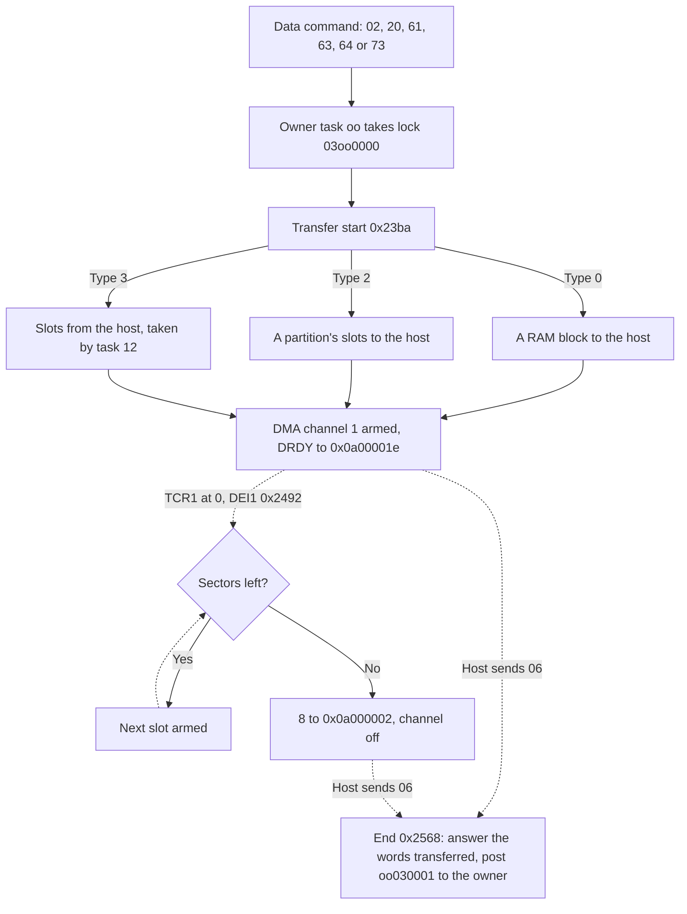

# Data transfer

## What it does

A command and its answer carry only four words each. Anything bigger, such as sectors, the table of
contents or a list of files, moves through a separate transfer register that the Saturn reads from
or writes to.

- One at a time. Only one transfer is open at once. Until the Saturn ends it with End Data
  Transfer, other commands that move data are told to wait.
- DMA. A DMA channel feeds the transfer register from the CD block's RAM, one block or one sector
  after another, while the SH-1 goes on with other work.
- Direction. Most transfers go to the Saturn: a block of RAM or a partition's sectors. Put Sector
  Data goes the other way, into free buffer slots.
- Sector commands. Get, Delete, Get and Delete, and Put Sector Data run in task 12, which checks
  each request first. Set Sector Length chooses how much of each sector moves,
  from the data alone to all 2352 bytes.

The sections below follow CDB105 by address.

## Overview

One transfer at a time runs on DMA channel 1 through the host interface: a block of RAM or a
partition's sectors to the host, or sectors from the host into buffer slots. The owner task starts
it under the transfer lock, the channel's end interrupt chains the sectors, and the host ends it
with `06`.

- Only one transfer is open at a time. The [data-command gate](host-commands.md#data-commands)
  answers other data commands with the wait status until `06`.
- The owner holds lock record 3 while the transfer runs and frees it when `06` posts class 3
  payload 1.

## Names

| Name | Address | Contents |
| --- | --- | --- |
| Words programmed | `0x0f000248` | Words armed so far, the current slot's included |
| Connection pointer | `0x0f00024c` | Address of the connection byte a sector transfer depends on |
| Block address | `0x0f000250` | Type 0: the RAM address |
| Block words | `0x0f000254` | Type 0: the word count |
| Owner | `0x0f000256` | Task that started the transfer, 0 when none |
| Sectors left | `0x0f000257` | Slots not yet armed |
| Current slot | `0x0f000258` | The next slot to arm, `ff` for none |
| Connection index | `0x0f000259` | n of the connection entry `0x0f0005a0 + 4n`: partition n for a get, filter n for a put |
| Status | `0x0f00025a` | 0, or `ff` after an error |
| Transfer byte | `0x0f00025b` | 1 while a transfer is open |
| Get sector length | `0x0f0006d8` | 0..3, the layout of slots sent to the host |
| Put sector length | `0x0f0006d9` | 0..3, the layout of slots written by the host |
| Transfer control | `0x0a000002` | Written around each transfer. Bit 0 is the direction, 1 from the host. `06` reads bit 2 ([board](../board.md#dma-requests)) |
| Data port | `0x0a000000` | Words from the host that `06` copies by hand |

Startup and the [restart](kernel.md#restart) reset this state at `startup_transfer_state`
(`0x2388`): CHCR1 = `0x1258`, 8 to `0x0a000002`, 3 to `0x0a00000c`, and `0x0f000248..0x0f00025b`
cleared except the current slot, which becomes `ff`.

## Transfer start

The transfer start, `transfer_start` (`0x23ba`), takes the lock message in r11: the owner task in
bits 23..16 and the type in the low word. It stores the owner, clears the status and arms DMA
channel 1.

| Type | Caller | Data | CHCR1 |
| --- | --- | --- | --- |
| 0 | Task 6 for `02` and `20` type 0 ([requests from the host](drive.md#requests-from-the-host)), task 7 for `73` (`0x7f34`, `0x7f6c`, [Get File Info](file-system.md#get-file-info)), task 2 for `20` type 1 (`0x5edc`, [subcode](subcode.md#the-host)) | The block at the block address, block words long | `0x125d`, to the host |
| 2 | Task 12 (`task12_transfer_start_get`, `0x6d7e`) | A partition's slots, from the current slot | `0x125d`, to the host |
| 3 | Task 12 (`task12_transfer_start`, `0x6d78`) | Slots written from the host, from the current slot | `0x435d`, from the host |

- The routine tests the type for 0, then for 2, and runs any other value as type 3. No ROM code
  passes type 1.
- Type 0 sets no sectors left and current slot `ff`. The block address goes to SAR1 and the block
  words to TCR1.
- Types 2 and 3 with current slot `ff` have nothing to move: status `ff`, 8 (type 2) or 9 (type 3)
  to `0x0a000002`, 2, DRDY, to `0x0a00001e` and no DMA. Task 12 starts type 3 only after taking
  its slots, so a put always has one.
- Otherwise the connection pointer becomes `0x0f0005a0 + 4n`, plus 1 for type 2. The current slot's
  [span](#sector-spans) goes to SAR1 (type 2) or DAR1 (type 3) and TCR1. The slot's successor in the
  links `0x0f000354` becomes the current slot and sectors left counts down.
- Arming stores the word count as words programmed. `0x0a000002` gets 2 and then 0 with the
  direction bit, then SAR1, DAR1 and TCR1 are written and CHCR1 after reading it. Last,
  `0x0a000002` gets 4 with the direction bit and `0x0a00001e` gets 2, DRDY
  ([interrupt flags](host-commands.md#interrupt-flags)).
- The firmware never clears DRDY, so a host that waits for it must clear the flag before it sends
  the data command ([interrupt flags](host-commands.md#interrupt-flags)).
- The interface requests channel 1 on DREQ1 ([board](../board.md#dma-requests)).
- The other address is `0x0a000000` in both directions. The channel runs in single address mode
  between memory and a device with DACK ([DMA channel 1](../sh7034.md#dma-channel-1)).

## Sector spans

`get_sector_span` (`0x6e18`) and `put_sector_span` (`0x6e76`) give the DMA address in r7 and the
word count in r8 for slot r9. Slot n starts at `0x09000230 + 0x930 * n` and a read writes the sector
header at `+12` ([DMA channel 0](sector-reads.md#dma-channel-0)).

| Length | Get (`0x0f0006d8`) | Put (`0x0f0006d9`) |
| --- | --- | --- |
| 0 | 2048 bytes (`0x400` words) from `+16` for mode 1 (header byte `+15`) and from `+24` for other modes. Mode 2 form 2 (submode bit 5 at `+18`) gives 2324 bytes (`0x48a` words) from `+24` | 2048 bytes from `+24` |
| 1 | 2336 bytes (`0x490` words) from `+16` | The same |
| 2 | 2340 bytes (`0x492` words) from `+12` | The same |
| 3 | 2352 bytes (`0x498` words) from `+0` | The same |

A put with length 0 writes each sector's data at `+24`, where mode 2 form 1 data sits.

## DMA channel 1 end

DEI1 (vector 74, ROM longword `0x0128`) enters `dma1_end` (`0x2492`) when TCR1 reaches 0. It clears
DE, TE and IE in CHCR1, switches to the stack `0x0f0009f8` with SR `0x60`, saves r0..r9, PR, GBR
and MACL and returns with RTE. It posts nothing and does not reschedule.

- With no sectors left it writes 8 with the direction bit to `0x0a000002` and leaves the channel
  off.
- Otherwise the current slot must not be `ff` and the connection byte must still hold `0x88`. The
  slot's span goes to SAR1 (direction bit clear, `get_sector_span`, `0x6e18`) or DAR1 (set,
  `put_sector_span`, `0x6e76`) and TCR1, with CHCR1 `0x125d` or `0x435d`. The successor becomes the
  current slot, sectors left counts down and the words are added to words programmed.
- A current slot of `ff` or a connection byte other than `0x88` is an error: status `ff`, no
  sectors left, and 8 with the direction bit to `0x0a000002`.

## Ending a transfer

`06` (`command_06_end_transfer`, `0x22cc`) clears the transfer byte and continues at `transfer_end`
(`0x2568`), which reads CHCR1 and writes `0x1258`, the channel off.

- Without an owner it answers `ffffff` and posts nothing.
- After an error it answers `ffffff` and posts the end to the owner.
- Otherwise TCR1 holds the words the channel did not move. A transfer to the host answers words
  programmed less TCR1.
- A transfer from the host first copies words the host sent past the channel. While bit 2 of
  `0x0a000002` reads clear and TCR1 words remain, it reads `0x0a000000` and stores the word from
  DAR1 onward, at most six.
- Once no TCR1 words remain and sectors are left, the current slot takes at most five more words,
  copied the same way, under the same checks as the DMA end. Its words are added to words
  programmed, and the current slot and sectors left do not advance. A current slot of `ff` or a
  changed connection byte answers `ffffff`.
- `transfer_end_answer` (`0x2602`) writes 8 to `0x0a000002` and answers words programmed less the
  words left.
- The answer is the status byte from `response_status_byte` (`0x91a8`) over the 24-bit word count
  in CR1 and CR2, with CR3 and CR4 zero ([responses](host-commands.md#responses)). r11 returns owner
  << 24 | `0x030001`, class 3 payload 1, which the IRQ6 handler posts, and the owner is cleared.
- Task 6 frees the transfer lock when it takes class 3 payload 1, and task 12 does the same at the
  [end of a sector transfer](#end-of-a-sector-transfer).

## Sector commands

Task 12 moves sectors between the buffer and the host. Four host commands hand it work, and `60`
sets the layout of the sectors it moves. The names follow Sega's CD library
([command map](../references.md#host-command-map)). `65..67` copy and move sectors inside the
buffer ([copy and move](sector-buffer.md#copy-and-move)).

| Command | Name | Handler | Task 12 |
| --- | --- | --- | --- |
| `60` | Set Sector Length | `command_60_set_sector_length` (`0x754e`) | Not involved |
| `61` | Get Sector Data | `command_61_63_get_sector_data` (`0x689c`) | `task12_get` (`0x6bac`) |
| `62` | Delete Sector Data | `command_62_delete_sector_data` (`0x68ba`) | `task12_delete` (`0x6b52`) |
| `63` | Get and Delete Sector Data | `command_61_63_get_sector_data` (`0x689c`) | `task12_get_delete` (`0x6c16`) |
| `64` | Put Sector Data | `command_64_put_sector_data` (`0x68d0`) | `task12_put` (`0x6c80`) |

Task 12 keeps its work in a few bytes, which startup clears at `task12_state_initialize` (`0x6b34`),
setting the first slot and the connection end to `ff`.

| Name | Address | Contents |
| --- | --- | --- |
| Request | `0x0f00071c`, `0x0f000720` | r1 and r2 of the last accepted command: CR1:CR2 and CR3:CR4 |
| Task 12 flags | `0x0f000724` | Bit 0 a request task 12 has not taken, bit 1 a get, bit 2 a get and delete, bit 3 a put |
| First slot | `0x0f000725` | The first slot of the transfer, `ff` for none |
| Count | `0x0f000726` | Slots in the transfer |
| Connection end | `0x0f000727` | `0x20 \| p` for a get from partition p, filter f for a put |
| Host device | `0x88` | Device 8 of the [connection table](sector-buffer.md#connections), the host side of a sector transfer |

### Set Sector Length

- `60` takes the get sector length from the CR1 low byte and the put sector length from the CR2
  high byte ([sector spans](#sector-spans)). `ff` keeps a length.
- A value from 4 to `fe` rejects the command, and neither length is stored.
- It writes `0x40`, ESEL, to `0x0a00001e`, answers with the cached response and posts nothing.
- Both lengths are 0 after startup.
- The get sector length also sets the size `52` computes
  ([buffer information](sector-buffer.md#buffer-information)).

### Request checks

`sector_request_check` (`0x6dac`) checks the partition, position and count of `61`, `62` and `63`.

| Request | Result |
| --- | --- |
| Partition (CR3 high byte) 24 or more | Reject |
| Empty partition | Wait |
| Position (CR2) `ffff` | The last sector |
| Another position at or past the partition's count | Wait |
| Count (CR4) 0 | Wait |
| Count `ffff` | The rest of the partition from the position |
| Position plus count past the end | Wait |

- `64` checks its request itself: a filter (CR3 high byte) of 24 or more rejects, and a count of 0
  or above the free pool count waits.
- `61`, `63` and `64` also wait while bits 1..3 of the task 12 flags are set, a sector transfer
  in progress. `62` has no such check.
- A request that passes goes to `task12_request_set` (`0x6a40`), which stores r1 and r2 as the
  request and sets bit 0. A request task 12 has not taken yet (bit 0 set) makes the new one wait
  instead.
- A wait or reject posts nothing and leaves the [data-command gate](host-commands.md#data-commands)
  open.

### Handing the request to task 12

- The handler returns `0c8100cc` in r11, with the command number cc, and the IRQ6 handler posts it
  to task 12.
- `61`, `63` and `64` pass the data-command gate and answer through `response_cached_keep_message`
  (`0x91fe`) with the data transfer request bit from `response_transfer_request` (`0x91a4`), which
  opens a transfer.
- `62` bypasses the gate and answers with the cached response through
  `response_cached_keep_message`. It is accepted while a transfer is open ([deleting during a
  transfer](#deleting-during-a-transfer)).

### Task 12

Task 12 waits at `0x6998` and dispatches each message at `task12_dispatch` (`0x699a`).

| Message | Handler | Next |
| --- | --- | --- |
| `62` | `task12_delete` (`0x6b52`) | Waits again |
| `61` | `task12_get` (`0x6bac`) | A transfer to the host |
| `63` | `task12_get_delete` (`0x6c16`) | A transfer to the host |
| `64` | `task12_put` (`0x6c80`) | A transfer from the host, or nothing without free slots |
| Class 3, the end of a transfer | `task12_transfer_end` (`0x6a6e`) | Waits again |

Each handler first takes the request through `task12_request_take` (`0x6a5c`), which clears bit 0.
It then works under the sector lock `0x0b0c0000` and pairs the host device `0x88` with the end its
transfer depends on through `connection_pair` (`0x5510`). That is the connection byte the transfer
checks at each DMA channel 1 end and in `06`.

- Get (`61`) pairs `0x88` with the end `0x20 | p` of partition p, keeps the slot at the position
  (`partition_slot`, `0x506c`) as the first slot and sets bit 1.
- Get and delete (`63`) pairs the same end, then unlinks the slots from the partition
  (`partition_unlink`, `0x50ca`) and keeps the first. The unlinked run ends with a link of `ff`. It
  sets bit 2.
- Put (`64`) pairs `0x88` with filter f and takes the count slots from the pool head through
  `pool_take_run` (`0x4f0c`, [lists](sector-buffer.md#lists)). It sets bit 3 and clears the first 24
  bytes of each slot, sync, header and subheader.
- Delete (`62`) pairs `0x88` with the end of partition p, releases the slots to the pool through
  `partition_release` (`0x51be`) and writes `0x80`, EHST, to `0x0a00001e`.
- Pairing clears r12 and r13, so the handlers keep the request on the stack around the call.

A get or put then takes the transfer lock `030c0000` and starts type 2 at
`task12_transfer_start_get` (`0x6d7e`) or type 3 at `task12_transfer_start` (`0x6d78`, [transfer
start](#transfer-start)).

- The current slot, sectors left and connection index come from the first slot, the count and the
  low five bits of the connection end.
- The call to `transfer_start` (`0x23ba`) restores PR in its delay slot, so the transfer start
  returns straight to the dispatch.
- A put that finds too few free slots writes `0x80` to `0x0a00001e` and starts nothing. Its
  response has already opened a transfer, so the host's `06` finds no owner and answers `ffffff`.

### End of a sector transfer

`06` posts class 3 payload 1 to task 12 as the owner, and task 12 finishes the transfer at
`task12_transfer_end` (`0x6a6e`).

- A get and delete returns its run, from the first slot to the link of `ff`, to the pool tail
  through `pool_return_run` (`0x4f58`).
- A put delivers its slots in link order from source `0x88` through `sector_deliver` (`0x4fa4`), so
  each sector passes the filter chain from filter f ([routing](sector-buffer.md#routing)). When
  `0x88` no longer names filter f, task 12 pairs them again first.
- A put delivers every slot it took, also when `06` ended it early or with an error.
- A get leaves its sectors in the partition, for the host to delete with `62`.
- Last, task 12 clears bits 1..3, sets the first slot to `ff`, frees the transfer lock and writes
  `0x80`, EHST, to `0x0a00001e`.

### Deleting during a transfer

`62` runs while a transfer is open, and what it changes can end that transfer with status `ff`.

- Pairing `0x88` with partition p clears the end `0x88` was paired with. A get from another
  partition, or a put, then finds its connection byte changed at the next DMA channel 1 end or in
  `06` ([DMA channel 1 end](#dma-channel-1-end)).
- Deleting the positions after the next slot to send cuts the link that follows it. A later DMA
  channel 1 end finds no slot.

## Unknown

- What bits 1 to 3 of `0x0a000002` do, bit 3 set by the 8 written when a transfer ends, and what
  clears bit 2 before `06` reads it. Ymir models bit 1 as a FIFO reset and bit 2 as the transfer
  enable ([board](../board.md#dma-requests)).
- How the interface chip moves the data between its FIFO and the host bus, and how far the channel
  runs ahead of the host.
- What the 12 bytes before a read sector's header hold, which a get with length 3 sends.
