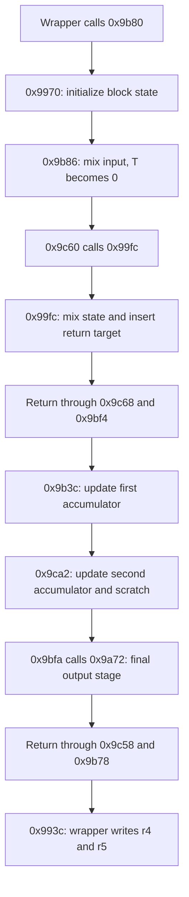

# Decoder

## What it does

Extension code is stored encoded, on the disc or in the MPEG card's ROM. The payload decoder turns
it back into plain code before the firmware runs it.

- Blocks. It works on 8-byte blocks. Each block goes through a fixed, reversible series of
  arithmetic steps that depends only on how many blocks are left.
- Check value. The last block is a check value, the trailer, computed along the way. When it does
  not match, the firmware discards the result.
- No key. Nothing secret is involved, so the steps can be run backwards to encode any code that
  then decodes and passes the check.
- Convoluted code. The routine reads some of its own instructions as constants and rewrites return
  addresses, which hides that it is a plain loop over the blocks.

The sections below follow the code by address.

## Overview

The decoder at CDB104/CDB105 `0x9904..0x9ce3` (CDB106/YGR022 `0x9914`) turns encoded extension
payloads into plain data. Both extension loaders call it: the disc loader decodes from `0x09075848`
into `0x09075800`, the expansion loader from `0x0e000004` into `0x0907b000`. Inputs are source,
destination and byte length in r1, r2 and r3. It returns 0 when the trailer matches and -1 otherwise.
Loader behavior around it is in [extensions](extensions.md#disc-extension-loader).

- The wrapper processes all complete 8-byte blocks but the last, which holds an 8-byte trailer.
  It needs at least two blocks and ignores a trailing partial block.
- Each block goes through a fixed transform whose eight schedule words depend only on the remaining
  block count. For a given count the transform is a bijection on 64-bit blocks.
- Two accumulators XOR together intermediate block states. The trailer must equal their final
  values. The accumulators do not affect the output.
- No secret key is involved. For a given length, any desired output has exactly one encoded input
  and a computable trailer ([encoding](#encoding)).
- The routine reads its own instruction bytes as constants and rewrites saved return addresses to
  insert a continuation, so its call and return structure does not match its control flow. The
  `Hitachi.PublicKeyCipher.` text is used as constant data and does not name a standard algorithm.

## Control flow

### Scope

- The description covers entry `extension_decode_wrapper` (`0x9904`) through its return at `0x9966`,
  every helper and the inserted continuation, for a normal call from either loader with valid
  memory, an intact stack and scratch area, and no intervening exception.
- The apparent per-block choice at `extension_decode_invariant_branch` (`0x9bee`) never branches.
  Every block executes `extension_decode_middle_mix` (`0x9c60`), the return-chain edit in
  `extension_decode_edit_returns` (`0x99fc`) and the continuation at
  `extension_decode_inserted_continuation` (`0x9b3c`). No branch or loop inside the block path
  depends on the input.
- There are seven `BSR` sites, nine `RTS` sites and five conditional branches. All 16 delayed
  transfers have `NOP` delay slots, and `BT`/`BF` are the non-delayed SH-1 forms. The code has no
  `JMP`, `JSR`, traps or peripheral accesses. The only modified return target is `0x9b3c`.
- Each block executes 423 instruction words exactly once, counting delay slots and excluding the
  wrapper.

### Outer wrapper

`L` is the unsigned 32-bit input length and `N = L >> 3`. Reads and writes are big-endian 32-bit
words. The wrapper rounds source and destination down to multiples of four.

| Code | Operation | Successor |
| --- | --- | --- |
| `0x9904..0x991c` | Save caller PR, align pointers, compute `N`, preset result to `-1`, test `N == 0` | True: `extension_decode_return` (`0x9964`). False: `0x991e` |
| `0x991e..0x9922` | Set remaining count to `N-1`, test for zero | True: `0x9964`. False: `0x9924` |
| `0x9924..0x992a` | Set the scratch base, zero both accumulators | `extension_decode_blocks` (`0x992c`) |
| `0x992c..0x993a` | Load the input pair into `r4/r5`, advance input by eight, save pointers and count, call `extension_decode_block` (`0x9b80`) | `extension_decode_after_block` (`0x993c`), after the continuation |
| `0x993c..0x994c` | Restore pointers and count, write `r4/r5`, advance output by eight, decrement count | `cmp/pl` true: `0x992c`. Otherwise `extension_decode_check` (`0x994e`) |
| `0x994e..0x9960` | Load the accumulator pair and input trailer, OR the two XOR differences, preset result to `-1` | Nonzero: `0x9964`. Zero: `0x9962` |
| `0x9962` | Set result to `0` | `extension_decode_return` (`0x9964`) |
| `0x9964..0x9968` | Restore caller PR and return | Caller |

- `N <= 0x1fffffff` for a 32-bit length, so the signed `cmp/pl` test means "remaining count above
  zero". The loop processes `N-1` blocks with counts `N-1` down to 1.
- Lengths below 16 return `-1` before reading the payload or touching scratch. Longer inputs
  produce `8*(N-1)` output bytes, and the next eight source bytes are the trailer. The last `L & 7`
  bytes are ignored. Callers apply their own length checks.
- Output is written before the trailer check, and the wrapper does not undo it on failure. Both
  loaders clear their destination areas on failure.
- The disc loader's destination starts `0x48` bytes below its source. Forward processing writes
  behind unread input, so that overlap is safe.

### Why the skip branch is never taken

The following holds for any payload, block count and incoming T:

1. `0x99ba` computes a value in `r6` and `0x99cc` copies it to `r7`. Neither changes before
   `xor r6,r7` at `0x9b98`, so `r7 = 0`.
2. `rotl r7` at `0x9bac` leaves zero. `0x9bb6` copies zero to `r9`, and `swap.w` at `0x9bbc` leaves
   zero. Nothing changes `r9` before `0x9bd2`.
3. `shll r1` at `0x9bcc` sets T. `rotcl r5` at `0x9bce` and `rotcl r4` at `0x9bd0` carry bits
   through the payload registers, which matters to the arithmetic.
4. `rotcl r9` at `0x9bd2` rotates zero with incoming T. The result is 0 or 1, and the outgoing T is
   the old bit 31 of `r9`, which is zero.
5. Every instruction at `0x9bd4..0x9bec` preserves T. `SHLL8`, `SHLR8` and `SHLR16` do not update
   T, and `SHLR8 r9` at `0x9be2` also clears `r9`.
6. `bt 0x9bf4` at `extension_decode_invariant_branch` (`0x9bee`) therefore always falls through to
   the call at `0x9bf0`.

ISA reference: [SH-1/SH-2/SH-DSP Software Manual][SH-ISA] (REJ09B0171-0500, Rev. 5.00), sections
6.1.47 ROTCL, 6.1.57 SHLL, 6.1.58 SHLLn and 6.1.60 SHLRn (pages 225, 238, 239..240 and 242..243).
The opcodes at the three ROTCL sites are `4524`, `4424` and `4924`.

### Block path

The diagram folds ordinary helper returns into their stages. The table keeps the exact order,
including the return into `extension_decode_inserted_continuation` (`0x9b3c`).



| Order | Executed range | Exit |
| --- | --- | --- |
| 1 | `0x9b80..0x9b84` | Save `extension_decode_after_block` (`0x993c`), `BSR 0x9970`, PR `0x9b86` |
| 2 | `0x9970..0x99da` | Initialize state and constants, return to `0x9b86` |
| 3 | `0x9b86..0x9bf2` | Mix input, skip branch false, `BSR 0x9c60`, PR `extension_decode_return_into_continuation` (`0x9bf4`) |
| 4 | `0x9c60..0x9c66` | Save `0x9bf4`, `BSR 0x99fc`, PR `0x9c68` |
| 5 | `0x99fc..0x9a70` | Mix state, insert the continuation into the stack, return to `0x9c68` |
| 6 | `0x9c68..0x9ca0` | Continue mixing, return to `0x9bf4` |
| 7 | `0x9bf4..0x9bf8` | Pop the inserted PR, return to `0x9b3c` |
| 8 | `0x9b3c..0x9b72` | Update the first accumulator, `BSR 0x9ca2`, PR `0x9b74` |
| 9 | `0x9ca2..0x9ce2` | Update the second accumulator and scratch, return to `0x9b74` |
| 10 | `0x9b74..0x9b76` | `BSR 0x9bfa`, PR `extension_decode_return_to_wrapper` (`0x9b78`) |
| 11 | `0x9bfa..0x9c56` | Mix with another instruction-word constant, `BSR 0x9a72`, PR `0x9c58` |
| 12 | `0x9a72..0x9b38` | Read the saved wrapper return address, final mixing, assign `r4/r5`, return to `0x9c58` |
| 13 | `0x9c58..0x9c5c` | Return to `0x9b78` |
| 14 | `0x9b78..0x9b7c` | Consume the original block return, return to `0x993c` |

Every stage contributes to the arithmetic. `0x9b3c` is entered by a return and has no PR push of
its own.

### Stack and PR

`S` is SP on entry to `extension_decode_wrapper` (`0x9904`) and `A` the caller's PR. Stack values
are listed from the current SP upward. Calls set PR but do not push it.

| Point | SP | Saved-return stack |
| --- | --- | --- |
| Wrapper after `0x9904` | `S-4` | `A` |
| Block after `extension_decode_block` (`0x9b80`) | `S-8` | `993C, A` |
| Seed after `extension_decode_seed` (`0x9970`) | `S-12` | `9B86, 993C, A` |
| Seed returned to `0x9b86` | `S-8` | `993C, A` |
| After `extension_decode_middle_mix` (`0x9c60`) | `S-12` | `9BF4, 993C, A` |
| After `extension_decode_edit_returns` (`0x99fc`), before stack edit | `S-16` | `9C68, 9BF4, 993C, A` |
| After `0x9a40`, stack edit complete | `S-20` | `9C68, 9BF4, 9B3C, 993C, A` |
| Helper returned to `0x9c68` | `S-16` | `9BF4, 9B3C, 993C, A` |
| Returned to `extension_decode_return_into_continuation` (`0x9bf4`) | `S-12` | `9B3C, 993C, A` |
| Returned into continuation `extension_decode_inserted_continuation` (`0x9b3c`) | `S-8` | `993C, A` |
| Inside `extension_decode_accumulate_second` (`0x9ca2`), after PR push | `S-12` | `9B74, 993C, A` |
| `0x9ca2` returned to `0x9b74` | `S-8` | `993C, A` |
| Inside `extension_decode_output_mix` (`0x9bfa`), after PR push | `S-12` | `9B78, 993C, A` |
| Inside `extension_decode_final_mix` (`0x9a72`), after PR push | `S-16` | `9C58, 9B78, 993C, A` |
| `0x9a72` returned to `0x9c58` | `S-12` | `9B78, 993C, A` |
| `0x9bfa` returned to `extension_decode_return_to_wrapper` (`0x9b78`) | `S-8` | `993C, A` |
| Continuation returned to `extension_decode_after_block` (`0x993c`) | `S-4` | `A` |
| Wrapper returned | `S` | Caller stack |

- Peak additional stack use is 20 bytes from wrapper entry, including the wrapper's saved PR. The
  temporary word pushed at `0x9a28` is overwritten by the edit, leaving the five return words shown.
  Nothing leaks across blocks or on either failure path.
- At `0x9c1c`, live PR is still `0x9b78`, because saving it at `0x9bfa` does not change it. At
  `0x9a9c`, `[SP+8]` is `0x993c`, not `0x9b78` or the caller's address.
- For processed input, `r0..r13`, MACL and SR.T are working state. `r14`, MACH, GBR, VBR and the
  other SR bits are untouched, and SP and PR are restored.

### ROM and code-address inputs

These are all the ROM data reads and code-address inputs in the routine, as big-endian 32-bit
values in CDB105.

| Site | Address or derivation | Value and role |
| --- | --- | --- |
| `0x9924` | Literal at `0x996c` | `0x0f00078c`, scratch base |
| `0x9972` | Literal at `0x99dc` | `0x000099ec`, marker base in `r12` |
| `0x9976` | Literal at `0x99e0` | `0x000099e4`, start of the marker text |
| `0x997a` | `0x99e4` | `0x48697461`, `Hita` |
| `0x997e` | `0x99e8` | `0x6368692e`, `chi.` |
| `0x998c` | `0x99ec` | `0x5075626c`, `Publ` |
| `0x99c0`, `0x9bca` | `0x99f0` | `0x69634b65`, `icKe` |
| `0x9a54`, `0x9b54` | `0x99f4` | `0x79436970`, `yCip` |
| `0x9a78`, `0x9ca8` | `0x99f8` | `0x6865722e`, `her.` |
| `0x9974..0x9978` | Saved `0x993c` minus `r12 = 0x99ec` | `0xffffff50`, stored at scratch `+0x18`. Word swap `0xff50ffff` |
| `0x999c..0x99ac` | `MOVA` gives `0x99fc`, read at `+4` | `0x63a37301` from `0x9a00`, initial scratch `+0x1c` |
| `0x99ae`, `0x99be` | That base plus `0x10`, read `0x9a0c` | `0x6009301c`, added at `0x99c4` |
| `0x9a04..0x9a0a` | Dereference saved PR `0x9c68` | `0xe77f6203`, instruction bytes mixed into `r3` |
| `0x9a3c..0x9a40` | `MOVA` gives `0x9b3c` | Inserted return target, a control input |
| `0x9c1c`, `0x9c34` | Live PR `0x9b78` plus `0x10` | `0x40044804` from `0x9b88`, subtracted at `0x9c3a` |
| `0x9a9c..0x9a9e` | `[SP+8] = 0x993c` minus `0x99ec` | `0xffffff50`, rotated left twice at `0x9aaa/0x9aac` to `0xfffffd43` |

- `0x9c68` executes `mov #0x7f,r7`, whose result is overwritten at `0x9c74`. Its instruction
  bytes still feed the constant read at `0x9a0a`, so the instruction cannot be removed or changed.
- Arithmetic immediates outside pointer and count handling: `0x9990` adds `-1`, `0x99b2` adds 2,
  `0x99bc` and `0x9a02` add 1, `0x9a5e` adds `0x39`, `0x9afa` adds `-1`, `0x9b00` adds 3, `0x9bae`
  adds `0x17`, `0x9c0e` adds `0x11`, `0x9c2e` and `0x9c48` add 1.
- There is no key table, peripheral read or input-selected ROM lookup.

### Scratch state

The scratch area is eight 32-bit words at `0x0f00078c..0x0f0007ab`.

| Offset | Role |
| --- | --- |
| `+0x00` | Next input pointer, saved and restored by the wrapper around each block |
| `+0x04` | Current output pointer, saved and restored the same way |
| `+0x08` | Remaining block count, also an arithmetic input at `0x9980` |
| `+0x0c` | Block scratch, first written at `0x9a50`, then replaced repeatedly |
| `+0x10` | First accumulator, zeroed once by the wrapper, updated once per block at `0x9b6e` |
| `+0x14` | Second accumulator, zeroed once by the wrapper, updated once per block at `0x9cae` |
| `+0x18` | Block scratch, initialized with an address difference at `0x9982`, later replaced |
| `+0x1c` | Block scratch, initialized from code bytes at `0x99b0`, later replaced |

- Every scratch read follows its initialization. The block routine leaves `+0/+4/+8` unchanged.
  Only `+0x10/+0x14` carry state into the next block. The arithmetic inputs are the payload words,
  the block count, the two accumulators and the constants listed above.
- `0x9c9a` loads the old first accumulator into `r8`, and `0x9b3e` the old second into `r9`.
  `0x9b60/0x9b62` XOR in the current `r4/r5`, and the results are stored at `0x9b6e/0x9cae`.
- Those are intermediate words. Later stages at `extension_decode_accumulate_second` (`0x9ca2`),
  `extension_decode_output_mix` (`0x9bfa`) and `extension_decode_final_mix` (`0x9a72`) keep changing
  the output, and `0x9ab4/0x9aba` read the updated accumulators back. The final output is assigned
  at `0x9b30/0x9b32` and written by the wrapper at `0x9942/0x9944`. As shown under Arithmetic, the
  later accumulator reads do not affect the output, and the trailer covers intermediate pairs.

### Code ranges and revisions

- Code ranges: `0x9904..0x9968`, `0x9970..0x99da`, `0x99fc..0x9b38`, `0x9b3c..0x9b7c`,
  `0x9b80..0x9c5c` and `0x9c60..0x9ce2`, 474 instruction words in total (51 wrapper, 423 block
  path). The gaps hold literals, the marker text and padding. The routine at `dma2_end` (`0x9ce4`)
  is not reached from here.
- The marker `Hitachi.PublicKeyCipher.` is 24 bytes with no terminator. `BT` at
  `extension_decode_invariant_branch` (`0x9bee`) is non-delayed, and the following `BSR` owns the
  `NOP` delay slot.
- CDB104 is identical to CDB105 across `0x9904..0x9ce3`. CDB106 places the routine at `+0x10` and
  differs only in the low bytes of the two marker pointers (CDB105 offsets `0x99df` and `0x99e3`).
  YGR022 equals CDB106 there. Scratch addresses, instruction-derived constants and both
  return-minus-marker differences are the same in all four revisions.

## Arithmetic

### Overview

- The block path reduces to eight schedule words computed from the block count, a transform of
  one 64-bit input block, and two XOR accumulator updates at an intermediate point. No accumulator
  value reaches either output word.
- For a fixed count the transform is a permutation of 64-bit blocks. Every data update is a
  rotation or an XOR with a function of the other word and the schedule, so each can be undone.
  The multiplies, ANDs and ORs inside those functions never need inverting.
- The trailer is a 64-bit XOR over intermediate block states. There is no signature.
- The pseudocode below reproduces the four observable results: final `r4`, final `r5`, scratch
  `+0x10` and scratch `+0x14`. The firmware also performs scratch writes, register changes and stack
  effects that do not reach those results.

### Conventions

All values are unsigned 32-bit words. Arithmetic wraps modulo `2^32` and right shifts are logical.
`^`, `&` and `|` are XOR, AND and OR. Assignments are sequential, and a pair assignment evaluates
both right-hand sides from the old pair.

```text
R(v, n) = ((v << n) | (v >> (32 - n))) modulo 2^32   // rotate left, 1 <= n < 32
W(v)    = R(v, 16)                                  // swap the two halfwords
SB(v)   = (v & 0xffff0000) | ((v & 0xff) << 8) | ((v >> 8) & 0xff)
U(v)    = W(SB(W(v)))                               // swap only the upper two bytes
P(v)    = (v & 0xffff) * (v >> 16)                   // unsigned 16-by-16 multiply

PAIR_R(x, y, n) = ((x << n) | (y >> (32 - n)),
                   (y << n) | (x >> (32 - n)))       // x is the high word
```

- `SB(0x12345678) = 0x12347856` and `U(0x12345678) = 0x34125678`. Neither is a full byte reversal.
  `P` returns the full 32-bit product, as `MULU.W` does through MACL.
- `PAIR_R(x,y,1)` is the `SHLL`/`ROTCL` chain at `0x9bcc..0x9bd0`: old `x` bit 31 enters `y` bit 0
  and old `y` bit 31 enters `x` bit 0. The rotation of zero at `0x9bd2` clears T and leaves the pair
  unchanged.
- `PAIR_R(x,y,16)` is the two `XTRCT` instructions and the moves after them at `0x9a8e..0x9a9a`. It
  rotates the 64-bit concatenation, not each word.
- ISA reference: [Renesas software manual][SH-ISA], MULU.W 6.1.41, SWAP 6.1.67, XTRCT 6.1.72
  (pages 218, 259..260, 268).

### Schedule

`k` is the remaining count, `N-1` down to 1, read at `0x9980`. `s0..s7` name derived values, not a
ROM table, and `q` and `v` are temporaries. The schedule depends only on `k` and fixed constants.
The firmware interleaves it with the payload work.

```text
s0 = (k + 0x6368692e) ^ 0x4dbea1ec
q  = R(s0, 3) + 0x17
s1 = 0x48697461 ^ (q ^ R(P(q) + 0x69634b65, 8))
q  = R(s1 + 1, 1) ^ 0xe77f6203
s2 = s0 ^ (W(q) + q)
q  = s2 + 0x39
s3 = s1 ^ (R(q, 2) ^ q)
q  = s3 + 0x79436970
v  = R(q, 8) - q
q  = (SB(v) + v) ^ q
s4 = s2 ^ (U(P(q + 0x11) + 1) - 0x40044804)
q  = (s4 << 1) + 1
s5 = s3 ^ ((q ^ SB(q)) + 0x6865722e)
q  = s5 + 0xfffffd43
q  = R(q, 3) ^ q
s6 = s4 ^ (W(q) + q)
q  = s6 + 3
s7 = s5 ^ (R(q, 1) ^ q)
```

The constant `0x4dbea1ec` used at `0x99c4` folds
`W(SB(R(0x48697461 - 1, 2) ^ 0x5075626c) + 2) + 0x6009301c`. The other constants, including
`0xfffffd43`, come from the input table above.

| Schedule word | CDB105 state |
| --- | --- |
| `s0` | `r11` after `0x99ce` |
| `s1` | `r10` after `0x9bea` |
| `s2` | `r11` after `0x9a46` |
| `s3` | `r10` after `0x9c92` |
| `s4` | `r3` after `0x9c3e`, stored at scratch `+0x1c` by `0x9c40` |
| `s5` | `r2` after `0x9a8a`, stored at scratch `+0x18` by `0x9a90` |
| `s6` | `r7` after `0x9af2`, stored at scratch `+0x1c` by `0x9af6` |
| `s7` | `r7` after `0x9b14` |

### Block transform

`x,y` are the first and second big-endian words of a source block and `A,B` the incoming
accumulators. Compute the schedule for the block's `k`, then:

```text
// Input mixing: 0x998e..0x99c2, 0x99c8..0x9bc4 in normalized execution order.
y = y ^ (R(x, 1) + x + 1)
q = y + s0
q = R(q, 2) ^ q
x = x ^ (R(q, 4) - q)
(x, y) = PAIR_R(x, y, 1)

// 0x99fe..0x9a68 followed by 0x9c6a..0x9c8a.
q = x + s1
q = W(q) + q
q = R(q, 2) ^ q
q = q + s2
q = R(q, 1) - q
y = y ^ (R(q, 8) ^ (q | x))

// Continuation 0x9b3c..0x9b62. These are the intermediate check words.
q = SB(y) + s3
x = x ^ (R(q, 2) ^ (q & y))
A_next = A ^ x
B_next = B ^ y

// 0x9cbc/0x9cd4, then 0x9bfa..0x9c52 and 0x9a74..0x9a86.
x = R(x, 1)
y = R(y, 1) ^ x
q = R(y, 3) ^ s4
x = x ^ (U(q) + q)
(x, y) = PAIR_R(x, y, 16)

// 0x9aa0..0x9b12. The multiply-derived count schedule is already available.
q = x + s5
q = R(q, 9) ^ q
q = R(q, 2) - q
q = q - 1 + s6
y = y ^ (W(q) + (q | x))

// 0x9b16..0x9b32: final multiply uses payload data, not just the schedule.
q = R(y, 1) + s7
x = x ^ (y ^ R(P(q), 3))
return (x, y, A_next, B_next)
```

`A_next` and `B_next` are stored at `0x9b6e` and `0x9cae`. The returned pair is the final `r4/r5`
assigned at `0x9b30/0x9b32`. `A_next/B_next` do not replace `x/y`.

| Result | Depends on |
| --- | --- |
| Eight schedule words | `k` |
| Emitted `x,y` | Input `x,y,k` |
| `A_next` | Input `x,y,k,A` |
| `B_next` | Input `x,y,k,B` |

Accumulator reads with no effect on the output:

- `0x9a12` and the later accumulator reads feed intermediate registers and scratch, but every such
  value is overwritten before it reaches a result. The instructions still execute and change
  registers along the way.
- In the final stage, `0x9ab4/0x9aba` load the updated accumulators into `r4/r5`. That work feeds
  `r7`, `r3` and scratch `+0x0c`. `r7` is replaced at `0x9aec` and `r3`, including the OR at
  `0x9af4`, at `0x9af8`. The scratch value read at `0x9af0` feeds that discarded OR. The final
  `r4/r5` come from `r10/r11`.
- The seed's count-dependent `r6/r7` values are equal, so their XOR at `0x9b98` is zero. That zero
  is what keeps the skip branch from being taken.

### Trailer and reversibility

Let `M_k(input)` be the 64-bit pair just before `A_next/B_next` above and `T_k(input)` the emitted
pair. For `N = L >> 3`, the wrapper processes source blocks `i = 0..N-2` with `k = N-1-i`,
starting from `A = B = 0`:

```text
output[i] = T_(N-1-i)(input[i])
trailer   = M_(N-1)(input[0]) XOR M_(N-2)(input[1]) XOR ... XOR M_1(input[N-2])
```

- XOR is per 32-bit word, and the trailer is stored big-endian as `A` then `B`. It is neither an
  XOR of the raw input nor of the output. A block's output and trailer contribution need no secret
  and no other block's state.
- Fixing `k` fixes the schedule. `x = x ^ f(y)` undoes itself while `y` is unchanged, and likewise
  `y = y ^ g(x)`. The pair rotations have inverse rotations. The adjacent steps `x = R(x,1)` and
  `y = R(y,1) ^ x` invert in reverse order, XOR first, then rotate right. Every stage has one of
  these forms, including the final multiply-dependent XOR.
- `M_k` and `T_k` are therefore bijections on 64-bit blocks. This follows algebraically from the
  equations. It does not require `P`, AND or OR to be bijective.
- For a fixed valid length, every output sequence has exactly one encoded input sequence and a
  computable trailer.

### Encoding

`payload.py` in the emulator's repository encodes and decodes payloads this way
([payload scripts][emulator-payload]).

Encoding runs the block transform backwards. For n blocks of plain data the encoded payload is n
blocks and the trailer, 8(n+1) bytes. Encoded block i comes from plain block i with k = n - i, the
count the decoder will use for it. The trailer is the XOR of the intermediate pairs M the encoding
yields, first words then second words, which is the A and B the decoder compares.

`PAIR_RR` rotates the pair right and undoes `PAIR_R`:

```text
PAIR_RR(x, y, n) = ((x >> n) | (y << (32 - n)),
                    (y >> n) | (x << (32 - n)))
```

```text
// From the wanted output pair (x, y) for count k back to the encoded pair. Each group undoes one
// stage of the block transform, last stage first, with the same schedule words.
q = R(y, 1) + s7
x = x ^ (y ^ R(P(q), 3))

q = x + s5
q = R(q, 9) ^ q
q = R(q, 2) - q
q = q - 1 + s6
y = y ^ (W(q) + (q | x))

(x, y) = PAIR_RR(x, y, 16)

q = R(y, 3) ^ s4
x = x ^ (U(q) + q)

y = R(y ^ x, 31)                // XOR first, then rotate right by one
x = R(x, 31)
M = (x, y)                      // the pair the decoder XORs into its accumulators

q = SB(y) + s3
x = x ^ (R(q, 2) ^ (q & y))

q = x + s1
q = W(q) + q
q = R(q, 2) ^ q
q = q + s2
q = R(q, 1) - q
y = y ^ (R(q, 8) ^ (q | x))

(x, y) = PAIR_RR(x, y, 1)

q = y + s0
q = R(q, 2) ^ q
x = x ^ (R(q, 4) - q)

y = y ^ (R(x, 1) + x + 1)
return (x, y, M)
```

- Every step XORs one word with a function of the other word, which is unchanged in that step, or
  rotates. Running the steps in this order therefore inverts the decoder's block transform exactly.
- A payload the decoder accepts can carry any data. A disc extension's data starts with the header
  the [disc loader](extensions.md#disc-extension-loader) reads.

[emulator-payload]: https://github.com/LysergicWarp/Sega-Saturn-CDB-Emulator/tree/main/scripts/payload
[SH-ISA]: https://www.renesas.com/document/mah/sh-1sh-2sh-dsp-software-manual?language=en
