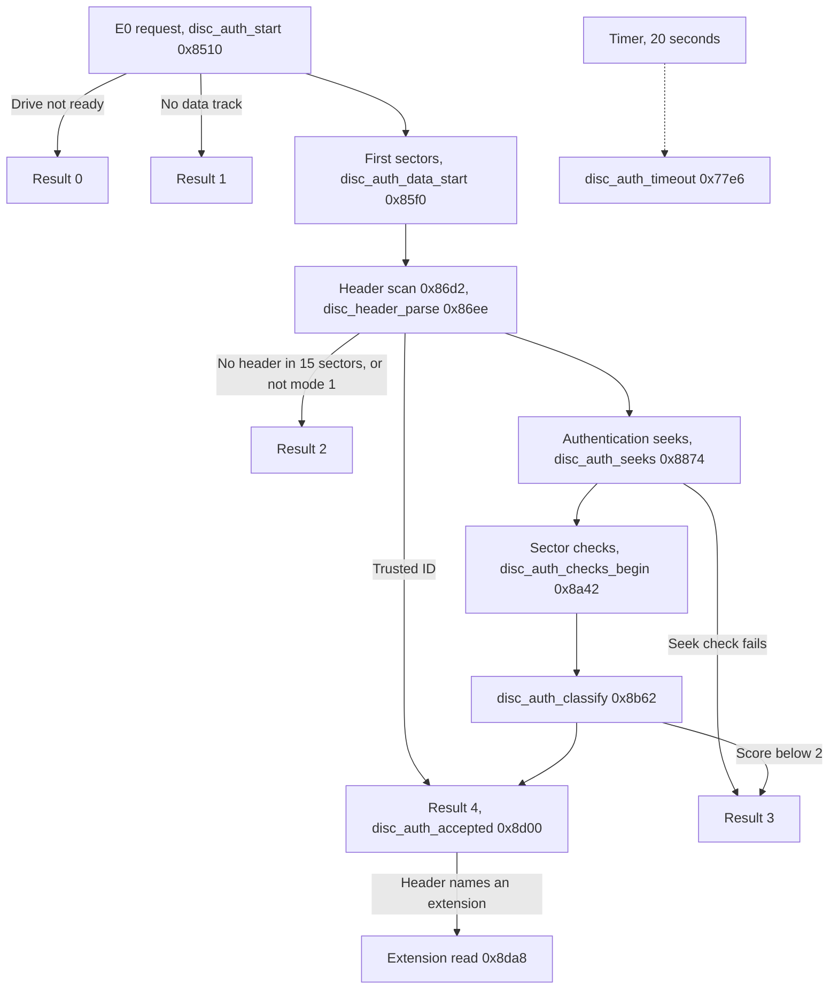

# Disc authentication

## What it does

Before the Saturn starts software from a disc, it asks the CD block whether the disc is a genuine
Saturn disc. The firmware answers with a number from 0 to 4, and 4 means accepted.

- Header. The firmware looks for the Saturn header, a sector that starts with `SEGA SEGASATURN `,
  among the first sectors of the data.
- Seeks. The drive makes four special seeks in two pairs and answers each with a measurement. The
  answers within each pair must nearly agree. What the drive measures is unknown.
- Sector checks. At three places the firmware reads sectors and compares them with a row of the
  SEGA logo stored in the ROM. Two of the three must match.
- Remembered discs. After a disc with the product number `SEGASYSTEM` passes, a later disc from the
  same maker is accepted from its header alone, until the CD block is next reset: at power-on, or
  by the SMPC's SYSRES, or CDOFF then CDON ([board](../board.md#clock-reset-and-mode)).
- Data lock. Sector data reaches the Saturn only once a check has started. A disc that fails the
  seeks or the sector checks locks it again. So does a check that runs out of its 20 seconds, or
  whose drive stops, before the disc is accepted.

The [README](../../README.md#disc-authentication) walks through the same process without code, in
more detail than the list above. The sections below follow CDB105 by address.

## Overview

The check runs from host command `E0` to the result that `E1` reports. Names such as
`disc_auth_start` label the code at the address given with them.
[`ring.py`][emulator-ring.py] runs the check positions, seek checks and sector checks of this guide
on values and raw sectors you supply, and [`make.py`][emulator-make.py] builds sectors for the
sector checks from the dump. Both are in the emulator's repository, the `emulator/` submodule here.
The example files are named where they apply. From the repository's top folder, with your dump
there as `cdb105.bin` and, for `sectors.txt`, a raw image of a disc as `game.bin`:

```
python emulator/scripts/ring/ring.py cdb105.bin emulator/scripts/ring/positions.txt
python emulator/scripts/ring/ring.py cdb105.bin emulator/scripts/ring/seeks.txt
python emulator/scripts/ring/ring.py cdb105.bin emulator/scripts/ring/sectors.txt
python emulator/scripts/ring/make.py cdb105.bin
python emulator/scripts/ring/ring.py cdb105.bin emulator/scripts/ring/full-check.txt
```

Task 7 runs each request as a state machine. The disc state byte holds the current stage. Between
stages task 7 waits at `0x77c0` for a message: a new sector, a finished seek or the timer.



| Disc state | Stage |
| --- | --- |
| 0 | No request |
| 1 | A [file system](file-system.md#reading) read, not part of a check |
| 2 | Request accepted by `E0` |
| 3 | [Header scan](#header-scan) |
| 4 | Header recognized |
| 5 | [Authentication seeks](#authentication-seeks) |
| 6 | [Sector checks](#sector-checks) |
| 7 | [Extension read](#extension-read) |

Every stage ends in [completion](#completion), which stores the result and releases the buffer.

## Names

The data a request uses, named here and by name in the rest of the guide.

| Name | Address | Contents |
| --- | --- | --- |
| Disc state | `0x0907adcb` | Stage of the current request |
| Result | `0x0f000787` | Outcome reported by `E1`, low byte of word `0x0f000786` |
| Busy flag | `0x0f0007b0` | Set by `E0`, cleared at completion |
| Delivery gate | `0x0f000788` | `ff` lets sectors reach the partitions ([Delivery gate](#delivery-gate)) |
| Partition | `0x0f000772` | Buffer partition p for the request, from the `E0` CR3 high byte |
| Request frame | `0x0f0002bc` | Frame address of the next sector request or seek |
| Drive flags | `0x0f00025f`, `0x0f0002a7` | The multi-session, authentication and read-error bits ([drive flags](drive.md#flags)) |
| Cursor | `0x0f00078b` | Position in the partition of the next sector to look at |
| Scan count | `0x0907adce` | Header-scan sectors left, 15 at the start |
| Zone | `0x0907adcd` | Picked from the counter of ITU4, channel 4 of the SH-1's integrated timer pulse unit (ITU), then the bitmap row of the current pass |
| Check positions | `0x0907adb8`, `0x0907adbc`, `0x0907adc0` | Frame addresses of the three sector-check passes |
| Seek phase | `0x0907adcf` | Authentication seeks done, 0 to 3 |
| Kept word | `0x0907adc8` | Report word of the last even seek phase |
| Report word | `0x0f00027e` | Word from the latest seek report |
| Report bytes | `0x0f0002ec..0x0f0002ef` | Four bytes from the latest seek report |
| Sector index | `0x0907adca` | Sectors checked in the current pass |
| Pass count | `0x0907adcc` | Sector-check passes done |
| Scramble buffer | `0x09077c00` | One sector, scrambled again |
| Frame buffer | `0x09078530` | The three sectors of a pass, interleaved |
| Check score | `0x0f000789` | Passes that matched, compared with 2 at classification |
| Logo bitmap | `logo_bitmap` (`0x8fb4`) | 17 rows of 106 bits, 16 bytes per row |
| Header ID | `0x0f000774..0x0f00077b` | First eight bytes of the disc's maker ID |
| Product number | `0x0f00077c..0x0f000785` | The disc's product number, compared with `SEGASYSTEM` |
| Trusted ID | `0x0f0002f0..0x0f0002f7` | ID saved from a `SEGASYSTEM` disc |
| ID gate | `0x0f0002f9` | 1 enables the trusted-ID shortcut |
| Any-ID gate | `0x0f0002f8` | 1 lets the shortcut accept any ID |
| 30-track flag | `0x0f00078a` | Set by a request for a disc whose TOC spans 30 tracks |
| Extension address, length | `0x0f00020c`, `0x0f000210` | Header fields used by extension preparation |
| Collection result | `0x0907adc4` | Encoded bytes still to come in the extension read |

## Messages

A message word holds the destination task, a class and a payload ([Messages](kernel.md#messages)).

| Message | From | Meaning |
| --- | --- | --- |
| `07810008` | IRQ6 handler, `E0` | Start a disc request |
| `06070002` | Task 7 | Read sectors into the partition |
| `07040000` | Sector delivery | A sector was added to the partition |
| `06070001` | Header scan | A Saturn header was recognized. Task 6 pauses the drive |
| `06070004` | Task 7 | Seek to the request frame |
| `07060002` | Task 6, drive report | An authentication seek completed |
| `07060003` | Task 6 | The drive stopped, or a seek or read was given up ([Drive stopped](#drive-stopped)) |
| `07060000` | Task 6 | The disc is gone, or Open Tray |
| `07070000` | Timer expiry | The 20-second timer ran out |
| `06070003` | Task 7 | The request is complete |

Task 6 serves the `0607xxxx` requests in its [served drive states](drive.md#requests-from-task-7).

Task 7 takes a waiting sector message before a seek report, and a seek report before a timer
expiry ([Posting](kernel.md#posting)).

## Request

`E0` subcode 0 posts `07810008`, and task 7's dispatch at `task7_message_class` (`0x77c2`) sends it
to `disc_auth_start` (`0x8510`). The command itself is described under [Group
E](host-commands.md#group-e).

- Three settings of host command `04` are saved and replaced until the request completes: the
  initialization flags (`0x0f00025c`) become 0, the ECC count (`0x0f000262`) 5 and the retry count
  (`0x0f000263`) 15 ([sector reads](sector-reads.md#names)). The check's reads therefore run with
  every initialization flag clear, so without R-W subcode and without the single-speed bit, with
  up to five extra pairs of Q and P correction passes, and with 15 retries before a read error.
- Host status `0x0f00028a` of 0, 6 or 7 (busy, open and no disc in the host's numbering), or a
  nonzero `0x0f00034b`, ends the request with result 0. The host status is 0 after reset and stays
  0 until the drive has read the TOC and paused, so a request before that stops here
  ([startup](drive.md#startup-and-the-toc)).
- Otherwise the check score, the pass count, the sector index and the seek phase are cleared, and
  `0x8576` opens the delivery gate.
- The 30-track flag is set when longwords `0x0f0002e4` and `0x0f0002e8` are both at least
  `0x0f0002e0` / 4 (unsigned) and the TOC runs across exactly 30 tracks. The longwords count the
  lead-in reports taken while the TOC was read: all of them, those with status bit 3 set and those
  with it clear ([the TOC](drive.md#the-toc)). Each kind has to make up at least a quarter.
- A first track whose control/ADR byte has bit 6 clear is not a data track and gives result 1. A
  data track continues at `disc_auth_data_start` (`0x85f0`).

## First sectors

`disc_auth_data_start` (`0x85f0`) starts the timer, connects the buffer and asks for the first 15
sectors.

- Timer `07070000` starts with duration 200,000, counted in steps of 100 µs, which is 20 seconds
  ([Timers](kernel.md#timers)).
- The partition number p also selects filter p, which is why `E0` limits it to 23. Under the sector
  lock (`0b070000`) filter p's true output is connected to partition p and its false output is
  cleared ([Sector buffer](sector-buffer.md)).
- The cursor starts at the partition's current count, so sectors already in the partition are
  skipped.
- The request frame is 150 (00:02:00). When the multi-session bit is set, on a disc with more than
  one session, it is instead the start of the last session's first track: k is the byte at
  `0x09000000`, the last session's number, the track number is the byte at `0x09000000 + k`, and the
  start is the low 24 bits of that track's TOC entry ([the TOC](drive.md#the-toc)).
- The scan count becomes 15 and the disc state 3.

### Sector request

`disc_auth_sector_request` (`0x8d24`) serves disc states 3, 6 and 7.

- Under the sector lock it sets filter p to pass a frame range from the request frame: 15 frames in
  state 3, 3 in state 6 and byte `0x0f000208` in state 7 (filter mode `0x40`).
- It sets the partition's notify bit, so each sector added to the partition posts `07040000`.
- It connects CD device 0 to filter p, posts `06070002` to task 6 and waits at `0x77c0`.

Task 6 sets the authentication bit, which marks the drive as owned by the request, and stages drive
command `06`, a read from the request frame ([Drive](drive.md#seek-read-and-pause)). In drive state
0, the state after reset, it takes the message and waits again
([Task 6](structure.md#task-6-and-task-14)).

The release after this acquire, and after the one in `disc_auth_data_start`, goes wrong when the
acquire had to wait for another task ([a contended sector lock](#a-contended-sector-lock)).

### Sector arrivals

Each sector added to the partition wakes task 7 with `07040000`. `task7_sector_class` (`0x78d4`)
routes it on the disc state at `0x78ee`.

| Disc state | Continues at |
| --- | --- |
| 3 | Header scan `disc_header_scan` (`0x86d2`) |
| 6 | Sector checks `disc_auth_check_sector` (`0x8a60`) |
| 7 | Extension read `disc_auth_extension_read` (`0x8da8`) |
| 4 | Releases the sectors past the cursor |
| 1 | `task7_file_sector` (`0x7954`), the [file system](file-system.md#reading) |
| Other | Waits |

## Header scan

`disc_header_scan` (`0x86d2`) takes the sector at the cursor through `partition_slot` (`0x506c`) and
falls into `disc_header_parse` (`0x86ee`). Nothing else enters the parser. It is a fragment of task
7's state machine rather than a function, and leaves through one of five branches: `0x77c0`,
`disc_header_scan`, `disc_auth_seeks` (`0x8874`), `disc_auth_result` (`0x8bd0`) and
`disc_auth_accepted` (`0x8d00`).

A sector holds a Saturn header when its mode byte (raw `+0x0f`) is 1 and its data starts with the 16
bytes `SEGA SEGASATURN `, compared as four longwords from `header_system_identifier` (`0x8a2c`). Raw
offsets count from the start of the sector slot, `0x09000230 + 0x930 * slot`, and the data starts at
raw `+0x10`.

### Not a header

`disc_header_mismatch` (`0x872e`) releases the sector through `partition_release` (`0x51be`) and
lowers the scan count. A sector whose mode byte is not 1 sets the scan count to 1 first (`0x8700`),
so it ends the request with result 2 at once. A disc whose data sectors are mode 2, such as a Video
CD, gets result 2 from its first sector.

- At zero the request ends with result 2, from `disc_header_not_found` (`0x8780`).
- Otherwise task 7 waits for the next sector when the cursor has reached the end of the partition,
  and scans the next sector at `disc_header_scan` (`0x86d2`) when one is already there.

### A header

`disc_header_extract` (`0x8786`) sets disc state 4 and copies four fields. Offsets count from the
start of the sector data. Field names follow Sega's system ID layout ([ST-040][ST040], Figure 4.1,
printed page 25).

| Data bytes | Field | Copied to | Use |
| --- | --- | --- | --- |
| `+0x10..+0x17` | Maker ID, first 8 of 16 bytes | Header ID | Compared with the trusted ID |
| `+0x20..+0x29` | Product number | Product number | Compared with `SEGASYSTEM` at classification |
| `+0xf8..+0xfb` | Reserved | Extension address | Disc address of an extension, big-endian |
| `+0xfc..+0xff` | Reserved | Extension length | Encoded length of an extension, big-endian |

It then posts `06070001` to task 6, disconnects CD device 0 through `connection_clear` (`0x54f0`)
and releases the partition's sectors from the cursor on, under the sector lock.

The standard fixes the maker ID at `SEGA ENTERPRISES` for Sega titles and at `SEGA TP ` plus a
company code for third parties, and fills reserved fields with 00 (printed page 26). The header ID
is therefore `SEGA ENT` on every Sega disc and `SEGA TP ` on every third-party disc. A disc that
follows the standard names no extension.

The copied fields stay in place whatever happens later, and a sector that fails the identifier test
leaves the fields of an earlier header untouched. The parser does not bound or align the length.
Extension preparation only requires a nonzero address and length and an address not above the TOC's
lead-out frame.

### Trusted-ID shortcut

`disc_header_check_state` (`0x8800`) decides whether the disc skips the remaining checks.

- With the ID gate at 1, a header ID equal to the trusted ID is accepted, and any ID is accepted
  when the any-ID gate is also 1.
- The header ID is the start of the maker ID, so a match means a disc from the same maker as the
  `SEGASYSTEM` disc, not the same disc.
- An accepted disc gets result 4, runs a 14,000,000-iteration countdown (`disc_header_delay`,
  `0x8834`) and continues at `disc_auth_accepted` (`0x8d00`).
- Anything else continues with the authentication seeks at `disc_auth_seeks` (`0x8874`).

The countdown loop is `add #-1`, `cmp/eq #0` and `bf`, 5 cycles per iteration
([instruction timing](../sh7034.md#instruction-timing)). Its 70,000,000 cycles take 3.5 seconds at
20 MHz, plus any time spent in interrupts.

Only [classification](#classification) sets the two gates, after a `SEGASYSTEM` disc passes every
check. Both are 0 after reset, so every disc then takes the full path. Disc initialization,
`disc_state_initialize` (`0x7a60`) and its alternate entry `disc_state_restart` (`0x7abc`), never
writes the trusted ID or the gates. `disc_state_initialize` clears the header ID and the product
number.

jhl (James Laird-Wah) reported this shortcut in 2014, with `SEGASYSTEM` discs as system discs, the
stored maker ID, and a 30-track super system disc that bypasses the maker check
([references](../references.md#historical-reports)).

Sega's System Disc KD02 is such a disc. Its own header, version `V1.000` of 1994-08-23, holds
product number `SEGASYSTEM` and maker ID `SEGA TP `, so once it passes, every third-party disc
takes the shortcut and Sega's own `SEGA ENT` discs do not. Its table of contents has 10 tracks, so
it does not set the any-ID gate.

KD02's only program sits in its boot area. It shows `COMPLETED`, waits until the drive reports the
tray open and restarts the BIOS's startup through BIOS vector `0x06000268` without resetting the
console. The remembered ID then serves the disc inserted next, as the KD02 instructions describe
([references](../references.md#historical-reports)). The BIOS
[compares only the low byte](#how-the-bios-uses-the-result) of the `0x0104` result.

## Authentication seeks

`disc_auth_seeks` (`0x8874`) sets disc state 5, picks the three check positions and then asks task 6
for four seeks, one at a time.

### Check positions

The ITU4 counter TCNT4 (`0x05ffff36`) supplies a zone and a column, so the positions differ from one
request to the next.

- Zone z is TCNT4 bits 4..0 modulo 13, so 0 to 12. Column c is bits 10..4, less 70 when it is 70 or
  more, so 0 to 69.
- Check position i, for passes 0, 1 and 2, is `0x49124 + 1470 * (z + i) + 21 * c`. `0x49124` is
  frame 299,300, MSF (minutes, seconds, frames) 66:30:50. A zone spans 1,470 frames and a column 21
  frames.
- In zone 0, a column below 2 gives the first position an offset of 42 frames instead of `21 * c`.
- In zone 12, the first two positions use `21 * (c mod 39)` and the third `21 * (c mod 19)`.
- Zones 0 to 14 cover frames 299,300 to 321,349 (66:30:50 to 71:24:49).
- [`positions.txt`][emulator-positions.txt] prints the seek targets and check positions
  for a column wrap and the zone 0 and zone 12 cases.

### Seeks

Each seek stores its request frame, posts `06070004` to task 6 and waits. Task 6 sends drive command
`02` with the request frame. It completes the seek when a drive report with status code 11 shows the
request frame, and posts `07060002` ([Ring seek](drive.md#ring-seek)). `task7_drive_class`
(`0x7822`) then continues at `disc_auth_seek_done` (`0x8952`).

| Seek phase | Request frame | Check on its report |
| --- | --- | --- |
| 0 | `0x3f435`, MSF 57:35:00 | None. The report word is kept |
| 1 | `0x3fe51`, MSF 58:09:38 | Report word at most 18 away from the kept word |
| 2 | First check position + `0xdea` (3,562 frames) | Report bytes. The report word is kept |
| 3 | First check position | Report bytes, and a report word at most 20 away from the kept word |

- The report bytes a, b, c and d at `0x0f0002ec..0x0f0002ef` pass when b is at least a / 2 and d
  at least c / 2, unsigned and rounded down.
- The distance between report words is their plain difference, without wraparound: a kept `0004`
  and a new `7ff0` are `7fec` apart.
- The kept word is read back sign-extended and the new word zero-extended. After a kept word of
  `0x8000` or above the distance is therefore `0xfffe8001` or more, and the check fails whatever
  the new word is.
- A failed check closes the delivery gate and gives result 3, from `disc_auth_seek_fail` (`0x897e`)
  for the bytes and `0x89c2` for the words.
- After phase 3, `disc_auth_checks_begin` (`0x8a42`) starts the sector checks.
- A report word of 0 or `ffff` never reaches task 7. Task 6 seeks again 206 frames further on, and
  after three such reports gives up with `07060003`, which ends the request with result 3
  ([Drive stopped](#drive-stopped)).
- What the report word and bytes measure is unknown. The drive computes them.
- [`seeks.txt`][emulator-seeks.txt] replays answers at the limits, Yabause's answers,
  retries and each way a seek check fails.

## Sector checks

Each check position gets one pass of three sectors. The firmware scrambles the sectors again,
interleaves them into one stream of 24-byte frames and compares part of that stream with one row
of a bitmap of the SEGA logo stored in the ROM. Under Scrambling and interleaving and Comparison a
frame is one of these 24-byte frames, not a frame address.

In effect, a pass matches when at least 85 of 106 columns of the stream follow the bitmap row's
pattern of two byte values, `a8` for a set bit and `59` for a clear one.

### A pass

- `disc_auth_check_pass` (`0x8a46`) makes the pass's check position the request frame, sets disc
  state 6 and requests 3 sectors from there.
- Each sector arrives at `disc_auth_check_sector` (`0x8a60`), which takes the sector at the cursor
  through `partition_slot` and continues in `disc_auth_check_frames` (`0x8a94`).
- The first and second sector only fill the frame buffer. When another sector is already waiting
  it is checked at once, otherwise task 7 waits at `0x77c0`.
- A sector that task 5 completes while task 7 still checks the previous one is checked in the same
  run by that rule. Its sector message stays in task 7's mailbox
  ([a sector message left behind](#a-sector-message-left-behind)).
- After the third sector, `logo_compare` (`0x8e6e`) compares the stream with the bitmap row, the
  sector index returns to 0 and the next pass starts at the next check position.
- The third pass ends at [classification](#classification).

### Scrambling and interleaving

- `sector_rescramble` (`0x8f1c`) applies the CD-ROM scrambler of ECMA-130 Annex B (polynomial
  x^15 + x + 1, first bytes `01 80 00 60`) to raw sector bytes 12..2351, which restores the
  scrambled form the bytes had on the disc. It writes 1,170 words to the scramble buffer from
  `0x09077c0c`, each with its byte pair swapped. The slot then goes back to the free pool.
- `frame_interleave` (`0x8f70`) copies the whole scramble buffer as 98 frames of 24 bytes into the
  frame buffer. Byte k of a frame goes to offset k of the 24 halfwords at
  `frame_interleave_offsets` (`0x90d4`), which gives each of the 24 bytes its own position in a
  frame 3 to 108 frames later.
- The copy includes the buffer's first 12 bytes, which `sector_rescramble` never writes. They are
  not the sector's sync bytes but whatever the buffer holds, 00 after the startup RAM check. Only
  an oversized disc extension, or loaded code, writes there afterwards
  ([disc extension loader](extensions.md#disc-extension-loader)).
- The three sectors of a pass start at frames 0, 98 and 196 of the frame buffer. Every position is
  covered once, so together they form one interleaved stream.

### Comparison

`logo_compare` walks 106 columns of the stream from frame 196 (`0x09079790`), 884 bytes in all.

| Table | Address | Contents |
| --- | --- | --- |
| Logo bitmap | `logo_bitmap` (`0x8fb4`) | The SEGA logo, 17 rows of 106 bits, row 0 at the bottom. Row z + i is used for pass i, so the checks use rows 0 to 14 |
| Column sizes | `logo_column_sizes` (`0x9104`) | 106 bytes, 5 to 12 bytes per column |
| Column mask | `logo_column_mask` (`0x90c4`) | One bit per column, set for 13 columns |

- Bits are taken most significant first. A set bit expects byte `a8` throughout the column, a
  clear bit `59`.
- A column is good when at least (n - m) / 2 of its n bytes match, rounded down. m is 0, or 1 for
  a column with its mask bit set, and 2 for column 8, which is masked.
- Eleven bad columns in a row stop the walk. The good columns counted so far still count.
- 85 or more good columns add 1 to the check score.
- [`sectors.txt`][emulator-sectors.txt] runs one pass on sectors from a raw disc image.
  [`full-check.txt`][emulator-full-check.txt] runs whole checks on sectors `make.py` builds
  from the logo bitmap with a chosen number of good columns per pass, which shows the 85-column
  threshold and the stop after eleven bad columns. Each pass prints the bitmap row, the row the
  stream reads as and the bad columns.

[`logo.py`](../../scripts/logo/logo.py) prints the logo bitmap from the dump, `#` for a set bit,
with each row's number and row 0 at the bottom. From the repository's top folder:

```
python scripts/logo/logo.py cdb105.bin
```

## Classification

`disc_auth_classify` (`0x8b62`) runs after the third pass.

- A check score below 2 closes the delivery gate and gives result 3. Two of the three passes must
  match.
- Otherwise the product number is compared with `SEGASYSTEM` (`disc_auth_system_text`, `0x8cf4`),
  as two longwords and a word. Any other value gives result 4.
- A `SEGASYSTEM` product number sets the ID gate, sets the any-ID gate when the 30-track flag is 1,
  copies the header ID to the trusted ID and stores 1 at `0x0f000786` and result 4 at
  `0x0f000787`, which `E1` reports as one word, `0x0104`.
- Every other request stage, and disc initialization, stores only the result byte. Only the word
  stores at startup (`0x77ac`, `0xba38`) clear the byte before it. After a `SEGASYSTEM` disc, `E1`
  therefore reports the 1 with every later result until the CD block is next reset
  ([board](../board.md#clock-reset-and-mode)). The reset request of `04` does not clear it.

## Acceptance

Every accepted disc continues at `disc_auth_accepted` (`0x8d00`). The only branches there are
`disc_header_continue` (`0x883c`), `0x8ba0` and `0x8bcc`, each after a store of result 4.

- It clears the expansion area through `expansion_extension_clear` (`0x1b5e`) and calls extension
  preparation `disc_extension_prepare` (`0x19ec`), which has no other caller. A disc extension is
  therefore only prepared after result 4 ([Disc extension
  loader](extensions.md#disc-extension-loader)).
- When preparation returns 0, meaning no extension, the request completes at `0x8bd4` with result 4.
- Otherwise `disc_auth_extension_start` (`0x8d14`) copies the extension address to the request
  frame, sets disc state 7 and requests the extension sectors.

## Extension read

In disc state 7 the sector request asks for byte `0x0f000208` sectors from the extension address,
the count set by preparation. Each arriving sector continues at `disc_auth_extension_read`
(`0x8da8`).

- It takes the sector at the cursor and passes its slot to `disc_extension_collect` (`0x1a38`),
  which copies the payload and returns the encoded bytes still to come. The value is kept as the
  collection result.
- The sector then goes back to the free pool. A nonzero result continues with the next waiting
  sector, or waits at `0x77c0`.
- A result of 0 means the last sector was collected, decoded and checked, whether the extension was
  installed or rejected. The request completes at `0x8bd4` and keeps result 4.
- Collection and decoding are described under
  [Disc extension loader](extensions.md#disc-extension-loader).

The timer keeps running in this state. A timeout here completes the request and keeps result 4 and
the open delivery gate.

## Timeout

`timer_expiry` (`0x1c90`) runs on the ITU4 compare match and posts `07070000` to task 7, which goes
to `disc_auth_timeout` (`0x77e6`).

| Disc state | Effect |
| --- | --- |
| 2 or 3 | Result 0, delivery gate closed |
| 7 | Result and delivery gate kept |
| Any other | Result 3, delivery gate closed |

Every case then completes at `0x8bd4`. Disc state 0, no request, is among the other states
([a timer expiry left behind](#a-timer-expiry-left-behind)).

When nothing ends the request sooner, as with a drive that never reaches a frame it seeks, the
timer expires 195,313 time units after the start. That is the duration of 200,000 in the kernel's
time units of 102.4 µs, and 762 or 763 TCNT4 overflow periods ([Timers](kernel.md#timers)). How
the drive's seeks and reads fit in the 20 seconds is under [drive timing](drive.md#timing).

## Drive stopped

Task 6 tells task 7 when the drive stops under a request. `task7_drive_stopped` (`0x8494`) then
decides the result.

| Message from task 6 | Sent when |
| --- | --- |
| `07060003` | While the authentication bit is set: a report with status code 8, Open Tray, a read error from task 5 once its retries run out, or a read that has taken no sector by its 150th report ([following the position](drive.md#following-the-position)). Also the third ring seek given up, which only an authentication seek reaches ([ring seek](drive.md#ring-seek)) |
| `07060000` | The disc-gone reset `drive_disc_gone` (`0x2a90`): the disc is gone (status `80` and similar), or Open Tray, in any drive state |

Task 7 takes class 6 payload 3 at `task7_drive_stopped`, and payload 0 there while the busy flag is
set.

- Host status 6 at `0x0f00028a`, set when the disc is gone, gives result `0x11`.
- In disc state 7 the request completes at `0x8bd4` and keeps its result.
- In disc state 3, the header scan, a set read-error bit counts the sector as scanned. At a
  scan count of 0 the result is 2, from `disc_header_not_found` (`0x8780`). Otherwise the request
  frame becomes 150 + 15 - count and the read is asked for again at `0x8d9a`, past the filter
  setup, so filter p keeps the frame range of the first request.
- On a single-session disc that is the next frame of the scan. The 150 is a constant, so on a
  multi-session disc, whose scan starts in the last session, the read starts again in the first
  session, outside the filter's frame range.
- Every other case closes the delivery gate and gives result 3 from disc state 4 upward, or 0.

## Completion

`disc_auth_result` (`0x8bd0`) stores the result and cancels the timer with `TRAPA 0x25`.

- In disc state 2 it continues at `disc_auth_notify` (`0x8c3e`). In other states it first runs
  `disc_auth_release` (`0x8be6`). Under the sector lock that disconnects CD device 0, clears the
  partition's notify bits, releases the sectors past the cursor and clears filter p's mode and frame
  range.
- `disc_auth_notify` (`0x8c3e`) posts `06070003` to task 6, restores the three `04` settings,
  clears the disc state and the busy flag, writes `0x0200`, EFLS, to `0x0a00001e` and waits at
  `0x77c0`.
- Result `0x11` continues at `0x7838` instead, which calls disc initialization `disc_state_restart`
  (`0x7abc`). That clears the result and the request state, clears the busy flag when a request was
  pending and writes `0x0200`, EFLS, to `0x0a00001e` ([interrupt
  flags](host-commands.md#interrupt-flags)).

An `E0` subcode 0 sent after reset, before the drive is ready, completes with result 0 and starts
nothing in the drive: task 6 takes `06070003` in drive state 0 and waits again. Apart from the
IRQ6 handler's own accesses, the request writes one device register, `0x0200` to `0x0a00001e`.

### Results

| Result | Meaning | Stored at |
| --- | --- | --- |
| 0 | Drive not ready, the drive stopped during the header scan, as with a sector rate outside the firmware's tolerance ([timing](drive.md#timing)), or a timeout before a header was found | `disc_auth_result` (`0x8bd0`), `0x7812` |
| 1 | The first track is not a data track | `disc_auth_result` (`0x8bd0`) |
| 2 | No Saturn header in 15 sectors, or a sector that is not mode 1 | `disc_auth_result`, from `disc_header_not_found` (`0x8780`) |
| 3 | A seek check or the sector checks failed, the drive stopped, or a timeout after the header scan | `disc_auth_result`, `0x7812` |
| 4 | Accepted | `0x8b9e`, `0x8bca`, `0x8814`, `0x8832` |
| `0x11` | The disc is gone (host status 6) when the drive stops, then cleared by disc initialization | `disc_auth_result` (`0x8bd0`) |

The [drive-stopped](#drive-stopped) path at `task7_drive_stopped` (`0x8494`) also stores 0, 2 or 3,
depending on the disc state and the read-error bit.

### How the BIOS uses the result

The Saturn's BIOS reads a disc's boot area only after result 4.

- Before the first boot-area read, BIOS `0x2b74` waits for EFLS, sends `E1` subcode 0 and compares
  the low byte of CR2 with 4. Any other value ends the read with an error. The BIOS then treats the
  disc as not bootable and leaves it to its CD player.
- Only the low byte counts, so the `0x0104` that follows a `SEGASYSTEM` disc boots like 4.

## Delivery gate

The delivery gate decides whether sectors from the disc reach the partitions at all.
Task 5 takes each sector from the decoder ([sector reads](sector-reads.md)), and
`sector_complete` (`0x4c52`) checks the gate for every sector. While it is not `ff`, the CD device
connections are cleared first, so the sector has no route and returns to the free pool
([Sector completion](sector-buffer.md#sector-completion)).

- It is 0 after reset. `0x8576` in `disc_auth_start` sets it to `ff`, before the data-track test.
- The timeout at `0x7816`, the drive-stopped path at `0x84b2` and `0x84d4`, the failed checks at
  `disc_auth_seek_fail` (`0x897e`), `0x89c2` and `0x8b6c`, and disc initialization
  `disc_state_restart` (`0x7abc`) set it to 0.
- Results 1, 2 and 4 therefore leave it open. Result 3 and a timeout before disc state 7 close it.
- A drive that stops before disc state 7 closes it too, except on a read error in the header scan
  ([drive stopped](#drive-stopped)). Result `0x11` closes it through disc initialization.
- Result 0 from the drive test leaves it as it was.

## Task 7 dispatch

Task 7 serves more disc requests than `E0`. Its dispatch at `task7_message_class` (`0x77c2`)
branches on the message class: 6 to `task7_drive_class` (`0x7822`), `0x81` to
`task7_request_dispatch` (`0x7864`), and classes 3, 4 and 7 from `task7_other_classes` (`0x77d4`).

| Class | Payload | Continues at |
| --- | --- | --- |
| `0x81` | 8, the `E0` request | `disc_auth_start` (`0x8510`) |
| `0x81` | 0, 1, 2, 4, 5, 6, 7 | `0x786a`, `task7_file_change_directory` (`0x7e88`), `task7_file_read_directory` (`0x7f88`), `task7_file_info_one` (`0x7f10`), `task7_file_info_all` (`0x7f44`), `task7_file_read` (`0x8228`), `task7_file_abort` (`0x78b2`) |
| `0x81` | Other | Wait at `0x77c0` |
| 3 | 1, the end of a transfer task 7 owns | `task7_transfer_class` (`0x79e4`), which frees the transfer lock ([Get File Info](file-system.md#get-file-info)) |
| 3 | Other | Wait at `0x77c0` |
| 4 | 0, a sector added | `task7_sector_class` (`0x78d4`, [Sector arrivals](#sector-arrivals)) |
| 4 | 1 | `task7_file_end` (`0x82be`) |
| 4 | 2 and other payloads | Wait at `0x77c0` |
| 6 | 0, the disc is gone | `task7_drive_stopped` (`0x8494`) while the busy flag is set, otherwise disc initialization `disc_state_restart` (`0x7abc`) |
| 6 | 2, a seek completed | `disc_auth_seek_done` (`0x8952`) |
| 6 | 3, the drive stopped | `task7_drive_stopped` (`0x8494`, [Drive stopped](#drive-stopped)) |
| 6 | 1 and other payloads | Wait at `0x77c0` |
| 7 | 0, the timer | `disc_auth_timeout` (`0x77e6`) |
| 7 | Other | Wait at `0x77c0` |

## Bugs and oddities

### A contended sector lock

`disc_auth_data_start` (`0x85f0`) takes the sector lock at `0x8608` and `disc_auth_sector_request`
(`0x8d24`) at `0x8d28`. Both load the lock word `0b070000` into r11 before the acquire, and their
releases at `0x864a` and `0x8d94` use r11 as the acquire left it. An acquire that has to wait
returns with only PC and SR restored ([contention](kernel.md#contention)). r11 then holds
`task_return_exception` (`0x11aa`), the address the dispatch jumped through.

- The release names lock record 0, whose entry in the record table at `trap_record_table`
  (`0x1464`) is 0. The owner check compares byte 3 of the ROM, `0x28` from the reset vector, with
  owner 0. It fails, the diagnostic trap runs with r0 1, and task 7 keeps the sector lock.
- Of the tasks with a lower priority than task 7 ([scheduling](kernel.md#scheduling)), ROM code
  takes the sector lock only in task 13, for a copy or move, and in task 9, through the routines
  of entries 81 and 87, `mpeg_rom_slot_take` (`0xc1f0`) and `mpeg_rom_page_file` (`0xc256`). While
  the request runs the busy flag lets no command but `05` through
  ([IRQ6 entry](host-commands.md#irq6-entry)), so only work started before `E0` can hold the lock.
  It meets task 7 at `0x8608`.
- After a wait at `0x8608`, the acquire at `0x8d28` finds the lock already held by task 7 and runs
  the diagnostic trap with r0 10. It returns as though the lock was taken, and the release at
  `0x8d94`, with the lock word loaded again at `0x8d26`, frees it. The request goes on unchanged.
- A wait at `0x8d28` in disc state 6 or 7 would leave task 7 waiting at `0x77c0` with the lock
  held. Sector completion in task 5 would then wait for it, and no sector would reach the checks
  until the timer or the drive ends the request, whose release step at `disc_auth_release`
  (`0x8be6`) takes the lock as its owner (diagnostic 10) and frees it. This needs work that task 9
  or 13 started before `E0` to hold the lock after the header scan.
- CDB104, CDB106 and YGR022 have the same code. In CDB106 and YGR022 r11 holds `0x11ba`, which names
  record 0 as well.

### A sector message left behind

In a [pass](#a-pass), a sector that task 5 completes while task 7 still checks the previous one is
checked in the same run, but its sector message stays in task 7's mailbox.

- Task 7 wakes once more for that message, with no sector past the cursor.
- `partition_slot` (`0x506c`) then returns slot `ff`, from which `0x8a7e` computes the sector
  address `0x09092900`, beyond the buffer. The check goes on from there as the next sector.
- Every known revision has this code ([firmware revisions](../firmware-revisions.md)).
- The file system's sector handling has the same race
  ([file system](file-system.md#bugs-and-oddities)).

### A timer expiry left behind

`timer_cancel` (`0x1e46`) takes the timer out of the table but not a message the timer has already
posted ([start and cancel](kernel.md#start-and-cancel)). An expiry posted while task 7 runs stays
in its class 7 mailbox slot until task 7 next waits.

- When the 20 seconds run out between task 7's last wake and the cancel at
  [completion](#completion), task 7 takes `07070000` at its next wait, with the disc state
  already 0.
- `disc_auth_timeout` (`0x77e6`) treats state 0 like states 4, 5 and 6. It stores result 3 over
  the result of the finished check, closes the delivery gate and runs completion a second time
  from `0x8bd4`, which writes EFLS again.
- A disc that was accepted then reports 3, or `0x0103` after a `SEGASYSTEM` disc, and its sectors
  no longer reach the partitions.
- Task 7 runs for 3.5 seconds without waiting in the countdown of the
  [trusted-ID shortcut](#trusted-id-shortcut). The expiry lands there only when the check had
  already taken 16.5 seconds or more.

## Unknown

- What the seek report word and bytes measure. They may carry the track wobble data that jhl
  reported as an authentication input ([references](../references.md#historical-reports)).
  Yabause's drive emulation answers every ring seek with the same word and bytes, which pass the
  checks ([references](../references.md#drive-emulation)).
- What the column mask marks. Some masked columns hold bytes the scrambler never writes or bytes of
  a sector header, others do not.
- Whether the checked frames are the ring visible on the data side of Saturn discs. The ring is
  reported to span roughly LBA 297,700 to 328,300, which contains the checked frames (LBA 299,192
  to 320,110, an LBA being the frame address less 150). Its data is reported as `A8h` for the mark
  and `59h` for the background, the bytes the comparison expects for set and clear bits
  ([references](../references.md#prior-community-work)).
- What status bit 3 of a lead-in report means, which the 30-track flag weighs. The share of such
  reports may be the "subcode stuff in the TOC region" that jhl reported for a super system disc.
- Which discs besides System Disc KD02 carry the product number `SEGASYSTEM`, and whether any
  carries the maker ID `SEGA ENT` or has 30 tracks.
- Whether any released disc carries an extension.
- Whether a check on a console ever runs close enough to its 20 seconds to leave a timer expiry
  behind.

[ST040]: https://antime.kapsi.fi/sega/files/ST-040-R4-051795.pdf

[emulator-full-check.txt]: https://github.com/LysergicWarp/Sega-Saturn-CDB-Emulator/blob/main/scripts/ring/full-check.txt
[emulator-make.py]: https://github.com/LysergicWarp/Sega-Saturn-CDB-Emulator/blob/main/scripts/ring/make.py
[emulator-positions.txt]: https://github.com/LysergicWarp/Sega-Saturn-CDB-Emulator/blob/main/scripts/ring/positions.txt
[emulator-ring.py]: https://github.com/LysergicWarp/Sega-Saturn-CDB-Emulator/blob/main/scripts/ring/ring.py
[emulator-sectors.txt]: https://github.com/LysergicWarp/Sega-Saturn-CDB-Emulator/blob/main/scripts/ring/sectors.txt
[emulator-seeks.txt]: https://github.com/LysergicWarp/Sega-Saturn-CDB-Emulator/blob/main/scripts/ring/seeks.txt
