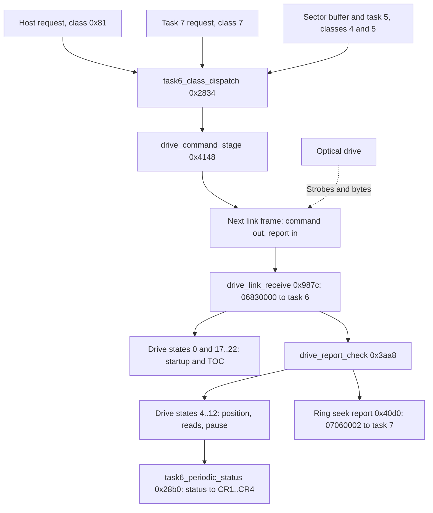
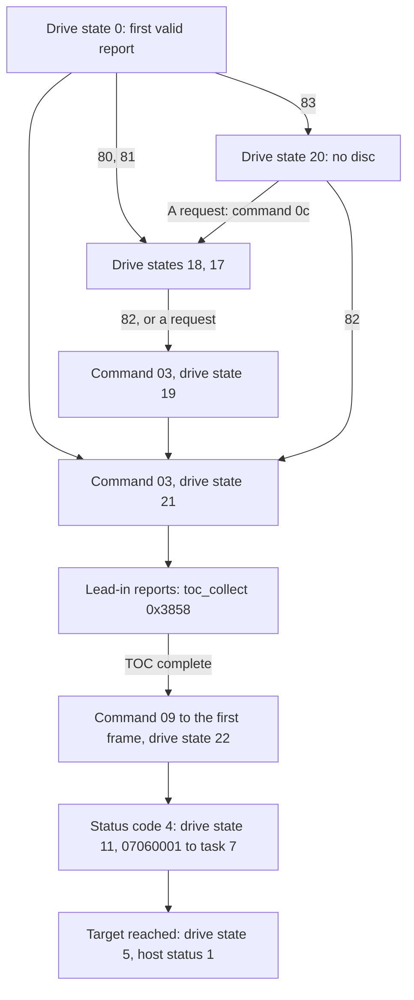

# Drive

## What it does

The optical drive is a separate unit with its own electronics for the laser, the signal and the
motors. It does what the CD block tells it, one command at a time. The drive task, task 6, is the
only part of the firmware that talks to it.

- Link. A serial line carries a steady stream of frames. In each one the CD block sends a command
  and the drive sends a report back, both with a checksum. With nothing to do, the command is empty.
- Reports. Most reports give the drive's state and its position on the disc, which the disc's own
  subcode records.
- Startup. After power-on or a new disc, the task reads the table of contents, the list of tracks
  kept in the lead-in before the first track. It then seeks to the start of the disc and pauses.
- Requests. Play, seek, scan and open tray from the Saturn, the special seeks of disc
  authentication and the pause for a full buffer all become drive commands here.
- Status. After each report the task refreshes the status the Saturn reads, such as busy, pause,
  play, seek, open tray or no disc, with the current track and position.

The sections below follow CDB105 by address.

## Overview

A serial link carries one command to the drive and one report back in every frame. Task 6 reads the
disc's table of contents after reset, turns requests from the host, task 7 and the sector buffer
into commands, and follows each report to keep the drive state and the status the host reads. Names
such as `drive_link_strobe` label the code at the address given with them.



## Names

| Name | Address | Contents |
| --- | --- | --- |
| Command | `0x0f0002c4..0x0f0002cf` | The staged command, 12 bytes |
| Pending byte | `0x0f0002cf` | Byte 11 of the command. 1 while the command waits to be sent |
| Packet | `0x0f000304..0x0f00030f` | The 12 bytes going out in the current frame |
| Received sum | `0x0f000310` | Sum of the report bytes received in the current frame |
| Byte count | `0x0f000311` | Transfers done in the current frame. `0x80` repeats the packet |
| Report | `0x0f0002d0..0x0f0002da` | The latest report, 11 bytes |
| Valid flag | `0x0f0002db` | 1 when the latest report's checksum matched |
| Drive state | `0x0f0002a5` | Task 6's state ([drive states](#drive-states)) |
| Host status | `0x0f00028a` | The status code reported to the host |
| Repeat count | `0x0f00028b` | Repeats of the play range so far, also the low byte of the first status word |
| Target frame | `0x0f0002a0` | Frame address of the current seek or read. Top byte 1 marks a track and index instead |
| Frame | `0x0f000294` | The drive's current frame address, from its reports |
| Request frame | `0x0f0002bc` | Frame address task 7 asks for |
| Play range | `0x0f000298`, `0x0f00029c` | Start and end of what to play. The start's top byte is 1 for a track position, the end's top byte is the repeat limit |
| Play mode | `0x0f00025d` | From the host's play request. Bit 7 keeps the position, bits 6..0 the repeat limit |
| Request positions | `0x0f000264`, `0x0f000268` | Start and end from the host's play or seek request |
| Read mode | `0x0f00025e` | Added to `05060000` when a read starts |
| Kept request | `0x0f000280` | A host or task 7 request held while the TOC is read |
| Session | `0x0f000289` | The session whose TOC is being read, 1 for the first |
| TOC report counts | `0x0f0002e0`, `0x0f0002e4`, `0x0f0002e8` | Lead-in reports taken: all, with status bit 3 set, with it clear |
| TOC | `0x09000064 + 4 * n` | Entry n: control/ADR in bits 31..24 over a frame address ([TOC](#the-toc)) |
| Retry count | `0x0f0002fa` | Ring seeks repeated |
| Report word | `0x0f00027e` | Word from the latest ring report |
| Report bytes | `0x0f0002ec..0x0f0002ef` | Four bytes from the latest ring report |
| Status buffers | `0x0f00026c`, `0x0f000274` | Two copies of the eight status bytes for CR1..CR4 |
| Buffer select | `0x0f00027c` | Bit 0 names the status buffer written last: set for `0x0f000274` |
| Control byte | `0x0f00028c` | Control/ADR of the current position. Bit 6 is the data bit |
| Q records | `0x09000218`, `0x09000224` | Two copies of the current position |
| Initialization flags | `0x0f00025c` | The CR1 low byte of `04` ([sector reads](sector-reads.md#names)) |
| Disc flags | `0x0f00025f` | [Flags](#flags) |
| Command flags | `0x0f0002a6` | [Flags](#flags) |
| Read flags | `0x0f0002a7` | [Flags](#flags) |

### Flags

Four bytes hold single-bit flags of task 6 and the requests it serves. The guides name each bit as
below.

| Byte | Bit | Name | Meaning |
| --- | --- | --- | --- |
| Initialization flags | 1 | R-W bit | R-W subcode on audio tracks, from `04` |
| | 4 | Single-speed bit | Single speed, from `04` |
| Disc flags | 5 | Double-speed bit | The next staged command gets byte 10 = 2 and clears the bit |
| | 6 | Authentication bit | Disc authentication owns the drive |
| | 7 | Multi-session bit | A `B0` report announced another session. Kept until the TOC is cleared |
| Command flags | 0 | Stop bit | Set by a stop, cleared by a seek, pause, read or ring seek |
| | 2 | Scan bit | A scan is requested |
| | 3 | Busy bit | Set by the host request path and by command staging, cleared at the report of the frame that sends the command, or when a request is only answered. The host sees status code 0 meanwhile |
| | 4 | Backward bit | The scan goes backward |
| | 5 | Reply bit | Set by command staging, cleared by the report after the frame that sends the command. Reports are not taken and the host sees status code 0 meanwhile |
| | 6 | Standby-timer bit | The standby timer runs |
| | 7 | Settle bit | The last positioning command was not a read: set by a seek, pause or stop and at a scan's end, cleared by a read or ring seek. Only while it is set does status code 4 count as settled, and status code 3 starts no delivery |
| Read flags | 0 | Play-end bit | The play range's repeats are used up. The next pause writes PEND |
| | 1 | R-W play bit | Task 5 collects R-W subcode while an audio track plays |
| | 2 | Retry bit | Seeking or reading again, host status 8 |
| | 3 | Read-error bit | A read error. The periodic status reports status code 9 |
| | 4 | Frame-update bit | The latest report gave or advanced the frame |
| | 5 | Data-read bit | The read takes data sectors |
| | 6 | Reading bit | A read in progress, with sector delivery through task 5 |
| | 7 | Held bit | The read is held because the buffer is full |

## Link

The drive moves one byte at a time. A strobe from the drive interrupts the SH-1, which sends the
next command byte and stores the byte just received ([SH7034 notes](../sh7034.md#itu-channel-3-and-sci0)).
The five lines run straight to the drive connector ([board](../board.md#optical-drive)).

| Part | Setting |
| --- | --- |
| Byte transfer | SCI0 in clocked synchronous mode (SMR0 `0x80` at startup) at 50,000 bit/s (BRR0 99), 160 µs a byte. Task 6 setup writes SCR0 `0x30`, transmit and receive enabled with the internal clock on SCK0. The board names the lines `COMCLK` (SCK0), `HDATA` (TxD0) and `CDATA` (RxD0) |
| Strobe | Input capture B of ITU3, channel 3 of the SH-1's integrated timer pulse unit (ITU), on a falling edge of TIOCB3 (PB3), the drive's `COMREQ` line. Task 6 setup ORs `0x50` into TIOR3 and `0x02` into TIER3 |
| Strobe handler | `drive_link_strobe` (`0x973c`), vector 93, ROM longword `0x0174` |
| Frame start | PB2, the drive's `COMSYNC` line, bit 2 of `0x05ffffc3`, read as an input |
| Final byte | SCI0 receive, `drive_link_receive` (`0x987c`), vector 101, ROM longword `0x0194` |
| Priority | IPRD `0x6666` from startup: both interrupts at level 6 |

### A frame

A frame is 13 transfers. Each strobe starts one transfer, and the byte a transfer received is stored
at the next strobe.

[`link.py`](../../scripts/drive-link/link.py) decodes frames written as text: it names the
commands and status codes, decodes the reports and checks both sums.
[`startup.txt`](../../scripts/drive-link/startup.txt) follows startup to the first pause, and
[`checksum.txt`](../../scripts/drive-link/checksum.txt) a bad report sum and a repeated command.
From the repository's top folder:

```
python scripts/drive-link/link.py scripts/drive-link/startup.txt
python scripts/drive-link/link.py scripts/drive-link/checksum.txt
```

| Transfer | SH-1 sends | Drive sends |
| --- | --- | --- |
| 1..11 | Command bytes 0..10 | Report bytes 0..10 |
| 12 | Inverted sum of command bytes 0..10 | Inverted sum of report bytes 0..10 |
| 13 | Answer: `00` when the drive's sum matched, otherwise `01` | Final byte |

- The first strobe of a frame, with PB2 low, builds the packet. With the pending byte at 0 it is a
  null packet, eleven zeros and `ff`. Otherwise it is the staged command, and the pending byte is
  cleared.
- Strobes 2 to 12 each store the report byte of the previous transfer at `0x0f0002d0` onward and
  add it to the received sum.
- At the 13th strobe, `drive_link_answer` (`0x97ac`) compares the drive's sum. A match sets the
  valid flag. It then enables the SCI0 receive interrupt (SCR0 bit 6) for the final byte.
- `drive_link_receive` reads the final byte. `00` lets the next frame build a new packet, any other
  value makes it send the same packet again. It disables the receive interrupt and posts
  `06830000` (task 6, class `0x83`) with `TRAPA 0x21`.
- The first strobe of a frame and the receive interrupt save the interrupted task's full context
  and leave through the scheduler at `task_requeue_current` (`0x102e`). The other strobes return
  with `RTE`.
- PB2 low within a frame restarts it at byte 0. The received sum is not cleared, so that frame's
  check fails.
- PB2 high on the first strobe sets the byte count to `0x80`. The frame that follows repeats the
  packet already at `0x0f000304` and leaves a staged command pending.
- Yabause's drive emulation builds its frames the same way: 11 bytes, their inverted sum and a
  13th byte of 0 ([references](../references.md#drive-emulation)).

## Reports

A report is a status byte and ten more bytes. Most reports carry the Q subcode of the current
position. The ring seek report uses the same bytes differently.

| Byte | Address | Q report | Ring report |
| --- | --- | --- | --- |
| 0 | `0x0f0002d0` | Status | Status |
| 1 | `0x0f0002d1` | Control and ADR | Report word, high byte |
| 2 | `0x0f0002d2` | Track, 0 in the lead-in | Report word, low byte |
| 3 | `0x0f0002d3` | Index, or the TOC point in the lead-in | Frame address, bits 23..16 |
| 4..5 | `0x0f0002d4..0x0f0002d5` | Relative time, minutes and seconds | Frame address, bits 15..0 |
| 6 | `0x0f0002d6` | Relative time, frames | First report word, high byte |
| 7 | `0x0f0002d7` | Zero | First report word, low byte |
| 8..9 | `0x0f0002d8..0x0f0002d9` | Absolute time, minutes and seconds | Second report word |
| 10 | `0x0f0002da` | Absolute time, frames | Unused |

- Bits 7..4 of the status byte are the status code. Status bit 2 marks a report with a position:
  the TOC reader, the position helpers and the PB6 update need it.
- The times are BCD, binary-coded decimal. The ring report's frame address is binary.
- `position_from_q` (`0x42bc`) takes the frame from a Q report with ADR 1: the absolute time as
  4500 * minutes + 75 * seconds + frames through `bcd_msf_frames` (`0x41b6`), which is the frame
  address with the two-second lead of 00:02:00 included. It sets the frame-update bit. In the
  lead-in (track byte 0) the frame is 0, or the relative time up to 360,000 frames while the
  multi-session bit is set.

| Status code | Name | What task 6 does with it |
| --- | --- | --- |
| 0 | TOC entry | A lead-in TOC report in drive states 19, 21 and 22 |
| 1 | Stopped | Drive state 21 and host status 0 in drive states 19, 21 and 22, with no command staged. An error in states 4..7, 10..12 and the ring seek state `0x21`, ignored in 8 and 9 |
| 2 | Seeking | Ignored |
| 3 | Playing | A read has started (state 4), a position while playing or reading (states 6 and 12). Audio and data both report it |
| 4 | Paused | A seek or pause has settled (states 4, 11, 22), a position while playing (state 6), the end of a scan (state 7), a completed pause (state 10) |
| 5 | Scanning | A position while scanning (state 7) |
| 8 | Tray or disc | The drive stopped ([report handling](#report-handling)). `80..83` pick the startup drive states: `80` tray open, `83` no disc |
| 9 | TOC end | The end of the TOC |
| 11 | Ring seek | The [ring seek](#ring-seek) |

The names describe what the firmware does with each code. Codes 1 and 2 keep Yabause's names,
since the firmware shows nothing more about them ([references](../references.md#drive-emulation)).
Codes 3 and 5 are errors while the TOC is read.

## Commands

Task 6 keeps one command at a time. `drive_command_stage` (`0x4148`) copies r1, r2 and r3 into
command bytes 0..11, clears the pending byte first and sets the busy and reply bits.

| Byte | Contents |
| --- | --- |
| 0 | Command |
| 1..3 | Frame address, binary |
| 4..7 | r2. A track seek or read puts the index in byte 4 over the next track's start frame |
| 8..9 | r3 bits 31..16. A track seek or read puts the track in byte 8 |
| 10 | r3 byte 10 masked with 2 or 1 |
| 11 | Pending byte, 1 in a staged command |

- Byte 10 is masked with 2 when the double-speed bit is set (and that bit is cleared). Otherwise
  it is masked with 1 when the single-speed bit is set, and with 2 when the data-read bit or the
  control byte's data bit is set. Otherwise it is masked with 1.
- Commands staged with `ff` in byte 10 therefore send 1 or 2. Commands staged with 0 there send 0,
  among them the stop, `04`.
- Byte 10 behaves as the drive speed, 1 single and 2 double. The single-speed bit, set by `04`,
  gives 1 and also makes task 5 expect one sector pulse per 1/75 s instead of per 1/150 s
  ([sector reads](sector-reads.md#sector-pulse)). Whether the drive takes the byte as its speed is
  unknown.
- On that reading, data reads, the TOC read and the ring seek run at double speed by default, and
  audio tracks normally at single speed.

| Command | Name | Staged at | Drive state | Host status |
| --- | --- | --- | --- | --- |
| `00` | Null | `0x3b04` | 18 | 6 |
| `02` | Ring seek | `0x3798` | `0x21` | Unchanged |
| `03` | Read TOC | `drive_toc_command` (`0x2ba0`), session in byte 1 | 19 or 21 | 0 |
| `04` | Stop | `drive_request_stop` (`0x3178`) | 9 | 2 |
| `05` | Standby | `drive_standby` (`0x31c4`) | 8 | 2 |
| `06` | Play | `0x2fc0`, `0x3f72` | 4 | 4, or 8 with the retry bit |
| `08` | Pause | `0x313a` | 5, or 10 with the reading bit | 1 |
| `09` | Seek | `0x2e3a`, `0x3f6c` | 4 | 4, or 8 when seeking again |
| `0a`, `0b` | Scan forward, backward | `drive_scan_start` (`0x4064`), backward with the backward bit | 7 | 5 |
| `0c` | Open tray | `drive_open_command` (`0x2c6c`), `0x2d98` | 17 | 0 |

- The names describe what the firmware sends each command for. `06` both plays audio and reads
  data sectors ([references](../references.md#drive-emulation)).
- `00` is staged with every byte 0, so the pending byte stays 0 and the link keeps sending null
  packets.
- `0c` is staged for the host's Open Tray request, except in drive state 0, which drops it, and
  18, which only clears the busy bit. In drive state 20 any host request stages it.
  Sega's library describes the same rule: a drive command in NODISC opens the tray
  ([references](../references.md#sega-documentation)).
- `0a` and `0b` set byte 1 to 1 when the settle bit is set.

## Drive states

The drive state at `0x0f0002a5` selects how task 6 handles each message. The numbers are the
firmware's. `0x21`, `0x22` and `0x99` are 33, 34 and 153.

| Drive state | Entered | Meaning, as the firmware treats it |
| --- | --- | --- |
| 0 | Reset | Waiting for the drive's first report |
| 4 | A seek or read command | Waiting for the drive to settle or start reading |
| 5 | A pause | Paused, host status 1, standby timer running |
| 6 | A read that reached its target | Playing or reading, host status 3 |
| 7 | A scan command | Scanning, host status 5 |
| 8 | The standby timer | Standby, host status 2 |
| 9 | Host stop request | Stopped, host status 2 |
| 10 | A pause while reading | Paused with a read still marked |
| 11 | A seek or pause that settled | Moving to the target frame |
| 12 | A read that started | Reading toward the target frame |
| 17 | Status `81`, or command `0c` | Waiting on the tray, host status 0 |
| 18 | Status `80` | Tray open, host status 6 |
| 19 | Status `82` in state 17 or 18, or a request there | Reading the TOC after the tray |
| 20 | Status `83` | No disc, host status 7 |
| 21 | Command `03` | Reading the TOC |
| 22 | The TOC complete | The seek to the first frame |
| `0x21`, `0x22` | Task 7's ring seek | [Ring seek](#ring-seek) and its completion |
| `0x99` | An error status | Error, host status 10 |

## Startup and the TOC

After reset task 6 waits for the drive's first report, reads the table of contents from the lead-in,
seeks to the first frame and pauses there. Until then the host status is 0, which task 7 treats as a
drive that is not ready.



### Drive state 0

Right after reset task 6 takes only valid reports, besides the messages every drive state takes
first ([task 6 dispatch](#task-6-dispatch)). Status `80`, `81` and `83` and codes 8 with bit 3 set
pick the first drive state. Anything else stages command `03`.

| Status | Continues at | Drive state | Host status |
| --- | --- | --- | --- |
| `80` | `drive_state_open` (`0x2bd6`), after `drive_disc_gone` (`0x2a90`) | 18 | 6 |
| `81` | `drive_state_tray` (`0x2bc8`), after `drive_disc_gone` | 17 | 0 |
| `83` | `drive_state_no_disc` (`0x2bea`) | 20 | 7 |
| `88..8f` | `drive_state_error` (`0x2bfa`) | `0x99` | 10 |
| Other | `0x2b0e`, command `03` | 21 | 0 |

- `drive_toc_command` (`0x2ba0`) stages command `03` with the session in byte 1 and in
  `0x0f000289`, and sets the double-speed bit, so byte 10 is 2. After reset the session is 1.
- `drive_state_store` (`0x2c00`) stores the drive state and host status, then resets the status
  buffers or stores only the status code. A report goes on to the periodic status, any other
  message waits again.
- The branch at `0x2ae2` always skips `0x2ae6..0x2af0`, and nothing else reaches it. It checks for
  an ADR 1 report and copies report byte 7 to `0x0f0002fe`, as `toc_collect` does.

### Tray and disc states

Drive states 17..22 use the table at `task6_drive_state_table` (`0x2818`): 17 and 18 go to
`task6_states_17_18` (`0x2b1e`), 20 to `task6_state_20` (`0x2cf0`) and 19, 21 and 22 to
`task6_states_19_21_22` (`0x2c58`).

| Drive state | Host request (class `0x81`) | Task 7 request 0 | Valid report |
| --- | --- | --- | --- |
| 17, 18 | Open Tray: command `0c` again in 17, only the busy bit cleared in 18. Others are kept and read the TOC in state 19 | Kept, TOC in state 19 | `82` TOC in state 19. `80` state 18, `81` state 17, `83` and `88..8f` state 20. Others read the TOC in state 21 |
| 19, 21, 22 | Open Tray: command `0c`, state 17. Others are answered and kept | Kept | As drive state 0 for `80..83` and `88..8f`, then by status code below |
| 20 | Command `0c`, state 17 | Command `0c`, state 17 | As drive states 19, 21 and 22 |

- A kept request is stored at `0x0f000280`. In drive states 19, 21 and 22 it is answered first:
  the busy bit is cleared, so the host sees the status again.
- Command `0c`, `drive_open_command` (`0x2c6c`), continues at `drive_state_tray` (`0x2bc8`): the
  disc-gone reset at `drive_disc_gone` (`0x2a90`), drive state 17 and host status 0.
- Status `80` and `81` in drive states 19..22 also run the disc-gone reset first. In states 17 and
  18 they do not.

| Status code in drive states 19, 21, 22 | Effect |
| --- | --- |
| 0 | `drive_toc_start` (`0x2c24`): drive state 21, host status 0, then `toc_collect` (`0x3858`) |
| 1 | Drive state 21, host status 0 |
| 3, 5 | Drive state `0x99`, host status 10 |
| 4 | In drive state 22, the seek after the TOC settled at `drive_startup_seek_done` (`0x3a84`) |
| 9 | `toc_end_reported` (`0x39ec`): the TOC ends with the sessions read so far |
| Other | Periodic status only |

### The TOC

`toc_collect` (`0x3858`) takes lead-in reports: status bit 2 set and track byte 0.

- Every such report counts in `0x0f0002e0`, and in `0x0f0002e4` when status bit 3 is set, otherwise
  in `0x0f0002e8`. Reset clears the three counts, and so does the disc-gone reset. Disc
  authentication compares them for its [30-track flag](disc-authentication.md#request).
- ADR 1 reports carry a point in byte 3 (BCD). Points 1..99 are tracks, `A0`, `A1` and `A2` the
  first track, the last track and the lead-out. Report byte 7 goes to `0x0f0002fe`.
- ADR 5 reports with point `B0` announce another session. Other ADR values and points are counted
  and ignored.

| Point | Stored at | Entry |
| --- | --- | --- |
| 1..99 | `0x09000064 + 4 * track` through `toc_store` (`0x4214`) | Control/ADR (byte 1) over the start frame (bytes 8..10) |
| `A0` | `0x090001f4`, index 100 | Control/ADR, the first track (byte 8, BCD, stored in binary), bytes 9 and 10 as sent. Byte 9 is the disc type |
| `A1` | `0x090001f8`, index 101 | Control/ADR, the last track (byte 8, BCD, stored in binary), bytes 9 and 10 |
| `A2` | `0x090001fc`, index 102 | Control/ADR over the lead-out frame (bytes 8..10) |
| `B0` | `0x09000064`, index 0 | The frame from bytes 8..10. The frame from bytes 4..6 goes to `0x09000210` when larger than the one there, which moves to `0x09000214`. The multi-session bit is set |

- Entries `A0..A2` are also written 12 bytes on: `0x09000200` keeps the first `A0` since the TOC
  was cleared, `0x09000204` and `0x09000208` the latest `A1` and `A2`.
- After each report the TOC is complete when `A0`, `A1` and `A2` are set, the last track is not
  below the first and every track entry from the first to the last is set. A disc of type `0x10`
  (byte `0x090001f6`) with one track, whose `A1` control byte has the data bit, skips the track
  entries.
- A complete session stores its first track at byte `0x09000000 + session` and counts the session.
  On a disc of type `0x10` the first track is taken from the previous session's `A1` instead, one
  more after an audio track.
- With the multi-session bit set, `toc_next_session` (`0x382c`) reads the next session: command
  `03` with the new session number, the `A1` entry kept at `0x0900020c`, and `A0..A2` reset to
  `ffffffff`. The bit stays set until the TOC is cleared, so on such a disc only status code 9
  ends the TOC.
- `toc_complete` (`0x395e`) restores `A0..A2` from `0x09000200..0x0900020b`: the first session's
  first track and the last session's last track and lead-out. Byte `0x09000000` becomes the last
  session's number, and entry 0 the lead-out when no `B0` was seen, with that number in its top
  byte.
- Task 6 then seeks to 150 plus the frame at `0x09000214` and sets drive state 22. The host status
  stays 0.
- `0x09000214` is 0 on a single-session disc. Otherwise it holds the second largest next-session
  start of the `B0` reports: the last session's start when the last session's lead-in has a `B0`
  report too. Without one it holds the start of the session before the last, or 0 on a disc of two
  sessions. A start of `ff:ff:ff` counts as frame 755,040, larger than any other.
- The same frame sets where [task 7's requests](#requests-from-task-7) 0 and 3 read and seek, so
  the file system reads the volume descriptor at 166 frames past it
  ([file system](file-system.md#multi-session-discs)). Disc authentication scans the last session's
  first track instead ([first sectors](disc-authentication.md#first-sectors)).
- Yabause's emulation answers command `03` with status `04` and then `46`
  ([references](../references.md#drive-emulation)).

### The seek after the TOC

`drive_startup_seek_done` (`0x3a84`) handles status code 4 in drive state 22.

- `drive_seek_settled` (`0x3c74`) takes the frame from the report and sets drive state 11.
  `07060001` goes to task 7, which only waits again.
- A kept request at `0x0f000280` is cleared and dispatched again through `task6_message_dispatch`
  (`0x2798`).
- In drive state 11 the next report at the target frame pauses the drive: drive state 5, host
  status 1 and the [standby timer](#standby-timer) ([target reached](#target-reached)).

## Task 6 dispatch

Task 6 resumes at `task6_message_dispatch` (`0x2798`) with GBR `0x0f00025c`. Before the drive state
is consulted, a drive report clears one of the busy and reply bits when the pending byte shows
the command has gone out ([Task 6](structure.md#task-6-messages)).

| Drive state | Handling |
| --- | --- |
| 0, after reset | `task6_state_0` (`0x2ad8`): only a valid report is taken ([drive state 0](#drive-state-0)) |
| 17..22 | Table at `task6_drive_state_table` (`0x2818`, [tray and disc states](#tray-and-disc-states)) |
| Any other | `task6_class_dispatch` (`0x2834`) |

Class `0x81` payloads 0, 12 and 13, and class 3, the end of the transfer 12 and 13 start, which
frees their lock, are taken at `task6_message_dispatch` in every drive state, before this choice.

`task6_class_dispatch` calls a handler from consecutive tables at `task6_class_tables` (`0x29c8`).
Payloads past a class's range wait again at `task6_message_wait` (`0x2796`). The class 6 index has
no bound, so payload 1 reads the first class 5 entry.

| Class | Payloads | Table | Handlers |
| --- | --- | --- | --- |
| 4 | 0, 1 | `0x2a30` | [Sector buffer](#requests-from-the-sector-buffer-and-task-5) |
| 5 | 0..4 | `0x29d0` | [Task 5](#requests-from-the-sector-buffer-and-task-5) |
| 6 | 0, the standby timer | `0x29cc` | `drive_standby` (`0x31c4`) |
| 7 | 0..4, task 7's requests | `0x29e4` | [Below](#requests-from-task-7) |
| `0x81` | 0..14 | `0x29f8` | [Host requests](#requests-from-the-host) |
| `0x83` | 0, a drive report | `task6_class_tables` (`0x29c8`) | [`drive_report_check`](#report-handling) (`0x3aa8`) |

A report handler returns to [`task6_periodic_status`](#periodic-status) (`0x28b0`). The other
handlers return to the wait at `task6_message_wait`.

### Requests from the host

The host commands that move the drive post class `0x81` requests to task 6. The posting path sets
the busy bit first ([host commands](host-commands.md#drive-requests)).

| Payload | Host command | Entry | Effect |
| --- | --- | --- | --- |
| 0 | `04` with the reset bit | `drive_request_init` (`0x2d06`) | Clear the play settings, restart the other tasks, then pause as payload 8 |
| 1 | None | `drive_request_none` (`0x2d7a`) | Nothing |
| 2 | `05` Open Tray | `drive_request_open` (`0x2d7e`) | Disc-gone reset, command `0c`, drive state 17 |
| 3 | `10` with track positions | `drive_request_play_track` (`0x2dc8`) | [Play](#play-range) between track positions |
| 4 | `10` with frame positions | `drive_request_play_frame` (`0x3004`) | [Play](#play-range) from a frame for a frame count |
| 5 | `10` with both positions `ffffff` | `drive_request_play_resume` (`0x2ebc`) | [Play](#play-range) the current range |
| 6 | `11` with a track position | `drive_request_seek_track` (`0x3084`) | Seek to the track and index |
| 7 | `11` with a frame position | `drive_request_seek_frame` (`0x30a0`) | Seek to the frame |
| 8 | `11` with `ffffff`, `04` without the reset bit | `drive_request_pause` (`0x30b8`) | Pause |
| 9 | `11` with 0 | `drive_request_stop` (`0x3178`) | Command `04`, drive state 9, host status 2 |
| 10, 11 | `12` forward, backward | `drive_request_scan` (`0x3208`), `drive_request_scan_back` (`0x3250`) | [Scan](#scan) |
| 12 | `20` with type 0 | `drive_request_subcode` (`0x35e4`) | Send the current Q record, 5 words |
| 13 | `02` Get TOC | `drive_request_toc` (`0x360e`) | Send the TOC, `0xcc` words |
| 14 | None | `drive_buffer_free` (`0x37c4`) | As class 4 payload 0 |

- No ROM code posts payloads 1 and 14. A loaded extension can.
- Payload 0 clears bytes `0x0f00025c` and `0x0f00025d`, the longword `0x0f000260` (the standby word
  and the two bytes from `04`'s CR4), the request positions, the play range and the repeat count,
  and keeps only the busy and reply bits and the frame-update bit. With IPRA..IPRD
  (`0x05ffff84..0x05ffff8b`) saved and cleared it calls `TRAPA 0x2e`, which
  [restarts the other tasks](kernel.md#restart). It then restores them and writes `0x0bc1` to
  `0x0a00001e`, ESEL among the flags ([interrupt flags](host-commands.md#interrupt-flags)). In host
  status 0, 6 or 7 it only answers, otherwise it continues as payload 8.
- The drive state, the TOC and the status stay as they were. The restart cancels the standby
  timer, and the pause of payload 8 starts it again.
- Payload 2 first tells task 7 with `07060003` while disc authentication owns the drive.
- Payloads 12 and 13 take lock `03060000` and pass the address and word count at `0x0f000250` and
  `0x0f000254` to the transfer start at `transfer_start` (`0x23ba`) as a type 0 transfer
  ([data transfer](data-transfer.md#transfer-start)).
  The Q record is `0x0900021a` when byte `0x0f000288` is 0, otherwise `0x09000226`.
- Payload 6 stores the position from `0x0f000264` as a track target, payload 7 as a frame target,
  both through [`play_target_store`](#play-range) (`0x3530`).
- Payload 8 in drive state 10 ends the marked read (`05060003` to task 5) and pauses in state 10.
  In host status 1 it does the same and pauses. In host status 3, or while reading, it pauses.
  Otherwise it seeks to the target frame.
- Payload 9 also clears the target, resets the status buffers, notifies task 5, sets the settle and
  stop bits and clears the standby-timer and scan bits.

### Requests from task 7

| Payload | Entry | Effect |
| --- | --- | --- |
| 0 | `drive_task7_play` (`0x36fe`) | Read from the request frame, or from the frame at `0x09000214` plus 166 when the request frame is 0 |
| 1 | `drive_task7_pause` (`0x3728`) | Clear the data-read, read-error and retry bits, pause with command `08` |
| 2 | `drive_task7_read` (`0x3730`) | Set the authentication bit and the data-read bit, read from the request frame with command `06` |
| 3 | `drive_task7_release` (`0x3754`) | Clear the authentication bit and the data-read, read-error and retry bits, seek to the frame at `0x09000214` plus 150 with command `09` |
| 4 | `drive_task7_ring_seek` (`0x3778`) | Ring seek with command `02` ([below](#ring-seek)) |

- The authentication bit marks a drive that disc authentication owns. A stopped drive tells task 7
  only while it is set ([report handling](#report-handling)).
- Payloads 0 and 2 also set `0x0f000284` to `ffffffff` and the read mode to 1. Payload 2 sets
  `0x0f00029c` to `00ffffff`, payload 0 clears it.
- `0x09000214` is 0 on a single-session disc. On a disc of more sessions it can hold the start of
  the last session or of an earlier one ([the TOC](#the-toc)).

### Requests from the sector buffer and task 5

These act only while a read is marked in the reading bit. The last delivered frame is
`0x0f0002ac`, written by sector completion ([Sector buffer](sector-buffer.md)).

| Message | Entry | Needs | Effect |
| --- | --- | --- | --- |
| `06040000` | `drive_buffer_free` (`0x37c4`) | Held bit set | The target becomes the last delivered frame. Inside the play range the read continues from `0x0f0002c0` with read mode 6 |
| `06040001` | `drive_buffer_full` (`0x37fe`) | Held bit clear | The same check. Inside the range: set the held bit, drive state 10, `05060009` to task 5 and a pause |
| `06050000` | `drive_task5_retry` (`0x3650`) | Held bit clear | Set the retry bit, read again from `0x0f0002b4` with read mode 2 |
| `06050001` | `drive_task5_none` (`0x3680`) | | Nothing |
| `06050002` | `drive_task5_error` (`0x368e`) | Held bit clear | Read error: the read-error bit, which the periodic status reports as code 9, and the busy bit. The reading, data-read and retry bits cleared, pause in drive state 10 |
| `06050003` | `drive_task5_position` (`0x36c0`) | Held bit clear | Only the offset below |
| `06050004` | `drive_task5_resume` (`0x36dc`) | Held bit clear | As `06050000` with read mode 8 |

- Outside the play range, class 4 counts a repeat and restarts the range at `drive_play_start`
  (`0x2f00`), or pauses through payload 8 when the repeats are used up.
- With the frame-update bit set, `06050000`, `06050003` and `06050004` store the frame minus
  `0x0f0002b0` in the signed byte `0x0f0002a4`, which the next read adds to its target.
- `06050002` tells task 7 with `07060003` while disc authentication owns the drive.
- Sector completion and the free pool post `06040000`, `06040001` and `06050004`
  ([Sector buffer](sector-buffer.md)). The other class 5 messages come from task 5
  ([sector reads](sector-reads.md)).

### Seek, read and pause

- `drive_seek_command` (`0x2dee`) seeks to the frame in r0, which callers also store as the target
  frame. `ffffff` becomes the lead-out frame, the low 24 bits of `0x090001fc`, and 0 becomes 150.
  Host status 4, drive state 4.
- `drive_read_command` (`0x2f5c`) reads from the target frame. With the data-read bit or the
  control byte's data bit set, the frame sent is the target plus the signed byte `0x0f0002a4`,
  minus 1.
  Host status 4, or 8 when the retry bit is set. Drive state 4.
- A target whose top byte is 1 holds a track and index instead. `toc_track_frame` (`0x326a`) turns
  it into the track's start frame. A read of a data track at index 0 or 1 then targets that
  frame. Otherwise the index goes in byte 4 over the next track's start (the lead-out after the last
  track), the track in byte 8, and the target keeps the track. Index 0 of an audio track becomes 1.
- A track whose TOC entry is missing gives `ffffff`, and the read becomes a seek to the lead-out.
- `drive_pause_command` (`0x3106`) stages command `08` and sets host status 1. The drive state is 5,
  or 10 while the reading bit is set.
- Seek, read and ring seek first notify task 5 through `drive_notify_task5` (`0x418c`): `05060003`
  when the reading bit is set, otherwise `05060007` when the R-W play bit is set. The read skips it
  while the read mode is 6. The pause posts the same messages itself.
- Each command cancels timer `06060000`.

### Play range

A host play request sets a range and a repeat limit, then reads from its start.

- Payload 3 stores `0x0f000264` with top byte 1 as the start and `0x0f000268` as the end. Payload 4
  takes the start frame from `0x0f000264` through `play_start_frame` (`0x3510`): bits 22..0, at
  least 150, with 0 kept as 0. The end is the start plus bits 22..0 of `0x0f000268`, from 150 when
  the start is 0. An end of `00ffffff` keeps the old end.
- Bits 6..0 of the play mode become the repeat limit when 15 or less, and the repeat count is
  cleared. Payload 5 with bits 6..0 of `7f` keeps both.
- `drive_play_range` (`0x2e7c`) sets `0x0f000284` to the end frame: the lead-out for 0, the end
  clamped to the lead-out for a frame range, `ffffffff` for a track range.
- Bit 7 of the play mode set: in host status 3 the request is only answered. In host status 1 or 2
  with the stop bit clear the range is checked at the current target. Other cases, among
  them a stopped drive, play from the target at `drive_play_target` (`0x2f0e`).
- Bit 7 of the play mode clear: `drive_play_start` (`0x2f00`) stores the range start as the target
  through `play_target_store` (`0x3530`).
- `drive_play_target` reads from the target, at once when its form differs from the range start's.
  With the same form `play_range_check` (`0x32c4`) decides: inside, read. Outside with bit 7 clear,
  seek to the target. With bit 7 set, count a repeat and start again, or pause when the repeats
  are used up.
- Payload 4 also sets the data-read bit when track 1 is the first track and the start lies more
  than 2250 frames before it, so byte 10 of the read is 2.

| Routine | Address | Result |
| --- | --- | --- |
| `play_target_store` | `0x3530` | Store a position as the target. A frame is clamped to the lead-out, 0 becomes 150. A track position gets index 1..99 (0 becomes 1), track 0 becomes the first track and a track outside the disc becomes the first or last track at index 1 |
| `lead_out_clamp` | `0x35cc` | Clamp r0 to the lead-out frame |
| `play_range_check` | `0x32c4` | T = 1 when the target lies inside the range, r0 = 1 when it lies before the start. Always inside while disc authentication owns the drive |
| `play_repeat_next` | `0x3dac` | Below the limit count one more (up to 14) and return T = 0. At the limit set the play-end bit and return T = 1. `play_repeat_check` (`0x3dcc`) checks without counting |

- A frame range holds start <= target < end, with a start of 0 read as 150 and an end of 0 as the
  lead-out. A track-form target counts as inside.
- A track range compares the current track and index (`0x0f00028d`, `0x0f00028e`) with the start
  and the end. Track 0 in the start is the first track and in the end the last track. Index 0 in the
  start is 1 and in the end 99, so the end track is included.
- A track range with a frame target compares frames or tracks: against `0x0f0002dc` when set, 150
  for a start of 0, the start track's frame for a data track at index 0 or 1, and otherwise the
  track `toc_track_of_frame` (`0x421e`) finds for the target.
- A repeat limit of 15 never runs out, because the count stops at 14.
- The standby timer start after the next pause turns a set play-end bit into `0x0010`, PEND, at
  `0x0a00001e`.

### Scan

- Payloads 10 and 11 clear or set the backward bit, set the scan bit, clear the data-read,
  read-error and retry bits, cancel the standby timer and clear the standby-timer bit.
- In host status 3 or 5 the scan starts at `drive_scan_start` (`0x4064`). In host status 1 or 2 a
  frame target is sought first, and the scan starts when the seek reaches it. Other cases are only
  answered.
- `drive_scan_start` checks the play range: outside, a repeat is checked and the drive pauses.
  Inside: drive state 7, host status 5, the busy bit, task 5 notified, command `0a` or `0b`.

### Standby timer

In drive state 5, `drive_pause_timer` (`0x4012`) starts timer `06060000` unless the standby-timer
bit shows it running.

- The duration is word `0x0f000260` in seconds, or 180 seconds when the word is 0
  ([timers](kernel.md#timers)).
- A set play-end bit is cleared and writes `0x0010`, PEND, to `0x0a00001e`
  ([interrupt flags](host-commands.md#interrupt-flags)).
- The expiry reaches task 6 as class 6 payload 0. `drive_standby` (`0x31c4`), only while the
  standby-timer bit is set, stages command `05`: drive state 8, host status 2.

## Position states

Drive states 4..12 take their reports through the table at `drive_state_table` (`0x3b7c`), from
`drive_report_dispatch` (`0x3b48`) with the status code in r2. Status code 1 is an error in each of
them, except the ignored drive states 8 and 9.

| Drive state | Handler | Status codes taken |
| --- | --- | --- |
| 4 | `drive_state_4` (`0x3ba0`) | 3 read started, 4 seek settled |
| 5 | `drive_state_5` (`0x3c96`) | None |
| 6 | `drive_state_6` (`0x3cac`) | 3 and 4, the position |
| 7 | `drive_state_7` (`0x3dee`) | 5 the position, 4 the end of the scan |
| 8, 9 | `drive_state_8` (`0x3e5a`), `drive_state_9` (`0x3e5e`) | None, reports are ignored |
| 10 | `drive_state_10` (`0x3e62`) | 4, the pause completed |
| 11 | `drive_state_11` (`0x3eb4`) | 4, the position |
| 12 | `drive_state_12` (`0x3ec2`) | 3, the position |

- `0x3bb2`, right after `drive_state_4`, stores r0 as the host status and continues at
  `status_code_store`. No code calls it.

### Read started

`drive_read_started` (`0x3bc4`) handles status code 3 in drive state 4. It clears the frame and the
report count at `0x0f000300`, and takes the frame from the report when status bit 2 is set.

- With the settle or scan bit set it only sets drive state 12.
- A data read, requested with the data-read bit or on a data track whose Q control has bit 6,
  starts sector delivery at `drive_delivery_start` (`0x3c2e`). A track target first becomes the
  frame plus 5, which is also kept in `0x0f0002dc` unless bit 7 of the play mode is set.
- Delivery: the target goes to `0x0f0002b8` and `0x0f0002ac`, `0x0f0002b0` is cleared,
  `05060000` plus the read mode goes to task 5 and the reading bit is set. Read mode 6 also
  clears the held bit. Task 5 then takes the sectors ([sector reads](sector-reads.md#read-start)).
- An audio track with the R-W bit set posts `05060005` instead and sets the R-W play bit.
- Drive state 12 follows in every case except a track target whose frame is not known yet, which
  waits for the next report.

### Following the position

`drive_seek_settled` (`0x3c74`) handles status code 4 in drive state 4 after a seek or pause: with a
position it sets drive state 11. Drive states 11 and 12 then follow the position at
`drive_position_follow` (`0x3ed4`).

- A report with status bit 2 and ADR 1 gives the frame. Without one a known frame counts up by one.
- While reading (the reading bit set, the held bit clear), the target is reached once `0x0f0002b0`
  is set and at or past it. Each report before that counts in `0x0f000300`, and the 150th is a
  read error: the busy and read-error bits, `05060003` to task 5 and a pause in drive state 5. With
  disc authentication owning the drive the request is given up instead, as after a third failed
  [ring seek](#ring-seek): `07060003` goes to task 7, and the release that follows at
  `drive_task7_release` (`0x3754`) clears the read-error bit again before task 7 runs. Task 7
  then decides by its disc state ([drive stopped](disc-authentication.md#drive-stopped)), result 0
  during the header scan.
- Otherwise a frame that went back, or more than 75 frames ahead, seeks again: the retry bit, host
  status 8 and command `09` (`06` in drive state 12) to the old frame plus 30.
- A frame target is reached at or past it. A track target is reached when the Q track and index
  (status bit 2, ADR 1) reach those at `0x0f00028d` and `0x0f00028e`.

### Target reached

`drive_target_reached` (`0x3fe0`) clears the retry bit.

| Condition | Next |
| --- | --- |
| Scan requested (the scan bit) | `drive_scan_start` (`0x4064`) |
| Drive state 12 | `drive_play_reached` (`0x4058`): drive state 6, host status 3 |
| Otherwise | `drive_pause_reached` (`0x3ff0`): drive state 5, host status 1, the status from the report, the repeat check outside the play range, then the [standby timer](#standby-timer) |

### Playing, scanning and pausing

- Drive state 6 follows the position with `drive_play_follow` (`0x3cc2`). Unless reading or in track
  0 or the lead-out, a jump reads again from the old frame plus 30. It then builds the status from
  the report. Outside the play range it repeats from the start or pauses.
- Inside the range at index 0 of a track whose data bit differs from the previous track's, or of
  the first track on a disc of type `0x10`, it plays on from that track: from its start frame for a
  data track, from index 1 otherwise. Bit 7 of the play mode is set for that.
- Drive state 7 follows the scan with status code 5. A Q control whose data bit differs from the
  control byte's stages the scan again. Past the range the drive pauses. Status code 4 ends the scan
  and pauses at the current position.
- Drive state 10 completes a pause with status code 4: drive state 5, host status 1 and the status
  copied with the last delivered frame by `status_copy_sector` (`0x4558`). Outside the play range,
  when the repeats are used up or the read is not held, the marked read ends with `05060003` to
  task 5.

## Ring seek

Drive state `0x21` is the seek that [disc authentication](disc-authentication.md#authentication-seeks)
uses. `drive_task7_ring_seek` (`0x3778`) sets it and copies the request frame to the target frame.

- It clears the retry count, then at `drive_ring_seek_issue` (`0x3788`) clears the report word and
  sets the double-speed bit. The command is `02` with the target frame and byte 10 set to 2.
- The report of the frame that sends the command is skipped. A report with status code 11, status
  bit 2 and the target frame completes the seek at `drive_report_seek` (`0x40d0`).
- On completion the report word goes to `0x0f00027e`, the first and second report words to
  `0x0f0002ec` and `0x0f0002ee`, `07060002` goes to task 7 and the drive state becomes `0x22`.
- A report word of 0 or `ffff` counts a retry and seeks again 206 frames further on through
  `drive_ring_seek_issue`.
- The third such report gives up at `drive_ring_seek_give_up` (`0x3750`): `07060003` goes to task 7,
  which ends the request with result 3, and the drive seeks back as for payload 3.
- A ring report with status bit 2 clear, another frame or another status code is ignored, except
  status code 1, an error ([report handling](#report-handling)). All reports in drive state `0x22`
  are ignored.
- Yabause's emulation answers command `02` with status `b6`, word `44f1` and report bytes `09 09 09
  09`. Those values pass task 7's word and byte checks
  ([references](../references.md#drive-emulation)), as
  [`seeks.txt`][emulator-seeks.txt] replays.

## Report handling

`drive_report_check` (`0x3aa8`) takes a report only when `drive_report_valid` (`0x2c44`) accepts it:
the valid flag is 1 and the reply bit is clear. It also clears the frame-update bit, which
the position helpers set again.

- Staging a command sets the busy and reply bits. The report of the frame that sends it clears
  the busy bit, and the next report clears the reply bit. That next report is the first reply
  taken.
- Status codes other than 8 continue at `drive_report_dispatch` (`0x3b48`). Drive states 4..12 use
  the [position states](#position-states) table at `drive_state_table` (`0x3b7c`), and the ring
  seek state `0x21` continues at `drive_report_seek` (`0x40d0`).
- Status code 1 in drive states 4..7 and 10..12 or the ring seek state `0x21` sets drive state
  `0x99` and host status 10.

Status code 8 stops the drive at `drive_report_stopped` (`0x3ac4`).

- While the authentication bit is set, it is cleared and `07060003` goes to task 7.
- Low nibble 3, or 8 and above, sets drive state `0x99` and host status 10.
- Other low nibbles run `drive_disc_gone` (`0x2a90`). That clears the TOC area through `toc_clear`
  (`0x2a38`), posts `07060000` to task 7 and writes `0x0020`, DCHG, to `0x0a00001e`. The command is
  cleared, the drive state becomes 18 and the host status 6, as for status `80` after reset.
- Both paths clear the target frame and reset the status buffers at `status_reset` (`0x450a`).

## Periodic status

After every report in a served drive state, `task6_periodic_status` (`0x28b0`) updates PB6 and the
host's status registers.

- With interrupts masked, bit 4 of the MPEG connection flags `0x0f000894`, the audio transfer, is
  copied to bit 4 of word `0x0a00001a`. When it is set, their bit 7 sets or clears PB6 (bit 6 of
  `0x05ffffc3`) ([MPEG flags](host-commands.md#mpeg-flags)).
- Otherwise, in drive states 6 and 12, PB6 follows bit 4 of report byte 1, the pre-emphasis bit of
  the Q control field. It needs status bit 2 and a track other than 0. Other drive states clear
  PB6, and a command waiting for its reply leaves it alone.
- CDB104 also clears PB6 on a report with track 0
  ([firmware revisions](../firmware-revisions.md#pre-emphasis-output-in-the-lead-in)).
- The status words come from the status buffer written last. While busy flag `0x0f0007b0` is set
  they are `20ff ffff ffff ffff`. Otherwise the first word gets `0x2000`, the periodic flag.
- A command waiting for its reply clears the status code. The read-error bit sets status code 9
  with `ff` in the other bytes.
- The words go to CR1..CR4 (`0x0a000010..0x0a000016`) only when bit 1 of word `0x0a000004` is set,
  which the interface sets once the host has read the previous response
  ([board](../board.md#interrupts)).
- `0x0400`, SCDQ, then goes to `0x0a00001e`, and task 6 waits again.

### Status bytes

The eight bytes follow the host's status layout. Status builders write them to the status buffer
not written last and then flip the buffer select.

| Bytes | Contents |
| --- | --- |
| 0 | Host status `0x0f00028a` |
| 1 | Repeat count `0x0f00028b`, ORed with `0x0f00028f`. Sega's library calls this byte the CD flag and repeat count, and takes the count from its low 4 bits |
| 2, 3 | Control/ADR `0x0f00028c`, track `0x0f00028d` |
| 4 | Index `0x0f00028e` |
| 5..7 | Frame address |

- `status_from_target` (`0x4300`) builds them from the target frame through `toc_track_of_frame`
  (`0x421e`). The lead-out is track `0xaa`, with its control byte from TOC index 102.
- `status_from_report` (`0x43c4`) builds them from a report with a position. The frame is the
  current frame, or while reading the last delivered frame `0x0f0002ac` with its top byte in
  `0x0f00028f`. It also becomes the target. The track (BCD, or `aa`), the relative time as the
  offset `0x0f000290`, the index and the control byte come from the report. At or past the lead-out
  while disc authentication owns the drive, the control byte is `0x29`.
- A report with another ADR is copied as it is into the next Q record. In host status 3, while not
  reading, the position then moves on by one frame.
- Both builders write a Q record (control/ADR, track, index with the offset into the track, frame)
  to `0x09000218` or `0x09000224` by byte `0x0f000288`, and flip that byte.
- `status_code_store` (`0x44f4`) replaces only byte 0 of the buffer written last.
  `status_reset` (`0x450a`) fills the next buffer and Q record with `ff`, keeping the status code.
- The jumps at `0x363c..0x364c` lead to `toc_entry` (`0x420a`), `status_from_target`,
  `status_from_report`, `status_code_store` and `status_reset`. No code calls the one to
  `status_from_report`, `status_report_jump` (`0x3644`).
- The host status values are Sega's drive status codes: 0 BUSY, 1 PAUSE, 2 STANDBY, 3 PLAY, 4
  SEEK, 5 SCAN, 6 OPEN, 7 NODISC, 8 RETRY, 9 ERROR, 10 FATAL
  ([references](../references.md#sega-documentation)).

## Timing

The drive keeps its own time and the firmware never sets it. Three parts of the firmware limit it:
the strobe handler, the sector pulse lock and the 20 seconds disc authentication allows.

- Strobes. Each strobe stores the byte in RDR0 as the one the previous transfer received, without
  checking RDRF, then starts the next transfer. A transfer takes 160 µs, 3,200 cycles of the 20 MHz
  clock. A strobe that comes before the previous transfer has ended stores a stale byte, so strobes
  must be more than 160 µs apart.
- Sector rate. A read starts only once two sector pulses come one interval apart within the
  tolerance: 16,666 ± 14 ITU4 counts (6,666.4 ± 5.6 µs) at double speed, 33,333 ± 28 (13,333.2 ±
  11.2 µs) at single speed ([sector pulse](sector-reads.md#sector-pulse)). The drive's sector rate
  must match it to within 0.084%. The CD rate, 1/150 s or 16,666.7 counts at double speed, lies
  inside. Only the lock checks the rate: once locked the pulse is off until the next read starts.
  A drive outside the tolerance never locks and no sector is taken. The read's 150th report is a
  read error, which gives up disc authentication with result 0 well before its timeout
  ([following the position](#following-the-position)).
- Disc authentication. One 20 second timer starts with the first sector request and runs until
  the request ends, through the extension read when the disc names one
  ([timeout](disc-authentication.md#timeout)). In that time the drive reads the first sectors for
  the header scan, makes the four ring seeks and reads the sectors of the three passes, eight
  moves at least, each with its sectors. A ring seek tried again or a read sent again adds a move.
  With none repeated, each move has a little under 2.5 s.

### Ranges in theory

Within those limits, how much timing the firmware tolerates depends on how the drive behaves. The
ranges below were found by running CDB105 in the [emulator][emulator], not measured on hardware.
They are the timings under which the firmware accepts a disc with a Saturn header, passing ring
seek answers and matching sectors, for a drive that:

- sends one frame per sector period, so a frame's 13 strobes fit in 1/150 s at double speed,
- hands over sectors from the frame it is sent to, none before,
- takes the same time for every seek, whatever the distance,
- answers each ring seek on the first try with values that pass, as Yabause's emulation does
  ([ring seek](#ring-seek)),

with each SH-1 instruction taking one cycle. With no sectors before the frame sent, the first two
pass before the pulse locks, task 5 misses the target and the read is sent again, from the same
frame and then earlier, four times in all. The check then makes 20 moves instead of 8.

| Timing | One at a time | All together | Outside |
| --- | --- | --- | --- |
| Sector period at double speed | 6,660.5 to 6,672.4 µs | The same | No read locks: result 0 at the read error, about 1 s after `E0` |
| Strobe spacing | 3,389 to 10,256 cycles (169 to 513 µs) | 3,390 to 10,246 cycles | Below: a transfer still running at the next strobe. Above: a frame longer than a sector period |
| Seek | Up to 0.96 s | Up to 0.33 s | Result 3 at the timeout |

- One at a time moves one timing with the others at 1/150 s, 200 µs and 1/15 s. All together holds
  for every combination of the ends of the three ranges.
- The sector range is the pulse tolerance, widened slightly by when the handler reads TCNT4.
  Near its ends the lock takes more pulses, so reads are sent up to eleven times and each seek has
  less time.
- The lowest strobe spacing is a byte's 3,200 cycles plus the 189 cycles the handler takes to start
  the transfer. Real instruction timing raises it.

A drive that lands a few frames before the frame it is sent to gives the pulse lock those sectors
before the target. Landing 4 frames before it, each read is taken at the first try away from the
ends of the sector range, and the check makes 8 moves. A seek may then take up to 2.46 s one at a
time and 0.59 s all together. Near the ends of the sector range the lock can still need more
sectors than the landing gives, so reads are sent again there, which sets the second figure.

Whether these margins are meant to allow for differences between drive units or follow from how
the firmware was written is not known, nor where real drives fall inside them.

## Unknown

- What the ring report word and bytes measure. The drive computes them.
- What commands `05` and `0c` do in the drive.
- What status bit 2 and status bit 3 mean. Bit 3 is counted separately for the lead-in reports that
  disc authentication weighs.
- How often the drive strobes and starts frames.

[emulator]: https://github.com/LysergicWarp/Sega-Saturn-CDB-Emulator
[emulator-seeks.txt]: https://github.com/LysergicWarp/Sega-Saturn-CDB-Emulator/blob/main/scripts/ring/seeks.txt
