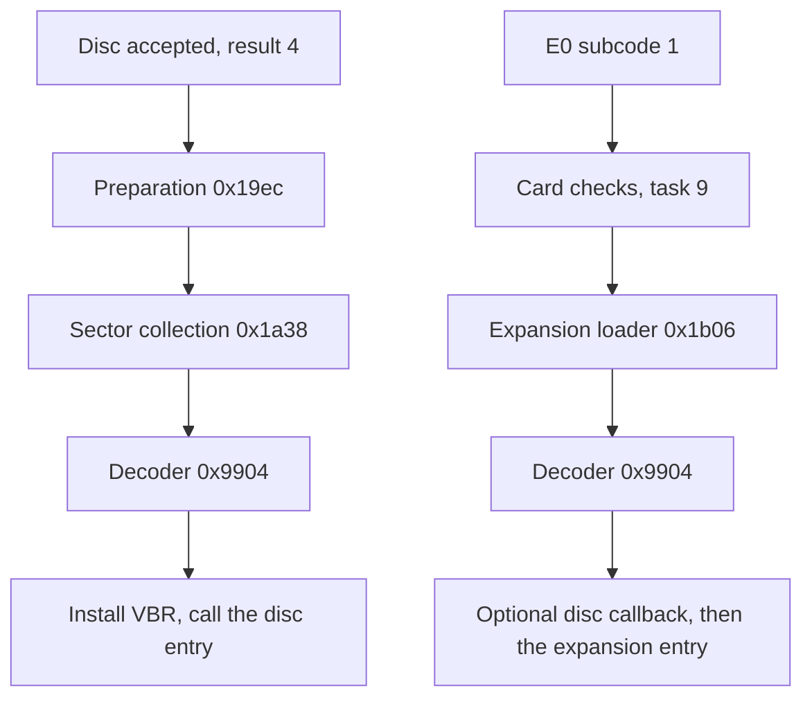

# Extensions

## What it does

The firmware can load and run SH-1 code that is not in its ROM, called an extension. It comes from
one of two places.

- Disc extension. After a disc passes authentication, its header can point to encoded code on the
  disc. The firmware reads it, decodes it and calls it, and the code can take over interrupts and
  tasks. Whether any released disc uses this is unknown.
- Card extension. The MPEG card's ROM holds encoded code for the SH-1. When the Saturn asks for the
  card and the card checks pass, the firmware decodes it into RAM. Once `93` turns the card on,
  most MPEG commands go through a table in that code. The routine that loads it is the expansion
  extension loader.
- Decoding. Both kinds go through the same decoder, which ends with a check value. The firmware
  keeps the code only when the check value matches.
- Links. A fixed page near the end of the ROM connects the firmware and loaded code: entry points
  into the card's code and a table of firmware routines that the code can call.
- Card requests. Task 9 runs the card checks, the card load and the copy of the card ROM to the
  Saturn.
- Card on. Once `93` turns the card on, its interrupts and data channels reach the firmware, and
  tasks 8 and 9 run the card's code for them.

The sections below describe CDB105.

## Overview

A disc extension comes from an authenticated disc, and a card extension from the MPEG card at
`0x0e000000`. Both are encoded, both pass through the same decoder and both end in a call into the
loaded code. The known MPEG card ROMs carry a card extension, described in the
[MPEG card SH-1 code](../mpeg-card/sh1-code.md) and the guides it lists.

Neither path inspects the code it loads. Each loader checks only the layout that path needs and
the decoder's check value, then calls the code. Neither looks at what the code does or limits
where its pointers lead ([hooks](#hooks)). The paths differ in their gate and layout, in where the
code runs and in which firmware hooks reach it.

| | Disc extension | Card extension |
| --- | --- | --- |
| Gate | An accepted disc whose header names one | `E0` subcode 1, taken only with hardware flag bit 1 (MPEG card present, set by startup's card test) and the card off, then the five card checks |
| Layout | VBR at `+0`, entry at `+0x3c`, nonzero `+0x44` | Version at `+0`, entry at `+4`, jump table from `+8` |
| Decoded at | `0x09075800`, 9 KB | `0x0907b000`, 20 KB |
| Entry runs | In task 7, interrupts masked, the new VBR installed | In task 9, interrupts above level 2 enabled, VBR unchanged |
| Hooks | VBR, the per-task resume words and the callback the expansion loader runs | The [expansion entries](#expansion-entries), called by the MPEG commands, task 8, task 9's card work loop and `E2` |
| Lifetime | Until the next accepted disc | Until the next `E0` subcode 1 or accepted disc |

[Calls into loaded code](#calls-into-loaded-code) covers what reaches each kind after its entry
returns.

## Names

| Name | Address | Contents |
| --- | --- | --- |
| Disc extension | `0x09075800..0x09077bff` | Decoded disc extension, header at the start |
| Collection area | `0x09075848` | Encoded disc extension as collected from sectors |
| Collection state | `0x0f000208..0x0f00021b` | Sector count byte, then the disc address, encoded length, collection pointer and bytes left |
| CD block revision | `0x0f0002ff` | Copy of decoded disc byte `+0x44`, returned by `01` ([commands `01` and `03`](host-commands.md#commands-01-and-03)) |
| Expansion source | `0x0e000000` | Length word, then encoded data from `0x0e000004` |
| Expansion | `0x0907b000..0x0907ffff` | Decoded card extension, jump table from `+8` |
| MPEG version | `0x0f0002fd` | Copy of decoded expansion byte `+0`, nonzero after a load, returned by `01` |
| Request byte | `0x0907538a` | Task 9 request: 1 for `E0`, 2 for `E2` |
| Check bits | `0x0f0007b1` | One bit per failed card check |
| Card status | `0x0f0007ac`, `0x0f0007ae` | Words returned by `E1` subcode 1 |
| Check block | `0x0907539c` | 18 words that checks 1 and 3 send to the card |
| Random state | `0x090753e8` | State of the checks' random word generator `card_random` (`0xbf94`) |
| MPEG interrupt flags | `0x0f000848`, mask `0x0f00084c` | Set by the [card interrupts](#card-interrupts), reported by `91`, masked by `92` |
| Card events | `0x0f000896` | Three bits the capture B handler leaves for task 8's entry 35 |
| MPEG flags | `0x0f000890..0x0f000897` | The play, decode, card, pause, connection and register flags ([MPEG flags](host-commands.md#mpeg-flags)) |
| Control and mode words | `0x0f000854`, `0x0f000868` | Kept copies of the card registers `0x0a100000` and `0x0a100014` ([MPEG flags](host-commands.md#mpeg-flags)) |

## Disc extension loader

In effect: after a disc is accepted, read the sectors its header points to, decode them, and when
the result checks out, install its vector table and call it. Only
[disc authentication](disc-authentication.md#acceptance) calls the preparation.

- Preparation `disc_extension_prepare` (`0x19ec`) clears the decoded header and vector state,
  requires a nonzero disc address and encoded length and checks the address against the low 24 bits
  of `[0x090001fc]`. It initializes the collection state.
- It computes the sector count `ceil(length / 2048)` but stores only its low byte. It does not
  check the length against the destination size.
- The disc extension area ends at `0x09077bff`, 9,144 bytes after the start of the collection
  area. A longer extension is collected and decoded past that end, into disc authentication's
  sector-check buffers from `0x09077c00` ([memory map](structure.md#memory-map)). The loader's
  clears stop at the area's end. What was written there stays until a later disc check's sector
  checks write over it and, where they never write, as in the scramble buffer's first 12 bytes,
  until the CD block is next reset
  ([scrambling](disc-authentication.md#scrambling-and-interleaving)).
- Collection `disc_extension_collect` (`0x1a38`) takes a slot number in r0 and reads the raw sector
  at `0x09000230 + 0x930 * low16(slot)`. It skips a 16-byte header for mode 1 or 24 bytes otherwise
  and appends up to 2048 bytes to the collection area, under the sector lock (`0x0b070000`).
- The copy loop moves whole longwords, at least four bytes, so a partial or zero count copies more
  than it accounts for.
- After the last sector, `disc_extension_decode_call` (`0x1a88`) saves PR and SR, masks interrupts
  (SR `0xf0`) and calls the decoder from the collection area into the disc extension area with the
  encoded length. The two areas overlap, 0x48 bytes apart.
- On success with a nonzero decoded byte `+0x44`, it installs VBR from decoded `+0`, copies `+0x44`
  to the CD block revision and calls the entry pointer at `+0x3c` when it is nonzero. Pointers are
  not range- or alignment-checked. Any nonzero `+0x44`, including `0x80..0xff`, passes.
- On a decoder failure or a zero `+0x44` it clears the disc extension area, VBR and the CD block
  revision.
- Both outcomes return zero, so r0 does not tell whether an extension was installed.
- A read that never finishes installs nothing. Preparation has already cleared the earlier
  extension's header, VBR and the CD block revision, so that extension is gone, and the bytes
  collected so far stay in the collection area.
- The read shares the 20 seconds of the disc's check. A timeout during it ends the request with
  result 4 ([extension read](disc-authentication.md#extension-read)), and so does a drive that
  stops with the disc still in. A disc that is gone gives `0x11`
  ([drive stopped](disc-authentication.md#drive-stopped)).

| Decoded field | Use |
| --- | --- |
| `+0x00` | VBR value installed on success |
| `+0x3c` | Optional disc entry point |
| `+0x40` | Optional callback, used by the expansion loader |
| `+0x44` | Required nonzero, copied to the CD block revision |
| `+0x45` | Compared by the expansion loader |
| `+4*ID` | Optional per-task resume address ([Hooks](#hooks)) |

### Disc entry

In effect: the entry runs once, inside task 7's extension read, before the request completes.

- It is called from `disc_extension_call_entry` (`0x1ac6`) with SR `0xf0`, so interrupts are
  masked, on task 7's stack, with PR `disc_extension_restore_status` (`0x1aca`). VBR already holds
  decoded `+0`.
- r0 holds the entry address and r1 `0x0907583c`, the address of the entry word. The decoder has
  used the other general registers, so they carry nothing from the loader.
- The sector lock is free. The last extension sector goes back to the pool after the entry returns.
- On return `disc_extension_restore_status` sets r0 to 0 and pops SR and PR, and the extension read
  at `0x8dcc` uses only r0. The entry may change any register but r14 and r15, and must return with
  PR and the stack as it found them. r14 is in no saved context, so every task shares its value
  ([task states](kernel.md#task-states)). Reset sets it to 0.
- The request then completes with result 4, as it does without an extension. From then on command
  `01` reports decoded `+0x44` as the CD block revision.

## Decoder

In effect the decoder undoes a reversible transform on each 8-byte block and checks an XOR of
intermediate states against the last block. It reads some of its own instructions as constants and
rewrites saved return addresses, but set that aside and it is a straight loop over the blocks. The
[decoder](decoder.md) document covers it in full.

- Entry `extension_decode_wrapper` (`0x9904`) takes source, destination and byte length in r1, r2
  and r3, aligns both pointers down to four bytes and requires at least two complete eight-byte
  blocks. The last complete block is the trailer, and a trailing partial block is ignored.
- The transform's schedule depends only on the remaining block count. No key is involved.
- Output is written before the trailer check. The return value is 0 on a match and -1 otherwise.
- Instruction bytes at `0x9a00`, `0x9a0c`, `0x9b88` and `0x9c68` double as arithmetic constants,
  and helper `extension_decode_edit_returns` (`0x99fc`) rewrites saved return addresses to insert
  the continuation at `extension_decode_inserted_continuation` (`0x9b3c`).

## Expansion extension loader

In effect: decode the card's code into the expansion area, run a disc extension's callback first
under the condition below, then call the card's entry.

- Entry `expansion_extension_load` (`0x1b06`) reads a BE32 length from `0x0e000000`, accepts
  `1..0x5000` and decodes from `0x0e000004` into the expansion area. The decoder also requires at
  least two blocks.
- Decoded `+0` goes to the MPEG version.
- When the disc extension's `+0x45` is greater than the expansion's `+1` (both sign-extended,
  compared unsigned) and disc `+0x40` is nonzero, that callback runs first.
- The callback runs in task 9, called from `0x1b3c` with r0 its own address, r1 `0x0907b000` and
  PR `expansion_extension_call_entry` (`0x1b40`).
- The loader then calls the entry read from r1 + 4 without a null check. The callback must preserve
  r1 for that read to hit the expansion header.
- The entry is called from `0x1b42` with r0 the entry address, r1 `0x0907b000` and PR `0x1b46`, in
  task 9 on its stack at SR `0x20`, so interrupts above level 2 stay enabled.
- On the known cards that entry fills the empty entries of the expansion's table from the
  [ROM table](#rom-table) and returns.
- It neither installs VBR nor masks interrupts. Success returns 0. Failure clears the expansion
  area, the MPEG version and card status `0x0f0007ac`, and returns -1.
- Its caller is `task9_expansion_load` (`0xbb38`) in task 9, after the card checks pass.
- `expansion_extension_clear_alternate` (`0x1b52`), between the failure path and the loader's
  exit, clears the expansion area and returns 0 through that exit. Nothing in the ROM refers to
  it. The exit pops PR from the stack and returns there, so code that calls it gets control back
  at the address it pushed, not after the call.

## MPEG card requests

Task 9 runs the card side of `E0` subcode 1 and `E2`: five card checks, then the expansion loader
or an expansion entry ([Group E](host-commands.md#group-e)).

- Task 9 dispatches at `task9_message_dispatch` (`0xba48`) on the payload low byte. Payload 0 goes
  to `task9_mpeg_stop` (`0xbbc6`).
- Command `93` posts payload 0 when it stops or resets the card. `task9_mpeg_stop` writes 3 to
  `0x0a00000c` and 0 to `0x0a10001a`. With the card bit set, bit 7 of the card flags
  ([MPEG flags](host-commands.md#mpeg-flags)), it posts `08090004` to task 8, which
  [activates](#card-activation) the card again. Otherwise it clears the MPEG state through
  `mpeg_state_clear` (`0xa4d0`) and writes MPED, `0x0800` to `0x0a00001e`
  ([interrupt flags](host-commands.md#interrupt-flags)).
- With the card bit set, other payloads go to the [card work loop](#card-work-loop).
- With the card bit clear, payload 1 returns to the wait. Payloads 2 (`E0`) and 4 (`E2`) clear the
  check bits and call the five checks listed at `0xbc28` with r0 = 1. A nonzero result sets check
  bit n. Every check runs, whether or not an earlier one failed.

| Check | Entry | Test |
| --- | --- | --- |
| 0 | `mpeg_check_none` (`0xbc7c`) | None, returns 0 |
| 1 | `mpeg_check_1` (`0xbcc4`) | A video sequence header sent to the card on its video data request ([card checks](#card-checks)) |
| 2 | `mpeg_check_none` (`0xbc7c`) | None, returns 0 |
| 3 | `mpeg_check_3` (`0xbe7c`) | Four words sent to the card on its audio data request |
| 4 | `mpeg_check_4` (`0xbf04`) | The card's memory, written and read back ([card memory](#card-memory)) |

When all checks pass, the request byte selects the action at `0xbb28`.

| Request | Action | Card status afterwards |
| --- | --- | --- |
| 1, `E0` | Expansion loader `expansion_extension_load` (`0x1b06`) | Byte `0x0f0007ad` = 2 whether or not the load succeeds. A failed load has cleared the MPEG version and word `0x0f0007ac` |
| 2, `E2` | Expansion entry 86 through `expansion_entry_86` (`0xf8e2`), [Get MPEG ROM](#get-mpeg-rom) on the known cards | Byte `0x0f0007ac` = 2, or 3 when the entry returns r13 = 0 |

- A failed load clears word `0x0f0007ac` before task 9 sets byte `0x0f0007ad`, so `E1` reports
  `0002`, as after a first successful load. The MPEG version, which command `01` returns, is 0
  after a failed load, which tells it apart from a successful one. A failed check for request 1
  and an accepted disc clear it as well.
- When a check fails, request 1 clears the expansion area through `expansion_extension_clear`
  (`0x1b5e`) and stores word `0x0001` at `0x0f0007ac`. Request 2 sets byte `0x0f0007ac` to 1 and
  keeps an earlier load. Both clear word `0x0f0007ae`.
- Either way task 9 clears the request byte and the busy flag, writes MPED and returns to the
  wait. `E1` subcode 1 reports the card status words.
- Word `0x0f0007ae` changes only in Get MPEG ROM and when a check fails. A load leaves it, so `E1`
  goes on reporting the last `E2`'s page count after a later `E0`.
- A request byte with neither bit set acts as request 1 when a check fails. When all pass, task 9
  returns to the wait and leaves the request byte, the busy flag and the card status as they were.

### Card checks

In effect: checks 1 and 3 send words to the card through its two data request lines, and check 4
writes the card's memory and reads it back. Each line is an SH-1 timer input whose falling edge
asks the DMA controller for one word ([board](../board.md#mpeg-card)).

- The checks take random words from `card_random` (`0xbf94`). The state at `0x090753e8` becomes the
  low word of the state times `0x93a5` (both signed) shifted right 8, plus TCNT4 read as a signed
  word, plus 89.
- Check 1 fills 16 words at `0x0907539c` with random words and turns them into an MPEG-1 video
  sequence header: start codes `0x000001b3` (sequence header) at +0, `0x000001b5` (extension) at
  +12 and +28, `0x000001b2` (user data) at +16 and `0x000001b8` (group of pictures) at +20.
- The random size, aspect ratio and picture rate at +4 stay. In the bit rate longword at +8 it sets
  bit 13, the marker bit, and clears bits 1 and 0, the two quantizer matrix flags.
- It sends 18 words from there to `0x0a10001e` on DMA channel 2, one word per falling edge of
  TIOCA1, the card's video data request. CHCR2 `0x1908` takes ITU1 input capture A as the request,
  and TIOR1 `0x0d` captures on falling edges ([SH7034 notes](../sh7034.md#dma-channels-2-and-3)).
  The last two words are whatever the block held.
- Check 3 writes `0x8209` to `0x0a180008` and 0 to `0x0a180000`. It clears the block and sends
  four zero words from it to `0x0a180000` on DMA channel 3, one per falling edge of TIOCA0, the
  card's audio data request (CHCR3 `0x1808`, TIOR0 `0x0d`).
- Checks 1 and 3 wait 0x500 loop passes and pass when the channel's TE bit is set, that is when
  every word has moved. TE already set before the channel starts fails the check.

### Card memory

Check 4 treats `0x0a100030..0x0a100037` as a window on 512 KB of card memory. It fills the memory
with a pattern from a random seed, reads back one group of four words in each quarter and clears
it. The known cards' image and sector jobs use the same window
([card memory](../mpeg-card/task-9.md#card-memory)).

| Register | Use by the firmware |
| --- | --- |
| `0x0a100030` | Address, in 8-byte units |
| `0x0a100032` | `0xfe00` before writing words, `0xfa04` before reading them |
| `0x0a100034` | Written `0xfffc` after the command. Bit 0 set means ready. While bit 2 is set the firmware waits before the next data word |
| `0x0a100036` | Data, one word per access, the address moving on by one word |

- Ready (`card_ready`, `0xbfca`): up to 33 times, write `0xff7f` to `0x0a100014` and read
  `0x0a100034`. Bit 0 set returns 0. Otherwise the try writes `0xffff` to `0x0a100034`, reads
  `0x0a100036` and writes 0 to it. The fill and the clear wait for ready the same way before each
  block, the compare before each read.
- The fill (`card_memory_fill`, `0xc014`) writes each block b of 1024 bytes, address b * 128, with
  seed + b + o at byte offset o. Each data word waits for bit 2 to clear, at most 81 reads.
- The compare (`card_memory_compare`, `0xc082`) reads four words at an address r7 * 0x4000 plus 14
  random bits, for r7 = 0 to 3, and expects the pattern.
- The clear (`card_memory_clear`, `0xc0f4`) writes 0 everywhere. Its result is not checked, so a
  card that stops answering during the clear still passes. Any other wait that runs out, or a word
  read back that differs, fails the check, and the memory is not cleared.
- After the clear, check 4 writes `0x0fff` to `0x0a10001a` and returns 0.

### Unused card routines

These routines sit among the checks with no reference anywhere in the ROM.

- `mpeg_check_fail` (`0xbc80`) returns -1.
- `card_id_check` (`0xbc84`) writes `0xffff` to `0x0a10001a` and expects `ffffffff` from
  `0x0a100008` and `0x0a10000a`, then writes `0xfffe` and expects `SEGA`. It returns 0 on a match.
- `card_header_check` (`0xbd78`) writes 3, 2, 1 and 0 to `0x0a100022` and compares each word read
  back there with a word taken from check 1's header: aspect ratio and width, picture rate and
  height, and two words from the bit rate longword. With r0 nonzero it also writes a random word to
  `0x0a100024` and expects the words combined with a 15-bit shift register sequence from it.
- `card_ready_masked` (`0xbfba`) and `card_control_set` (`0xbff8`) clear or set bit 7 of the mode
  word and write the word to `0x0a100014`. `card_ready_masked` then polls for ready as `card_ready`
  (`0xbfca`) does.

## Get MPEG ROM

In effect: copy the card ROM, from offset `0x5000` on, into sector slots in 2048-byte pages and file
each one through a filter, as if it came from a disc. `E2` runs this routine at `mpeg_rom_get`
(`0xc170`) as expansion entry 86, which the known cards leave to the [ROM table](#rom-table). The
host then gets the pages with `61`.

| Name | Address | Contents |
| --- | --- | --- |
| Page | `0x0907538c` | The next page, starting at `E2`'s offset |
| End | `0x09075390` | `E2`'s offset plus count |
| Filter | `0x09075398`, copy at `0x09075399` | `E2`'s filter f |
| Slot | `0x0907539a` | The slot being filled |
| Page count | `0x0f0007ae` | Card status word 2, the pages copied so far |

- The routine clears the page count, then works through the pages from the offset up to the end.
- For each page it takes the free pool's head through `mpeg_rom_slot_take` (`0xc1f0`), under the
  sector lock as owner 9 (`0x0b090000`). Without a free slot it returns r13 = -1.
- `mpeg_rom_page_address` (`0xc20a`) gives the slot's address and the page's source,
  `0x0e005000 + 2048 * page`. The address is not wrapped: page 246 reads `0x0e080000`, and the last
  page, `0x7ff`, reads `0x0e404800`. The card's ROM repeats every 512 KB
  ([board](../board.md#mpeg-card)), so page 246 is the ROM's start, its length word and SH-1 code.
- `mpeg_rom_slot_clear` (`0xc21e`) clears the 24 bytes before the page, where a sector's sync,
  header and subheader sit, `mpeg_rom_page_copy` (`0xc23c`) copies the 2048 bytes and
  `mpeg_rom_slot_clear` clears the 280 bytes after them. Together they fill the 2352-byte slot.
- `mpeg_rom_page_file` (`0xc256`), under the sector lock, pairs CD device 3 (`0x83`) with filter f
  through `connection_pair` (`0x5510`) and delivers the slot from device 3 through `sector_deliver`
  (`0x4fa4`, [routing](sector-buffer.md#routing)). The page goes to whichever partition filter f's
  chain sends it to, as a put does. Device 3 stays paired with filter f afterwards.
- The routine then moves to the next page and adds 1 to the page count. After the last page it
  returns r13 = 0, and task 9 sets card status byte `0x0f0007ac` to 3.
- When the pool runs out, the pages filed so far stay in their partition, the page count says how
  many, and task 9 sets the status byte to 2. From reset the pool holds 200 slots. The 200th page
  fills the buffer and writes BFUL, as any delivery does
  ([notifications](sector-buffer.md#notifications)).
- The cleared header reads as a mode 0 sector, so `61` with get sector length 0 sends exactly the
  page's 2048 bytes ([sector spans](data-transfer.md#sector-spans)).
- While `E2` runs, its busy flag rejects every command but `05`. The host reads the page count with
  `E1` subcode 1 after MPED.
- The helpers are ROM table entries 81 (`mpeg_rom_slot_take`), 82 (`mpeg_rom_slot_clear`), 83
  (`mpeg_rom_page_copy`), 84 (`mpeg_rom_page_address`) and 87 (`mpeg_rom_page_file`), so loaded code
  can call them. The known card extensions call 81, 82, 84 and 87.

## The card while it is on

Once `93` turns a loaded card on, three things run its work. Task 8 activates it and handles its
events, task 9 runs jobs in the card work loop, and four interrupts carry the card's two lines and
its two data channels.

### Card activation

In effect: command `93` with CR2 bit 0 turns a loaded card on. Task 8 starts the card's lines,
resets the MPEG state and calls expansion entry 34, which sets the card bit. The card bit opens
the MPEG commands ([groups 9 and A](host-commands.md#groups-9-and-a)) and task 9's card work loop.

- Task 8 takes payload 4 at `task8_mpeg_activate` (`0xa41c`) and writes `0x7fff` to `0x0a10001a`.
- `startup_mpeg_card_channels_start` (`0xa460`) starts the card's lines. It clears DE and TE, the
  enable and transfer-end bits, in CHCR2 and CHCR3, the control registers of DMA channels 2 and 3
  ([SH7034 notes](../sh7034.md#dma-channels-2-and-3)).
- It makes ITU0, ITU1 and ITU2, channels 0 to 2 of the SH-1's integrated timer pulse unit (ITU),
  capture falling edges: TIOR0 and TIOR1 `0x0d`, TIOR2 `0xdd`. It clears their flags and enables
  capture A of ITU0 and ITU1 and both captures of ITU2 (TIER2 3).
- ITU2's inputs are the card's two interrupt lines, TIOCA2 and TIOCB2
  ([board](../board.md#mpeg-card)). From here their falling edges raise IMIA2 and IMIB2 (vectors 88
  and 89), whose handlers are `imia2_audio_error` (`0xb852`) and `imib2_video_status` (`0xa190`,
  [card interrupts](#card-interrupts)).
- `mpeg_state_clear` (`0xa4d0`) clears the MPEG state, the card bit with it. Task 8 then calls
  entry 34 through `expansion_entry_34` (`0xf812`), returning to `0xa438`.
- The known cards leave entry 34 to the ROM table's `mpeg_state_activate` (`0xa4f0`). It calls
  entry 33 through `expansion_entry_33` (`0xf80e`), reads `0x0a180008` and writes `0x8209` to it and
  to `0x0f000884`, and 0 to `0x0a180000`.
- `mpeg_state_activate` then stores `0x67818022` in the play, decode, card and pause flags from
  `0x0f000890`, which sets the card bit. It also
  stores -1 at `0x0f000850`, `0x0101` in the words `0x0f000898`, `0x0f00089a` and `0x0f00089c`, and
  20 at `0x090752e0`.
- The ROM table's entry 33, `mpeg_state_init` (`0xa52c`), sets state words from the control word and
  writes five card words: `0x47af` to `0x0a100020`, `0xff7e` to `0x0a10001a`, `0xfff3` to
  `0x0a100014`, `0x0096` to `0x0a100002` and `0x88fe` to `0x0a100000`. The known cards replace entry
  33 with their own.
- Task 8 writes MPED to `0x0a00001e` and jumps to entry 32, which on the known cards is its own
  wait.
- `93` with bit 0 clear stops the card, and with bit 0 set while the card is on it resets it
  ([groups 9 and A](host-commands.md#groups-9-and-a)).

### Card work loop

With the card bit set, task 9 runs the loop at `task9_card_work` (`0xba5e`) for any payload but 0.
The loop is how a card extension's work runs in task 9.

| Byte | Bits 0, 1, 2, 3 | How |
| --- | --- | --- |
| `0x09075388` | Entries 54, 53, 69, 70 | Called in that order, the byte read again after each call |
| `0x09075389` | Entries 78, 77, 80, 79 | The entry of the lowest bit set, jumped to without a return address |

- Entry 76, the ROM's `task9_card_work_recheck` (`0xbad6`), rechecks: when any of bits 0..3 is set
  in either byte, the loop runs again, otherwise task 9 waits. The jumped-to entries end there.
- An entry has to clear its bit, or the loop calls it again.
- Work starts when a bit is set and task 9 then takes a nonzero payload.
- The ROM's `9A` sets the bits of `0x09075388` for new connections, bit 0 current video, bit 1
  next video, bit 2 current audio and bit 3 next audio, and posts `09810001`
  ([`9A`](host-commands.md#9a-set-mpeg-connection)). So on the known cards, whose `9A` calls the
  ROM's, entries 54, 53, 69 and 70 take the connections
  ([task 9's card work](../mpeg-card/task-9.md)).
- `93` clears both bytes and `0x0907538a` when it stops or resets the card.

### Card interrupts

In effect: the card has two interrupt lines, and two DMA channels carry its video and audio data.
The firmware turns their events into MPEG status bits and host interrupt flags, and hands the rest
to task 8, which runs the card's code for it.

| Event | Vector | Handler | Result |
| --- | --- | --- | --- |
| Falling edge of TIOCA2, ITU2 capture A | 88 | `imia2_audio_error` (`0xb852`) | The audio error, through entries 56 and 57. Nothing is posted |
| Falling edge of TIOCB2, ITU2 capture B | 89 | `imib2_video_status` (`0xa190`) | Reads the card's status word, sets MPEG status bits and posts `088c0010` to task 8 for entry 35 |
| DMA channel 2 end | 76 | `dma2_end` (`0x9ce4`) | Posts `08890008` to task 8 for entry 51 |
| DMA channel 3 end | 78 | `dma3_end` (`0xb4bc`) | Posts `088a000c` to task 8 for entry 72 |

- All four save the full frame and leave through the scheduler at `task_requeue_current` (`0x102e`)
  ([scheduling](kernel.md#scheduling)). Task 8 comes before task 9, so a capture during a card job
  in task 9 runs entry 35 first, and the job goes on afterwards.
- Channels 2 and 3 are the channels the [card checks](#card-checks) use. Their end interrupts need
  IE in CHCR2 and CHCR3.
- The MPEG interrupt flags are the longword `0x0f000848`, which `91` reports and clears, under the
  mask `0x0f00084c`, which `92` sets ([`90`, `91` and `92`](host-commands.md#90-91-and-92)). A
  flag set while its mask bit is set writes `0x2000`, MPST, to `0x0a00001e`.
- Sega's MPEG part names the flags the firmware sets here: bit 4 VDERR (video decode error), bit 10
  SQEND (sequence end detected) and bit 20 ADERR (audio decode error). It describes MPST as the
  notice of MPEG interrupt status and MPCM as the end of an MPEG operation interval.

#### Capture A

- Entry 56 (`mpeg_audio_error`, `0xb88e`) clears IMFA in TSR2. The handler itself does not.
- With DMA channel 3 running (DE set), entry 56 clears DE, calls entry 57 and sets DE again.
  Otherwise it just calls entry 57.
- Entry 57 (`audio_control_pulse`, `0xb8e0`) reads `0x0a180008`, then writes the word kept at
  `0x0f000884` to it with bit 14 set and, 8 loop passes later, with bit 14 clear. The kept word does
  not change.
- Entry 56 then sets bit 5 of `0x0f000845` and bit 20 of the flags. `90` reports `0x0f000845` in
  CR3's low byte, where Sega's MPEG report puts the audio status and its error bit, bit 5.
- The known cards keep entries 56 and 57.

#### Capture B

The handler reads the card register `0x0a100000` three times, five `nop`s apart, and keeps the bits
set in every read. A clear bit is an event.

- With the card bit clear it only counts: bit 4 clear adds `0x0100` to the word `0x0f00089e` and
  bit 5 clear adds 1.
- With the card bit set, bits 0 to 3, 5, 6 and 8 go inverted to the word `0x0f000846`. At an
  interval, bit 4 clear, they replace the old bits, otherwise they are ORed in. `90` reports the
  word in CR4, where Sega's MPEG report puts the video status. Sega names those bits decoding,
  picture displayed, pause, freeze, field, picture updated and output ready.
- The word `0x0f000850` takes the status word masked with the word `0x0f000852` or `0x030f`, and
  `0x0f000852` becomes `ffff`.

| Bit clear | Effect |
| --- | --- |
| 4 | An interval. Entries 38 and 39 when armed ([countdowns](#countdowns)), `0x1000` (MPCM) to `0x0a00001e`, and bit 2 of the card events for task 8 |
| 6 | Bit 1 of the card events, and entry 40 when bit 2 or 6 of the pause flags is set |
| 11 | Bit 0 of the card events |
| 12 | Bit 2 of the decode flags |
| 13 | Bit 0 of the decode flags and flag bit 10, SQEND |
| 15 | Flag bit 4, VDERR |

- Any bit set in the card events posts `088c0010`, task 8's offset 16, entry 35.
- `90` reports bit 0 of the decode flags as bit 3 of its MPEG status, the bit Sega's report calls
  the decode state, 1 for stopped.

#### Task 8's card events

Entry 35 (`task8_card_events`, `0xab78`) handles the card events in task 8. The known cards replace
it with their own. The ROM's entry 35 keeps bit 3 of the card flags set while it runs, so `95` and
`9C` wait meanwhile. It takes the bits in order and clears each first. States are the video state
`0x0f00089c` and the audio state `0x0f00089d` ([`9C`](host-commands.md#9c-change-mpeg-connection)).

| Bit | Entries | Also |
| --- | --- | --- |
| 0 | 43, then 44 for video state 4 or 45 for 5 | Bit 5 of the decode flags set meanwhile |
| 1 | 47, then 48 or 49 the same way | Entry 36, when bit 7 of the play flags and bit 6 of `0x09075370` are set. Bit 4 of the decode flags set meanwhile |
| 2 | 75, then 74, 46 or 41 for video state 3, 5 or 6, and 73, 85 or 42 for audio state 3, 5 or 6 | The interval counted. Bit 1 of the decode flags set meanwhile |

- The interval counter is the word `0x0f000842`. It counts only while bits 0 and 6 of the mode word
  are set. `90` reports it in CR2, where Sega's MPEG report puts its interval (VSYNC) counter.
- After an interval, with both states 4, bits 0 and 1 of the play flags and bit 0 or 1 of
  the pause flags set, bit 7 of the play flags is set. Otherwise it is cleared, and a set bit 6 of
  `0x09075370` is cleared and `088a000c` posted.
- Entry 36 (`mpeg_timestamp_check`, `0xae68`) returns `088a000c` for posting when the byte
  `0x090752ad` over the word `0x090752a8` is above the byte `0x090752ae` over the word `0x090752a4`,
  bytes sign-extended, compared unsigned. Otherwise it returns 0. `0x090752a4` is the longword `99`
  answers.
- On the known cards those bytes and longwords are 33-bit timestamps: `0x090752ae` over
  `0x090752a8` is the second video timestamp and `0x090752ad` over `0x090752a4` the audio one
  ([pictures and timestamps](../mpeg-card/video-and-audio.md#pictures-and-timestamps)). The ROM's
  entry 36 pairs each byte with the other timestamp's longword. The cards' own entry 36 compares
  the second video timestamp with the audio one.
- Entries 43 to 49, 73 to 75 and 85 exist only on the card
  ([task 8's handlers](../mpeg-card/task-8.md)). Entry 35 ends by jumping to entry 32,
  task 8's wait, and task 8 then takes what it posted: entry 51 for `08890008`, entry 72 for
  `088a000c`.

#### Countdowns

- In video state 4 or 5, with bits 0 and 6 of the mode word set, an interval calls entry 38
  when bit 0 of the pause flags is set and entry 39 when bit 4 is.
- Entry 38 (`mpeg_countdown_a`, `0xaacc`) counts the word `0x0f00088c` down. At 1 it reloads it
  from `0x0f00088e`, sets bit 2 of the pause flags and sets bit 2 of the mode word, which it
  writes to `0x0a100014`. Entry 39 (`mpeg_countdown_b`, `0xaaf8`) does the same with `0x0f000888`,
  `0x0f00088a`, bit 6 of the pause flags and bit 3.
- `96` sets bits 0 and 4 of the pause flags and the countdown words from CR2 and CR4
  ([`96`](host-commands.md#96-set-decoding-method)). The known cards' `96` runs the ROM's handler
  for that ([card's `96`](../mpeg-card/commands.md#96)).
- Entry 40 (`mpeg_countdown_expired`, `0xab34`), called for status bit 6, clears bit 2 of the mode
  word for bit 2 of the pause flags, and bit 3 for bit 6, which also calls entry 37. It writes the
  mode word to `0x0a100014` and clears both bits of the pause flags.
- Entry 37 (`mpeg_record_match`, `0xae2c`) stores the low byte of the card register `0x0a100006` at
  `0x09075312` and looks its low 6 bits up among the low 6 bits of the bytes `0x090752e7 + 4k`, k =
  0 to 3. A match copies the longword `0x090752f4 + 4k` to `0x09075304` and the 6 bits to the word
  `0x0907530c`. Without one the word becomes `ffff`.
- The known cards keep entries 38 to 40 and replace entry 37.

#### Recovery

State 6 is the state Sega's MPEG part calls recovery (RCV).

- Entry 41 (`mpeg_video_recover`, `0xad40`), for the video part, writes the mode word
  without bits 2 and 3 to `0x0a100014`, leaving the kept word as it is. It then reads the sector
  count of the partition named by the byte `0x0907532b`, the partition in the video connection
  record that `9B` reports.
- A count of 0 returns. Otherwise the entry clears bit 12 of the video status, the bit Sega names
  buffer empty. With bit 2 of the play flags set it returns while the count is below the word
  `0x090752e0`, 20 from activation. Otherwise one sector is enough.
- Past that it posts `08890008`, restores the video state from `0x0f000898`, sets bit 2 of
  `0x0907535c` and bit 5 of the play flags, clears the decode bit, bit 0 of the control word,
  for `0x0a100000`, and writes the mode word to `0x0a100014` again. Bit 1 of
  the register flags is set while it does so and cleared after.
- Until then `0x0a100014` lacks bits 2 and 3 while the kept word may have them, and
  [`AE`](host-commands.md#ae-and-af) answers the kept word.
- Entry 42 (`mpeg_audio_recover`, `0xadb8`) handles the audio part the same way with the partition
  byte `0x0907532f` and a threshold of 4. It clears bit 4 of `0x0f000845`, posts `088a000c`,
  restores the audio state from `0x0f000899` and sets bit 7 of `0x0f000895`.
- The known cards replace entries 41 and 42. Their own entry 42 calls the ROM's through the
  [ROM table](#rom-table).

#### DMA channel ends

- DMA channel 2 end (`dma2_end`) clears IE in CHCR2, sets bit 1 of the card flags and posts
  `08890008`. DMA channel 3 end (`dma3_end`) clears IE in CHCR3, sets bit 2 of the card flags and
  posts `088a000c`. DE and TE stay as the channel left them.
- On the known cards, entry 74 starts channel 2 with the video data and entry 73 channel 3 with the
  audio, both with IE set
  ([starting a transfer](../mpeg-card/video-and-audio.md#starting-a-transfer)).
- Entries 51 and 72 then start the channel again for each sector
  ([sector feeds](../mpeg-card/task-8.md#sector-feeds)).
- `9C` waits while either bit is set. `9C`'s cuts through entries 58 and 59 clear them
  ([`9C`](host-commands.md#9c-change-mpeg-connection)).
- Entry 61 (`mpeg_decode_pulse`, `0xb9b2`), which no ROM code calls, pulses the decode bit: it
  writes the control word with bit 0 clear to `0x0a100000` and, 8 loop passes later, with bit 0
  set, which it keeps. Bit 1 of the register flags is set meanwhile. The known cards keep it.

## Expansion entries

A fixed page at `0xf800..0xfacb` connects ROM code with the loaded expansion by entry number n, 0
to 100. It sits apart from the rest of the code, after unused space, at the same address in every
known revision ([firmware revisions](../firmware-revisions.md#rom-layout)).

- `expansion_command_entry` (`0xf800`), used by the MPEG commands, computes n = (command & `0x3f`) -
  16, 0 to 31, and jumps to the longword at `0x0907b008 + 4n` ([Groups 9 and
  A](host-commands.md#groups-9-and-a)).
- Stubs `0xf80a + 4k` load n = 32 + k and continue at `expansion_table_jump` (`0xf912`). For n up
  to 88 (`0xf80a..0xf8ea`) that jumps through the expansion's table at `0x0907b008 + 4n`. `E2`'s
  entry 86 is at `expansion_entry_86` (`0xf8e2`). Five of task 8's six message handlers are such
  stubs ([MPEG task](structure.md#mpeg-task)).
- The stubs for n = 89 to 97 (`0xf8ee..0xf90e`) continue at `rom_table_jump` (`0xf91a`) instead,
  which jumps through the ROM table at `0xf938 + 4n` ([ROM table](#rom-table)).
- The jump keeps r14 on the stack while it reads the table and restores it before jumping. The
  entry runs with r0 its own address and the caller's PR, stack and other registers, so callers
  pass arguments in registers and the entry returns straight to them.
- An entry of 0 jumps to address 0. On the known cards that is entries 3, 30 and 31, for commands
  `93`, `AE` and `AF`, which the command tables send to their own handlers instead.
- The stubs for 89 to 97 work without a card. The others need a loaded card whose entry has filled
  its table.

### ROM table

The ROM table `rom_table` (`0xf938..0xfacb`) has one longword per entry number. Entries 89 to 97 are
firmware services, reached through the stubs above, and entries 98 to 100 are RAM addresses.

| n | Stub | Entry | Service | Registers |
| --- | --- | --- | --- | --- |
| 89 | `rom_entry_89` (`0xf8ee`) | `response_status_byte` (`0x91a8`) | Response with the status byte ([responses](host-commands.md#responses)) | Puts the status byte in r12's high byte |
| 90 | `rom_entry_90` (`0xf8f2`) | `response_wait` (`0x91ec`) | Response with the wait bit | Returns the cached response in r12 and r13, status bit 7 set |
| 91 | `rom_entry_91` (`0xf8f6`) | `connection_get` (`0x55ae`) | Read a connection ([connections](sector-buffer.md#connections)) | r1 an end, returns its connection in r1 |
| 92 | `rom_entry_92` (`0xf8fa`) | `connection_pair` (`0x5510`) | Connect two ends both ways | r1 and r2 |
| 93 | `rom_entry_93` (`0xf8fe`) | `partition_release` (`0x51be`) | Release slots of a partition to the pool ([partitions](sector-buffer.md#partitions)) | r1 partition, r2 position, r3 count |
| 94 | `rom_entry_94` (`0xf902`) | `partition_slot` (`0x506c`) | The slot at a position of a partition | r1 partition, r2 position, returns the slot in r1 |
| 95 | `rom_entry_95` (`0xf906`) | `buffer_pool_take` (`0x4e98`) | Take the free pool's head | Returns the slot in r1 and the count left in r2 |
| 96 | `rom_entry_96` (`0xf90a`) | `partition_unlink` (`0x50ca`) | Unlink slots from a partition | r1 partition, r2 position, r3 count, returns the first and last in r1 and r2 |
| 97 | `rom_entry_97` (`0xf90e`) | `pool_return` (`0x4ed4`) | Return a slot to the pool | r1 slot |
| 98 | | `0x09000230` | The first sector slot | |
| 99 | | `0x0f000600` | The partition records | |
| 100 | | `0x0f00034a` | The free pool's count | |

- 50 entries below 89 hold addresses of ROM routines between `mpeg_command_98` (`0x9d44`) and
  `mpeg_command_a6` (`0xc43e`), most of them in the MPEG code. The others are 0.

| n | Entry | Routine | Registers |
| --- | --- | --- | --- |
| 0..2, 4..22 | `mpeg_command_90` (`0xaeda`) for `90` to `mpeg_command_a6` for `A6` | The ROM's handlers for commands `90 + n`, `90..92` and `94..A6` ([groups 9 and A](host-commands.md#groups-9-and-a)) | r1 = CR1:CR2, r2 = CR3:CR4, the answer in r12 and r13 |
| 32 | `task8_message_wait` (`0xa022`) | Task 8's message wait ([MPEG task](structure.md#mpeg-task)) | |
| 33 | `mpeg_state_init` (`0xa52c`) | The MPEG state words and five card words ([card activation](#card-activation)) | |
| 34 | `mpeg_state_activate` (`0xa4f0`) | Entry 33, `0x8209` to `0x0a180008`, then the card bit ([card activation](#card-activation)) | |
| 35 | `task8_card_events` (`0xab78`) | Task 8's card events ([task 8's card events](#task-8s-card-events)) | |
| 36 | `mpeg_timestamp_check` (`0xae68`) | A comparison of two MPEG timestamp words for entry 35 ([task 8's card events](#task-8s-card-events)) | Returns `088a000c` or 0 in r11 |
| 37 | `mpeg_record_match` (`0xae2c`) | Looks up the card register `0x0a100006` among four records ([countdowns](#countdowns)) | |
| 38, 39 | `mpeg_countdown_a` (`0xaacc`), `mpeg_countdown_b` (`0xaaf8`) | The two countdowns ([countdowns](#countdowns)) | |
| 40 | `mpeg_countdown_expired` (`0xab34`) | A countdown's end ([countdowns](#countdowns)) | r13 = `0x0f000890` |
| 41, 42 | `mpeg_video_recover` (`0xad40`), `mpeg_audio_recover` (`0xadb8`) | Video and audio recovery ([recovery](#recovery)) | |
| 56, 57 | `mpeg_audio_error` (`0xb88e`), `audio_control_pulse` (`0xb8e0`) | The audio error's two steps ([capture A](#capture-a)) | |
| 58, 59, 60 | `mpeg_video_channel_stop` (`0xb95c`), `mpeg_audio_channel_stop` (`0xb994`), `mpeg_flag_toggle` (`0xb9ec`) | The video and audio cuts and the flag toggle of entry 88 ([`9C`](host-commands.md#9c-change-mpeg-connection)) | |
| 61 | `mpeg_decode_pulse` (`0xb9b2`) | The decode bit pulse, which no ROM code calls ([DMA channel ends](#dma-channel-ends)) | |
| 66, 67, 68 | `mpeg_response_reject` (`0xae8c`), `mpeg_response_wait` (`0xae92`), `mpeg_response_status` (`0xaea4`) | The MPEG commands' reject, wait and status responses ([`90`, `91` and `92`](host-commands.md#90-91-and-92)) | The answer in r12 and r13 |
| 76 | `task9_card_work_recheck` (`0xbad6`) | The recheck that ends task 9's card work loop ([card work loop](#card-work-loop)) | |
| 81 | `mpeg_rom_slot_take` (`0xc1f0`) | Takes a free slot for [Get MPEG ROM](#get-mpeg-rom) under the sector lock | Returns the slot in r0, -1 when the pool is empty |
| 82 | `mpeg_rom_slot_clear` (`0xc21e`) | Clears a slot's start | r1 the address, advanced. Bit 0 of r5 clear 24 bytes, set 280 |
| 83 | `mpeg_rom_page_copy` (`0xc23c`) | Copies a 2048-byte page | r1 destination, r2 source, both advanced |
| 84 | `mpeg_rom_page_address` (`0xc20a`) | A slot's address and a page's offset | r1 slot, r2 page, returned as the address and the offset |
| 86 | `mpeg_rom_get` (`0xc170`) | [Get MPEG ROM](#get-mpeg-rom) | Takes `E2`'s page and end from RAM |
| 87 | `mpeg_rom_page_file` (`0xc256`) | Files the page's slot through `E2`'s filter | Takes the slot and filter from RAM |
| 88 | `mpeg_command_9c_apply` (`0xb5d2`) | `9C`'s connection cuts ([`9C`](host-commands.md#9c-change-mpeg-connection)) | |

- No ROM code reads entries below 89, and 44 of those 50 routines have no other reference in the
  ROM. The known card extensions copy them into the expansion's table when they load, wherever
  their own entry is 0 ([MPEG card SH-1 code](../mpeg-card/sh1-code.md#the-entry-table)).
- The byte at `rom_table_version` (`0xf934`), before the table, is 0 in every known revision. The
  card's entry routine compares it with the card's version and lets ROM entries replace the card's
  only when the ROM's byte is greater.
- Entry 86 is [Get MPEG ROM](#get-mpeg-rom), and entries 81 to 84 and 87 are its helpers.
- 96 returns r1 = `ff` when it unlinks nothing. Unlinking a whole partition resets its record.
- Services 91 to 97 change the buffer lists. Get MPEG ROM holds the sector lock as task 9
  (`0x0b090000`) around the same kind of work, and loaded code can take it the same way
  ([locks](kernel.md#locks)).

## Hooks

- Disc and expansion payloads have different layouts and installation behavior. They share the
  decoder and are connected by the optional disc callback.
- Installed VBR values, disc entry and callback pointers and the expansion entry point all select
  code outside the ROM. The loaders do not restrict these targets to the loaded areas. A new VBR
  also moves every kernel service and interrupt ([Kernel](kernel.md)).
- The decoded disc header holds one word per task at `0x09075800 + 4*ID`. Message resumption jumps
  to a nonzero word instead of the task's saved PC, with the consumed message in r11 and 0 in r13.
  For task 8 that word is `0x09075820`. The word is read at every resumption, so the redirection
  lasts as long as the word.
- Each task waits for messages at one place only, so the continuation a resume word replaces is
  fixed. Task 6 reads only r11 after its wait, so its hook can use other registers and then jump to
  `task6_message_dispatch` (`0x2798`).

| Task | Wait | Continuation |
| --- | --- | --- |
| 1 | `task1_message_wait` (`0x63de`) | `0x63e0` |
| 2 | `0x5e72` | `task2_message` (`0x5e74`) |
| 4 | `0x5702` | `task4_message` (`0x5704`) |
| 5 | `task5_message_wait` (`0x45e0`) | `task5_message` (`0x45e2`) |
| 6 | `task6_message_wait` (`0x2796`) | `task6_message_dispatch` (`0x2798`) |
| 7 | `0x77c0` | `task7_message_class` (`0x77c2`) |
| 8 | `task8_message_wait` (`0xa022`) | `task8_message_dispatch` (`0xa024`) |
| 9 | `task9_message_wait` (`0xba46`) | `task9_message_dispatch` (`0xba48`) |
| 12 | `0x6998` | `task12_dispatch` (`0x699a`) |
| 13 | `0x6fd0` | `task13_message` (`0x6fd2`) |

- The loader installs VBR before it calls the disc entry, with interrupts masked, so the entry can
  fill the table VBR points to before any exception reads it. A table holding the ROM's vectors
  keeps every kernel service and interrupt handler in use, and single vectors can point elsewhere.

## Calls into loaded code

In effect: after its entry returns, a card extension goes on being called through its table as
part of the firmware's normal work. A disc extension is reached only through what its header
installed. Neither kind has rights the other lacks.

### Card extension

- The MPEG commands run entries 0..31 inside IRQ6, with the command registers in r1 and r2
  ([groups 9 and A](host-commands.md#groups-9-and-a)).
- Five of task 8's six message handlers are expansion entries ([MPEG task](structure.md#mpeg-task)).
- Task 9's card work loop calls entries 53, 54, 69, 70 and 77..80
  ([card work loop](#card-work-loop)).
- `E2` calls entry 86, only while the card is off ([Get MPEG ROM](#get-mpeg-rom)).
- The MPEG commands need hardware flag bit 1, MPEG card present, which startup sets when its own
  card test passes ([reset and startup](structure.md#reset-and-startup)). That test is apart from
  the five [card checks](#card-checks) of `E0` and `E2`. All but `93` also need the card bit,
  which [activation](#card-activation) sets. The work loop needs the card bit too.
- Command `01` returns decoded `+0` as the MPEG version.

### Disc extension

- VBR: every exception, interrupt and kernel service goes through its vector table. That includes
  IRQ6 at VBR+`0x118`, the host command interrupt ([IRQ6 entry](host-commands.md#irq6-entry)).
- Resume words: a task with a nonzero word resumes there after each message, in place of its saved
  PC ([hooks](#hooks)).
- Callback: `+0x40` runs in task 9 before each card load's entry, when `+0x45` is greater than the
  card's `+1` ([expansion extension loader](#expansion-extension-loader)).
- The command dispatch sends every command to a ROM handler or to the expansion's table. A disc
  extension that takes host commands installs its own route, through its vectors or a resume word.
- Command `01` returns decoded `+0x44` as the CD block revision.

### Crossing over

The SH-1 has no privilege levels. Any loaded code can load VBR and write the RAM that holds either
kind's hooks.

- A card extension can install its own VBR and resume words. The next accepted disc clears
  both, along with the expansion area.
- A disc extension runs after acceptance has cleared the expansion area, so it can fill the
  expansion's table itself. The MPEG commands then still need the card bit and hardware flag bit 1.
  Setting bit 1 by hand also makes `01` report a card.
- Some card-on paths write card registers, such as `93`'s stop and reset
  ([`93`](host-commands.md#93)). What those writes do with no card present is unknown.
- The host's reset request keeps a disc extension's vectors and resume words in effect, but turns
  the card off until `93` activates it again ([lifetime](#lifetime)).

## Lifetime

- Startup clears the disc extension area, VBR and the CD block revision through
  `disc_extension_reset` (`0x19d4`), called from `startup_runtime_init` (`0x08f8`).
- A CD-block reset forgets a card extension too: startup clears the MPEG version
  ([card extension lifecycle](../sh1-execution/lifecycle.md)).
- Preparation for each accepted disc clears the decoded header and VBR, and the whole area when that
  disc names no extension. An installed disc extension therefore lasts until the next disc is
  accepted.
- A request that ends with another result leaves it in place. So does the host's reset request,
  command `04` with bit 0: the [restart](kernel.md#restart) leaves VBR and the extension areas
  alone, so resume words and vectors stay in effect for the restarted tasks.
- A card extension stays until a later `E0` subcode 1 or an accepted disc. A failed check or a
  failed load clears it, a successful load decodes it again, and every accepted disc clears the
  expansion area through `expansion_extension_clear` (`0x1b5e`). A failed check for `E2` keeps it.
- While the card is on, `E0`, `E1` subcode 1 and `E2` are rejected, so a new load needs `93` to
  stop the card first.
- The host's reset request keeps a card extension but turns the card off: task 8's setup runs again
  and clears the card bit, so `93` has to activate it again
  ([card extension lifecycle](../sh1-execution/lifecycle.md)).

## Unknown

- The complete disc extension layout, and whether any released disc carries one.
