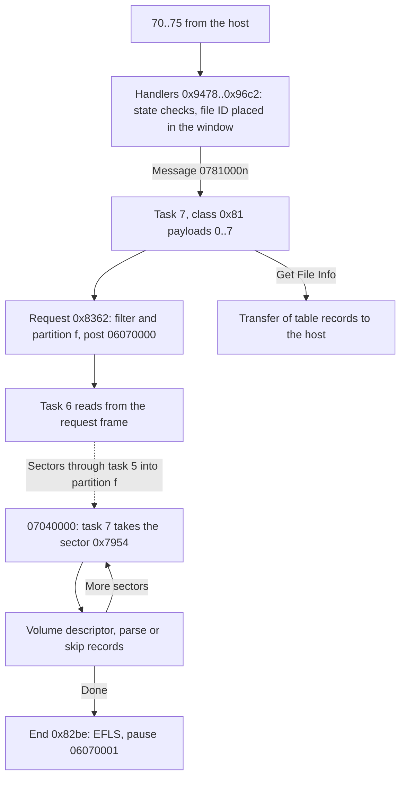

# File system

## What it does

Saturn discs keep their files in ISO 9660, the usual CD-ROM file system. The CD block can read it
by itself, so the Saturn can ask for a file by its number in a directory instead of by its position
on the disc.

- Directories. Change Directory and Read Directory read a directory from the disc into a table of
  up to 254 files, each with its position and length. The first request finds the root directory
  through the volume descriptor.
- File list. Get File Info sends table entries to the Saturn, and Get File System Scope tells it
  which part of the directory the table holds.
- Reading. Read File reads a file's sectors into a partition, and the Saturn takes them from there
  like any other sectors. Abort File ends a request early.
- The work runs in task 7, the task that also checks discs, and uses the same drive reads as
  everything else.

The sections below follow CDB105 by address.

## Overview

Commands `70..75` ask task 7 to find the root through the volume descriptor, to read a directory
into a table of file records, to send those records to the host and to read a file's sectors into a
partition, which the host then gets with `61..63`. Sega's CD library describes the same file system
from the host's side ([references](../references.md#sega-documentation)).



- Task 7 reads for the file system with disc state 1 (`0x0907adcb`), so its class 4 sector messages
  go to the file system and not to [disc authentication](disc-authentication.md).
- A request ends with `0x0200`, EFLS, at `0x0a00001e`, and a pause to task 6
  ([interrupt flags](host-commands.md#interrupt-flags)).
- Like every read, the file system's sectors pass only once an `E0` request has opened the delivery
  gate. Before that each sector disconnects CD device 0 and returns to the pool
  ([sector completion](sector-buffer.md#sector-completion)).

## Names

The command names follow Sega's CD library: `70` Change Directory, `71` Read Directory, `72` Get
File System Scope, `73` Get File Info, `74` Read File and `75` Abort File
([command map](../references.md#host-command-map)). A file ID numbers a directory's records from 0:
0 is the directory itself, 1 its parent and 2 the first file.

| Name | Address | Contents |
| --- | --- | --- |
| Command words | `0x0f000744` | CR1..CR4 of the last file system command |
| Sectors left | `0x0f00074c` | Sectors a read still expects |
| ID counter | `0x0f000750` | The file ID of the record a skip is at |
| Placed ID | `0x0f000754` | The file ID `file_id_window` (`0x7e36`) last placed |
| Window | `0x0f000758` | First file ID << 8 \| file count, 0 without files |
| Next record | `0x0f00075c`, `0x0f000764` | Frame of the sector that holds the record after the window, and its offset. Both 0 when the window holds the directory's last record |
| Root frame | `0x0f000760` | The root directory's frame, 0 until a volume descriptor was read |
| Root sectors | `0x0f000766` | The root directory's length in sectors |
| Table offset | `0x0f000768` | Where the parse writes its next record |
| Placement | `0x0f00076a` | The result of `file_id_window` for Read Directory |
| State | `0x0f00076b` | 0 no table, 1 reading, 2 ready, 4 aborting |
| Step | `0x0f00076c` | What task 7 reads, [below](#reading) |
| Record count | `0x0f00076d` | Records in the table during a parse |
| Index | `0x0f00076e` | The table index a command hands to task 7 |
| File number | `0x0f000770` | Filter file number for Read File |
| Filter mode | `0x0f000771` | Filter mode of the next request |
| Filter | `0x0f000772` | Filter f, which also names partition f |
| Table | `0x09074210` | 256 records of 12 bytes |
| Disc state | `0x0907adcb` | 1 while task 7 reads for the file system ([disc authentication](disc-authentication.md#names)) |

## Commands

Every handler keeps CR1..CR4 at `0x0f000744`. Filter f is the CR3 high byte and the file ID the
CR3 low byte with CR4. The CR1 low byte with CR2 is `74`'s sector offset.

| Command | Accepted | Message | Answer |
| --- | --- | --- | --- |
| `70` with ID `ffffff` | In any state but 4 | `07810000`, payload 0 | Cached status |
| `70` | State 2, the ID in the window and a directory | `07810001`, payload 1 | Cached status |
| `71` | State 2 | `07810002`, payload 2 | Cached status |
| `72` | State 2 | None | The window |
| `73` with one ID | State 2, the ID in the window, through the [data-command gate](host-commands.md#data-commands) | `07810004`, payload 4 | 6 words, data transfer request |
| `73` with `ffffff` | State 2, the window not empty | `07810005`, payload 5 | 6 words per file, data transfer request |
| `74` | State 2, the ID in the window, the offset below the file's sectors | `07810006`, payload 6 | Cached status |
| `75` | Any state | `07810007`, payload 7. None in state 4 | Cached status |

- State 4, an abort in progress, answers WAIT to every command but `75`. Otherwise a command that
  needs state 2 answers WAIT in state 1, while a read runs, and REJECT in state 0.
- A filter of 24 or more is rejected by `70`, `71` and `74`.
- `70`, `71` and `74` keep filter f at `0x0f000772` and set disc state 1 before they post.
- `72` answers the file count in the CR1 low byte and CR2, the first file ID in the CR3 low byte and
  CR4, and in the CR3 high byte 1 when the window holds the directory's last record. This is Sega's
  last directory record flag.
- `70` needs a directory: bit 7 of the record's attributes when any of bits 3..7 is set, otherwise
  bit 1. So an XA record whose attributes have none of those bits counts by its ISO 9660 flag.
- `74` stores the file's length in sectors, rounded up, and its index before it checks them. A
  rejected `74` leaves both.
- Read File keeps the state at 2, so the other commands are answered while it runs. Sega's library
  lets the host get the file's sectors before the read ends.

## The table and the window

The table holds 256 records: record 0 is the directory, record 1 its parent and records 2..255 up
to 254 files. The window names the files it holds: from the first file ID, count of them.

[`directory.py`](../../scripts/directory/directory.py) builds this table and window from an ISO
9660 image and runs `70..75` on them, and [`make.py`](../../scripts/directory/make.py) builds the
example images, `plain.iso` and `xa.iso`. The example files are named where they apply. From the
repository's top folder:

```
python scripts/directory/make.py
python scripts/directory/directory.py plain.iso scripts/directory/window.txt
python scripts/directory/directory.py plain.iso scripts/directory/interleaved.txt
python scripts/directory/directory.py xa.iso scripts/directory/xa-filter.txt
```

| Offset | Field |
| --- | --- |
| `+0` | Frame: the extent plus 150 |
| `+4` | Data length in bytes |
| `+8` | File unit size |
| `+9` | Interleave gap size |
| `+10` | File number, 0 without XA fields |
| `+11` | Attributes |

| Attribute bit | Meaning |
| --- | --- |
| 1 | The directory flag of the record's file flags |
| 3..7 | Bits 3..7 of the XA attributes' high byte: form 1, form 2, interleaved, CD-DA, directory |

- `73` sends these 12 bytes per record as 6 words, as Sega's file information.
- `file_id_window` (`0x7e36`) places a file ID against the window. IDs 0 and 1 give records 0
  and 1. An ID in the window gives its index, the ID less the first ID plus 2. Below the window it
  returns 1, at or past its end 2.
- After a read that reaches the directory's last record the rest of the table is cleared. A
  directory without files gives the window word 0, so `72` answers first file ID 0.

## Reading

Every read goes through the same request (`task7_file_request`, `0x8362`) under the sector lock:

- CD device 0 feeds filter f, filter f's true output feeds partition f and its false output is
  cleared, as Sega's library describes.
- Partition f's end is paired with device `0x8f`, and partition f is emptied into the pool
  ([partitions](sector-buffer.md#partitions)).
- The filter record gets the mode, the start frame, the sector count and the file number.
- Partition f notifies task 7 of each sector (notify bit 0), except for Read File (bit 1, a
  countdown of the sectors).
- Task 7 posts `06070000`, and task 6 reads from the request frame
  ([class 7 requests](drive.md#requests-from-task-7)).

On each sector notification task 7 takes the first slot of partition f. Its data starts at `+24` in
a mode 2 sector and at `+16` otherwise. The step decides what happens next:

| Step | Read |
| --- | --- |
| 1 | The volume descriptor |
| 2, 3 | The root, or the directory of Change Directory, parsed from each sector's start |
| 4 | The next sector of a directory |
| `0x14` | A directory parsed from the next record's offset in the first sector |
| `0x24` | Records skipped from the sector's start |
| `0x34` | Records skipped in the first sector, from its start or from the next record's offset |
| 5 | Read File |

### The volume descriptor and the root

- `70` with ID `ffffff` asks for the volume descriptor while no root frame is known. The request
  frame is 0, which task 6 reads as the frame at `0x09000214` plus 166, and the filter has mode 0,
  so every sector passes.
- The first sector must start with 01 `CD001`, a primary volume descriptor. Otherwise the request
  ends and the state stays 0, so there is no table.
- The root directory record at `+156` gives the root frame, its extent plus 150, and the root's
  sectors, its data length over 2048. Task 7 then reads the root.
- Once the root frame is known, `70` with `ffffff` reads the root straight away.

### Multi-session discs

Sega describes the last session's volume descriptor. The firmware reads the one at frame 166 plus
`0x09000214`, the second largest next-session start from the TOC's `B0` reports
([the TOC](drive.md#the-toc)).

- When the last session's lead-in has a `B0` report too, that frame is the last session's start, so
  the root comes from the last session.
- Without one it is the start of the session before the last, 0 on a disc of two sessions, so the
  root comes from the session before the last.
- Disc authentication scans the last session's first track either way
  ([first sectors](disc-authentication.md#first-sectors)).

### Parsing a directory

- A directory read has filter mode `0x40`, the frame range, over the directory's sectors. The root
  read and Change Directory write the table from record 0, with the window at first ID 2.
- Change Directory to ID 0, the directory itself, reads nothing. It only writes EFLS, the table
  and the window stay as they were, and disc state 1 stays set.
- Records are parsed until a record length of 0 or the end of the sector. Each gives a table
  record: the big-endian extent and data length, the unit size and gap, then the XA fields.
- A record has XA fields when bytes remain after its identifier and the identifier's pad byte. The
  file number is at `+8` of that area and the attributes' high byte at `+4`.
- After each sector the slot is released to the pool. When partition f already holds the next
  sector, task 7 parses it in the same run, otherwise it waits.
- On the directory's last sector the file count is the records less 2, and nothing is left to read.
- At 256 records the table is full. The frame and offset of the next record are kept, unless it
  would be past the directory's last sector.

### Read Directory

Task 7 places `71`'s file ID against the window.

| Where | What happens |
| --- | --- |
| In the window, index 2 or below | Only EFLS |
| In the window, further on | The records from that index move to index 2 and the ID becomes the first ID. With nothing left to read the rest of the table is cleared and only EFLS follows. Otherwise the read goes on from the next record's offset with filter mode `0x40`, step `0x14` |
| Before the window | The whole directory is read again from its first frame, counting file IDs from 0 and skipping records up to the ID |
| Past the window | With nothing left to read only EFLS. Otherwise the read goes on from the next record, counting on from the window's end |

- A skip that reaches the ID parses from that record with the ID as the new first ID. One that
  reaches the directory's end ends the request and leaves the table as it was.
- The paths that only write EFLS leave disc state 1 set.
- [`window.txt`](../../scripts/directory/window.txt) moves the window through a directory of 300
  files by each row of the table.

### Read File

- The start frame is the file's frame plus the offset. For an interleaved file, unit size u and gap
  g, the offset counts o / u units of u + g sectors plus o mod u sectors.
- The filter has mode `0x41`, the frame range and the file number, over the file's sectors less the
  offset. The file number is the record's.
- The last sector of the count posts `07040001`, and the request ends with the sectors in partition
  f, where the host gets them with `61..63` ([sector commands](data-transfer.md#sector-commands)).
- For an interleaved file the frame range is only as long as the file's sectors left, without the
  gaps between them, so it ends before the file does. On a mode 1 disc the gap sectors in the range
  pass the filter and the file's last sectors are not read.
  [`interleaved.txt`](../../scripts/directory/interleaved.txt) shows the range on a file in units
  of 2 with gaps of 1.

### Get File Info

- Task 7 takes the transfer lock `03070000` and starts a type 0 transfer of the records from the
  table ([transfer start](data-transfer.md#transfer-start)): one record for payload 4, the window's
  files from record 2 for payload 5.
- `06` ends the transfer and posts `07030001`. Task 7 then frees the lock. Its class 3 handler
  compares other payloads with the halfword at `0x7a08`, which is 0, so only payload 1 frees it.

### Ending and aborting

- The end (`task7_file_end`, `0x82be`) runs under the sector lock. Except after Read File it clears
  device `0x8f`'s connection and empties partition f. It clears partition f's notify bits.
- It sets disc state 0, posts `06070001`, a pause, to task 6 and writes EFLS.
- `75` with nothing in progress only writes EFLS. Otherwise task 7 sets state 4 and ends the
  request. After Read File the state is 2 again and the sectors read so far stay in partition f.
  After any other step the state is 0, as Sega describes: the table must be read again.

## Bugs and oddities

- Read Directory past the window does not set the filter mode. After Read File the mode is still
  `0x41` with the file's number, so on an XA disc the directory's sectors, file number 0, fail the
  filter when that file's number was not 0. The read never ends until `75`, or a `70` with ID
  `ffffff`, whose root request takes its place.
  [`xa-filter.txt`](../../scripts/directory/xa-filter.txt) runs this on an XA image.
- A directory sector that task 5 completes while task 7 parses the previous one is parsed in the
  same run, but its notification stays in the mailbox. Task 7 wakes for it with partition f empty,
  `partition_slot` (`0x506c`) returns slot `ff`, and the parse would read a sector at `0x09092900`,
  beyond the 512 KB buffer. Task 7's
  [sector check](disc-authentication.md#a-sector-message-left-behind) has the same race.
- Read File of an interleaved file ends its frame range before the file's end, as
  [above](#read-file).
- On a disc of more sessions whose last session has no `B0` report, the root request reads an
  earlier session's volume descriptor while disc authentication checks the last session
  ([multi-session discs](#multi-session-discs)).

## Unknown

- Whether the sector race happens with real drive timing.
- Whether the lead-in of a disc's last session has a `B0` report, which decides the session whose
  volume descriptor the root request reads.
