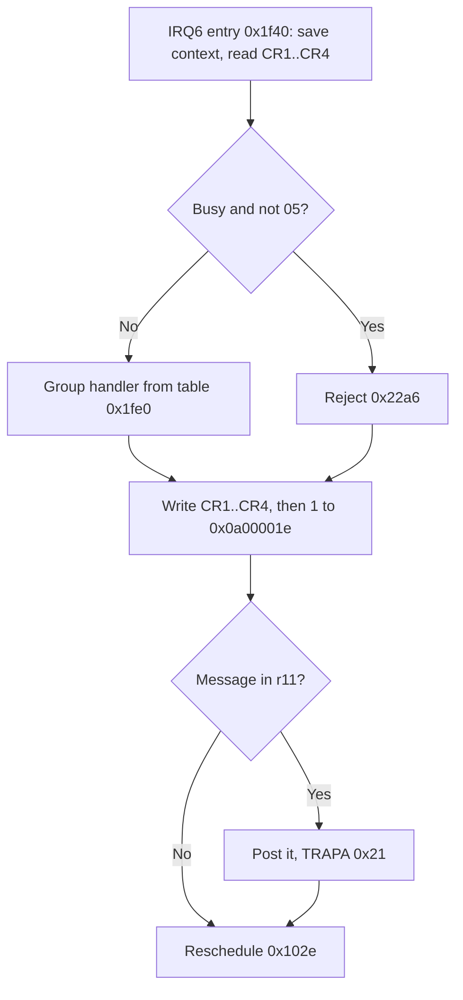

# Host commands

## What it does

The Saturn's main processors cannot reach the CD block's memory. They control it through four
16-bit command registers: the Saturn writes a command into them, and the CD block writes its answer
back into the same registers.

- Arrival. Writing the last register interrupts the SH-1. The handler reads the command and runs
  the routine for its group of commands.
- Answer. Every answer starts with a status byte: the drive's state, with one flag for wait, a
  command that cannot run now, and one for a data transfer that is ready. Commands the firmware
  does not know are rejected.
- Longer work. A command that takes time, such as a play request or a disc check, is answered at
  once and handed to a task. The Saturn then asks again for the outcome.
- Events. The firmware also sets bits in an interrupt flag register that the Saturn reads, for
  events such as an answered command, a new sector or a full buffer.

The sections below follow CDB105 by address.

## Overview

Each command arrives through IRQ6. The handler reads four 16-bit command registers, runs the
handler for the command's group and writes a four-word response. A command that needs more work
also posts a message to a task. Bulk data uses a separate transfer register
([references](../references.md#sega-documentation)), which DMA channel 1 serves on the CD block side
([data transfer](data-transfer.md)).

The handler always ends at `task_requeue_current` (`0x102e`). Without a message the interrupted task
is the one selected again. With one, the woken task runs first when it has the higher priority
([Scheduling](kernel.md#scheduling)).

## Names

| Name | Address | Contents |
| --- | --- | --- |
| CR1..CR4 | `0x0a000010`, `0x0a000012`, `0x0a000014`, `0x0a000016` | Command in, response out |
| r1, r2 | | CR1:CR2 and CR3:CR4 as read by the handler |
| Busy flag | `0x0f0007b0` | Bit 0 set while an `E0` or `E2` request runs |
| Transfer byte | `0x0f00025b` | 1 while a data transfer to or from the host is open |
| Request positions | `0x0f000264`, `0x0f000268` | Start and end from `10`, the position from `11` |
| Drive flags | `0x0f0002a6`, `0x0f0002a7` | The busy, reply, read-error and reading bits ([drive flags](drive.md#flags)) |
| Card bit | Bit 7 of the card flags `0x0f000892` | Set: groups 9 and A run, `E0` is rejected, task 9 calls card extension entries ([MPEG flags](#mpeg-flags)) |
| Hardware flag | `0x0f00027d` | Set by the startup checks. Bit 1, MPEG card present, enables the MPEG commands, `E0` subcode 1 and `E2`. Bit 7 marks a failed RAM or interface check |
| Hardware information | `0x0f0002fc..0x0f0002ff` | Returned by `01`: byte `0x0f0002fc`, which the ROM leaves 0, MPEG version `0x0f0002fd`, drive information `0x0f0002fe`, CD block revision `0x0f0002ff` |
| Request message | `0x09075384` | The last accepted `E0` or `E2` message |
| Disc result | `0x0f000786` | Word returned by `E1` subcode 0 |
| Card status | `0x0f0007ac`, `0x0f0007ae` | Words returned by `E1` subcode 1 |

The Saturn reaches the same interface registers on the A-bus, from `0x25890000`
([libyaul's memory map][LIBYAUL-MAP] and [register offsets][LIBYAUL-CDB]). [Yabause][YAB-YGR] pairs
the two sides this way.

| Register | Saturn address | SH-1 address |
| --- | --- | --- |
| CR1..CR4 | `0x25890018`, `0x2589001c`, `0x25890020`, `0x25890024` | `0x0a000010`, `0x0a000012`, `0x0a000014`, `0x0a000016` |
| Interrupt flags, HIRQREQ | `0x25890008` | `0x0a00001e` ([interrupt flags](#interrupt-flags)) |
| Data transfer | `0x25818000` | `0x0a000000` ([data transfer](data-transfer.md)) |

- Sega's library hands games `0x25818000` for sector data (`CDC_GetDataPtr`) and reads the words
  of the TOC at `0x25898000`. [Yabause's host emulation][YAB-CS2] takes sector data as longwords
  at the first and the TOC, file information and subcode words at the second. libyaul defines the
  register at `0x25890000`.
- The three addresses differ only in address bits 15 and 19. The CD block's connector carries
  `AA2` to `AA5` and `AA12` to `AA14` and no higher address line
  ([board](../board.md#main-board-connector)), so the board cannot tell them apart.

## IRQ6 entry

- IRQ6 is vector 70 at VBR+`0x118`, priority `IPRB[7:4]` = 6, low-level sensed (ICR bit 1
  clear). The idle SR `0x20` accepts it ([SH7034 notes](../sh7034.md#irq6)).
- The interface chip asserts IRQ6 when the host writes CR4. It sets bit 0 of `0x0a000004`, the
  command flag, which bit 0 of `0x0a000008` enables ([board](../board.md#interrupts)).
- Entry `irq6_command_entry` (`0x1f40`) saves r0..r13, PR, GBR, MACH and MACL below the PC/SR
  pushed by the CPU, stores the 80-byte frame pointer in the current task record and switches SP to
  `0x0f0008f8`. r14 and VBR stay live. Interrupting the idle task puts the frame at `0x0f000fb0`.
- It writes 0 to `0x0a000004`, which clears the command flag and releases IRQ6, and reads CR4, CR3,
  CR2 and CR1 in that order. The command is the high byte of r1.
- While the busy flag is set, only command `05` is accepted.

## Dispatch

The command's high nibble indexes 16 group handlers at `0x1fe0`.

| Group | Handler | Accepts |
| --- | --- | --- |
| 0 | `command_group_zero` (`0x2020`) | `00..06`, through a seven-entry table at `0x2034` |
| 1 | `command_group_one` (`0x2050`) | `10..12`, through a three-entry table at `command_group_one_table` (`0x2068`, [drive requests](#drive-requests)) |
| 2 | `command_group_two` (`0x2074`) | `20` only, through the table at `command_group_two_table` (`0x208c`, [data commands](#data-commands)) |
| 3 | `command_group_three` (`0x2090`) | `30..32`, through a three-entry table at `command_group_three_table` (`0x20a8`, [commands 30, 31 and 32](#commands-30-31-and-32)) |
| 4 | `command_group_four` (`0x20b4`) | `40..48` through a nine-entry table at `command_group_four_table` (`0x20d0`, [buffer commands](#buffer-commands)) |
| 5 | `command_group_five` (`0x20f4`) | `50..56` through a seven-entry table at `command_group_five_table` (`0x210c`, [buffer commands](#buffer-commands)) |
| 6 | `command_group_six` (`0x2128`) | `60..67` through an eight-entry table at `command_group_six_table` (`0x2140`): `60` and `61..64` ([sector commands](data-transfer.md#sector-commands)), `65` and `66` at `command_65_66_copy_move` (`0x6efc`), `67` at `command_67_copy_error` (`0x6f38`, [buffer commands](#buffer-commands)). `61`, `63` and `64` use the [data-command gate](#data-commands) |
| 7 | `command_group_seven` (`0x2160`) | `70..75` through a six-entry table at `command_group_seven_table` (`0x2178`): `70` at `command_70_change_directory` (`0x9478`), `71` at `command_71_read_directory` (`0x9524`), `72` at `command_72_get_file_system_scope` (`0x9566`), `73` through the [data-command gate](#data-commands), `74` at `command_74_read_file` (`0x9618`), `75` at `command_75_abort_file` (`0x96c2`, [file system](file-system.md)) |
| 8, B, C, D | `command_reserved_and_ff` (`0x2294`) | Nothing, the shared reject path |
| 9 | `command_group_9` (`0x2190`) | [MPEG commands](#groups-9-and-a) |
| A | `command_group_a` (`0x2200`) | [MPEG commands](#groups-9-and-a) |
| E | `command_group_e` (`0x2270`) | `E0..E2`, through a three-entry table at `0x2288` ([Group E](#group-e)) |
| F | `command_group_f` (`0x2298`) | [`ff`](#commands-00-ff-and-rejected-commands) |

The names follow the Sega CD library function that issues each command: `00` Get CD Status, `01` Get
Hardware Info, `02` Get TOC, `03` Get Session Info, `04` Initialize CD Block, `05` Open Tray, `06`
End Data Transfer, `10` CD Play, `11` CD Seek, `12` CD Scan, `20` Get Subcode, `30` Set CD Device
Connection, `31` Get CD Device Connection, `32` Get Last Buffer, `40` Set Filter Range, `41` Get
Filter Range, `42` Set Filter Subheader Condition, `43` Get Filter Subheader Condition, `44` Set
Filter Mode, `45` Get Filter Mode, `46` Set Filter Connection, `47` Get Filter Connection, `48`
Reset Selector, `50` Get Buffer Size, `51` Get Sector Number, `52` Calculate Actual Size, `53` Get
Actual Size, `54` Get Sector Info, `55` Execute FAD Search, `56` Get FAD Search Results, `60` Set
Sector Length, `61` Get Sector Data, `62` Delete Sector Data, `63` Get and Delete Sector Data, `64`
Put Sector Data, `65` Copy Sector Data, `66` Move Sector Data, `67` Get Copy Error, `70` Change
Directory, `71` Read Directory, `72` Get File System Scope, `73` Get File Info, `74` Read File and
`75` Abort File. FAD in the names of `55` and `56` is Sega's frame address, a sector's position on
the disc. The MPEG commands follow Sega's MPEG part: `90` Get MPEG Status, `91` Get MPEG
Interrupt, `92` Set MPEG Interrupt Mask, `93` Initialize MPEG, `94` Set MPEG Mode, `95` MPEG Play,
`96` Set Decoding Method, `97` Send Decode Sync, `98` Get MPEG Timecode, `99` Get MPEG Timestamp,
`9A` Set MPEG Connection, `9B` Get MPEG Connection, `9C` Change MPEG Connection, `9D` Set MPEG
Stream, `9E` Get MPEG Stream, `9F` Get Picture Size, `A0` Display Picture, `A1` Set Window, `A2` Set
Border Color, `A3` Set Fade, `A4` Set Video Effects, `A5` Get Image and `A6` Set Image Window.
Sega's MPEG part names no function for `AE` Get Card Register Copy or `AF` Card Register Access.
SBL 6.01's CD communication library sends them from `CDC_MpGetLsi` and `CDC_MpSetLsi`. Group E
has no library function: `E0` Authenticate Device, `E1` Get Authentication Result and `E2` Get
MPEG ROM ([command map](../references.md#host-command-map)).

## Responses

- The handler's response in r12 and r13 goes to CR1..CR4 in order, followed by 1 at `0x0a00001e`.
  The handler makes ten word accesses in total and never polls.
- The interface sets bit 1 of `0x0a000004` when the host reads the fourth response word, and the
  entry's write of 0 clears it. Task 6's periodic status writes CR1..CR4 only while it is set, so
  it does not overwrite a response the host has not read
  ([periodic status](drive.md#periodic-status)).

The high byte of CR1 is the status byte. Outside groups 9 and A, every command handler but `ff` and
`20` type 1 ends in one of these entries. The MPEG commands answer through their own responses
([`90`, `91` and `92`](#90-91-and-92)).

| Entry | Status byte | Used by |
| --- | --- | --- |
| `response_status_byte` (`0x91a8`) | The status below | `01`, `03`, `06`, `31`, `32`, `41`, `43`, `45`, `47`, `50`, `51`, `53`, `54`, `56`, `67`, `72`, `E1` |
| `response_transfer_request` (`0x91a4`) | The status with bit 6 set, data transfer request | `02`, `20` type 0, `73`, `61`, `63` and `64` after `response_cached_keep_message` (`0x91fe`) |
| `command_00_status` (`0x91f0`) | The cached response unchanged | `00` |
| `response_cached_keep_message` (`0x91fe`) | The cached response, keeping the message in r11 | `30`, `40`, `42`, `44`, `46`, `48`, `52`, `55`, `60`, `62`, `65`, `66`, `70`, `71`, `74`, `75`, `E0`, `E2` |
| `response_mark_pending` (`0x91f6`) | 0, BUSY, after setting the busy bit | `04`, `05`, `10`, `11`, `12` |
| `response_wait` (`0x91ec`) | The status with bit 7 set, WAIT | `02` and `03` before the drive reports a status, data commands while a transfer is open, `61..64` whose [request](data-transfer.md#request-checks) cannot be served yet, the [buffer commands](#buffer-commands) whose request or task is not ready, the [file system](file-system.md#commands) commands while it reads or aborts |
| `response_reject` (`0x91e8`) | `ff`, REJECT | Rejected commands |

- The status bits follow Sega's response format: `ff` REJECT, bit 7 WAIT, bit 6 the data transfer
  request, bit 5 the periodic response, and the low bits the drive status, 0 BUSY to 10 FATAL
  ([references](../references.md#sega-documentation)). A command answered with WAIT is not carried
  out.
- `ff` answers raw longwords with no status byte ([`ff`](#commands-00-ff-and-rejected-commands)).
  `20` type 1 builds its status from `host_status_byte` (`0x9170`), by the same rule as
  `response_status_byte` ([R-W subcode](subcode.md#the-host)).

## Interrupt flags

The firmware signals events to the host by writing a bit mask to `0x0a00001e`. The bits are those
of Sega's interrupt factor register HIRQREQ, and each is written where Sega's description of the
bit puts it ([references](../references.md#sega-documentation)).

| Value | Sega name | Written by |
| --- | --- | --- |
| `0x0001` | CMOK | Every command response ([responses](#responses)) |
| `0x0002` | DRDY | The transfer start, once a transfer is armed ([data transfer](data-transfer.md)) |
| `0x0004` | CSCT | Sector completion, for every sector ([sector completion](sector-buffer.md#sector-completion)) |
| `0x0008` | BFUL | 200 buffered sectors ([notifications](sector-buffer.md#notifications)) |
| `0x0010` | PEND | The pause after a play range ends ([standby timer](drive.md#standby-timer)) |
| `0x0020` | DCHG | The disc-gone reset when the tray opens ([report handling](drive.md#report-handling)) |
| `0x0040` | ESEL | Task 5, after `30` changes the device connection ([device connection](sector-reads.md#device-connection)), `60` ([set sector length](data-transfer.md#set-sector-length)), and task 4 after `40`, `42`, `44`, `46`, `48`, `52` and `55` ([task 4](sector-buffer.md#task-4)) |
| `0x0080` | EHST | Task 12, after `62` and at the end of each sector transfer, and for a put without free slots ([sector commands](data-transfer.md#sector-commands)) |
| `0x0100` | ECPY | Task 13 at the end of `65` and `66` ([copy and move](sector-buffer.md#copy-and-move)) |
| `0x0200` | EFLS | The end of every file system request ([file system](file-system.md#ending-and-aborting)), the end of an `E0` disc request, and disc initialization `disc_state_restart` (`0x7abc`), which also follows a disc-gone reset ([completion](disc-authentication.md#completion)) |
| `0x0400` | SCDQ | Every periodic status ([periodic status](drive.md#periodic-status)) |
| `0x0800` | MPED | The end of an `E0` card request or `E2` ([MPEG card requests](extensions.md#mpeg-card-requests)), and the card's activation and stop by `93` |
| `0x1000` | MPCM | `97`, unless it only answers (the movie mode with VSYNC timing) or gives the wait response ([`97`](#97-send-decode-sync)), and each interval the capture B handler sees while the card bit is set ([capture B](extensions.md#capture-b)) |
| `0x2000` | MPST | An MPEG interrupt flag (`0x0f000848`) set while its mask bit (`0x0f00084c`) is set ([card interrupts](extensions.md#card-interrupts)) |
| `0x0be1` | CMOK, DCHG, ESEL, EHST, ECPY, EFLS, MPED | Task 14 at startup ([task 14](structure.md#task-14)) |
| `0x0bc1` | The same without DCHG | The restart of `04` ([requests from the host](drive.md#requests-from-the-host)) |

- Sega describes EFLS as the end of a file system operation. The firmware also sets it when an
  `E0` disc request ends and at disc initialization.
- The firmware only sets these bits. The host can only clear them, by writing 0 to a bit of
  HIRQREQ ([references](../references.md#sega-documentation)).
- A DRDY from an earlier transfer therefore stays set. A host that waits for DRDY after a data
  command must clear it before sending the command. Otherwise the wait passes before the new
  transfer is armed, and the host reads the data port before the DMA channel has filled it
  ([transfer start](data-transfer.md#transfer-start)).

- `response_status_byte` (`0x91a8`) takes the status as 0 while a drive command waits for its reply
  (the busy or reply bit), 9 after a read error (the read-error bit), and otherwise byte 0 of the
  status buffer written last, the host status ([status bytes](drive.md#status-bytes)).
- The cached response (`response_cached`, `0x9200`) is the status buffer written last with the same
  status rules, or `00ffffff ffffffff` while the busy flag is set. While a read is marked (the
  reading bit) or in drive state 10, its frame is the last delivered frame `0x0f0002ac`.
- A drive request from `response_mark_pending` (`0x91f6`) is therefore answered with status 0. The
  drive task's own status follows with the drive's reports ([periodic
  status](drive.md#periodic-status)).

## Commands `00`, `ff` and rejected commands

These are answered inside the handler and post nothing. The interrupted task then continues with
every general and special register, PC and SR restored.

- `00` returns cached status longwords, applying state flags and optional low 24-bit fields.
- `ff` takes a subcode from r1 bits 23..16. Subcode 0 echoes r2 twice, 1 returns the longwords at
  `0x0f000000` and `0x0f000004`, the two startup diagnostic words and the ROM sum ([reset and
  startup](structure.md#reset-and-startup)), and others return zero. No status byte replaces CR1's
  high byte.
- Rejected commands return status `ff` with cached or sentinel remaining fields.

## Commands `01` and `03`

Both are answered inside the handler and post nothing.

- `01` (`command_01_hardware_info`, `0x9274`) returns CR2 = hardware flag `0x0f00027d` << 8 | 1 and
  CR3, CR4 = the longword at `0x0f0002fc`. These are the fields of Sega's hardware information:
  hardware flag, CD block version, then MPEG version, drive information and CD block revision in
  bytes `0x0f0002fd..ff` ([references](../references.md#sega-documentation)).
- Task 6's setup clears `0x0f0002fc`, and no ROM code writes it afterwards, so CR3's high byte is 0
  unless a loaded extension writes it.
- The MPEG version is byte `+0` of a loaded card extension, and the CD block revision is byte
  `+0x44` of a loaded disc extension ([extensions](extensions.md#names)). The drive information
  holds byte 7 of the last lead-in report, `ff` after setup ([the TOC](drive.md#the-toc)).
- The 1 in CR2 is the CD block version, the literal at `0x9290`: 0 in CDB104, 2 in CDB106 and
  YGR022 ([version number](../firmware-revisions.md#version-number)).
- `03` (`command_03_session_info`, `0x92ac`) takes a session number from the CR1 low byte. While
  the host status is 0 it answers with the wait status. Otherwise CR2 is 0 and CR3, CR4 are one
  longword:

| Session | CR3 and CR4 |
| --- | --- |
| 0 | TOC entry 0 (`0x09000064`). Without a `B0` report, the number of sessions in bits 31..24 over the lead-out frame. After one, as on a disc of more than one session, the frame from the last `B0` report's bytes 8..10 with bits 31..24 clear, so the count reads 0 ([the TOC](drive.md#the-toc)) |
| 1 up to the session count (byte `0x09000000`) | The session's first track (byte `0x09000000 + n`) in bits 31..24 over that track's start frame minus 150. A missing track entry gives bits 23..0 of `0x09000214` instead, without the subtraction |
| Above the count, or a count of `ff` | `ffffffff` |

## Command `05`

`05`, Open Tray, hands the request to task 6.

- `command_05_open_tray` (`0x934a`) builds r11 = `0x06810002` (task 6, class `0x81`, payload 2),
  sets the busy bit (mask `0x08`) and builds the cached response. The handler posts the message at
  `command_post_message` (`0x1fce`).
- The reschedule at `task_requeue_current` (`0x102e`) requeues the interrupted task 14 in state 4
  at head `0x0f000204` and selects task 6. Task 14 keeps its full frame for later.
- Task 6 consumes the message and continues at `task6_message_dispatch` (`0x2798`) with r11
  `0x06810002`, SP `0x0f000a90`, SR `0x21`, PR `0x1054` and GBR `0x0f00025c`.
- From there task 6 decodes class `0x81` payload 2. After reset, the drive state is zero, which
  routes through `0x2812` toward `task6_state_0` (`0x2ad8`), where task 6 waits again ([Task
  6](structure.md#task-6-and-task-14)). In drive state 18 it only clears the busy bit. In other
  drive states it stages drive command `0c` ([Drive](drive.md#requests-from-the-host)).

## Drive requests

The commands that move the drive post a class `0x81` request to task 6, the drive task. They share
the posting path at `response_mark_pending` (`0x91f6`), which sets the busy bit before
building the response, so the status reports code 0 until task 6 has answered. The payloads are
listed under [requests from the host](drive.md#requests-from-the-host). In drive state 0, before the
drive's first report, task 6 drops them, except payload 0. While the TOC is read it answers them
and keeps the last for the end of the first seek, except Open Tray and payload 0, which act at once
([tray and disc states](drive.md#tray-and-disc-states)).

| Command | Handler | Posts |
| --- | --- | --- |
| `04` | `command_04_initialize` (`0x9310`) | Payload 0 when bit 0 of the CR1 low byte is set and bit 7 clear, otherwise payload 8 |
| `05` | `command_05_open_tray` (`0x934a`) | Payload 2 |
| `10` | `command_10_play` (`0x9350`) | Payload 3, 4 or 5 by the positions |
| `11` | `command_11_seek` (`0x93f0`) | Payload 6, 7, 8 or 9 by the position |
| `12` | `command_12_scan` (`0x941a`) | Payload 10 or 11 by the CR1 low byte (0 or 1). Larger values are rejected |

- `04` stores the CR1 low byte at `0x0f00025c` unless its bit 7 is set. The CR2 word goes to the
  standby word `0x0f000260` unless it is `ffff`, and the two CR4 bytes go to `0x0f000262` and
  `0x0f000263` unless they are `ff`. Payload 0, the reset request, clears these again and
  [restarts the other tasks](kernel.md#restart).
- `10` stores the CR3 high byte as the play mode `0x0f00025d`. The start position is the CR1 low
  byte and CR2, the end position the CR3 low byte and CR4. Bit 23 of a position marks a frame
  address, otherwise it holds a track and index.
- `10` with both positions `ffffff` posts payload 5, the current range. A single `ffffff` takes that
  position from the current range at `0x0f000298` and `0x0f00029c`: bits 23..0 of a track range, a
  frame start with bit 23 set, and `00ffffff` for a frame end, which keeps the end. A zero start or
  end stays 0.
- Bit 23 in either position posts payload 4, otherwise payload 3 with bits 23..16 of both cleared.
  Both 0 post payload 4, which plays from frame 150 to the lead-out. Two nonzero positions of
  different kinds are rejected. The positions go to `0x0f000264` and `0x0f000268`.
- `11` with position `ffffff` posts payload 8 and with 0 payload 9. A frame position (bit 23 set)
  posts payload 7 and a track position payload 6, with the position at `0x0f000264` and bit 23
  cleared.

## Commands 30, 31 and 32

These set and read the CD device connection, which feeds the decoder's sectors into a filter
([connections](sector-buffer.md#connections)).

- `30` (`command_30_set_connection`, `0x4d68`) takes a filter from the CR3 high byte. `ff` or a
  filter below 24 goes to `0x0f000344` and to task 5 as `05810030`, which connects CD device 0 with
  that filter or, for `ff`, disconnects it ([sector reads](sector-reads.md#device-connection)). The
  handler posts the message itself and answers with the cached response through
  `response_cached_keep_message` (`0x91fe`). Other filters are rejected.
- `31` (`command_31_get_connection`, `0x4d8e`) returns the filter connected to CD device 0
  (`0x0f000690`) and `32` (`command_32_last_buffer`, `0x4d96`) the partition the last completed
  sector reached (`0x0f000323`), each in the CR3 high byte with the status from
  `response_status_byte` (`0x91a8`). The other bytes are 0, and `ff` means none.
- While the delivery gate is closed, sector completion disconnects CD device 0, so `31` then
  returns `ff` ([sector completion](sector-buffer.md#sector-completion)).
- `33..3f` are rejected.

## Buffer commands

Groups 4 and 5 and `65..67` work on the sector buffer's filters, partitions and sectors. What each
one does is under [settings](sector-buffer.md#settings),
[buffer information](sector-buffer.md#buffer-information) and
[copy and move](sector-buffer.md#copy-and-move).

- `41`, `43`, `45`, `47`, `50`, `51`, `53`, `54`, `56` and `67` answer inside the handler with the
  status from `response_status_byte` (`0x91a8`) and post nothing.
- `40`, `42`, `44`, `46`, `48`, `52` and `55` hand their request to task 4 through
  `buffer_command_post` (`0x76d4`), which posts `048100cc` and answers with the cached response
  through `response_cached_keep_message` (`0x91fe`).
- `65` and `66` hand theirs to task 13 at `copy_move_request` (`0x6f5a`), which posts `0d8100cc`
  the same way.
- A request the task has not taken yet makes the next one wait. A filter or partition of 24 or more
  rejects.
- Group 4's table ends at `48` and group 5's at `56`, so `49..4f` and `57..5f` are rejected. No
  branch reaches the second `jmp @r4` at `0x20ca`, after group 4's reject.

## Data commands

Commands that move data to or from the host pass through one gate. A transfer stays open until the
host ends it with `06`, and meanwhile the gate answers every data command with the wait status.

| Command | Entry | Handler |
| --- | --- | --- |
| `02` | `command_data_entries` (`0x22d6`) | `command_02_toc` (`0x9292`): the TOC |
| `20` | `0x22dc` | `command_20_subcode` (`0x9430`): the subcode |
| `61`, `63` | `0x22e2`, `0x22e8` | `command_61_63_get_sector_data` (`0x689c`) |
| `64` | `0x22ee` | `command_64_put_sector_data` (`0x68d0`) |
| `73` | `0x22f4` | `command_73_get_file_info` (`0x95b8`) |

- Each entry passes its handler in r4 to the gate at `command_data_gate` (`0x22fa`). While the
  transfer byte `0x0f00025b` is set, the gate answers through `response_wait` (`0x91ec`) and posts
  nothing. Otherwise it calls the handler.
- A response with status bit 7 clear and bit 6 set opens a transfer: the gate sets the transfer
  byte to 1.
- `02` answers with the wait status while the host status is 0. Otherwise it posts `0681000d`
  (payload 13) and answers with the TOC size in words, `0xcc`, in CR1's low byte and CR2, and the
  data transfer request.
- `20` with type 0 (CR1 low byte) posts `0681000c` (payload 12) and answers with 5 words in CR1's
  low byte and CR2 and the data transfer request. Type 1 continues at `command_20_rw` (`0x6354`):
  without a decoded R-W pack it answers WAIT, otherwise 12 words, the data transfer request and the
  subcode flags in CR4, and task 2 sends the pack ([subcode](subcode.md#the-host)). Other types are
  rejected.
- `73` answers 6 words per file with the data transfer request. Task 7 takes the transfer lock
  `03070000` and sends the file records ([Get File Info](file-system.md#get-file-info)).
- Task 6 takes lock `03060000`, the transfer lock, and hands the address and word count to the
  transfer start at `transfer_start` (`0x23ba`, [requests from the
  host](drive.md#requests-from-the-host)), which sends them on DMA channel 1. It releases the lock
  when it receives class 3 payload 1.
- `06` (`command_06_end_transfer`, `0x22cc`) clears the transfer byte and continues at
  `transfer_end` (`0x2568`), which stops the channel, answers the number of words transferred and
  posts class 3 payload 1 to the transfer's owner ([ending a
  transfer](data-transfer.md#ending-a-transfer)).
- The [restart](kernel.md#restart) of `04` also clears the transfer byte and frees the transfer
  lock.

## Group E

`E0` starts a disc or MPEG card request, `E1` reads its result and `E2` runs expansion entry 86. On
the known cards that entry copies the card ROM into the sector buffer
([Get MPEG ROM](extensions.md#get-mpeg-rom)). The subcode is the CR2 low byte.

| Command | Handler | Subcodes | When accepted |
| --- | --- | --- | --- |
| `E0` | `command_e0_authenticate` (`0xc2b6`) | 0 disc, 1 MPEG card | Message to task 7 or task 9, busy flag set |
| `E1` | `command_e1_auth_result` (`0xc39a`) | 0 disc, 1 MPEG card | Status words, no message |
| `E2` | `command_e2_mpeg_rom` (`0xc334`) | None | Message to task 9, busy flag set |

### `E0`

- Any subcode is rejected while the card bit is set.
- Subcode 0 stores r1 and r2 at `0x0907adb0` and `0x0907adb4`, then requires a partition (CR3 high
  byte) of at most 23. It sets the disc state `0x0907adcb` to 2 and posts `07810008` (task 7, class
  `0x81`, payload 8). The rest is in [disc authentication](disc-authentication.md).
- Subcode 1 requires bit 1 of the hardware flag. It sets request byte `0x0907538a` to 1 and posts
  `09810002` (task 9, class `0x81`, payload 2) ([MPEG card requests](extensions.md#mpeg-card-requests)).

### `E1`

- `E1` posts nothing and leaves the busy flag unchanged. The response is CR1 = status byte << 8
  (from `response_status_byte`, `0x91a8`) and CR3 = 0.
- Subcode 0 returns the disc result word in CR2 and 0 in CR4. Its low byte `0x0f000787` is the disc
  authentication result.
- Subcode 1 is rejected while the card bit is set. Otherwise it returns the two card status words
  in CR2 and CR4.

### `E2`

- `E2` requires bit 1 of the hardware flag, a nonzero MPEG version `0x0f0002fd` (set only by a
  successful expansion load) and a clear card bit.
- The filter (CR3 high byte) must be at most 23, the offset (r1 bits 23..0) at most `0x7ff` and
  offset plus count (CR4) at most `0x800`. Offset and count are in 2048-byte pages, and Get MPEG
  ROM files each page through that filter.
- It stores the offset at `0x0907538c`, offset plus count at `0x09075390` and the filter at
  `0x09075398`, sets request byte `0x0907538a` to 2 and posts `09810004` (task 9, class `0x81`,
  payload 4).
- When task 9 writes MPED, `E1` subcode 1 returns card status byte 3 and the number of pages
  filed, or status byte 2 when the free pool ran out first. The host gets the pages with `61` from
  the partition the filter sends them to ([Get MPEG ROM](extensions.md#get-mpeg-rom)).

### Accepting and rejecting

- An accepted `E0` or `E2` stores its message as the request message, builds the cached response
  through `response_cached_keep_message` (`0x91fe`), sets the busy flag and returns the message for
  `TRAPA 0x21`. The task that completes the request clears the busy flag.
- Rejections use the reject response and post nothing. `E3..EF` are rejected.
- After reset, `E0` subcode 0 runs to completion with result 0, `E1` returns zero status and result
  words, and `E2` is rejected because no expansion is loaded.

## Groups 9 and A

These are the MPEG commands. Every one of them except `93`, `AE` and `AF` runs through the loaded
card extension's table, as jhl (James Laird-Wah) reported
([references](../references.md#historical-reports)). The known cards fill 13 of those entries from
the ROM table, so those commands run ROM routines ([MPEG card
commands](../mpeg-card/commands.md#routing)). The ROM table has handlers for nine more, which the
known cards replace with their own ([the handlers the cards
replace](#the-handlers-the-cards-replace)).

- Both groups require bit 1 of the hardware flag. Every command except `93` also requires the card
  bit. Otherwise the command is rejected.
- Their 16-entry tables at `command_group_9_table` (`0x21c0`) and `command_group_a_table`
  (`0x2228`) send `93` to `mpeg_command_93` (`0xa050`), `AE` to `mpeg_command_ae` (`0xa148`) and
  `AF` to `mpeg_command_af` (`0xa0f0`). All other entries point to `expansion_command_entry`
  (`0xf800`).
- `expansion_command_entry` computes n = (command & `0x3f`) - 16, 0 to 31, and jumps to the
  longword at `0x0907b008 + 4n` in the decoded expansion area ([Expansion
  entries](extensions.md#expansion-entries)).
- The handlers run inside IRQ6 with r1 = CR1:CR2 and r2 = CR3:CR4, and answer in r12 and r13 like
  the firmware's own. They post r11 when it is nonzero.
- The MPEG states, `0x0f00089c` for video and `0x0f00089d` for audio, move on in the known cards'
  code ([video and audio](../mpeg-card/video-and-audio.md)):
  - `9A` sets 2, and task 9's card work sets 3 once it finds the stream.
  - An interval starts the transfer and sets 4.
  - The end of a stream with a next connection sets 5, and the switch returns the part to 4.
    Without a next connection the part stops, and its state goes to 1.

### MPEG flags

The MPEG commands, the card's interrupts and task 8 keep their state in a few bytes and words of
on-chip RAM. The sections below name them.

| Name | Address | Bits |
| --- | --- | --- |
| Play flags | `0x0f000890` | 0 and 1 play, 2 automatic video transfer, 3 a current video connection, 4 synchronized play, 5 decode off, 6 automatic audio transfer, 7 the synchronized pause ([video and audio](../mpeg-card/video-and-audio.md)) |
| Decode flags | `0x0f000891` | 0 decode stopped, 1, 4 and 5 one per card event while its entries run, 2 status bit 12 read clear, 6 a GOP (group of pictures) started, 7 an interlaced scan |
| Card flags | `0x0f000892` | 0 a video switch at the end of a stream, 1 and 2 a DMA channel 2 and 3 end not yet taken, 3 task 8's card events running, 6 the sector buffer mode, 7 the card bit |
| Pause flags | `0x0f000893` | 0..2 the pause and 4..6 the freeze, with the values 2 held, 5 an interval and 0 released. 7 the synchronized pause |
| Connection flags | `0x0f000894` | 0 and 4 the video and audio transfers, which a cut clears, 1 and 5 a next video and audio connection, 7 the PB6 level while bit 4 is set ([periodic status](drive.md#periodic-status)) |
| Register flags | `0x0f000897` | Set while code uses a card register: 0 for `0x0a180008`, 1 for `0x0a100000`, 2 for `0x0a10001a` and 3 while it reads word 6 through `0x0a100022`. The known cards' code sets them, and ROM entries 41 and 61 set bit 1. The commands that use the same register wait while its bit is set |
| Control word | `0x0f000854` | The kept copy of the card register `0x0a100000`. Bit 0 is the decode bit |
| Mode word | `0x0f000868` | The kept copy of the card register `0x0a100014`, the decoder's modes ([its bits](#the-handlers-the-cards-replace)) |

- In the decode flags, bit 0 is set when the card's status bit 13 reads clear and bit 2 when status
  bit 12 reads clear. Bits 5, 4 and 1 are set while task 8's card events 0, 1 and 2 run their
  entries ([task 8's card events](extensions.md#task-8s-card-events)). Bit 6 stays set from a GOP
  start until a picture with a later temporal reference.
- Bits 0 and 2 of the decode flags have other writers. The card's activation sets bit 0 and clears
  bit 2 ([card activation](extensions.md#card-activation)), and `mpeg_state_clear` (`0xa4d0`)
  clears both. The known cards' entry 43 clears bit 0 at a picture start, except during a stream
  switch, and clears bit 2 as it flags GSTRT
  ([picture starts](../mpeg-card/task-8.md#picture-starts)).
- Only the known cards' code uses bit 0 of the card flags, bit 6 of the decode flags and bit 7 of
  the pause flags. It keeps the synchronized pause in the pause flags, where the ROM's entry 35
  keeps it in the play flags ([task 8's handlers](../mpeg-card/task-8.md#card-events)).

### `93`

`93` (`mpeg_command_93`, `0xa050`) turns the card on and off with CR2 bit 0 and answers through
entry 68, the MPEG status response ([ROM table](extensions.md#rom-table)).

- Without a loaded card extension (version byte `0x0907b000` at 0) it answers `ff000000` and posts
  nothing.
- Bit 0 set with the card bit clear posts `08810004`, task 8's
  [card activation](extensions.md#card-activation).
- Bit 0 clear clears the card bit, then resets as below.
- The reset, also for bit 0 set with the card bit set: stop the card's lines
  (`startup_mpeg_card_channels_stop`, `0xa490`), clear `0x09075388..0x0907538a`, and post
  `08890000`, `088a0000`, `088c0000` and `09810000`. The IRQ6 exit posts `08810000`.
- Task 8 takes its four payload-0 messages through entry 32. Task 9's payload 0 clears the MPEG
  state and writes MPED, or posts `08090004` when the card bit is still set, which activates the
  card again ([MPEG card requests](extensions.md#mpeg-card-requests)).

### `90`, `91` and `92`

The ROM's own handlers for these are ROM table entries 0 to 2, which the known cards keep.

| Command | Handler | Response |
| --- | --- | --- |
| `90` | `mpeg_command_90` (`0xaeda`) | Through entry 68 |
| `91` | `mpeg_command_91` (`0xaeea`) | The status byte over the low 24 bits of `0x0f000848`, which it clears, and 0 in CR3, CR4. It also clears bit 5 of `0x0f000845` and bit 7 of `0x0f000847` |
| `92` | `mpeg_command_92` (`0xaf1a`) | Stores CR1's low byte and CR2 at `0x0f00084c`, then answers through entry 68 |

- None of them posts a message.
- Entries 66, 67 and 68, `mpeg_response_reject` (`0xae8c`), `mpeg_response_wait` (`0xae92`) and
  `mpeg_response_status` (`0xaea4`), are the MPEG commands' reject, wait and status responses.
  Entry 66 answers status `ff`. Entry 67 keeps the status byte of firmware service 90, the wait
  response, and entry 68 clears r12 and calls service 89, the status byte response ([ROM
  table](extensions.md#rom-table)).
- Each adds the MPEG status at `mpeg_response_mpeg_status` (`0xaeb0`) in the layout of Sega's MPEG
  report ([MPEG card SH-1 code](../mpeg-card/sh1-code.md#other-entries)):
  - CR1's low byte, Sega's operation status: the audio state `0x0f00089d` in bits 4..7, bit 0 of
    the decode flags as bit 3 and the video state `0x0f00089c` in bits 0..2.
  - CR2: the interval counter `0x0f000842`.
  - CR3 and CR4: the longword `0x0f000844`, the picture type byte (Sega's picture information), the
    audio status and the video status.
- The wait response from entry 67 carries the status byte with bit 7 set, WAIT.

### The other ROM handlers

The known cards leave ten more command entries to the ROM table, so these commands run ROM
routines too. `AE` and `AF` never go through the table. Their state is in on-chip RAM from
`0x0f000840` and in buffer RAM from `0x090752a0`. Several also write the card's registers at
`0x0a100000` and `0x0a180000`.

| Command | Name | Handler | Answer |
| --- | --- | --- | --- |
| `95` | MPEG Play | `mpeg_command_95` (`0xa750`) | Entry 68, or entry 67 when it cannot act |
| `99` | Get MPEG Timestamp | `mpeg_command_99` (`0x9e5c`) | The status byte, the longword `0x090752a4` in CR3 and CR4 |
| `9B` | Get MPEG Connection | `mpeg_command_9b` (`0xb3a8`) | Two connection records |
| `9C` | Change MPEG Connection | `mpeg_command_9c` (`0xb528`) | Entry 68, or entry 67. Posts `08810014` |
| `9E` | Get MPEG Stream | `mpeg_command_9e` (`0xb44c`) | Two stream records |
| `9F` | Get Picture Size | `mpeg_command_9f` (`0x9e74`) | The status byte, the two sizes in CR3 and CR4 |
| `A2` | Set Border Color | `mpeg_command_a2` (`0xb678`) | Entry 68 |
| `A3` | Set Fade | `mpeg_command_a3` (`0xb686`) | Entry 68, 67 or 66 |
| `A4` | Set Video Effects | `mpeg_command_a4` (`0xb6d6`) | Entry 68 or 67 |
| `A6` | Set Image Window | `mpeg_command_a6` (`0xc43e`) | Entry 68 or 66 |
| `AE` | Get Card Register Copy | `mpeg_command_ae` (`0xa148`) | The status byte, the word sign-extended in CR3 and CR4 |
| `AF` | Card Register Access | `mpeg_command_af` (`0xa0f0`) | Entry 68 after a write, the status byte and the word after a read |

- `9C`, `A2`, `A3` and `A4` end in shared code at `mpeg_command_exit_status` (`0xb826`, entry 68),
  `mpeg_command_exit_wait` (`0xb834`, entry 67) and `mpeg_command_exit_reject` (`0xb842`, entry 66),
  which the card-replaced `A5` handler at `mpeg_command_a5` (`0xb7ca`) also uses.
- `99` and `9F` call service 89 without entry 68's clear of r12, so CR1's low byte and CR2 keep
  what r12 held when the handler started: the low 24 bits of the current task record's address.
- In `95`, `9C` and `A4`, a byte of CR1 to CR4 with bit 7 set leaves the setting it controls
  alone, like Sega's no-change value for these parameters.

#### `95`, MPEG Play

`95` rebuilds the play flags and, through CR4, the decode bit.

- With bit 3 of the card flags set it gives the wait response and changes nothing.
- The play flags start with bit 4 cleared. CR2's low byte sets bit 2 when its bit 0 is clear and
  clears it when set. CR2's high byte does the same for bit 6.
- CR1's low byte with bit 0 set clears bits 0, 1 and 4. With bit 0 clear it sets bits 0 and 1, but
  only when bits 0 and 6 of the mode word are both set.
- They then get bit 4 when bits 0, 2, 3, 6 and 7 are all set.
- CR4's low byte controls the decode bit. With bit 3 of the new play flags or bit 1 of the register
  flags set, the play flags are stored and the answer is the wait response. Otherwise bit 0 set sets
  bit 5 of the play flags and clears the decode bit, and bit 0 clear does the opposite. The control
  word goes to the card register `0x0a100000`.

#### `99` and `9F`

- `99` answers the longword `0x090752a4` in CR3 and CR4. The known cards' code keeps the audio
  timestamp's low 32 bits there
  ([pictures and timestamps](../mpeg-card/video-and-audio.md#pictures-and-timestamps)).
- `9F` writes 0 to the card register `0x0a100022`, reads it, writes 1 and reads it again, each
  read after five `nop`s. CR3 gets the low 12 bits of the first word and CR4 those of the second.
  Sega's `CDC_MpGetPictSiz` takes CR3 as the horizontal size and CR4 as the vertical size.
- With bit 3 of the register flags set, `9F` gives the wait response instead. That path returns
  without clearing r11, so the IRQ6 exit posts r11 as the interrupted code left it when it is
  nonzero.
- The known cards set that bit only while task 8 reads the card's word 6 under entry 35. r11 then
  holds task 8's message `088c0010`, or the message entry 36 returned, which entry 35 has already
  posted. The post repeats it, and task 8 runs entry 35 once more with no event
  ([video and audio](../mpeg-card/video-and-audio.md#overview)).

#### `9B` and `9E`

These answer a pair of records: the current pair when bit 0 of CR3's high byte is clear, the next
pair when it is set. CR3's high byte is first stored over the first record's high byte.

| Command | Current pair | Next pair | Masks for r12 and r13 |
| --- | --- | --- | --- |
| `9B` | `0x0907532c`, `0x09075328` | `0x09075334`, `0x09075330` | `0xff0701ff`, `0x0137c1ff` |
| `9E` | `0x0907533c`, `0x09075338` | `0x09075344`, `0x09075340` | `0xff22ffff`, `0x0122ffff` |

- r12 is the status byte over the first record's low 24 bits, r13 the stored byte over the
  second record's low 24 bits, each masked.
- `9B` also writes `ff` into a record's last byte: for the current pair when `0x0f00089d` (first
  record) or `0x0f00089c` (second) is 1, for the next pair when bit 5 or bit 1 of the connection
  flags is clear.
- The masks keep fields of Sega's connection and stream parameters. For `9B` these are the
  connection mode bits (0..2, and 4 and 5 in the second record), the layer and picture search bits
  and the partition. For `9E` they are the stream mode's bits 1 and 5 and the stream and channel
  numbers.

#### `9C`, Change MPEG Connection

`9C` changes the connection of two parts, each with a state byte: CR2's low byte acts on the part
whose state is `0x0f00089c`, CR2's high byte on the part whose state is `0x0f00089d`. `9B` returns
the `0x0f00089d` part's record in CR1 and CR2 and the `0x0f00089c` part's in CR3 and CR4. Their
masks match Sega's audio and video connection parameters in that order, so the high byte is the
audio part and the low byte the video part.

- Any of bits 1 to 3 of the card flags, or bit 0 of `0x0907537b`, gives the wait response.
- CR2 is kept at `0x09075374` and CR3 at `0x09075376`.
- For each byte without bit 7: bit 0 set needs bit 1 (low byte) or bit 5 (high byte) of
  the connection flags. Then the state must be 4, or the answer is the wait response.
- Each accepted part's state becomes 5. Then entry 88 runs, the answer comes from entry 68, and
  `08810014` goes to task 8, whose offset 20 runs entry 64.
- The known cards supply their own entries 64 and 88. The ROM table's entry 88
  (`mpeg_command_9c_apply`, `0xb5d2`) cuts each part whose byte has bits 7 and 0 clear: it calls
  entry 58 or 59, clears bit 0 or bit 4 of the connection flags, sets the state to 1 and calls
  entry 60. It ends by setting `0x0907537b`, so a later `9C` waits until that byte is cleared.
- Entry 58 (`mpeg_video_channel_stop`, `0xb95c`), for the video part, stops DMA channel 2: DE and
  TE cleared, IE set. It clears bit 1 of the card flags, which the channel's end sets, the bytes
  `0x0907535c` and `0x09075351`, the longword `0x09075314` and bits 3 and 4 of the play flags, then
  writes 3 to `0x0a00000c`.
- Entry 59 (`mpeg_audio_channel_stop`, `0xb994`), for the audio part, stops DMA channel 3 the same
  way and clears bit 2 of the card flags and the byte `0x09075371`.
- Entry 60 (`mpeg_flag_toggle`, `0xb9ec`) toggles bit 1 of the play flags, once for each part cut.
- The known cards replace entries 58 and 60 and keep 59
  ([card interrupts](extensions.md#dma-channel-ends)).

#### `A2`, `A3` and `A4`

These set the picture's look. Each writes a word the firmware keeps in RAM and the matching card
register.

| Command | Kept word | Card register | From |
| --- | --- | --- | --- |
| `A2` | `0x0f000866` | `0x0a100012` | CR2 as it is |
| `A3` | High byte of the control word | `0x0a100000` | (CR2's low byte + 8) << 4 \| (CR2's high byte + 8) |
| `A4` | `0x0f00086c` | `0x0a10001c` | CR2's low byte, CR3 and CR4 |
| `A4` | Bits 4..7 of the control word | `0x0a100000` | CR2's high byte |

- `A3` takes each byte as a signed gain and rejects anything outside -8..7, the range Sega gives
  for the luminance and chrominance gains.
- `A3` and `A4` give the wait response while bit 1 of the register flags is set.
- `A4`: CR4's low and high bytes set bits 5 and 4 of the word when their bit 0 is clear and clear
  them when it is set. CR3's low
  and high bytes set bits 12..15 and 8..11: 15 for 0, the value minus 1 for 1 to 9, and 9 for 10
  and above, `ff` leaving them. Bits 0..2 take CR2's low byte inverted. CR2's high byte, inverted,
  goes to bits 4..7 of the control word, which is written only then.

#### `A6`, Set Image Window

`A6` stores a position (CR1's low byte 0) or a size (1) for bank 0 to 3 (CR2's low byte).

- CR3 and CR4, each rounded down to even, go as two words to `0x0907539c` + 8 * bank + 4 *
  selection. A larger selection or bank is rejected.
- The table shares its RAM with the block the card checks send.
- `A6` also clears the longword `0x09075384`, which holds the last accepted `E0` or `E2` message,
  and posts nothing.

#### `AE` and `AF`

These read and write the card's registers by offset. CR2's low byte, rounded down to even, is the
offset. Bit 1 of CR1's low byte selects the registers at `0x0a180000` instead of `0x0a100000`.

- `AF` with bit 0 of CR1's low byte clear writes CR4 to the register and answers through entry 68.
  With bit 0 set it reads the register and answers the word sign-extended in CR3 and CR4.
- `AE` never reads the card. It answers the word the firmware keeps for a register,
  sign-extended: `0x0f000884` for the `0x0a180000` registers, otherwise `0x0f000854` + offset for
  offsets below `0x16`, offset - 4 up to `0x1c` and offset - 6 beyond. So the kept words
  `0x0f000854`, `0x0f000866`, `0x0f000868`, `0x0f00086a`, `0x0f00086c` and `0x0f00086e` answer
  for the registers at offsets `0x00`, `0x12`, `0x14`, `0x1a`, `0x1c` and `0x20`.
- The offsets `0x16`, `0x18` and `0x1e` have no word of their own. `AE` answers the words kept for
  `0x12`, `0x14` and `0x1c` instead.

### The handlers the cards replace

The ROM table also has handlers for nine commands that the known cards answer with their own code.
They run for a card extension that leaves those entries empty. The cards' own `96` and `A0` can
jump to the ROM's, and their `9A` calls it
([the card's handlers](../mpeg-card/commands.md#the-cards-handlers)).

| Command | Name | Handler | Answer |
| --- | --- | --- | --- |
| `94` | Set MPEG Mode | `mpeg_command_94` (`0xa5dc`) | Entry 68, 67 or 66 |
| `96` | Set Decoding Method | `mpeg_command_96` (`0xa824`) | Entry 68 or 67 |
| `97` | Send Decode Sync | `mpeg_command_97` (`0xa98c`) | Entry 68 or 67 |
| `98` | Get MPEG Timecode | `mpeg_command_98` (`0x9d44`) | The frame bank, picture type and temporal reference in CR1 and CR2, the time code in CR3 and CR4 |
| `9A` | Set MPEG Connection | `mpeg_command_9a` (`0xaf64`) | Entry 68, 67 or 66. Posts `09810001` |
| `9D` | Set MPEG Stream | `mpeg_command_9d` (`0xb2c4`) | Entry 68, 67 or 66 |
| `A0` | Display Picture | `mpeg_command_a0` (`0xaa64`) | Entry 68 or 67 |
| `A1` | Set Window | `mpeg_command_a1` (`0x9ed8`) | Entry 68 or 66 |
| `A5` | Get Image | `mpeg_command_a5` (`0xb7ca`) | The image's word count, or entry 67 or 66 |

Each takes the parameters of the Sega function it is named after, in the order the function lists
them. Several keep the decoder's modes in the mode word `0x0f000868`, which they write to the card
register `0x0a100014` after a change. Its bits as these commands use them:

| Bit | Meaning | Set by |
| --- | --- | --- |
| 0 | VSYNC decode timing, clear for host timing | `94` |
| 1 | Output to VDP2, clear for output to the host | `94` |
| 2 | Clear while paused | `96`, entries 38 and 40 |
| 3 | Clear while frozen | `96`, entries 39 and 40 |
| 4, 5 | The frame bank in a still picture mode | `97`, `A0` |
| 6 | Movie mode, clear for a still picture mode | `94` |
| 7 | Clear in the sector buffer mode | `94` |

#### `94`, Set MPEG Mode

`94` takes the mode from CR1's low byte, the decode timing from CR2's high byte, the output from
CR2's low byte and the scan mode from CR3's high byte. Bit 7 of each leaves that setting alone.

- A scan mode with bit 1 set, PAL in Sega's list, is rejected. Bit 0 clear (interlace) sets bit 7
  of the decode flags, set clears it.
- Bit 1 of the register flags gives the wait response.
- Mode 4, Sega's sector buffer mode, sets bit 6 of the card flags and clears bit 7 of the mode word.
- Mode 2 is rejected. Sega lists it as the high definition movie mode and marks it unsupported.
- The other modes: bit 1 (high definition) clears bit 3 of the control word, which is otherwise
  set. Bit 0 (still picture) clears bit 6 of the mode word and sets the decode bit. A movie mode
  sets bits 6 and 7 and takes the decode bit from bit 5 of the play flags as `95` left it. The
  control word goes to the card register `0x0a100000`.
- Coming from a still picture mode, a new mode first writes `0x0f00086a` without bit 14 to
  `0x0a10001a`, or waits while bit 2 of the register flags is set. The kept word keeps bit 14, so
  `AE` answers a bit the register no longer has. The rejected mode 2 writes it too.
- Leaving the sector buffer mode writes 0 to `0x0a10001a` and runs entry 33, which sets the MPEG
  state's first values again, as the [card activation](extensions.md#card-activation) does.
- Timing 0 (VSYNC) sets bit 0 of the mode word, output 0 (VDP2) bit 1. Value 1 clears them.
- When bits 0 and 6 of the mode word are no longer both set, `95`'s play bits 0, 1 and 4 of the
  play flags are cleared.

#### `96`, Set Decoding Method

`96` takes the audio mute from CR1's low byte, the pause timing from CR2 and the freeze timing from
CR4. Bit 7 of the mute and `ffff` for a timing leave them alone.

- Bit 3 of the card flags, held while task 8's card events run, gives the wait response. So does
  a mute while bit 0 of the register flags is set.
- The mute's bits 0, 1 and 2 (right channel, left channel and Sega's fixed bit) go to bits 11, 10
  and 8 of `0x0f000884`, which goes to the audio register `0x0a180008`.
- Pause 0 pauses, clearing bit 2 of the mode word. While paused it steps one picture instead: it
  sets bit 2, which entry 40 clears again at the next picture update. 1 releases the pause.
- Another pause value is Sega's slow playback interval. It goes to `0x0f00088c` and `0x0f00088e`,
  which entry 38 counts down on each interval, releasing one picture each time it expires.
- Bits 0..2 of the pause flags keep the pause: 2 paused, 5 an interval, 0 released.
- The freeze works the same way with bit 3 of the mode word, bits 4..6 of the pause flags and
  `0x0f000888`, which entry 39 counts. A new freeze also runs entry 37, which keeps the picture
  shown.
- After the activation both are set, Sega's initial pause and freeze.
- While the video state is 6 (recovery) the pause is left alone. Sega documents the wait response
  in that state. The ROM does not wait and still sets the freeze. The known cards' `96` waits
  there.

#### `97`, Send Decode Sync

`97` is the host's decode sync, with a frame bank in CR2's low bits for still pictures.

- In the movie mode with VSYNC timing it only answers.
- In a still picture mode the bank goes to bits 4 and 5 of the mode word, and `fffb` to
  `0x0a100016`.
- With the video state at 4 or 5 and bit 1 of the pause flags clear, not paused, it runs entries 38
  and 39 for the intervals `96` set. In the movie mode it then writes `fffd` to `0x0a100016`. In a still
  picture mode it pulses the decode bit on `0x0a100000`, clear and set again five `nop`s later, or
  gives the wait response while bit 1 of the register flags is set.
- It then adds 2 to `0x0f000842` and writes MPCM. Sega describes both: the interval counter grows
  by 2 with each decode sync, and MPCM follows it in host timing or a still picture mode.

#### `98`, Get MPEG Timecode

`98` answers the frame bank in CR1's low byte, the picture type and temporal reference in CR2's
high and low bytes, and the time code's hours, minutes, seconds and pictures in the bytes of CR3
and CR4.

- In the movie mode it takes them from the records at `0x090752e4` and `0x090752f4` for the bank in
  bits 6 and 7 of the card register `0x0a100006`.
- While the picture is frozen (bit 3 of the mode word clear) and CR2's bit 0 is clear, it answers
  what entry 37 kept when the freeze started instead.
- In a still picture mode it writes 6, 4 and 5 to `0x0a100022` and reads the card's words back:
  word 6 holds the picture type and temporal reference, word 4's low byte and word 5 the time code.
- The time code is unpacked as an MPEG group of pictures header holds it: 6 bits of pictures, 6 of
  seconds, a marker bit and 6 of minutes, then bits 19..26 into CR3's high byte, the 5 bits of hours
  with the drop frame flag's place at bit 5. The time code read from the card has 24 bits, word 4's
  low byte and word 5, here and in the records the known cards keep
  ([task 8](../mpeg-card/task-8.md)), so bits 5..7 of that byte are always 0.
- In a still picture mode with bit 3 of the register flags set it gives the wait response. That path
  returns with r11 holding the status byte over the low 24 bits of the current task record's
  address, and the IRQ6 exit posts it as a message.

#### `9A`, Set MPEG Connection

`9A` connects the decoder to buffer partitions. The audio connection is CR1's low byte (the mode)
and CR2 (the layer and the partition), the video connection CR3's low byte and CR4. Bit 0 of CR3's
high byte selects the next connections instead of the current ones. Bit 7 of a mode leaves that
part alone, and partition `ff` cuts the connection.

- A partition above 23 is rejected. Bit 3 of the card flags gives the wait response, and so does bit
  6, the sector buffer mode, for video.
- A current connection needs its state at 1, stop. A next one needs its bit of the connection flags
  clear, bit 5 for audio and bit 1 for video. A current cut needs the state at 1, 2 or 3, a next cut
  any state but 5. These are the states in which Sega allows a cut. Otherwise the wait response.
- A current connection is kept whole, CR1:CR2 at `0x0907532c` and CR3:CR4 at `0x09075328`, the
  records `9B` returns. Its state becomes 2 and it sets a request bit of `0x09075388`: bit 2 for
  audio, bit 0 for video. It clears the buffer empty flag of the audio or video status, and video
  also sets bit 3 of the play flags.
- A next connection goes to `0x09075334` or `0x09075330` and sets its bit of the connection flags
  and the request bit 3 (audio) or 1 (video).
- A current cut in state 2 or 3 sets bit 2 (audio) or 0 (video) of `0x0907534d`. A next cut sets
  bit 3 or 1 of it, or with bit 7 (audio) or 5 (video) of `0x0907534c` set clears that bit and the
  part's bit of the connection flags.
- With both current connections set at the system layer, a picture search with audio (bit 6 of
  CR4's high byte) stays in the video record and the audio request bit is cleared. Otherwise bit 6
  of the video record is cleared.
- Both current connections with bits 0 and 2 of the play flags set bit 4 of them.
- Every accepted `9A` posts `09810001` to task 9. Its card work loop calls entries 54, 53, 69 and
  70 for request bits 0 to 3 ([card work loop](extensions.md#card-work-loop)), card code on the
  known cards.

#### `9D`, Set MPEG Stream

`9D` sets which stream and channel the decoder takes: the audio stream's mode in CR1's low byte
with its stream and channel numbers in CR2, the video stream's in CR3's low byte and CR4. Bit 0 of
CR3's high byte selects the next streams.

- With bit 0 of a mode set, a stream number above 31 for audio or 15 for video is rejected. These
  are the MPEG stream IDs `0xc0..0xdf` and `0xe0..0xef`.
- The current streams wait while bit 1 or 2 of the card flags is set, a DMA channel 2 or 3 end not
  yet taken.
- The mode byte is stored as it is, so bit 7, Sega's no change, is stored too. Bit 0 stores the
  stream number and bit 4 the channel number, into the records `9E` returns.
- Current streams with bit 0 or 4 of a mode set bit 1 of `0x09075371` (audio) or bit 3 of
  `0x0907535c` (video).

#### `A0`, Display Picture

- `A0` takes the display switch in bit 0 of CR2's high byte and a frame bank in CR2's low bits.
- In a still picture mode the bank goes to bits 4 and 5 of the mode word, and `fff7` to
  `0x0a100016`.
- Bit 1 of the register flags then gives the wait response.
- The switch on clears bit 1 of the control word and off sets it, and the control word goes to
  `0x0a100000`.

#### `A1`, Set Window

`A1` covers Sega's five window functions. CR1's low byte selects the window setting, CR3 and CR4
are its x and y, and bit 0 of CR2's low byte writes all window words to the card.

| Setting | Sega function | Kept at |
| --- | --- | --- |
| 0 | `CDC_MpSetWinFpos`, frame buffer window position | `0x0f00085e`, `0x0f000860` |
| 1 | `CDC_MpSetWinFrat`, frame buffer window ratio | `0x0f000862`, `0x0f000864` |
| 2 | `CDC_MpSetWinDpos`, display window position | `0x0907531c`, `0x0907531e` |
| 3 | `CDC_MpSetWinDsiz`, display window size | `0x0f00085a`, `0x0f00085c` |
| 4 | `CDC_MpSetWinDofs`, display window offset | `0x09075320`, `0x09075322` |

- Bit 15 of a value leaves it alone, bit 14 for the ratio, as in Sega's formats.
- Settings 0, 2 and 3 are doubled while bit 3 of the control word is set, which `94` clears for high
  definition. Bit 15 is kept and bit 14 is lost.
- The display position and offset are summed into `0x0f000856` and `0x0f000858`.
- The write puts the eight words from `0x0f000856` into `0x0a100002..0x0a100011`.
- Any other setting is rejected.
- The activation's values are Sega's initial ones: the offset 150 and 38, the size 352 by 240
  doubled, and the ratio 1.

#### `A5`, Get Image

- With bit 1 of the mode word set, output to VDP2, `A5` is rejected. Sega says the function does not
  work then.
- It reads the card register `0x0a100000` into `0x0f000852` and gives the wait response while
  bit 8 is set.
- Otherwise it writes `0x00fe` to `0x0a100016` and answers the display window's width times its
  height in CR1's low byte and CR2, the height halved while bit 3 of the control word is set.
- CR3 and CR4 hold `0a00 0000`, the interface's base address, which the IRQ6 entry leaves in r13.

## Unknown

- How the interface chip moves the transfer data between its FIFO and the host bus
  ([data transfer](data-transfer.md#unknown)).
- What drive command `0c` does in the drive.

[LIBYAUL-CDB]: https://github.com/yaul-org/libyaul/blob/develop/libyaul/scu/bus/a/cs2/cd-block/cd-block-internal.h
[LIBYAUL-MAP]: https://github.com/yaul-org/libyaul/blob/develop/libyaul/scu/scu/map.h
[YAB-CS2]: https://github.com/Yabause/yabause/blob/master/yabause/src/cs2.c
[YAB-YGR]: https://github.com/Yabause/yabause/blob/master/yabause/src/ygr.c
