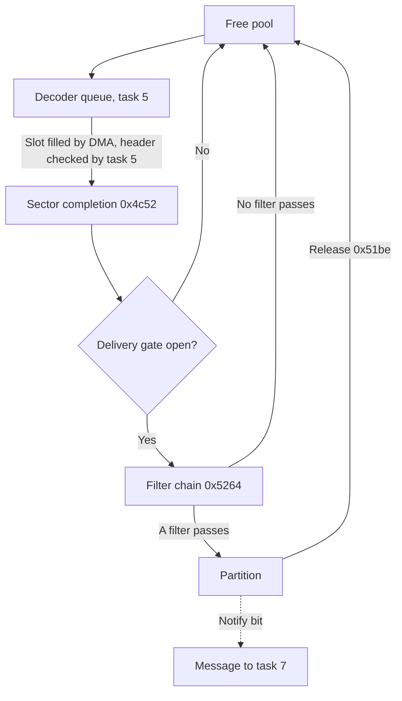

# Sector buffer

## What it does

The CD block keeps the sectors it reads in its own RAM until the Saturn takes them. The buffer has
room for 202 sectors, and this module decides which sectors are kept and where they wait.

- Slots. The buffer is split into slots of one sector each. A slot is free, on its way in from the
  disc, or waiting in a partition.
- Filters. Each new sector passes through a chain of filters. A filter picks sectors by their
  position on the disc, or for Mode 2 sectors by the file, channel and type bytes of their
  subheader. A sector that passes goes to that filter's partition, and one that fails is tried by
  the next filter.
- Partitions. The 24 partitions are separate queues that the Saturn reads from.
- Freeing. The Saturn reads a partition's sectors and deletes them, which frees their slots. A
  sector that no filter takes is freed at once. The Saturn can also write sectors of its own into
  free slots and file them through a filter.
- Settings. The Saturn sets each filter's conditions and outputs, and can empty a partition or reset
  every filter and connection. Task 4 carries these out. It also works out how much data a get
  would send and finds sectors by their position on the disc.
- Copy and move. Task 13 copies a partition's sectors, or moves the sectors themselves, through a
  filter into other partitions.
- Gate and notices. No sector reaches a partition until disc authentication opens the delivery
  gate. The firmware tells the Saturn about every sector that arrives and when the buffer is full.

The sections below follow CDB105 by address.

## Overview

A sector arrives in a slot on task 5's decoder queue ([sector reads](sector-reads.md)). Sector
completion then sends it down a chain of filters into a partition, and a sector that no filter
accepts goes back to the free pool. The host reads a partition's sectors with `61` or `63`, removes
them with `62` or `63` and adds sectors through a filter with `64`
([sector commands](data-transfer.md#sector-commands)). It sets up filters, connections and
partitions with `40..48`, which task 4 carries out ([settings](#settings)), asks about the buffer
with `50..56` ([buffer information](#buffer-information)) and copies or moves sectors between
partitions with `65` and `66`, which task 13 carries out ([copy and move](#copy-and-move)).

## Names

| Name | Address | Contents |
| --- | --- | --- |
| Slots | `0x09000230 + 0x930 * n` | 202 raw sectors of 2352 bytes |
| Links | `0x0f000354 + n` | Next slot after slot n, shared by every list. `ff` ends a list |
| Free pool | `0x0f000348` | Head, tail, count and buffer-full byte |
| Countdown | `0x0f00034c` | Longword counted down by notify bit 1 |
| Buffered count | `0x0f000350` | Word, buffered sectors |
| Decoder queue | `0x0f000314..0x0f000343` | Head, tail, count, current slot `+3`, flags `+5`, last destination `+15`, next frame address `+44` ([all fields](sector-reads.md#decoder-queue)) |
| Filters | `0x0f000420 + 16f` | 24 filter records |
| Filter connections | `0x0f0005a0 + 4f` | Source of filter f, the end of partition f, true output and false output of filter f |
| Partitions | `0x0f000600 + 6p` | 24 partition records |
| Device connections | `0x0f000690 + n` | Filter fed by CD device n |
| Delivery gate | `0x0f000788` | `ff` lets sectors through ([Delivery gate](disc-authentication.md#delivery-gate)) |
| Sector lock | Record 11 | Taken by ROM code in tasks 4, 5, 7, 9, 12 and 13, each task with its own ID as the owner, `0x0b040000` for task 4, and by the known cards' code as tasks 8 and 9 ([Locks](kernel.md#locks)) |
| Task 4 request | `0x0f000738..0x0f000740` | r1 and r2 of the last command for task 4. The pending bit, bit 0 of `0x0f000740`, is set while task 4 has not taken it |
| Command results | `0x0f0006bc..0x0f0006d7` | `52`'s size, task 4's copy of its request at `0x0f0006c0` and `55`'s search from `0x0f0006c8` |
| Sector lengths | `0x0f0006d8`, `0x0f0006d9` | Get and put sector lengths from `60` ([set sector length](data-transfer.md#set-sector-length)) |
| Task 13 state | `0x0f000728..0x0f000735` | Request, flags, slot, position, count and the two ends of a copy or move ([copy and move](#copy-and-move)) |
| Task 13 flags | `0x0f000730` | Bit 0 a request not yet taken, bit 1 while a copy runs, bit 2 while a move runs, bit 3 the error |

## Lists

Slots move between the free pool, the decoder queue and the partitions. All three keep head, tail
and count and chain their slots through the shared links.

| Routine | Entry | Role |
| --- | --- | --- |
| Pool removal | `buffer_pool_take` (`0x4e98`) | Takes the pool head |
| Queue append | `task5_queue_append` (`0x4bae`) | Appends slot r1 to the decoder queue |
| Queue take | `sector_queue_take` (`0x4bda`) | Takes the decoder-queue head |
| Pool return | `pool_return` (`0x4ed4`) | Appends slot r1 to the pool tail, ignoring `ff` |
| Run take | `pool_take_run` (`0x4f0c`) | Takes a run of r1 slots from the pool head |
| Run return | `pool_return_run` (`0x4f58`) | Appends a run to the pool tail |

- Pool removal returns r1 = head and r2 = remaining count, sets the returned slot's link to `ff`
  and clears head and tail to `ff` on the last removal. An empty pool returns r1 255 and r2 0
  without writing. Indices are zero-extended.
- Queue append ignores an r1 low byte of `ff`. Otherwise it installs the first head or links the old
  tail, updates the tail and increments the byte count, which wraps from 255 to 0. It neither
  terminates the new tail's link nor checks indices or counts.
- Neither pool removal nor queue append saves PR or uses the stack.
- Queue take returns the head in r1 and the remaining count in r2, or r1 `ff` when the queue is
  empty.
- The first slot returned to an empty pool runs `pool_notify` (`0x51fa`,
  [Notifications](#notifications)).
- Run take returns the first slot in r0 and r1 and gives the last slot of the run a link of `ff`.
  A run of 0, or longer than the pool count, returns `ff` and changes nothing. Taking the whole
  pool sets head and tail to `ff`.
- Run return follows the run from slot r1 to a link of `ff`, appends it and adds its length to
  the count. It runs `pool_notify` after every return, not only into an empty pool. `ff` is ignored.
- Task 12 uses the run routines for the sectors the host puts or gets and deletes
  ([sector commands](data-transfer.md#sector-commands)).

## Setup

Task 4 builds the lists at startup, and task 5 reserves two slots for its queue.

- Task 4 calls `buffer_records_initialize` (`0x5370`), which links all 202 slots into the pool
  (successors 1..201, then `ff`). The pool state gets bytes `00 c9 ca 00`: head 0, tail 201, count
  202, buffer not full.
- `selector_initialize` (`0x53b0`) clears the 24 filters and empties the 24 partitions
  (`{0xffff, 0, 0xffff}`). It sets each filter connection word to `ffff(a0+i)ff`, so filter i's true
  output feeds partition i and nothing else is connected, and clears the device connections to `ff`.
- Task 5 at `task5_setup` (`0x4594`) clears the 48 bytes of the decoder queue, sets bytes `+0`,
  `+1` and `+3` to `ff` and the longword at `+12` to `ffffffff`. It then moves two slots from the
  pool to its queue: pool head 2, tail 201, count 200, queue 0 -> 1 -> `ff`.
- Before that it clears `0x0a00000a` and then `0x0a000006`, clears the low three bits of
  `0x0a00001a` and sets the low nibble of `0x05ffff86` to 8 (IRQ7 priority 8), keeping the upper
  bits. There is no polling.
- Task 5 then waits at `task5_message_wait` (`0x45e0`) without posting, with PC `task5_message`
  (`0x45e2`), SR `0x20` and SP `0x0f000b98`. An empty or one-slot pool reaches the same wait with
  fewer slots reserved. Its message handling from `task5_message` is under [sector
  reads](sector-reads.md#messages).

## Sector completion

Sector completion `sector_complete` (`0x4c52`) takes the oldest slot from the decoder queue and
delivers it. It is called from `0x4892` and `task5_complete_slots` (`0x4a34`) in task 5 and acts
once more than two slots are queued, the two being the slot in transfer and the slot prepared for
the next one.

- Under the sector lock (owner 5) it takes the head slot and keeps it at `+3` (`0x0f000317`).
- It delivers the slot from CD device 0 through `sector_deliver` (`0x4fa4`) and keeps the partition
  it reached, or `ff`, at `+15` (`0x0f000323`).
- It stores the frame address after the sector header, plus one, at `+44` (`0x0f000340`) and, with
  bit 31 set, at `0x0f0002ac`. It then writes 4, CSCT, to `0x0a00001e`.
- While the delivery gate is not `ff`, it first clears the CD device connections through
  `connection_clear` (`0x54f0`) with r1 `0x80`. The slot then has no route and returns to the pool.

## Filters

A filter tests a sector and passes it to its true output or its false output.

| Offset | Field |
| --- | --- |
| `+0` | Mode bits |
| `+1` | Not used, cleared when `44` initializes the filter |
| `+2` | File number |
| `+3` | Channel number |
| `+4` | Submode mask |
| `+5` | Coding mask |
| `+6` | Submode value |
| `+7` | Coding value |
| `+8` | Start frame |
| `+12` | Frame count |

| Mode bit | Passes when |
| --- | --- |
| 0 | Subheader byte 0 equals the file number |
| 1 | Subheader byte 1 equals the channel number |
| 2 | Subheader byte 2 masked by `+4` equals `+6` |
| 3 | Subheader byte 3 masked by `+5` equals `+7` |
| 4 | Inverts the result of bits 0..3 |
| 6 | start <= frame < start + count |

- The subheader is that of a mode 2 sector. Other sector modes compare as a zero subheader.
- A filter with no mode bits passes every sector. Bit 4 has no effect without one of bits 0..3,
  and routing does not test bits 5 and 7.
- `filters_clear` (`0x545c`) clears all 24 filter records. `filter_clear` (`0x543e`) clears one,
  but no code reaches it: the only longword that holds its address, `0x8354`, is never loaded.

## Connections

Connections wire CD devices to filters, and filter outputs to partitions or further filters.

- Device connection byte n names the filter fed by CD device n (n below 16).
- Entry f has four connection bytes, one for each end `0x00 | f`, `0x20 | f`, `0x40 | f` and
  `0x60 | f`: `+0` the filter's source, `+1` the end of partition f, `+2` the true output and
  `+3` the false output.
- Task 12 pairs the host device `0x88` with the end `0x20 | p` of a partition for `61`, `62` and
  `63`, and with filter f's source for `64` ([sector commands](data-transfer.md#sector-commands)).
- The file system pairs device `0x8f` with the end of partition f while it reads, and clears that
  connection when a request other than Read File ends ([reading](file-system.md#reading)).
- Task 13 pairs device `0x81` with the end of the source partition and device `0x89` with the
  destination filter for `65` and `66`, and leaves both pairs in place
  ([copy and move](#copy-and-move)).
- Pairing clears both ends first, each with the end it pointed to, so every end holds one
  connection. A filter's source in particular has one: pairing a new source with it disconnects the
  old one, whether a CD device, a device of task 12 or 13, or another filter's false output.
- Routing follows false outputs without a limit. `46` can make a filter its own false output, but a
  device reaches that filter only by pairing with its source, which clears the loop first.

| End | Meaning |
| --- | --- |
| `0x80 \| n` | CD device n, n below 16 |
| `0xa0 \| p` | Partition p, p below 24 |
| `0x00..0x7f` | A filter end, index below 24 |

The device ends in use:

| Device end | Used by |
| --- | --- |
| `0x80` | CD device 0, the drive's sectors ([sector completion](#sector-completion)) |
| `0x81`, `0x89` | Task 13, the source and destination of a copy or move ([copy and move](#copy-and-move)) |
| `0x83` | CD device 3, the pages Get MPEG ROM files and the sectors the known cards' jobs file ([Get MPEG ROM](extensions.md#get-mpeg-rom), [card jobs](../mpeg-card/task-9.md#jobs)) |
| `0x88` | Task 12, the host's sector commands ([sector commands](data-transfer.md#sector-commands)) |
| `0x8b` | The known cards' `AA` ([sector jobs](../mpeg-card/task-9.md#sector-jobs)) |
| `0x8c`, `0x8d` | The known cards' audio and video feeds ([sector feeds](../mpeg-card/task-8.md#sector-feeds)) |
| `0x8f` | The file system ([reading](file-system.md#reading)) |

| Routine | Entry | Role |
| --- | --- | --- |
| Set | `connection_set` (`0x5536`) | Stores connection r1 -> r2 |
| Pair | `connection_pair` (`0x5510`) | Clears both ends, then connects them both ways |
| Clear | `connection_clear` (`0x54f0`) | Clears a connection and the end it points to |
| Get | `connection_get` (`0x55ae`) | Reads a connection |
| Clear 24 ends | `filter_sources_clear` (`0x5402`), `partition_ends_clear` (`0x5408`), `false_outputs_clear` (`0x540e`) | Clears the filter sources, the partition ends or the false outputs through `connection_clear` |
| Reset true outputs | `true_outputs_reset` (`0x5428`) | Sets the true output of each filter i back to partition i |

- Set accepts sources `0x80 | n`, `0x00 | f`, `0x20 | f`, `0x40 | f` and `0x60 | f`. It stores
  `ff` for a destination outside the three kinds above.

## Routing

Delivery sends a slot down the filter chain and appends it to the first partition that accepts it.

- Delivery `sector_deliver` (`0x4fa4`) routes slot r1 from source r2 through `sector_route`
  (`0x5264`).
- The sector header at slot `+12` gives the frame address, Sega's FAD, through `msf_to_fad`
  (`0x4e0c`). That converts BCD MSF, minutes, seconds and frames in binary-coded decimal, to
  frames + 75 * seconds + 4500 * minutes (00:02:00 is 150). `fad_to_bcd_msf`
  (`0x4e3e`) converts a frame address back to BCD MSF by restoring division against 45000, 4500,
  750, 75, 10 and 1, the weights at `bcd_msf_weights` (`0x4e8a`).
- Routing starts at the source's filter and follows each failing filter's false output. The first
  passing filter's true output is the destination.
- The slot is appended to that partition (index & 31 below 24). Without one it returns to the pool
  and r1 is `ff`. Slots from 202 upward and sources whose low five bits reach 16 have no route.

## Partitions

A partition is a queue of slots with a cursor that speeds up lookups by position.

| Offset | Field |
| --- | --- |
| `+0` | Head |
| `+1` | Tail |
| `+2` | Count |
| `+3` | Notify bits ([notifications](#notifications)) |
| `+4` | Cursor position |
| `+5` | Cursor slot |

- `partition_slot` (`0x506c`) returns in r1 the slot at position r2 of partition r1. Position 0 is
  the head, `ff` or count - 1 the tail. Other positions follow the links from the cursor when it
  lies at or before them, otherwise from the head. An invalid or empty partition, or a position past
  the end, returns `ff`.
- No branch reaches `0x50c4` in `partition_slot`, which would return the cursor slot `+5`. Other
  positions all go through the walk at `partition_seek` (`0x5600`).
- `partition_release` (`0x51be`) releases r3 slots from position r2 of partition r1 to the pool
  tail. `ff` selects the last position or the rest of the partition. Releasing a whole partition
  empties its record. A run past the end changes nothing and returns r1 `ff`.
- `partition_empty` (`0x5476`) empties partition r1 into the pool. Its run follows the pool tail,
  or becomes the pool when the pool is empty, which runs `pool_notify` (`0x51fa`). The partition's
  record resets and the buffered-sector word drops by its count. A partition of 24 or more, or an
  empty one, is left alone. `partitions_empty` (`0x54da`) empties all 24.
- `chain_advance` (`0x5652`) follows links up to 25 per pass through an unrolled sequence. In
  effect it follows n links.

## Notifications

- Task 7 sets the notify bits of the partition it reads into: bit 0 for disc authentication and
  the file system's other reads, bit 1 for Read File. It clears them when the request ends
  ([first sectors](disc-authentication.md#first-sectors), [reading](file-system.md#reading)).
- After an append, notify bit 0 posts `07040000` (task 7, class 4, payload 0). Bit 1 counts down
  the countdown longword and posts `07040001` at zero.
- At 200 buffered sectors `0x0a00001e` gets 8, BFUL, the buffer-full byte becomes `ff` and, with
  bit 6 of the queue flags (`0x0f000319`) set, `06040001` is posted.
- The first slot returned to an empty pool runs `pool_notify` (`0x51fa`), which clears a set
  buffer-full byte. With bit 5 of the queue flags set, `0x0f0002ac` without bit 31 goes to
  `0x0f0002c0` and `06040000` is posted. Otherwise, with bit 1 set, it is copied to `0x0f0002b4` and
  `06050004` is posted.

## Settings

Commands `40..48` set and read filters and connections. The handlers answer the reads themselves
and hand every setting to task 4. The names follow Sega's CD library
([command map](../references.md#host-command-map)).

| Command | Name | Handler | Task 4 |
| --- | --- | --- | --- |
| `40` | Set Filter Range | `command_40_set_filter_range` (`0x7380`) | `task4_filter_range` (`0x57ac`) |
| `41` | Get Filter Range | `command_41_get_filter_range` (`0x7396`) | None |
| `42` | Set Filter Subheader Condition | `command_42_set_filter_subheader` (`0x73c4`) | `task4_filter_subheader` (`0x57e0`) |
| `43` | Get Filter Subheader Condition | `command_43_get_filter_subheader` (`0x73da`) | None |
| `44` | Set Filter Mode | `command_44_set_filter_mode` (`0x741c`) | `task4_filter_mode` (`0x580e`) |
| `45` | Get Filter Mode | `command_45_get_filter_mode` (`0x7432`) | None |
| `46` | Set Filter Connection | `command_46_set_filter_connection` (`0x745e`) | `task4_filter_connection` (`0x5848`) |
| `47` | Get Filter Connection | `command_47_get_filter_connection` (`0x74b2`) | None |
| `48` | Reset Selector | `command_48_reset_selector` (`0x7512`) | `task4_reset_selector` (`0x58b6`) |

- Filter f is the CR3 high byte in `40..47`, and f of 24 or more rejects.
- `40` takes the start frame from the CR1 low byte and CR2 and the frame count from the CR3 low
  byte and CR4, 24 bits each. `41` answers them in the same places.
- `42` takes the channel from the CR1 low byte, the submode and coding masks from the CR2 high and
  low bytes, the file number from the CR3 low byte and the submode and coding values from the CR4
  high and low bytes. `43` answers them in the same places.
- `44` takes the mode from the CR1 low byte. With bit 7 set it initializes the filter instead:
  frame range, subheader condition and mode 0. `45` answers the mode in the CR1 low byte.
- `46` takes flags from the CR1 low byte, a partition from the CR2 high byte and a filter from the
  CR2 low byte. Flag bit 0 pairs the true output with the partition and flag bit 1 pairs the false
  output with that filter's source (`connection_pair`, `0x5510`). For `ff` the output is
  disconnected instead (`connection_clear`, `0x54f0`). A partition or filter of 24 or more, other
  than `ff`, rejects only when a flag selects its output.
- `47` answers the true output's partition in the CR2 high byte and the false output's filter in
  the CR2 low byte: the low five bits of each connection byte, or `ff` for a byte whose top three
  bits are set.
- `48` with flags 0 (CR1 low byte) empties partition p, the CR3 high byte, and rejects p of 24 or
  more. Other flags reset parts of the selector in this order: bit 2 empties every partition, bit 3
  clears the partition ends, bit 4 clears every filter record, bit 5 clears the filter sources, bit
  6 sets each true output back to the partition of the same number and bit 7 clears the false
  outputs. Bits 0 and 1 do nothing. These are Sega's reset flags.
- Clearing the partition ends disconnects the devices that read them, `0x88` of task 12 or `0x81`
  of task 13. Clearing the filter sources disconnects CD device 0 from the filter `30` chose.

### Task 4

Task 4 waits at `0x5702` and takes each message at `task4_message` (`0x5704`).

- A handler hands its request to task 4 through `buffer_command_post` (`0x76d4`).
  `task4_request_set` (`0x7778`) keeps r1 and r2 at `0x0f000738` and sets the pending bit, and
  a request task 4 has not taken yet makes the new one wait. Otherwise the handler returns
  `048100cc` in r11, with the command number cc, and answers with the cached response through
  `response_cached_keep_message` (`0x91fe`).
- Task 4 copies the request to `0x0f0006c0` and clears the pending bit (`task4_request_take`,
  `0x7794`), then
  runs payloads 40, 42, 44, 46, 48, 52 and 55 of class `0x81`. Class 7 runs payloads 40, 42, 44 and
  46 the same way. Other messages are dropped.
- No post reaches the class 7 route: task 4's mailbox has slots for classes 3, 5 and `0x81` only, so
  a post of class 7 fails with the diagnostic trap ([posting](kernel.md#posting)). No ROM code posts
  classes 3 and 5 to task 4 either.
- Each setting runs under the sector lock `0x0b040000`, frees it and writes `0x40`, ESEL, to
  `0x0a00001e`, where Sega's description of ESEL puts it
  ([interrupt flags](host-commands.md#interrupt-flags)).

## Buffer information

Commands `50..56` answer questions about the buffer. Task 4 computes the answers of `52` and `55`,
which `53` and `56` return.

| Command | Name | Handler | Task 4 |
| --- | --- | --- | --- |
| `50` | Get Buffer Size | `command_50_get_buffer_size` (`0x7532`) | None |
| `51` | Get Sector Number | `command_51_get_sector_number` (`0x7590`) | None |
| `52` | Calculate Actual Size | `command_52_calculate_actual_size` (`0x75b4`) | `task4_actual_size` (`0x591e`) |
| `53` | Get Actual Size | `command_53_get_actual_size` (`0x75d4`) | None |
| `54` | Get Sector Info | `command_54_get_sector_info` (`0x75e0`) | None |
| `55` | Execute FAD Search | `command_55_execute_fad_search` (`0x766e`) | `task4_fad_search` (`0x5a18`) |
| `56` | Get FAD Search Results | `command_56_get_fad_search_results` (`0x76b8`) | None |

- Partition p is the CR3 high byte in `51`, `52`, `54` and `55`, and p of 24 or more rejects.
- `50` answers the free pool count, at most 200, in CR2, 24 partitions in the CR3 high byte and 200
  sectors in CR4. With task 5's two reserved slots the free count is 200 when every partition is
  empty.
- `51` answers the count of partition p in CR4.
- `52` checks its partition, position and count as `61` does
  ([request checks](data-transfer.md#request-checks)). Task 4 then counts the words a get of those
  sectors would send, by the get sector length: `0x490`, `0x492` or `0x498` per sector for lengths
  1, 2 and 3. For length 0 it first clears the partition's end, then reads each sector's header
  under the sector lock and counts `0x400` words, or `0x48a` for a Mode 2 Form 2 sector.
- The size goes to `0x0f0006bc`, and `53` answers it in the CR1 low byte and CR2. It is 0 after
  startup.
- `54` answers the sector at position CR2 of partition p: the frame address of its header in the
  CR1 low byte and CR2, and for a Mode 2 sector its subheader (file, channel, submode, coding) in
  CR3 and CR4, otherwise 0. Position `ffff` is the last sector. An empty partition or a position
  past the end waits.
- `55` searches partition p from position CR2 (`ffff` the last) for the frame address in the CR3
  low byte and CR4, and waits as `54` does. Task 4 converts the target to BCD MSF (`fad_to_bcd_msf`,
  `0x4e3e`), clears the partition's end and walks to the partition's end. A sector whose header
  equals the target ends the search. Otherwise the sector with the highest header below the target
  is kept. The result is its frame address, position and partition, or position `ffff` with frame 0
  when no sector lies below the target.
- `56` answers the result: the position in CR2, the partition in the CR3 high byte and the frame in
  the CR3 low byte and CR4. All three are 0 after startup.
- The search compares headers, so a partition need not be in frame order.

## Copy and move

`65` copies and `66` moves sectors from a partition into a filter, whose chain files them like
sectors from the disc. Task 13 does the work, and `67` reports how it ended.

| Command | Name | Handler | Task 13 |
| --- | --- | --- | --- |
| `65` | Copy Sector Data | `command_65_66_copy_move` (`0x6efc`) | `task13_copy` (`0x704c`) |
| `66` | Move Sector Data | `command_65_66_copy_move` (`0x6efc`) | `task13_move` (`0x714e`) |
| `67` | Get Copy Error | `command_67_copy_error` (`0x6f38`) | None |

- The destination filter f is the CR1 low byte, the source partition p the CR3 high byte, the
  position CR2 and the count CR4. f of 24 or more rejects, and `sector_request_check` (`0x6dac`)
  checks the rest as for `61` ([request checks](data-transfer.md#request-checks)). `65` also waits
  for a count above the free pool count. `66` works in a full buffer.
- The handler keeps the request at `0x0f000728` through `task13_request_set` (`0x6ff8`), where a
  request task 13 has not taken makes the new one wait, and returns `0d8100cc` for task 13 with the
  cached response.
- Task 13 takes each message at `task13_message` (`0x6fd2`) and runs a payload low byte of `65` or
  `66`, whatever the class. `task13_request_start` (`0x721e`) takes the request and keeps the
  position, count and both ends at `0x0f000732..0x0f000735`. Under the sector lock `0x0b0d0000` it
  pairs device `0x81` with the end of partition p and device `0x89` with filter f.
- A copy takes each sector from the position on and routes it from `0x89` through filter f's chain
  (`sector_route`, `0x5264`). A sector no filter passes is skipped. Otherwise task 13 takes a free
  slot, copies all 2352 bytes into it outside the lock (`sector_copy`, `0x72c0`) and delivers the
  copy from `0x89`. The source keeps its sectors.
- A move unlinks the run from partition p under the lock (`partition_unlink`, `0x50ca`) and
  delivers its slots in order from `0x89`. A sector no filter passes returns to the pool.
- Before each step `task13_connections_check` (`0x727c`) takes the lock and checks that `0x81` and
  `0x89` still name their ends. A changed pair, a copy without a free slot or a move without a run
  sets bit 3 of the task 13 flags, the error, and ends the command. A copy returns the slot it had
  taken, a move every slot it had not delivered.
- Bit 1 of the task 13 flags marks a copy and bit 2 a move while they run. At the end task 13 writes
  `0x100`, ECPY, to `0x0a00001e`.
- `67` answers in the CR1 low byte `ff` while bits 0..2 are set (a request not yet taken, a copy or
  a move), 1 after an error and otherwise 0, Sega's busy, error and normal codes. The error stays
  until the next copy or move.

## Bugs and oddities

- Pairing `0x89` with the destination filter's source disconnects whatever fed that filter. A copy
  or move into the filter that `30` connected CD device 0 to cuts the drive's sectors off from the
  filters, and `31` then answers `ff`. The pair stays after the command.
- A move that finds a pair changed returns every slot it has not delivered to the pool, so those
  sectors end up in neither partition. Sega describes a disconnected selector as an error but not
  the lost sectors.
- `52` reads the partition when task 4 runs, not when the command arrives. Accepted while task 13
  holds the sector lock during a move out of the same partition, it counts past the partition's new
  end, follows a link of `ff` and reads the header of slot `ff` at `0x09092900 + 15`, beyond the
  512 KB buffer. One sector past the end counts slot `ff` as a sector, so `53` answers one sector
  too many. Two or more leave size `ffffff`. The [file system](file-system.md#bugs-and-oddities)
  has the same kind of race.
- `52` clears the partition's end only for get sector length 0. Sega describes the disconnection
  for every length.
- `52` with count 0 or a get sector length above 3 frees the sector lock without having taken it,
  which reaches the diagnostic trap. No command gives either: `sector_request_check` (`0x6dac`)
  waits for count 0 and `60` rejects lengths from 4.
