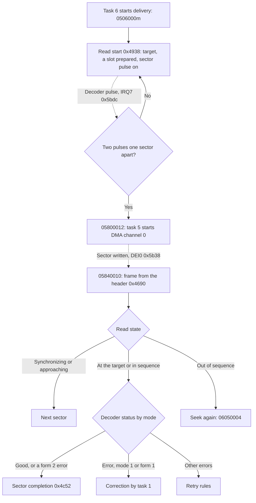

# Sector reads

## What it does

A CD stores data in sectors of 2352 bytes, 75 a second at single speed. During a read the CD
block's decoder hands the firmware one sector at a time, with a note of any errors it found. This
module brings those sectors into the buffer.

- Locking on. Task 5 waits until the decoder's sector pulse comes at a steady pace. A DMA channel
  then copies each sector into a free buffer slot while the SH-1 does other work.
- Position. Each sector's header gives its position on the disc. Task 5 waits for the first sector
  the read asked for and takes every sector from there. A sector out of order makes it read again
  from the sector it needs.
- Errors. With error correction on, task 1 repairs Mode 1 and Form 1 sectors with the two layers
  of parity they carry. Other errors are retried, passed on or end the read, as Initialize CD Block
  sets.
- Delivery. Good sectors go through the filters into the partitions that the Saturn reads from. A
  full buffer pauses the read until the Saturn frees space.

The sections below follow CDB105 by address.

## Overview

Task 6 moves the drive and starts delivery. Task 5 then locks onto the decoder's sector pulse, has
DMA channel 0 copy each sector into a slot, checks the sector's header against the target and its
decoder status against the settings of `04`, and completes good sectors into the partitions.



- Interrupt handlers never post directly. IRQ7 and the DMA end post through `TRAPA 0x2d`, which
  delivers the message a moment later from compare match B of ITU4, channel 4 of the SH-1's
  integrated timer pulse unit (ITU, [posting from interrupts](kernel.md#posting-from-interrupts)).
- Every position task 5 takes goes to task 6 as `06050003` with the frame at `0x0f0002b0`, which
  task 6 uses to decide that the read reached its target ([drive](drive.md#following-the-position)).
- Completion then routes the sector through the filters. While the delivery gate is closed it
  disconnects CD device 0 first, so the sector returns to the pool ([sector buffer](sector-buffer.md#sector-completion)).

## Names

| Name | Address | Contents |
| --- | --- | --- |
| Decoder queue | `0x0f000314..0x0f000343` | Slots on their way from the decoder, and the read's state ([fields](#decoder-queue)) |
| Pulse state | `0x0f0006dc` | 0 before the first pulse, 1 after it, 2 locked |
| Subcode state | `0x0f0006dd` | 1 hunting and 2 locked while subcode is on ([subcode](subcode.md#the-handlers-record)) |
| Pending flags | `0x0f0006de` | Decoder flags masked with their enables at the last IRQ7. The subcode handler replaces them with the flags word's low byte |
| Tolerance | `0x0f0006df` | Allowed error of a pulse interval, in counts |
| Misses | `0x0f0006e3` | Pulses outside the tolerance |
| Interval | `0x0f0006e4` | Expected time between pulses, in counts |
| Last pulse | `0x0f0006e8` | Time of the last pulse |
| Correction bitmap | `0x0f0006a0..0x0f0006b9` | One bit per slot waiting for task 1 |
| Initialization flags | `0x0f00025c` | CR1 low byte of `04`: bit 1 R-W subcode, bit 2 no Mode 2 subheader check, bit 3 Form 2 retries, bit 4 standard (single) speed |
| Read flags | `0x0f0002a7` | Task 6's frame-update bit ([drive flags](drive.md#flags)) |
| ECC count | `0x0f000262` | CR4 high byte of `04`, Sega's error correction code (ECC) count. `0x80` turns correction off, 0 runs P, Q and P only, and others allow up to one pair of Q and P per count, 5 at most ([correction](#passes)) |
| Retry count | `0x0f000263` | CR4 low byte of `04` ([retry rules](#retry-rules)) |
| Decoder flags | `0x0a000006` | Bit 4 the sector pulse, set when the interface finds a sector header, bit 5 a subcode frame and bit 6 with it a subcode block start ([subcode](subcode.md#frames)). An enabled flag raises IRQ7 ([board](../board.md#interrupts)). The pulse handler writes `0xffef`, task 5 writes the word back without bits 5 and 6 |
| Decoder enables | `0x0a00000a` | The same bits |
| Decoder control | `0x0a00001a` | Low three bits 2 at a read start, 7 once locked, 0 when stopped. Bit 7 is cleared before each transfer. Ymir models bit 7 as the interface's gate for DREQ0 ([board](../board.md#dma-requests)) |
| Decoder status | `0x0a00001c` | Read for each sector, its low byte kept at queue `+6` |

The names of the `04` settings are Sega's (`CDC_CdInit`, [references](../references.md#sega-documentation)).

### Decoder queue

The queue holds the slots between the decoder and completion: the transferred ones, the slot in
transfer and the slot prepared for the next transfer.

| Offset | Field |
| --- | --- |
| `+0`, `+1`, `+2` | Head, tail and count |
| `+3` | Slot being completed: the head slot that [sector completion](sector-buffer.md#sector-completion) takes, `ff` at setup |
| `+4` | Read state: 0 stopped, 1 waiting for the pulse lock, 2 synchronizing, 3 approaching, 4 streaming |
| `+5` | Flags: bit 1 held for a slot, bit 2 task 1 correcting, bit 3 correction running, bit 4 retry asked, bit 5 held for a full buffer, bit 6 read active |
| `+6` | Decoder status of the last sector |
| `+7` | Mode kept at synchronization |
| `+8` | Error count |
| `+9` | Attempt count |
| `+10` | Mode of the last sector |
| `+11` | Form: 1 for mode 1 and form 1, 2 for form 2, otherwise 0 |
| `+12`, `+13`, `+14` | Slot prepared, slot in transfer, slot transferred, `ff` for none |
| `+15` | Last partition a completed sector reached |
| `+16`, `+20`, `+24` | Addresses of those three slots |
| `+28` | Target frame |
| `+32` | Last frame taken |
| `+36` | Frame of the last sector |
| `+40` | Expected frame while approaching |
| `+44` | Next frame to deliver |

## Messages

Task 5 waits at `task5_message_wait` (`0x45e0`) and decodes each message at `task5_message`
(`0x45e2`). Class 6 payloads index the table at `task5_class6_table` (`0x4658`). Anything else waits
again.

| Message | From | Entry | Effect |
| --- | --- | --- | --- |
| `05060000`, `05060001` | Task 6, a new read | `task5_read_start` (`0x4938`) | [Read start](#read-start), stopping an active read first |
| `05060002` | Task 6, after `06050000` | `0x4950` | Read start, keeping the error count |
| `05060006` | Task 6, after a full buffer | `0x4946` | Read start, clearing queue flag 5 |
| `05060008` | Task 6, after `06050004` | `task5_read_resume` (`0x4954`) | Read start, keeping both counts |
| `05060003` | Task 6, seek, pause or a new read | `task5_read_end` (`0x4a76`) | [Stop](#stop), then `06050001` |
| `05060005`, `05060007` | Task 6, audio | `task5_subcode_enable` (`0x4abc`), `task5_subcode_disable` (`0x4aea`) | [Subcode](#subcode) on and off |
| `05060009` | Task 6, buffer full | `task5_buffer_hold` (`0x48d0`) | [Hold](#full-buffer) |
| `05060004` | | | Nothing |
| `05800012` | IRQ7 | `task5_pulse_locked` (`0x49e6`) | [Pulses locked](#sector-pulse) |
| `05840010` | DEI0 | `task5_sector_done` (`0x4690`) | [A sector arrived](#headers) |
| `05010011` | Task 1 | `task5_correction_done` (`0x4a08`) | [Correction finished](#correction) |
| `05810030` | Command `30` | `task5_connect` (`0x4b08`) | [Device connection](#device-connection) |

Task 5 sends task 6 `06050003` (position), `06050004` (seek again), `06050000` (retry), `06050002`
(read error) and `06050001` (stopped), and `06040001` and `06040000` for the buffer. Task 6's side is
under [requests from the sector buffer and task 5](drive.md#requests-from-the-sector-buffer-and-task-5).

## Read start

- The entries fall through into each other. Payloads 0 and 1 stop an active read (flag 6) and set
  the flags to `0x40`. `0x4946`, payload 6, clears queue flag 5 and the error count. `0x4950`,
  payload 2, clears the attempt count. `task5_read_resume` (`0x4954`), payload 8, keeps both counts.
- `task5_read_resume` clears flag 1. The target `0x0f0002b8`, set by task 6, goes to `+28` and
  `+44`, and with bit 31 set to `0x0f0002ac`.
- With the buffer-full byte `0x0f00034b` set the read stops at once, sets queue flag 5 and posts
  `06040001`.
- Otherwise `task5_slot_prepare` (`0x4cf4`) prepares a slot and `task5_queue_trim` (`0x4cca`)
  returns the oldest queued slot beyond two to the pool. Without a free slot the buffer is full
  ([full buffer](#full-buffer)).
- Read state 1. The pulse and subcode states are cleared, the decoder flags cleared, the sector
  pulse enabled (`0x0a00000a` = `0x10`) and the decoder control's low bits set to 2 with interrupts
  masked.

## Sector pulse

IRQ7 (`irq7_decoder`, `0x5bdc`, vector 71) runs on its own stack at `0x0f000950`. It masks the
decoder flags with their enables into `0x0f0006de`. Bit 4 is the sector pulse
(`decoder_sector_pulse`, `0x5c32`), bit 5 the subcode (`subcode_frame`, `0x5cb8`).

- The pulse handler clears flag 4 by writing `0xffef` to `0x0a000006`.
- The first pulse keeps its time and sets the interval and tolerance: `0x8235` counts and 28 with bit
  4 of the initialization flags, half of both without it. Pulse state 1.
- Each later pulse keeps its time and compares the time since the last pulse with the interval. Off
  by more than the tolerance it only counts a miss. Within it the decoder control gets the low bits
  7, the pulse state becomes 2, the pulse is disabled and `05800012` goes to task 5.
- The time at `itu4_time` (`0x5e40`) is the time high part `0x0f00021c`, plus one while OVF is
  pending in TSR4, over TCNT4. ITU4 counts at 2.5 MHz, so `0x8235` counts are 1/75 s, one sector at
  single speed.
- Bit 4 of the initialization flags also makes task 6 send its reads with byte 10 = 1 instead of 2
  ([commands](drive.md#seek-read-and-pause)).
- Pulses in any other pulse state only disable the pulse.
- With the pulses locked, `task5_pulse_locked` (`0x49e6`) sets read state 2, clears the last frame
  `+32` to `ffffffff`, starts DMA with the prepared slot at `dma0_start` (`0x5b7c`) and prepares the
  next slot.

## DMA channel 0

- `dma0_arm` (`0x5b84`) clears bit 7 of the decoder control. With a prepared slot it programs DAR0
  = slot + 12, TCR0 = `0x492` words (2340 bytes, the sector after its 12 sync bytes) and CHCR0 =
  `0x436d`, after reading CHCR0 to clear TE ([SH7034 notes](../sh7034.md#dma-channel-0)). The slot
  moves from `+12` to `+13`.
- Without a prepared slot it writes CHCR0 = `0x4368`, which turns the channel off.
- The end of a transfer enters DEI0 (`dma0_end`, `0x5b38`, vector 72) on the stack `0x0f0009a8`.
  It keeps the decoder status's low byte at `+6`, moves the transferred slot from `+13` to `+14`,
  starts the next transfer and posts `05840010`.
- Two transfers that end before the first message is delivered both post, and the second finds no
  prepared slot and turns the channel off. Task 5 then takes the second sector's header twice.

## Headers

A sector message converts the transferred slot's header time from binary-coded decimal (BCD) to a
frame through `msf_to_fad` (`0x4e0c`) and keeps it at `+36`, with the header's mode byte at `+10`.
The read state decides what happens next.

| State | The sector | Next |
| --- | --- | --- |
| 2 | Follows the last frame and decoder status bit 6 is clear | A pair: the frame goes to `+40` and `0x0f0002b0`, the mode to `+7`, `06050003` to task 6. At the target go on as state 3. Up to 48 frames before it, state 3. Past it or farther before it, an attempt |
| 2 | Does not follow | Kept as the last frame |
| 3 | Any | While `+40` is short of the target it counts on by one. Once it reaches the target the sector must be the target itself, then state 4, otherwise an attempt |
| 4 | Follows the last frame | Taken: `0x0f0002b0` and `06050003`, then the [status checks](#decoder-status) |
| 4 | Does not follow | An attempt |
| Other | Any | Stop |

- With decoder status bit 6 a streamed sector's header mode byte is rewritten in the slot with the
  mode kept at synchronization.
- Every sector that is not taken prepares the next slot and returns the oldest queued slot beyond
  two to the pool.
- An attempt (`0x4750`) counts down the drive offset `0x0f0002a4` and sets `0x0f0002b0` to a frame
  plus the attempt count: the expected frame `+40` after an overshoot or a pair far before the
  target, otherwise the read's target `+28`. It then counts the attempt. Up to 16 attempts post
  `06050004` with `+44` at `0x0f0002b4`, the seventeenth is a read error.
- Task 6 answers with a read from `0x0f0002b4` with read mode 8, and with the frame-update bit it
  first sets the drive offset to its last reported frame less `0x0f0002b0`
  ([requests](drive.md#requests-from-the-sector-buffer-and-task-5)). After a break while streaming,
  `0x0f0002b0` holds the read's first target, so the offset points past the missing sector and the
  next read overshoots once before the offset settles.

## Decoder status

`task5_sector_checks` (`0x4788`) clears the attempt count and the form and prepares the next slot.
Without a free slot the read [holds or the buffer is full](#full-buffer). Otherwise the decoder
status is checked with a mask chosen by the mode:

| Sector | Form `+11` | Mask |
| --- | --- | --- |
| Mode 1 | 1 | `0x21` |
| Mode 2, submode bit 5 clear (form 1) | 1 | `0x22` |
| Mode 2, submode bit 5 set (form 2) | 2 | `0x24`, or `0x20` when the EDC (error detection code) word at slot `+0x92c` is 0 |
| Mode 2 with bit 2 of the initialization flags | 0 | `0x20` |
| Any other mode | 0 | `0x20` |

- Mode 2 compares the two subheader copies first, unless bit 2 of the initialization flags is set.
  Different copies go to the retry rules.
- No error bits: the sector is delivered. Unless correction runs, flag 4 and the error count are
  cleared, `sector_complete` (`0x4c52`) completes the oldest queued slot, and the read ends once
  `+44` reaches the end frame `0x0f000284`.
- Errors in mode 1 or form 1 go to [correction](#correction), or to the retry rules when
  `0x0f000262` is `0x80`.
- Form 2 sectors are delivered with their errors, unless bit 3 of the initialization flags sends them to
  the retry rules.
- Errors in any other mode go to the retry rules.

### Retry rules

`0x483c` reads the retry count `0x0f000263`:

| Setting | Effect |
| --- | --- |
| `0x80` | Retry without limit: stop, set flag 4 and post `06050000` with `+44` at `0x0f0002b4` |
| `0` | Read error: stop, clear the flags and post `06050002` |
| Low nibble n | Retry while the error count `+8` is below n, counting each retry. Then deliver the sector when bit 6 is set, otherwise a read error |

Task 6 answers `06050000` with a read from `0x0f0002b4` with read mode 2 and `06050002` with status
9 and a pause.

## Correction

Task 5 hands sectors with errors to task 1, one at a time. Task 1 repairs what it can with the
sector's own P and Q parity, the error correction of ECMA-130 Annex A, and its result word decides
between delivery and the retry rules.

[`correct.py`](../../scripts/correction/correct.py) runs task 1's passes with the tables from your
dump on a sector you damage, and prints each pass and the result word. The example files are
named under [Passes](#passes). From the repository's top folder, with your dump there as
`cdb105.bin`:

```
python scripts/correction/correct.py cdb105.bin scripts/correction/single-errors.txt
python scripts/correction/correct.py cdb105.bin scripts/correction/q-completes.txt
python scripts/correction/correct.py cdb105.bin scripts/correction/p-completes.txt
python scripts/correction/correct.py cdb105.bin scripts/correction/cycle.txt
```

### Task 5's side

- The first error sends the oldest queued slot to task 1 at `task5_correction_request` (`0x4b9a`):
  flag 2, the slot at `0x0f00071b` and `01050010`. Flag 3 marks correction as running.
- While it runs, a later sector with an error is marked in the correction bitmap, and no sector is
  completed.
- Task 1's answer `05010011` (`task5_correction_done`, `0x4a08`) clears flag 2. Bit 7 in either
  byte of task 1's result word `0x0f000718` goes to the retry rules, unless bit 6 of the retry count
  is set and the retries are used up.
- Otherwise `task5_complete_slots` (`0x4a34`) completes slots until two remain or the end frame is
  reached. A slot marked in the bitmap goes to task 1 first. When no slot is left, flag 3 is
  cleared, and with flag 1 set the read is sought again with `06050004`.
- Nothing checks the EDC after task 1 answers. The result word alone decides.

### Task 1

Task 1 (`task1_correction`, `0x63f2`) corrects the slot named at `0x0f00071b` and answers
`05010011`. It keeps its state at `0x0f000710`:

| Offset | Field |
| --- | --- |
| `+0` | Address of the slot's header, `0x0900023c + 0x930 * slot` |
| `+4` | The header's four bytes as they arrived |
| `+8` | Q result, the high byte of the result word |
| `+9` | P result, the low byte |
| `+10` | Q and P pairs left |
| `+11` | The slot |

- A slot of `ff` goes back to the wait without an answer. Task 5 never sends one.
- A mode 2 sector's header is cleared in the slot before decoding, since ECMA-130 computes mode 2
  parity over a zero header. A header that reads 0 afterwards gets its saved bytes back. A mode 1
  header takes part in the decoding like any other byte.
- A mode 2 subheader never reaches task 1 damaged when its copies differ: task 5 compares them first
  and uses the retry rules ([decoder status](#decoder-status)).

### Codes

The 2340 bytes from the header on (slot bytes 12..2351) are 1170 words of two bytes. The two bytes
of a word are coded separately, so every code vector below exists twice, once per byte.

| Code | Vectors | Word m of vector v | Elements | Parity bytes |
| --- | --- | --- | --- | --- |
| P | 43 columns | `43m + v`, m = 0..25 | 26 | Rows 24 and 25, slot bytes 2076..2247 |
| Q | 26 diagonals | `(44m + 43v) mod 1118`, m = 0..42, then `1118 + v` and `1144 + v` | 45 | Slot bytes 2248..2351 |

A pass decodes every vector of one code. Each vector of n elements gives two syndromes: S0, the XOR
of its elements, and S1, the sum of element m times alpha^(n-1-m) in GF(2^8) with the field
polynomial x^8 + x^4 + x^3 + x^2 + 1.

| S0 | S1 | Outcome |
| --- | --- | --- |
| 0 | 0 | No error |
| Nonzero | Nonzero | One error of value S0 at element n - 1 - k, where alpha^k = S1 / S0. k from n on is a failure |
| Either one 0 | | Failure |

- k is log S1 - log S0 mod 255, from the logarithm table `gf_log_table` at `0x675c`.
- A corrected byte is XORed with S0. The pass result counts corrections in bits 0..6 and sets bit 7
  when any vector failed.
- The vectors of one pass share no byte, so their order does not matter.

### Passes

`sector_correct` (`0x6438`) runs the passes:

1. P, Q, P.
2. A last P result of 0 ends it, and so does an ECC count of 0.
3. Otherwise pairs of a Q pass and a P pass follow, as many as the ECC count and 5 at most. The
   pairs end at the first pass with a result of 0.

The result word holds the last Q result and the last P result. No pass follows the last P pass
that the ECC count allows. When that P pass completes a repair the Q pass before it failed on, the
sector is whole, but the Q result keeps bit 7 and the sector goes to the retry rules. With an ECC
count of 0 that P pass is the second one, otherwise the P pass of the last pair. One more pair lets
a Q pass that finds nothing end the passes with a clear result.

- A reread of the same damage gives the same result word. With a retry count of `0x80` the read
  then retries without end. With 0, or a low nibble without bit 6, it ends with a read error. With
  bit 6 the sector is delivered, repaired, once the retries are used up
  ([retry rules](#retry-rules)). A sector that the passes repair can therefore fail the read.
- [`p-completes.txt`](../../scripts/correction/p-completes.txt) shows the case after the second P
  pass and after a pair's P pass, each with the count that delivers the sector.
- [`single-errors.txt`](../../scripts/correction/single-errors.txt) and
  [`q-completes.txt`](../../scripts/correction/q-completes.txt) run sectors that the first P, Q and
  P passes repair.
- [`cycle.txt`](../../scripts/correction/cycle.txt) runs errors that no pass can place through
  five pairs, and a chain that one pair completes.

| Routine | Address | Work |
| --- | --- | --- |
| `task1_correction` | `0x63f2` | Slot, header and answer |
| `sector_correct` | `0x6438` | The passes above |
| `correct_p_pass` | `0x6486` | Columns 0..41 in pairs through `p_vector_pair` (`0x650c`), column 42 through `p_vector_single` (`0x64be`) |
| `correct_q_pass` | `0x64a4` | 13 pairs of diagonals through `q_vector_pair` (`0x65ba`) |

- A vector routine decodes two columns or two diagonals at once, both bytes of each, as four byte
  lanes of one 32-bit register. S1 is built by Horner's rule, the running value times alpha plus
  the next element.
- Times alpha is a left shift of all four lanes followed by an XOR with one of 16 longwords in
  `lane_reduce_table` (`0x685c`). The index holds the carry out of bit 31 and the inverted bits
  shifted into bits 24, 16 and 8. The longword clears those crossed bits and adds `0x1d` to each
  lane that overflowed.
- Element m - 1 of diagonal 2i + 1 lies right before element m of diagonal 2i, so one long read
  serves both diagonals, the odd one a step behind. It catches up with a last step of its own before
  the parity words.
- A P pass without errors runs about 13,600 instructions and a Q pass about 14,900, so P, Q and P
  come to about 42,000 per sector.

### Stop during correction

- A stop while task 1 corrects starts task 1 again through `TRAPA 0x28` ([services](kernel.md#services)).
- The interrupt behind the stop has already put task 1 back in its ready queue. Its fresh record
  runs from the entry `task1_message_entry` (`0x63dc`) to the wait, and no answer comes.
- The slot keeps the corrections of the passes that ran and goes back to the pool with the flush.

## Full buffer

- No free slot with only the two transfer slots queued means a full buffer (`task5_buffer_full`,
  `0x49c6`): the buffer-full byte `0x0f00034b` becomes `ff`, 8, BFUL, goes to `0x0a00001e` and, with
  flag 6, `06040001` to task 6.
- No free slot with more slots queued, as while correcting, holds the read (`0x48ba`): DMA and the
  decoder stop and flag 1 is set. The first slot back in the pool then posts `06050004`
  ([notifications](sector-buffer.md#notifications)).
- Completion posts `06040001` too when 200 sectors are buffered. Task 6 then pauses and posts
  `05060009`. `task5_buffer_hold` (`0x48d0`) stops, sets queue flag 5 when a read was active and
  posts `06050001`. When the buffer-full byte is already clear it also posts `06040000` with `+44`
  at `0x0f0002b4`.
- Once the host frees a slot, the pool posts `06040000`, and task 6 reads on from `0x0f0002c0` with
  read mode 6, which enters task 5 at `0x4946`.

## Stop

`task5_stop` (`0x4b3c`) stops a read:

- It clears DE in CHCR0. `and #254,r0` zero-extends its immediate, so the whole upper byte of CHCR0
  is cleared with it.
- `decoder_stop` (`0x4b70`) disables the sector pulse, clears the decoder control's low bits with
  interrupts masked and clears the pulse state.
- It clears flag 3, and when task 1 is still correcting (flag 2) clears that too and starts task 1
  again with `TRAPA 0x28`.
- `task5_queue_flush` (`0x4c0e`) returns queued slots to the pool until two remain and clears the
  correction bitmap. Read state 0.

## Subcode

- Payload 5 (`task5_subcode_enable`, `0x4abc`), from an audio read with bit 1 of the initialization
  flags, clears `0x0f0006e0` and `0x0f0006e1`, sets the subcode state to 1 and `0x0f0006e2` to `fe`,
  clears `0x0f0006ec..0x0f0006ee`, clears decoder flags 5 and 6 and enables decoder flag 5.
- Payload 7 (`task5_subcode_disable`, `0x4aea`) clears decoder flag 5 and its enable and the subcode
  state.
- With decoder flag 5 enabled, IRQ7 runs the subcode handler `subcode_frame` (`0x5cb8`), which
  collects the R-W symbols into packs for task 2 ([subcode](subcode.md)).

## Device connection

Command `30` stores its filter at `0x0f000344` and posts `05810030` ([host
commands](host-commands.md#commands-30-31-and-32)). `task5_connect` (`0x4b08`) then connects CD
device 0 with that filter through `connection_pair` (`0x5510`) under the sector lock, or clears the
connection through `connection_clear` (`0x54f0`) for `ff`, and writes `0x40`, ESEL, to `0x0a00001e`.

## Unknown

- What the decoder flags other than 4, 5 and 6, the decoder control values 2 and 7 and bit 7 of the
  control mean.
- What the decoder status bits report. Task 5 treats `0x01`, `0x02` and `0x04` as errors for mode 1,
  form 1 and form 2, `0x20` as an error for every mode, and bit 6 as a mode byte to replace.
