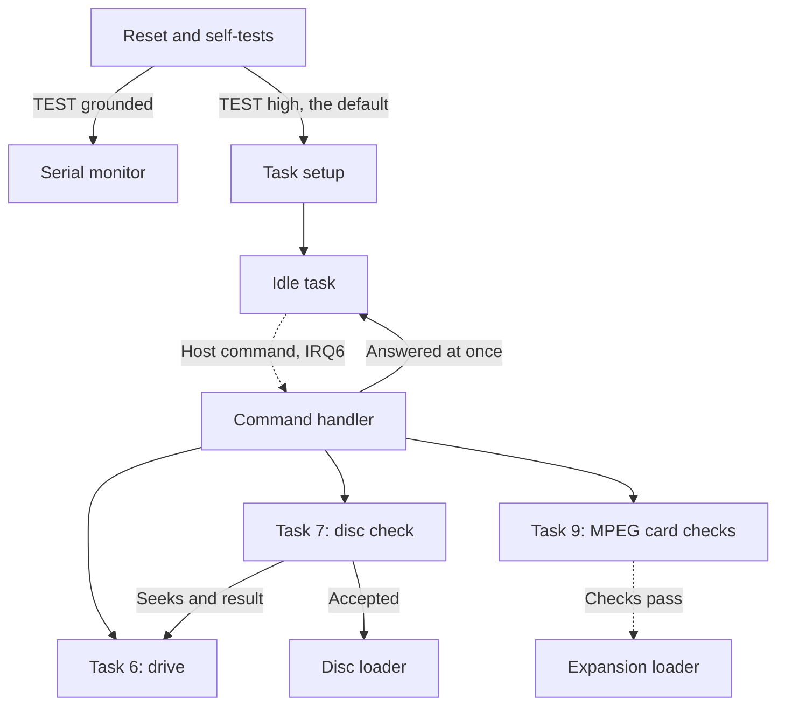
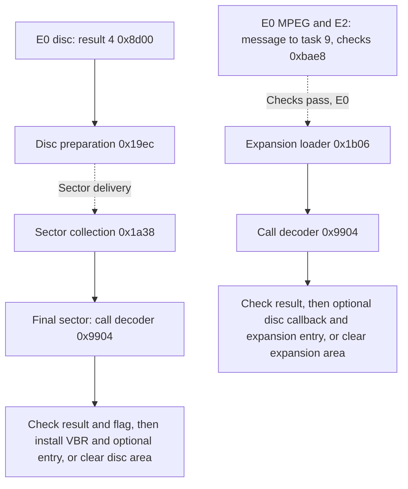
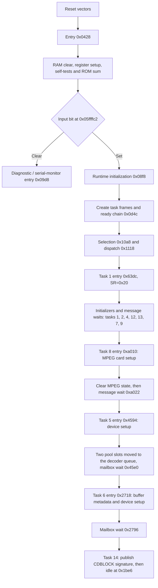
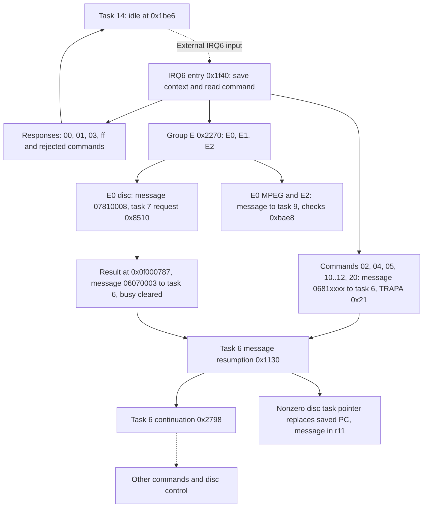

# Structure

The map of the CD-block firmware: lifecycle, modules and memory, plus startup and the tasks that
have no guide of their own. Addresses are CDB105. Module names describe observed responsibilities,
not original source boundaries. The tasks, messages, mailboxes, task states and `TRAPA` services
this page uses are the [kernel](kernel.md)'s. The main SH-2 BIOS and the optical drive's own
firmware are separate programs. [Bugs and oddities](bugs-and-oddities.md) lists the behavior that
looks unintended, the code nothing in the ROM reaches and the messages no ROM code posts.

| Guide | Covers |
| --- | --- |
| [Kernel](kernel.md) | Tasks, the restart, scheduling, messages, locks, timers and the other trap services |
| [Host commands](host-commands.md) | IRQ6 entry, dispatch, responses, commands `00..06`, `10..12`, `20`, `ff`, the data-command gate, group E and the MPEG commands |
| [Sector buffer](sector-buffer.md) | Slots, free pool, task 5's decoder queue, sector completion, filters and partitions |
| [Sector reads](sector-reads.md) | Task 5: the decoder's sector pulse, DMA channel 0, header and status checks, retries, correction and full buffers |
| [Subcode](subcode.md) | The R-W channels: the decoder interrupt's subcode handler, task 2's pack decoding and `20` type 1 |
| [Drive](drive.md) | The drive link, reports and commands, the startup and TOC, host requests and task 6's drive states |
| [Disc authentication](disc-authentication.md) | The `E0` disc check, including the disc-header parser |
| [File system](file-system.md) | Commands `70..75` and task 7's ISO 9660 reads: the volume descriptor, the directory table, Read File and Get File Info |
| [Extensions](extensions.md) | Disc and expansion loaders, MPEG card requests, expansion entries and hooks |
| [Decoder](decoder.md) | The payload decoder in full |

## Lifecycle

After reset the firmware tests its RAM and interface, sums the ROM, builds its task records and
dispatches the first task. Eleven tasks run their setup. Ten of them end in a mailbox wait, and the
last one idles. From then on work arrives as host commands through IRQ6, which can post messages
that wake tasks. Solid arrows in this page's diagrams are direct transfers. Dashed arrows are
connections whose intervening path is unknown.

[Reset and startup](#reset-and-startup) follows the chain up to the idle task, and
[task 6 and task 14](#task-6-and-task-14) the paths of a host command. The disc check has its own
[guide](disc-authentication.md).

After a disc passes, or the MPEG card checks pass, a loader decodes code into RAM with the
[payload decoder](decoder.md) ([extensions](extensions.md)).

Authentication, header recognition, decoder integrity and extension installation are separate
operations. A matching header or decoder trailer alone does not mean the firmware accepts a disc
or runs an extension. The kernel serves all of these paths.

## Module index

| Module | Main addresses | Coverage |
| --- | --- | --- |
| [Reset and startup](#reset-and-startup) | `0x0428`, mode branch `0x0502`, first task `0x63dc` | Documented |
| [Initial tasks](#initial-tasks) | Tasks 1, 2, 4, 12, 13, 7, 9, 8, 5, 6, 14, idle `0x1be6` | Documented |
| [Waits](#waits) | Mailbox waits, idle loop, delays, polling | Documented |
| [Scheduler](kernel.md#scheduling) | `0x0d4c`, `0x1058`, `0x102e`, `0x10a8`, `0x1118`, `0x116c`, `0x117c`, `0x11aa` | Documented |
| [Messages](kernel.md#messages) | Post `0x0f72/0x11be`, wait `0x0e80`, resume `0x1130`, send `0x0ee4`, reply `0x0f44`, post and raise `0x0fb8` | Documented |
| [Lock services](kernel.md#locks) | `0x1250..0x131d`, attempt `0x121e` | Documented |
| [Timers](kernel.md#timers) | `0x1c70`, `0x1c90`, `0x1d96`, `0x1e46` | Documented |
| [Restart](kernel.md#restart) | `TRAPA 0x2e` at `0x0d94`, timer reset `0x1c46` | Documented |
| [Other trap services](kernel.md#services) | `TRAPA 0x20..0x2d` | Documented |
| [Host commands](host-commands.md) | `0x1f40`, table `0x1fe0`, groups 1..7 `0x2050`/`0x2074`/`0x2090`/`0x20b4`/`0x20f4`/`0x2128`/`0x2160`, data-command gate `0x22fa`, handlers `0x9274..0x944f`, `0x4d68..0x4db7` and `0x7380..0x76ed`, group E `0x2270` | Documented |
| [Sector buffer](sector-buffer.md) | Task 5 `0x4594`, completion `0x4c52`, delivery `0x4fa4`, routing `0x5264`, partitions `0x506c`, `0x51be`, connections `0x54f0..0x5600`, selector helpers `0x5402..0x5475` and `0x54da`, task 4 `0x5704..0x5af3`, task 13 `0x6fd2..0x7321`, copy and move `0x6efc` | Documented |
| [Sector reads](sector-reads.md) | Task 5 `0x45e2..0x4bad`, queue helpers `0x4c0e..0x4d21`, IRQ7 `0x5bdc`, DMA channel 0 `0x5b38`/`0x5b7c`, deferred post `0x1eac`/`0x1d38`, task 1's correction `0x63f2..0x689b` | Documented |
| [Subcode](subcode.md) | Handler `0x5cb8`, task 2 `0x5e74`, Q and P parity `0x5fa4..0x6279`, GF(64) tables `0x6294..0x6353`, `20` type 1 `0x6354`, status byte `0x9170` | Documented. What the interface does at the sync frames unknown |
| [Data transfer](data-transfer.md) | Start `0x23ba`, DMA channel 1 end `0x2492`, `06` end `0x2568`, sector spans `0x6e18`/`0x6e76`, sector commands `0x689c..0x6961` and `0x754e`, task 12 `0x699a..0x6e17` | Documented. The interface's control bit 3 unknown |
| [File system](file-system.md) | Handlers `0x9478..0x973b`, task 7 `0x78b2`, `0x7954..0x7a5b` and `0x7b6c..0x8447`, ID window `0x7e36`, partition empty `0x5476` | Documented |
| [Task 6 and task 14](#task-6-and-task-14) | `0x2718`, `0x2a38`, `0x1be0`, `0x1efc`, dispatch `0x2798` | Documented |
| [Drive](drive.md) | Link `0x973c`, `0x987c`, dispatch `0x2834`, startup `0x2b1e..0x2d05`, TOC `0x3858`, host requests `0x2d06..0x3255`, drive states `0x3b7c`, commands `0x4148`, reports `0x3aa8`, status `0x28b0` | Documented. What the drive does with its commands unknown |
| [MPEG task](#mpeg-task) | `0xa010`, `0xa4d0`, table `0xa034`, activation `0xa41c`, card events `0xab78` | Documented, the card's handlers in [task 8's handlers](../mpeg-card/task-8.md) |
| [Card interrupts](extensions.md#card-interrupts) | Captures of ITU2, channel 2 of the SH-1's integrated timer pulse unit (ITU), `0xb852` and `0xa190`, DMA channel 2 and 3 ends `0x9ce4` and `0xb4bc`, ROM entries 35..42 `0xaacc..0xae8b` and 56..61 `0xb88e..0xba33` | Documented |
| [Disc authentication](disc-authentication.md) | Request `0x8510`, data track `0x85f0`, header scan `0x86d2..0x883f`, seeks `0x8874`, sector checks `0x8a42` and `0x8e6e..0x8fad`, classification `0x8b62`, result `0x8bd0`, `0x8d00`, extension read `0x8da8` | Documented, seek report meaning unknown |
| [Disc extension loader](extensions.md#disc-extension-loader) | `0x19d4..0x1b05` | Documented |
| [Expansion extension loader](extensions.md#expansion-extension-loader) | `0x1b06..0x1b79`, caller `0xbb38` | Documented |
| [MPEG card requests](extensions.md#mpeg-card-requests) | Task 9 `0xba48`, checks `0xbc28`, `0xbc7c..0xc16f`, action `0xbb1e` | Documented |
| [Get MPEG ROM](extensions.md#get-mpeg-rom) | `0xc170..0xc285`, ROM table entries 81..84, 86, 87 | Documented |
| [MPEG commands](host-commands.md#groups-9-and-a) | Groups 9 and A, `93` `0xa050`, `90..92` `0xaeda..0xaf33`, responses `0xae8c..0xaed9`, the [other ROM handlers](host-commands.md#the-other-rom-handlers) `95`, `99`, `9B`, `9C`, `9E`, `9F`, `A2..A4`, `A6`, `AE`, `AF` with entry 88 `0xb5d2`, the [handlers the cards replace](host-commands.md#the-handlers-the-cards-replace) `94`, `96..98`, `9A`, `9D`, `A0`, `A1`, `A5`, stubs `0xf800..0xf8ec` | Documented, the card's handlers in [MPEG commands](../mpeg-card/commands.md) |
| [Payload decoder](decoder.md) | `0x9904..0x9ce3` | Documented |
| [Extension hooks](extensions.md#hooks) | Decoded header fields, per-task PC words | Documented |
| [Interface page](extensions.md#expansion-entries) | Stubs `0xf800..0xf937`, ROM table `0xf938..0xfacb` | Documented |
| [Exceptions](#exceptions) | Vector table `0x0000..0x03ff`, handlers `0x0934..0x09d7` | Documented |
| [Serial monitor](#serial-monitor) | Report `0x09d8`, setup `0x0a48`, loop `0x0a72`, commands `0x0bb6`, `0x0c06`, `0x0c42` | Documented |

## Memory map

| Range | Contents |
| --- | --- |
| `0x00000000..0x0000ffff` | Firmware ROM |
| `0x00000000..0x000003ff` | Vector table |
| `0x00000400..0x0000c4ab` | Identity text, code and data |
| `0x0000c4ac..0x0000f7ff` | Unused, `ff` |
| `0x0000f800..0x0000facb` | Interface page: expansion entry stubs and the ROM table ([expansion entries](extensions.md#expansion-entries)) |
| `0x0000facc..0x0000ffff` | Unused, `ff` |
| `0x05fffe00..0x05ffffff` | SH7034 on-chip peripherals ([SH7034 notes](../sh7034.md)) |
| `0x09000000..0x0907ffff` | 512 KB CD-buffer DRAM |
| `0x09000000..0x09000063` | Byte 0 the last session's number, byte k the first track of session k |
| `0x09000064..0x090001ff` | TOC: entry n at `0x09000064 + 4*n` with control/ADR in bits 31..24 over a frame address. Tracks 1..99, then `A0` (first track in bits 23..16), `A1` (last track) and the lead-out at `0x090001fc`. Entry 0 holds the last `B0` report's lead-out limit, or without one the session count over the lead-out ([Drive](drive.md#the-toc)) |
| `0x09000200..0x09000217` | First `A0`, latest `A1` and `A2`, previous session's `A1`, and the two largest next-session starts |
| `0x09000218..0x0900022f` | Two Q records of the current position |
| `0x09000230 + n*0x930` | Raw sector slots, n below 202 |
| `0x09074210..0x09074e0f` | File system table: 256 records of 12 bytes ([file system](file-system.md#the-table-and-the-window)) |
| `0x09074e10..0x0907510f` | Subcode ring: 32 packs of 24 R-W symbols ([subcode](subcode.md#the-ring)) |
| `0x09075384..0x0907539b` | MPEG request state: accepted message, request byte `0x0907538a`, `E2` page, end, filter and slot ([Get MPEG ROM](extensions.md#get-mpeg-rom)) |
| `0x09075800..0x09077bff` | Decoded disc extension, with its header at `0x09075800` |
| `0x09075848` | Encoded disc extension collection area |
| `0x09077c00..0x0907aadf` | Sector-check buffers: one re-scrambled sector at `0x09077c00`, interleaved frames from `0x09078530` |
| `0x0907adb0..0x0907add3` | Disc request state: `E0` parameters, check positions, state byte `0x0907adcb`, saved `04` settings at `0x0907add0` |
| `0x0907b000..0x0907ffff` | Decoded card extension, with a jump table from `0x0907b008` |
| `0x0a000000..` | Interface chip registers |
| `0x0e000000..` | Expansion source (length word, then encoded data from `0x0e000004`) |
| `0x0f000000..0x0f000fff` | 4 KB on-chip RAM: task records, mailboxes, stacks, state |
| `0x0f000000..0x0f000007` | Diagnostic words and the ROM sum ([reset and startup](#reset-and-startup)). The monitor keeps its state from `0x0f000004` ([serial monitor](#the-monitor)) |
| `0x0f000220..0x0f00023f` | Software timers: four entries of identifier and deadline |
| `0x0f000248..0x0f00025b` | Data transfer state and the transfer byte ([names](data-transfer.md#names)) |
| `0x0f00025c..0x0f000303` | Task 6 state ([Drive names](drive.md#names)) |
| `0x0f00026c..0x0f00027b` | Two copies of the eight status bytes for CR1..CR4 ([Drive](drive.md#status-bytes)) |
| `0x0f0002c4..0x0f0002cf` | Staged drive command, byte 11 pending |
| `0x0f0002d0..0x0f0002db` | Latest drive report, 11 bytes, then its valid flag |
| `0x0f000304..0x0f000312` | Drive link: outgoing packet, received sum, byte count, full-save flag |
| `0x0f000314..0x0f000343` | Decoder queue: head, tail, count, current slot `+3`, last destination `+15`, next frame address `+44` |
| `0x0f000348..0x0f000353` | Free pool (head, tail, count, buffer-full byte), countdown longword, buffered-sector word `0x0f000350` |
| `0x0f000354..0x0f00041d` | Slot links shared by the pool, the decoder queue and the partitions |
| `0x0f000420..0x0f00059f` | 24 filter records, 16 bytes each |
| `0x0f0005a0..0x0f0005ff` | 24 filter connections, 4 bytes each |
| `0x0f000600..0x0f00068f` | 24 partition records, 6 bytes each |
| `0x0f000690..0x0f00069f` | CD device connections |
| `0x0f0006bc..0x0f0006d9` | Buffer command results and the sector lengths ([sector buffer names](sector-buffer.md#names)) |
| `0x0f0006dc..0x0f0006eb` | Decoder interrupt record, shared by the sector pulse and the subcode handler ([subcode](subcode.md#the-handlers-record)) |
| `0x0f0006ec..0x0f00070f` | Task 2's subcode state, locator terms and P notes ([subcode](subcode.md#names)) |
| `0x0f00071c..0x0f000727` | Task 12's request and transfer ([sector commands](data-transfer.md#sector-commands)) |
| `0x0f000728..0x0f000735` | Task 13's request and copy or move state ([copy and move](sector-buffer.md#copy-and-move)) |
| `0x0f000738..0x0f000740` | Task 4's request ([task 4](sector-buffer.md#task-4)) |
| `0x0f000744..0x0f000772` | File system state ([names](file-system.md#names)) |

## Reset and startup

Reset checks the board, sums the ROM and then either starts the kernel or enters the diagnostic
monitor.

- The reset vectors give PC `0x00000428` and SP `0x0f001000`.
- Reset sets SR to `0xf0`, r14 to 0 and VBR to 0, then clears all 4 KB of on-chip RAM before
  touching the stack. r14 stays zero through the first task.
- Register setup comes before the buffer-RAM and interface checks. The RAM check covers address
  lines, byte lanes, two complementary full-buffer patterns and zero.
- The interface setup at `startup_interface_setup` (`0x07e0`) writes 0 to `0x0a00001a`. CDB106
  writes `0x1100` there on boards with the 20-pin drive ([firmware
  revisions](../firmware-revisions.md#drive-strap)).
- A preliminary stride probe also touches `0x09080000..0x09080001`, past the 512 KB buffer. How the
  board decodes that address is unknown.
- RAM or interface failures set the diagnostic words at `0x0f000000` and `0x0f000002` and bit 7 of
  the hardware flag `0x0f00027d`, Sega's hardware error bit. Up to three attempts run, and a later
  pass overwrites earlier results. Failure does not stop startup.
- Word `0x0f000000` holds the address-line test: bit k for the buffer word at offset 2^k that read
  back wrong, bit 0 for offset 0. Word `0x0f000002` holds bit 0 for the byte lanes, bit 1 for the
  patterns, bit 2 for the interface registers, bit 3 for the interface data and the card mask in
  bits 4..7. Command `ff` returns both words, and the [serial monitor](#the-report) reports them.
- Identity text starts at `0x0400`: `"Copyright (C) Hitachi, Ltd. 1993"`, 34 bytes with the quotes,
  then a `0009` pad word. `startup_rom_sum` (`0x06f0`) sums the ROM as aligned big-endian longwords
  and stores the result at `0x0f000004`. The sum is zero, with `rom_checksum_compensation`
  (`0x0424`) as its compensation longword. Normal startup does not act on it. Command `ff` returns
  it, and the serial monitor's [report](#the-report) sends its low byte.
- The startup card test, `startup_mpeg_card_registers` (`0xa364`) and `startup_mpeg_card_test`
  (`0xa3b8`), sets up the card windows at `0x0a100000` and `0x0a180000` and returns a four-bit mask
  that becomes bits 4..7 of word `0x0f000002`. The caller sets hardware flag bit 1, MPEG card
  present, when the mask is zero, which the MPEG commands and `E2` later require.
- The setup writes `0x6c` to `0x0a100002` and arms DMA channels 2 and 3 to move two zero words each
  to `0x0a10001e` and `0x0a180000` on the card's video and audio data requests. It enables ITU0's
  and ITU1's capture A and both of ITU2's captures on falling edges
  ([card activation](extensions.md#card-activation)). After 120,000 loop passes the test
  reads back the register and the capture flags.

| Mask bit | Set when |
| --- | --- |
| 0 | `0x0a100002` does not read back `0x6c` |
| 1 | ITU1 captured no falling edge of TIOCA1, the card's video data request |
| 2 | ITU2 captured no falling edge of TIOCB2, the card's video interrupt `MPEG V IRQ` |
| 3 | ITU0 captured no falling edge of TIOCA0, the card's audio data request |

- The last check, at `startup_zero_result` (`0x08ec`), always returns 0, so its caller never sets
  hardware flag bit 0.
- Bit 2 of `0x05ffffc2` selects normal initialization at `startup_runtime_init` (`0x08f8`) when
  set, or the diagnostic and [serial monitor](#serial-monitor) entry at `diagnostic_report`
  (`0x09d8`) when clear. Error flags do not affect this choice. The bit is PB10, the board's `TEST`
  input on test pad TP3, pulled high ([board](../board.md#test-pads-and-other-pins)).
- Normal initialization calls `startup_auth_state` (`0xba34`), `startup_disc_result_clear`
  (`0x77a8`), `disc_extension_reset` (`0x19d4`), `startup_transfer_state` (`0x2388`) and
  `startup_timer_state` (`0x1c04`). They clear the disc result, the card status, the busy flag and
  the check bits, clear the disc-extension buffer and initialize the transfer state and the timers.
  No extension is loaded. Task setup follows at `startup_task_queues` (`0x0d4c`,
  [Kernel](kernel.md#tasks)).
- The first task starts at `task1_message_entry` (`0x63dc`) with SP `0x0f000cb0`, SR `0x20`, VBR 0,
  r14 0, GBR `0x05ffff00` and PR `0x0d90`.

## Initial tasks

Each task runs its setup once and then waits for its first message. With no host commands pending,
they run in this order, the order of the startup chain. After that, whenever several tasks are
ready, the one with the highest priority runs, 1 being the highest
([scheduling](kernel.md#scheduling)).

| ID | Priority | Entry | Work before the first wait | Wait / saved continuation | Work after the wait |
| --- | --- | --- | --- | --- | --- |
| 1 | 8 | `task1_message_entry` (`0x63dc`) | None. A later filter accepts source/class 5 with low byte `0x10` | `task1_message_wait` (`0x63de`) / `0x63e0` | Repairs the sectors task 5 sends (`01050010`) with their P and Q parity and answers `05010011` ([correction](sector-reads.md#correction)) |
| 2 | 7 | `task2_entry` (`0x5e68`) | Clear three words at `0x0f0006ec` | `0x5e72` / `task2_message` (`0x5e74`) | Decodes the R-W subcode packs that the decoder interrupt collects and sends them to the host ([subcode](subcode.md#task-2)) |
| 4 | 1 | `task4_buffer_entry` (`0x56f8`) | Initialize buffer links, slot records and command state | `0x5702` / `task4_message` (`0x5704`) | Carries out the filter settings, selector resets, size calculations and frame searches of groups 4 and 5 ([task 4](sector-buffer.md#task-4)) |
| 12 | 4 | `task12_entry` (`0x6990`) | Initialize `0x0f00071c..0x0f000727` | `0x6998` / `task12_dispatch` (`0x699a`) | Runs the sector data commands `61..64` ([sector commands](data-transfer.md#sector-commands)) |
| 13 | 9 | `task13_entry` (`0x6fc8`) | Initialize `0x0f000728..0x0f000735` | `0x6fd0` / `task13_message` (`0x6fd2`) | Copies and moves sectors for `65` and `66` ([copy and move](sector-buffer.md#copy-and-move)) |
| 7 | 5 | `task7_disc_entry` (`0x77b2`) | Initialize disc and header fields and a `0x0c00`-byte workspace | `0x77c0` / `task7_message_class` (`0x77c2`) | Disc requests: [disc authentication](disc-authentication.md) and the [file system](file-system.md) |
| 9 | 10 | `task9_message_wait` (`0xba46`) | None, waits before expansion processing | `task9_message_wait` / `task9_message_dispatch` (`0xba48`) | [MPEG card requests](extensions.md#mpeg-card-requests): the card checks and load and `E2`. The [card work loop](extensions.md#card-work-loop) |
| 8 | 6 | `task8_mpeg_entry` (`0xa010`) | Write an MPEG card register, clear two RAM regions | `task8_message_wait` (`0xa022`) / `task8_message_dispatch` (`0xa024`) | The MPEG card's messages: activation and the card's events, mostly through the card extension ([MPEG task](#mpeg-task)) |
| 5 | 3 | `task5_setup` (`0x4594`) | Update device registers, clear local state, move two pool slots to its queue | `task5_message_wait` (`0x45e0`) / `task5_message` (`0x45e2`) | Takes the sectors of a read from the decoder, checks them and passes them through the filters ([sector reads](sector-reads.md)) |
| 6 | 2 | `task6_setup` (`0x2718`) | Initialize buffer metadata and local state, keep diagnostics, update registers | `task6_message_wait` (`0x2796`) / `task6_message_dispatch` (`0x2798`) | Runs the drive: commands, reports, the host's drive requests and the status ([task 6 and task 14](#task-6-and-task-14)) |
| 14 | 11 | `task14_entry` (`0x1be0`) | Write control registers and the NUL `CDBLOCK` signature | Idle loop `task14_idle` (`0x1be6`), no mailbox | None. The scheduler returns to its loop whenever no other task is ready |

- Every task enters with SR `0x20`, r14 0 and VBR 0. PR is `0x0d90` for task 1 and `0x0ed2`
  afterward. Tasks 7, 8 and 6 leave T set, so their waits save SR `0x21`. The others save `0x20`.
- The ten mailbox tasks end in state 1, waiting for a message
  ([task states](kernel.md#task-states)), with exception frames. Task 6 saves PC
  `task6_message_dispatch` and SR `0x21` at SP `0x0f000a88`. Task 5 saves PC `task5_message` and SR
  `0x20` at SP `0x0f000b98`.
- Task 14 is then current (record `0x0f0001bc`, state 5, running) and all twelve ready heads, the
  heads of the scheduler's ready queues ([scheduling](kernel.md#scheduling)), are empty. It idles
  with PC and PR `task14_idle`, SP `0x0f001000`, SR `0x20`, GBR `0x05ffff00`, r14 and VBR 0.
- The first seven tasks touch RAM only. Task 8 adds one register write. Task 5 adds two word reads
  and four word writes. Task 6 adds seven mixed-width accesses and task 14 nine word accesses.
  None posts or consumes a message during setup.
- Message resumption can replace a task's saved PC with a word from the decoded disc-extension
  header ([Hooks](extensions.md#hooks)).
- The host's reset request runs this setup again for every task except 6 and 14, which ends in the
  same waits ([restart](kernel.md#restart)).

### Setup helpers

- Task 4 builds the sector lists and resets filters and partitions through
  `buffer_records_initialize` (`0x5370`) and `selector_initialize` (`0x53b0`) ([Sector
  buffer](sector-buffer.md#setup)).
- `buffer_command_state_initialize` (`0x5790`) clears command state at `0x0f0006bc..0x0f0006d9`.
- `task12_state_initialize` (`0x6b34`) clears task 12 state and sets bytes `0x0f000725` and
  `0x0f000727` to `ff`. `task13_state_initialize` (`0x7026`) clears task 13 state and sets
  `0x0f000731` to `ff`.
- Disc initialization `disc_state_initialize` (`0x7a60`) clears the stored header ID and metadata,
  selected state, and `0x09074210..0x09074e0f`. Its shared tail clears busy flag `0x0f0007b0` only
  when disc state `0x0907adcb` was nonzero.
- The alternate entry `disc_state_restart` (`0x7abc`) also clears the disc result `0x0f000787` and
  the delivery gate `0x0f000788` and writes `0x0200`, EFLS, to `0x0a00001e` ([interrupt
  flags](host-commands.md#interrupt-flags)).

## Waits

A mailbox wait can depend on hardware only through whatever posts the message. The table separates
the immediate release condition from its outside source. A message is one 32-bit word, written
here as eight hex digits such as `048100cc`: the destination task, the class or the sending task,
and a 16-bit payload ([messages](kernel.md#messages)).

| Wait or loop | Release condition | Outside source |
| --- | --- | --- |
| Task 4 wait `0x5702` | `40`, `42`, `44`, `46`, `48`, `52` and `55` post `048100cc` | IRQ6 host command |
| Task 12 wait `0x6998` | `61..64` post `0c8100cc`, `06` the end of a transfer `0c030001` | IRQ6 host command |
| Task 13 wait `0x6fd0` | `65` and `66` post `0d8100cc` | IRQ6 host command |
| Task 8 wait `task8_message_wait` (`0xa022`) | A mailbox message from the MPEG commands, such as `08810004` from `93`, from task 9 (`08090004`, which activates the card again) or from the card's interrupts ([MPEG task](#mpeg-task)) | IRQ6 host command, ITU2 captures, DMA channels 2 and 3 |
| Task 5 wait `task5_message_wait` (`0x45e0`) | A mailbox message. Task 6 posts its read requests `0506xxxx`, the decoder interrupt the pulse lock `05800012`, the end of DMA channel 0 each sector `05840010`, task 1 `05010011` and command `30` `05810030` | Decoder (IRQ7), DMA channel 0, ITU4 compare match B, IRQ6 host command, drive link |
| Task 1 wait `task1_message_wait` (`0x63de`) | Task 5's correction request `01050010` | Decoder status |
| Task 2 wait `0x5e72` | A mailbox message. The subcode handler posts `02800010`, `20` type 1 `02810000` and `06` the end of a transfer `02030001` | Decoder (IRQ7), ITU4 compare match B, IRQ6 host command |
| Task 7 wait `0x77c0` | A mailbox message. `E0` subcode 0 posts `07810008`, `70..75` `07810000..07810007`, sector delivery `07040000` and `07040001`, the timer `07070000`, `06` the end of a transfer `07030001`, task 6 `07060002` when an authentication seek completes, `07060003` when the drive stops or gives up under authentication ([drive stopped](disc-authentication.md#drive-stopped)), `07060000` from the disc-gone reset and `07060001` once the seek after the TOC settles | IRQ6 host command, decoder, ITU4, drive link |
| Task 9 wait `task9_message_wait` (`0xba46`) | A mailbox message. `E0` subcode 1 posts `09810002`, `E2` `09810004`, `93` `09810000` and `9A` `09810001` | IRQ6 host command |
| Task 6 wait `task6_message_wait` (`0x2796`) | A mailbox message. Host commands `02`, `04`, `05`, `10..12` and `20` post `0681xxxx`, `06` the end of a transfer `06030001`, task 7 its requests `06070000..06070004`, the sector buffer and task 5 `0604xxxx` and `0605xxxx`, the standby timer `06060000` and the drive link a report `06830000` after every frame | IRQ6 host command, drive link, decoder, ITU4 |
| Task 6 clear loops `0x272e..0x2734`, `0x2a3e..0x2a44` | Pointer reaches a fixed end address | None, RAM initialization |
| Task 14 idle `task14_idle` (`0x1be6..0x1bee`) | None in the loop. IRQ6 (priority 6) interrupts it at mask 2 | IRQ6 input |
| Contended acquire at `trap_lock_acquire` (`0x12d2`) | The owner releases and the waiter is selected | Internal |
| Time read in `TRAPA 0x24`, `timer_start` (`0x1d96..0x1da2`) | The time high part reads the same before and after TCNT4 | ITU4 overflow |
| Startup delays `0x04c8..0x04cc`, `0x070a..0x070e` | 120,000 passes before the card check reads its flags, 400 before the buffer probe | None |
| Card check waits `0xbd3c..0xbd40`, `0xbed0..0xbed4` | 1,280 passes before [checks 1 and 3](extensions.md#card-checks) read CHCR2 and CHCR3 | The card's data requests |
| Card ready `card_ready` (`0xbfca`) and the card memory fill `card_memory_fill` (`0xc014`), compare `card_memory_compare` (`0xc082`) and clear `card_memory_clear` (`0xc0f4`) | Bit 0 of `0x0a100034` set, up to 33 tries, or bit 2 clear before each word, at most 81 reads ([card memory](extensions.md#card-memory)) | MPEG card |
| Entry 57 `0xb8f0..0xb8f6` | 8 passes between the two writes to `0x0a180008` | None |
| Header delay `disc_header_delay_loop` (`0x8836..0x883a`) | A counter reaches zero after 14,000,000 iterations | None |
| Diagnostic mode poll `0x0a36..0x0a42` | Bit 2 of `0x05ffffc2` stays set for 200,000 polls. A clear bit reloads the count | `TEST` input, TP3 |
| Diagnostic report delay `0x09ee..0x09f2` | 2,857,142 passes | None |
| Monitor loop `monitor_loop` (`0x0a72..0x0a82`) | None. It polls SCI1 with interrupts masked ([the monitor](#the-monitor)) | SCI1 |

All mailbox waits use `TRAPA 0x23` ([waiting](kernel.md#waiting)). Tasks 5, 6 and 14 read device
registers once during setup. Those reads are not readiness polls. Every other loop in the ROM ends
on its own count or data.

## Task 6 and task 14

Task 6 is the drive task. It keeps the drive state and the latest drive report, holds cached status
and the TOC, and receives the host's drive requests, task 7's requests, messages from the sector
buffer and task 5, and the drive's reports. The [Drive](drive.md) guide follows its work
from the startup on. Task 14 publishes the
`CDBLOCK` signature and then idles.

A host command interrupts the idle task through IRQ6. The handler answers some commands at once
and hands the others to tasks as messages.

### Task 6 setup

- Task 6 at `task6_setup` (`0x2718`) sets GBR to `0x0f00025c`, saves PR around `toc_clear`
  (`0x2a38`), then clears `0x0f00025c..0x0f000303` except diagnostic byte `0x0f00027d`.
- State `+16/+20/+24/+28` become `ffffffff`, bytes `+16/+24` become zero and `+162` becomes `ff`.
  Longwords `0x0f000304..0x0f000313` become 0, 0, 255, 0. Task 5 state and the pool are untouched.
- Helper `toc_clear` fills `0x09000000..0x09000203` with `ff`, clears `0x09000210..0x09000217`
  (writing the first word twice), clears the [multi-session bit](drive.md#flags), bit 7 of state
  `+3`, and longwords `+132/+136/+140`. It has
  a second caller at `0x2a9a`.
- Setup then fills `0x09000218..0x0900022f` with `ff`. `0x09000204..0x0900020f` is left unchanged.
- With interrupts masked (SR ORed with `0xf0`), task 6 rewrites the word at `0x0a00001a` as
  `(value & 0xffef) | 0x40`, then restores SR.
- It writes byte `0x30` to SCR0 (`0x05fffec2`) and ORs `0x50` into TIOR3 (`0x05ffff23`) and
  `0x02` into TIER3 (`0x05ffff24`), which set up the [drive link](drive.md#link). It leaves
  GBR `0x05ffff00`, keeps PR and SP, and waits with T set.

### Task 6 messages

Messages resume at `task6_message_dispatch` (`0x2798`), which sets GBR `0x0f00025c` and keeps the
message in r12, the sign-extended class in r8 and the payload low byte in r11.

| Message | Continues at |
| --- | --- |
| Class `0x81`, payload 12 | `drive_request_subcode` (`0x35e4`), the Q record to the host |
| Class `0x81`, payload 13 | `drive_request_toc` (`0x360e`), the TOC to the host |
| Class `0x81`, payload 0 | `drive_request_init` (`0x2d06`), the reset request ([restart](kernel.md#restart)) |
| Class 3 | `task6_class_3` (`0x2866`) |
| Anything else | By drive state, below |

- A drive report (class `0x83`) with the [reply bit](drive.md#flags) set and byte `0x0f0002cf`
  other than 1 clears the busy bit, or the reply bit when the busy bit is already clear.
- Drive state byte `0x0f0002a5` then selects the handling.

| Drive state | Handling |
| --- | --- |
| 0, after reset | `task6_state_0` (`0x2ad8`). Every message except a drive report waits again at `task6_message_wait` (`0x2796`), including command `05` and task 7's class 7 requests. A drive report with byte `0x0f0002db` equal to 1 continues on the report status at `0x2af2` ([drive state 0](drive.md#drive-state-0)) |
| 17..22 | Table at `task6_drive_state_table` (`0x2818`, [tray and disc states](drive.md#tray-and-disc-states)) |
| Other | [Class dispatch](drive.md#task-6-dispatch) from `task6_class_dispatch` (`0x2834`) |

### Task 14

- Task 14 at `task14_entry` (`0x1be0`) calls `task14_register_setup` (`0x1efc`), which writes 0 to
  `0x0a000004`, ORs `0x0060` into `0x05ffff86`, writes `0x0001` to `0x0a000008` and `0x0be1` to
  `0x0a00001e` ([interrupt flags](host-commands.md#interrupt-flags)). The first and third writes
  clear the interface's command flags and enable the command interrupt, so host commands raise IRQ6
  from here on ([board](../board.md#interrupts)).
- It then writes `0x0043`, `0x4442`, `0x4c4f`, `0x434b` to `0x0a000010..0x0a000017`, the bytes NUL
  `CDBLOCK`. After task 5, `0x05ffff86` reads `0x0068`: IRQ6 priority 6, IRQ7 priority 8.
- Task 14 then loops at `task14_idle` (`0x1be6`, three NOPs and a BRA with a NOP delay slot). It
  has no exit of its own. ROM longword `0x0118` points to the IRQ6 handler at `irq6_command_entry`
  (`0x1f40`).

## MPEG task

Task 8, the MPEG task, sets up an MPEG card register and then dispatches its messages, mostly into
the MPEG card extension.

- Task 8 writes `0x7fff` to the word register at `0x0a10001a`, which Yabause places on the MPEG
  card ([board](../board.md#mpeg-card)).
- Helper `mpeg_state_clear` (`0xa4d0`) clears 24 longwords at `0x0f000840..0x0f00089f`, then 83
  longwords at `0x090752a0..0x090753eb`, both in descending order. It makes no calls, posts
  nothing, reads no status and returns with T set.
- Task 8 keeps PR around the helper and waits with `TRAPA 0x23` at `task8_message_wait` (`0xa022`),
  saving SP `0x0f000dd8`, PC `task8_message_dispatch` (`0xa024`) and SR `0x21`.
- On resumption, `task8_message_dispatch` uses the low byte of r11 as a byte offset into the table
  at `task8_dispatch_table` (`0xa034`). There is no scaling, range or alignment check, and offset 24
  reads the literal `0x0a100000` that follows the table.

| Offset | Handler |
| --- | --- |
| 0 | `expansion_entry_32` (`0xf80a`), expansion entry |
| 4 | `task8_mpeg_activate` (`0xa41c`) |
| 8 | `expansion_entry_51` (`0xf856`), expansion entry |
| 12 | `expansion_entry_72` (`0xf8aa`), expansion entry |
| 16 | `expansion_entry_35` (`0xf816`), expansion entry |
| 20 | `expansion_entry_64` (`0xf88a`), expansion entry |

- The five expansion entries jump through the loaded card extension's table ([Expansion
  entries](extensions.md#expansion-entries)). On the known cards, offset 0's entry 32 is
  `task8_message_wait` from the ROM table, task 8's own wait, and the other four are card code
  ([MPEG card SH-1 code](../mpeg-card/sh1-code.md#other-entries)). `task8_mpeg_activate` activates
  the card ([card activation](extensions.md#card-activation)).
- The card's interrupts post to offsets 8, 12 and 16. Under the ROM table, offset 16's entry 35 is
  `task8_card_events` (`0xab78`), which handles the card's events and calls further entries
  ([card interrupts](extensions.md#task-8s-card-events)).
- Task 8 comes before task 9 in the ready order, so its handlers run before a card job in task 9
  goes on.
- Resumption first checks the disc task-8 word at `0x09075820`. A nonzero value replaces
  `task8_message_dispatch`, so the task continues at that address with the message in r11.

## Exceptions

The vector table sends every exception and interrupt without a handler of its own to a few short
handlers at `0x0934..0x09d7`. None of their sources is raised in normal operation, but each has a
defined effect: most restart the firmware, a few return at once, and a DMA address error stops the
DMA controller.

| Handler | Vectors | Effect |
| --- | --- | --- |
| `exception_illegal_instruction` (`0x0934`) | 4, general illegal instruction | Restart |
| `exception_slot_illegal` (`0x093a`) | 6, slot illegal instruction | Return |
| `exception_address_error` (`0x0940`) | 9, CPU address error | Return |
| `exception_dma_address_error` (`0x0946`) | 10, DMA address error | Stop the DMA controller, then return |
| `exception_nmi` (`0x09b4`) | 11, NMI | Return |
| `exception_user_break` (`0x09ba`) | 12, user break | Restart |
| `interrupt_sci1` (`0x09c6`) | 104..107, SCI1 | Restart |
| `interrupt_unused` (`0x09cc`) | 64..69 (IRQ0..IRQ5), 80..82 (ITU0), 84..86 (ITU1), 90 (ITU2 overflow), 92 and 94 (ITU3 compare match A, overflow), 100, 102 and 103 (SCI0 receive error, transmit, transmit end), 108 (parity), 109 (A/D), 112 (watchdog), 113 (refresh) | Restart |
| `exception_ignored` (`0x09d2`) | Reserved vectors, `TRAPA 0x2f..0x3f` | Return |

- The vectors with handlers of their own are the traps `0x20..0x2e` ([kernel](kernel.md#services)),
  IRQ6, IRQ7, the four DMA channel ends, ITU2's two captures, ITU3's compare match B, ITU4 and
  SCI0's receive. `exception_restart_unused` (`0x09c0`) is one more restart stub, which no vector
  names.
- The table applies while VBR is 0. An extension's own table can name other handlers
  ([extensions](extensions.md#disc-extension-loader)).

### Restart

- A restart branches to the reset entry `firmware_reset` (`0x0428`) without a reset. SP stays where
  the exception left it, eight bytes below the interrupted SP, until the first task gets its own.
- Startup then runs as after reset. It sets up the registers again and stops the DMA channels, and
  the RAM test rewrites the whole buffer, so a loaded extension is gone. VBR returns to 0. Registers
  that only later code writes, such as channel 0's addresses, keep their values until it runs.
- The firmware ends in the same idle state as after reset, with task 6 back in drive state 0. Only
  a longword below the idle task's frame differs: the return address `disc_extension_reset`
  (`0x19d4`) pushes, eight bytes lower.

### DMA address error

- The handler masks interrupts and stops the DMA controller as startup's DMA setup does: it clears
  DMAOR, which also clears its address error flag, writes `0x40` to CHCR0..CHCR3, which clears DE,
  IE and TE, and sets DMAOR to 1.
- It then writes 8 to the transfer control `0x0a000002`, as a transfer's end does, and returns. No
  task is told, so whatever waited for a channel's end keeps waiting.
- A sector read waits for a sector no channel writes. Task 6 stays in drive state 12, host status 4
  (SEEK), with no timeout, until a new play command restarts the read.
- A host transfer stops where it is. `06` ends it with the words moved, and a put files its
  part-filled slot ([data transfer](data-transfer.md)).
- A card check on channel 2 or 3 fails, as when the card never asks for data
  ([MPEG card requests](extensions.md#mpeg-card-requests)).

### What can raise them

- The firmware leaves IRQ0..IRQ5, ITU0, ITU1, SCI1, parity, A/D, the watchdog and refresh at
  priority 0 (IPRA, IPRE and parts of IPRB and IPRC), so they never interrupt.
- The level 6 sources that restart, ITU2's overflow, ITU3's compare match A and overflow and SCI0's
  transmit and transmit end, have their enables clear.
- SCI0's receive error shares its enable with the receive interrupt, which the drive link sets for
  the drive's last byte. In the link's clocked synchronous mode the only receive error is an
  overrun, and the strobe handler clears SSR0 before every transfer, so none arises.
- The card checks enable ITU1's and ITU0's capture A as DMA requests for channels 2 and 3, at
  priority 0, so they never interrupt either.
- Startup clears the user break controller, NMI is tied high
  ([board](../board.md#clock-reset-and-mode)), and no ROM code issues `TRAPA 0x2c` or `0x2f..0x3f`.
  The illegal instruction and address error vectors need code or a DMA setup that faults.

## Serial monitor

With `TEST` (TP3) grounded at reset the firmware reports its self-tests on SCI1, then runs a small
monitor that reads and writes memory over a 9600-bps line. The kernel never starts. SCI1 reaches
TP1 (SCK1), TP2 (TxD1) and TP3 (PB10, also RxD1)
([board](../board.md#test-pads-and-other-pins)), and the rear SH-2 serial port is separate. This is
the monitor reported on the CD-block test pads
([references](../references.md#prior-community-work)).

In effect it is a board test tool: `R` and `W` reach the buffer RAM, the interface and the MPEG
card and expansion areas, and `L` repeats one access for a probe to follow. Its refusals leave no
way to read the ROM past the identity text's first 32 bytes: no command runs code, and the
peripherals, where a DMA channel would be set up, cannot be written.

### The report

- Reset branches to `diagnostic_report` (`0x09d8`) with interrupts masked. SCI1 is still as startup
  set it: clocked synchronous, BRR1 99, which gives 50,000 bit/s at 20 MHz, the clock on TP1
  ([SH7034 notes](../sh7034.md#itu-channel-3-and-sci0)).
- It sends two bytes: the low byte of the ROM sum, 0 for a good ROM, then after a delay loop of
  2,857,142 passes a byte built from the [diagnostic words](#reset-and-startup).

| Bit | Set when |
| --- | --- |
| 0 | An address line or the byte lanes failed |
| 1 | The patterns failed |
| 2 | The interface registers failed, or no address line failed |
| 3 | The interface data failed |
| 4 | Card mask bit 0 or 2 |
| 5 | Card mask bit 1 |
| 6 | Card mask bit 3 |
| 7 | Never. It would need a fifth mask bit |

- Bit 2 is set on a board that passes, because the byte is built in r13, which still holds
  `0x0f000004` from reading the sum. Only an address-line failure replaces it with 1. A passing
  board with the card test passing reports `00 04`.
- The firmware then waits for `TEST` to read high 200,000 times in a row. A low read starts the
  count again.

### The monitor

- Setup at `monitor_setup` (`0x0a48`) sets SP to `0x0f001000`, SCI1 to asynchronous 8N1 at BRR1
  `0x41` (about 9470 bps, nominally 9600) with transmit and receive, and PB10 to RxD1, so TP3
  becomes the receive line. Interrupts stay masked, and the loop at `monitor_loop` (`0x0a72`) polls.
- Setup clears SSR1 while transmit is still enabled. By the SH7034's flag rules that starts a
  transmission of TDR1, which still holds the report's second byte, so that byte goes out again at
  9600 bps before the prompt `:` ([SH7034 notes](../sh7034.md)). Whether a board sends it is
  unknown.
- The monitor's state replaces the ROM sum at `0x0f000004`: the line length, the transmit ring's
  write and read indexes and a line-ready byte, then `L`'s address, word and mode. The line is at
  `0x0f000100` and the 256-byte transmit ring at `0x0f000200`.
- Every received byte is echoed. Tabs and bytes from `0x20` up, `0x80..0xff` included, are stored.
  Backspace drops one. Other control bytes are only echoed.
- CR ends the line and is echoed alone, without a line feed. A line keeps at most 255 bytes, and
  later bytes overwrite the last one.
- The line's first byte names the command, in either case. Other lines only get the prompt.
- Arguments are hex, after spaces or tabs. A byte that is not a hex digit counts as 0, and only the
  last eight digits count.

| Command | Effect | Refused |
| --- | --- | --- |
| `R address` | Answers `>`, four hex digits and CR: the byte at an odd address after `00`, or the word at an even one | Never, but area 0 reads only `0x0400` plus the low five bits, the first 32 of the identity text's 34 bytes, and area 7 only `0x0f000000..0x0f000007`, the diagnostic words and the monitor's own state |
| `W address value` | Writes the value's low byte to an odd address or its low word to an even one. No answer | Areas 5 (on-chip peripherals) and 7 (on-chip RAM) |
| `L address [value]` | Reads the address, or writes the value, once a loop until the next CR arrives. No answer | Areas 0, 5 and 7 |

- The area is address bits 26..24. A refused command, or one missing an argument, does nothing,
  and the prompt follows as usual.
- So the monitor cannot read the ROM past the identity text's first 32 bytes or on-chip RAM past
  its first eight bytes, and cannot write on-chip RAM or peripherals. The buffer RAM, the interface
  and the MPEG card and expansion areas are open to all three commands.
- The transmit ring has no full check. When 256 bytes wait, the write index passes the read index
  and the waiting output is lost. Lines sent back to back at the line rate do this: each `R` line of
  four bytes queues eleven, and the four byte times it takes to arrive send only four.

## Reading the ROM

- Code and data overlap. The decoder reads its own instructions as constants, and task 14's
  descriptor reads vector longwords as a RAM range.
- Vectors, computed branches, tables, alternate entries, saved-return edits and RAM-loaded targets
  create paths that a plain function graph or linear disassembly misses.
- Uniform fill does not prove a range is unused.
