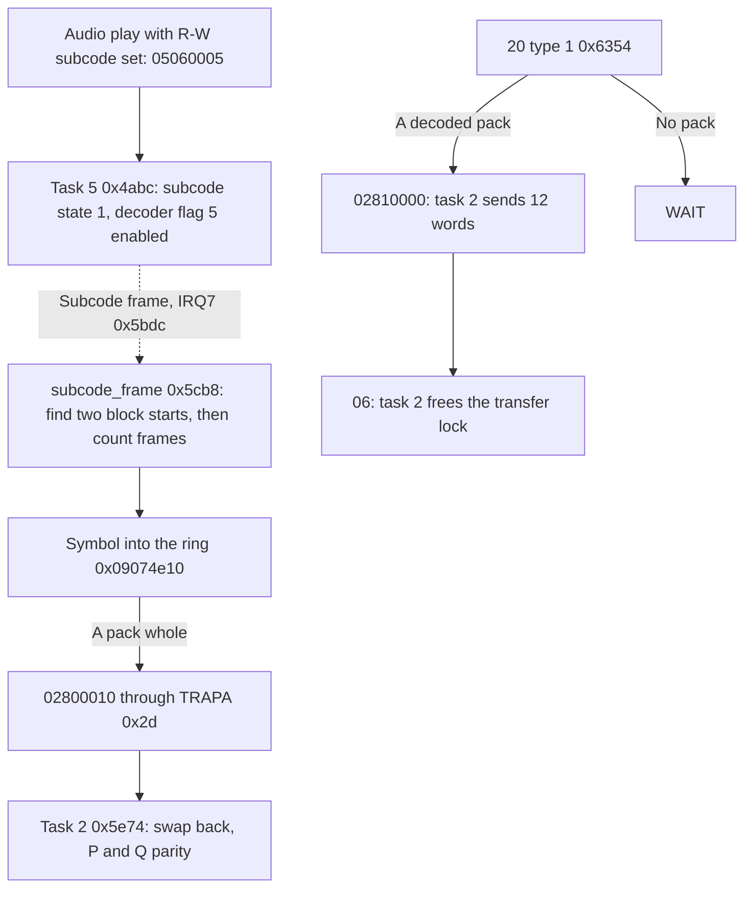

# Subcode

## What it does

Alongside the sound or data, a CD carries subcode: eight channels named P to W, one bit each in
every frame of the disc. P and Q mark tracks and positions, and the drive reports them. CD+G discs
use the other six, R to W, for graphics. When Initialize CD Block turns on its R-W setting, the CD
block collects them while an audio track plays.

- Collecting. The decoder interrupt brings one 6-bit symbol per frame, 7350 a second. The firmware
  counts frames by time and sorts the symbols into packs of 24, undoing the way the disc spreads
  each pack over eight.
- Correcting. Task 2 checks each pack with its two layers of Reed-Solomon parity and fixes up to
  two wrong symbols. A pack it cannot fix is marked.
- Sending. Get Subcode with type 1 sends the Saturn one pack at a time, with a flag for a marked
  pack and one for packs lost because the Saturn read too slowly.
- Oddities. Some packs with too many errors come out wrongly "corrected" and unmarked, a delayed
  task 2 can spoil packs the Saturn has not read yet, and an interrupt that comes slightly late
  misplaces the rest of a block ([bugs and oddities](#bugs-and-oddities)).

The sections below follow CDB105 by address.

## Overview

With bit 1 of the initialization flags an audio play turns the R-W channels on. The decoder
interrupt then brings one six-bit symbol per frame, the subcode handler puts each symbol in place in
a ring of packs, task 2 corrects each whole pack with its two Reed-Solomon codes, and `20` type 1
sends the host one pack of 24 symbols at a time.



- Task 6 posts `05060005` when an audio read starts with bit 1 of the initialization flags, the R-W
  subcode setting of `04` ([read started](drive.md#read-started)). A pause
  posts `05060007`, which turns it off ([sector reads](sector-reads.md#subcode)).
- Like every interrupt handler, the subcode handler posts through `TRAPA 0x2d`, and compare match B
  of ITU4, channel 4 of the SH-1's integrated timer pulse unit (ITU), delivers the message
  ([posting from interrupts](kernel.md#posting-from-interrupts)).
- The pack format, the swaps and the interleave are those that US 5,502,696 describes for the R-W
  channels ([references](../references.md#cd-subcode)).

## Names

| Name | Address | Contents |
| --- | --- | --- |
| Decoder record | `0x0f0006dc..0x0f0006eb` | Shared by the [sector pulse](sector-reads.md#sector-pulse) and the subcode handler ([fields](#the-handlers-record)) |
| Ring | `0x09074e10..0x0907510f` | 32 packs of 24 bytes, one symbol each |
| Task 2 state | `0x0f0006ec..0x0f0006f7` | Its two ring indexes, its state and the last results ([fields](#task-2)) |
| Locator terms | `0x0f0006f8..0x0f000704` | Products and quotients of the P syndromes ([P parity](#p-parity)) |
| P notes | `0x0f000708..0x0f00070f` | The last P correction's logs, symbols and nonzero patterns |
| Symbol word | `0x0a000018` | The frame's R-W symbol in the low six bits |
| Decoder flags | `0x0a000006` | Bit 5 a subcode frame, bit 6 with it the start of a block, as the handler reads them |
| `gf64_antilog_table` | `0x6294` | Powers of alpha in GF(64), field polynomial x^6 + x + 1 |
| `gf64_log_table` | `0x62d4` | Their logarithms. The log of 0 is 63 |
| `gf64_distance_table` | `0x6314` | For the two-error step: c = alpha^d + alpha^-d gives d, 1..23, and 0 for any other c |

The names of the two answer flags are Sega's (`CDC_TgetScdRwch`,
[references](../references.md#sega-documentation)).

### The handler's record

| Offset | Field |
| --- | --- |
| `+1` | Subcode state: 0 off, 1 hunting, 2 locked |
| `+2` | The low byte of the flags word, taken each frame |
| `+3` | Pack done, the pulse's tolerance byte |
| `+4` | Pack 0..31 of the stream |
| `+5` | Symbol 0..23 in that pack |
| `+6` | Frame 0..97 of the block, `fe` and `ff` while hunting |
| `+7` | Missed syncs, the pulse's miss count |
| `+12` | TCNT4 at the last frame, the pulse's time |

## Frames

A subcode block is 98 frames: 96 symbols and two sync frames. At single speed 7350 frames arrive a
second, one every 340 counts of ITU4's 2.5 MHz clock. Each decoder flag 5 raises IRQ7, which runs
`subcode_frame` (`0x5cb8`) on its own stack at `0x0f000950`.

- The handler takes the low byte of the flags word into `+2`, clears flags 5 and 6 by writing
  `0xff9f` to `0x0a000006` and reads TCNT4.
- Flag 6 marks the first symbol of a block. The handler numbers that frame 0, so frames 0..95 carry
  the symbols and frames 96 and 97 are the sync frames of the next block.
- In any subcode state other than 1 and 2 the handler returns at once.

### Hunting

- Payload 5 sets the subcode state to 1 and the frame to `fe`, and clears the pack and symbol.
- Each frame keeps its TCNT4. Only a frame with flag 6 counts the frame up.
- The second block start brings the frame to 0. The handler locks: missed syncs 0, state 2, and
  this frame's symbol is stored as symbol 0 of the current pack.

### Counting frames

A locked frame measures the time since the last one to count the frames it moves on. The frames
between two interrupts leave no symbol behind.

| TCNT4 difference | Frames |
| --- | --- |
| Below 85 | Hunting again |
| 85..425 | 1 |
| 426..5525 | 1 + (difference - 85) / 340, four quotient bits |
| Above 5525 | Hunting again |

- The frame advances by that count and wraps at 98. A wrap starts the next pack with the symbol at
  the new frame, normally 0.
- Frames 96 and 97 leave the symbol as it is. Any other frame moves the symbol on by the count,
  and past 23 it starts the next pack.
- Starting a pack sets pack done, `+3`. Every locked frame clears it first.

### Block starts

| Flag 6 at frame | Effect |
| --- | --- |
| 0 | Missed syncs cleared |
| 1..4 | The block restarts there: frame and symbol 0 |
| 5..97 | A missed sync. The third starts hunting again |

- Frame 0 without flag 6 counts nothing. A block start that never comes goes unnoticed, only a
  stray one counts.
- Hunting again moves the pack to the next multiple of 4, clears the symbol and sets the frame to
  `ff`, so the next block start locks. Nothing is stored on that frame. A block holds 4 packs, so
  the pack stays in step with the blocks.
- Pack done is not cleared by hunting. A pack started on the frame that begins hunting is therefore
  posted by the frame that locks again.

### The ring

The symbol goes to ring pack `+4 + 7 - (+5 mod 8)`, byte `+5`. Symbol n of a pack is sent n mod 8
packs after the pack's symbol 0, so symbol n of stream pack p belongs to the pack whose symbol 0
came in stream pack p - (n mod 8).

- The pack whose symbol 0 came in stream pack p is ring pack p + 7 (mod 32), and it is whole once
  stream pack p + 7 has ended. So when the handler starts a pack, the ring pack it left is whole.
- The 8 ring packs from the handler's pack on are always being filled. The other 24 hold packs
  that are whole.
- A frame that starts a pack also checks the host: if task 2's host pack equals the handler's pack
  plus 8, the next pack to be overwritten, task 2's state becomes 3, overrun. Then `02800010` goes
  to task 2.

## Task 2

Task 2 waits at `0x5e72` and takes its messages at `task2_message` (`0x5e74`). Its state is at
`0x0f0006ec`:

| Offset | Field |
| --- | --- |
| `+0` | Next ring pack to decode |
| `+1` | Next ring pack for the host |
| `+2` | State: 0 idle, 1 waiting for pack 9, 2 running, 3 overrun |
| `+4`, `+5` | The last P and Q results |
| `+8` | Address of the pack being decoded |

| Message | From | Effect |
| --- | --- | --- |
| `02800010` | The subcode handler | Decode the packs made whole |
| `02810000` | `20` type 1 | [Send the host pack](#the-host) |
| `02030001` | `06`, the end of the transfer | Free the [transfer lock](kernel.md#locks), `03020000` |
| Others | | Nothing |

- Payload 5 clears `+0..+2`. The first pack message sets state 1.
- In state 1 decoding waits until the handler's pack is 9. Both indexes then start at 8, the second
  pack after the lock, and the state becomes 2.
- In states 2 and 3 task 2 decodes ring packs from `+0` on until `+0` reaches the handler's pack.
  The test comes after each pack, so every message decodes at least one.
- Each pack is decoded in place. Symbols 3 and 23, 2 and 5, 1 and 18 are swapped back, the
  [P parity](#p-parity) and then the [Q parity](#q-parity) run, and a failure of either sets bit 7
  of symbol 0.

## Parity

Both codes are Reed-Solomon codes over GF(64) with the field polynomial x^6 + x + 1. A product or a
quotient goes through the log and antilog tables, in `gf64_multiply` (`0x622a`) for a product and
`gf64_divide` (`0x6252`) for a quotient. The results count corrected symbols, and `0x80` is a
failure.

[`subcode.py`](../../scripts/subcode/subcode.py) runs both steps with the tables from your dump on
packs you damage, beside a textbook decoder.
[`corrections.txt`](../../scripts/subcode/corrections.txt) runs packs with one and two errors and
with more than the code corrects. From the repository's top folder, with your dump there as
`cdb105.bin`:

```
python scripts/subcode/subcode.py cdb105.bin scripts/subcode/corrections.txt
python scripts/subcode/subcode.py cdb105.bin scripts/subcode/miscorrection.txt
```

### P parity

`subcode_p_check` (`0x6032`) decodes the whole pack as a (24, 20) code that corrects two symbols.

- `subcode_syndromes` (`0x6050`) forms S0..S3: symbol 23 - j weighs alpha^(jk) in S_k. So symbol
  23 - j has the locator alpha^j.
- `subcode_locator_terms` (`0x617c`) forms D = S0 S2 + S1^2, E = S1 S2 + S0 S3 and F = S1 S3 + S2^2,
  then sigma1 = E / D, sigma2 = F / D and c = sigma1^2 / sigma2.
- `subcode_p_correct` (`0x60a6`) decides by which of D, E and F are nonzero:

| D, E, F | S0, S3 | Outcome |
| --- | --- | --- |
| All 0 | Both 0 | Nothing found, 0 |
| All 0 | Either nonzero | One error: S1 / S0 = alpha^j, the error S0 at symbol 23 - j, result 1. j above 23 is a failure, and so is S0 = 0 |
| All nonzero | | Two errors, below |
| Some 0 | | Failure |

For two errors at locators X1 and X2, c = X1/X2 + X2/X1.

- `gf64_distance_table` gives the distance d between their logs. 0 is a failure.
- log X1 = (d + log sigma2) / 2 by a right shift, and log X2 = log sigma2 - log X1. Each must be
  below 24.
- The error at X2 is (S0 X1 + S1) / sigma1, the error at X1 that plus S0. Result 2.

### Q parity

`subcode_q_check` (`0x5fa4`) checks symbols 0..3 as a (4, 2) code that corrects one symbol.

- S0 is their sum, S1 = s0 alpha^3 + s1 alpha^2 + s2 alpha + s3, formed by Horner's rule. Times
  alpha is a shift that adds `0x43` on overflow.
- Both 0: result 0. One of them 0: failure.
- Otherwise the error S0 is at symbol 3 - k, where alpha^k = S1 / S0. k above 3 is a failure.

## The host

`20` with type 1, Get Subcode R-W, reaches `command_20_rw` (`0x6354`) through the
[data-command gate](host-commands.md#data-commands).

- Without a pack for the host, state 0 or 1 or the host pack equal to the next pack to decode, it
  answers the status with bit 7, WAIT, and posts nothing.
- Otherwise it answers the status with bit 6, the data transfer request, 12 words in CR1's low byte
  and CR2 and the flags in CR4: bit 0 pack data error when symbol 0 has bit 7, bit 1 overrun error
  in state 3.
- It clears bits 7 and 6 of symbol 0 and posts `02810000` to task 2.
- Task 2 takes lock `03020000` and passes the ring pack and 12 words to the transfer start
  `transfer_start` (`0x23ba`) as type 0 ([data transfer](data-transfer.md#transfer-start)). The host
  gets the 24 symbols, two to a word.
- It then moves the host pack on by one. In state 3 it moves it to the next pack to decode plus
  9, the oldest pack the next one does not overwrite, and returns to state 2.
- `06` ends the transfer and posts `02030001`, and task 2 frees the lock.
- The status byte comes from `host_status_byte` (`0x9170`), the rule the other answers use:
  0 while a drive command waits for its reply, 9 after a read error, otherwise the drive status.

## Subcode off

- Payload 7 clears decoder flag 5 and its enable and the subcode state. No subcode frame interrupts
  after that.
- Task 2 keeps its packs, and `20` type 1 still sends the decoded ones.
- A read start clears the pulse and subcode states and enables the sector pulse alone.

## Bugs and oddities

- The two-error step halves d + log sigma2 with a shift. log sigma2 is kept below 63, so the
  halving gives the locators only while their logs add up to less than 63. That holds for every
  pair of symbols in the pack. For errors that the code cannot correct, though, the syndromes can
  look like two errors at locators past the pack. For 299 of the 741 pairs of such locators, those
  with both logs from 31 to 55 and at most 23 apart, the shift gives places inside the pack
  instead: two symbols, or one symbol twice for the 24 pairs whose logs are one apart. The step
  corrects those, returns 2 and sets no flag. Locators alpha^40 and alpha^35, for example, become
  symbols 15 and 19. The pack is still no codeword, and unless the change upsets the Q parity of
  symbols 0..3 it reaches the host without the pack data error. A search for the roots among the
  pack's own locators fails such a pack.
  [`miscorrection.txt`](../../scripts/subcode/miscorrection.txt) runs this example and counts the
  pairs.
- A pack message that finds `+0` already at the handler's pack decodes a full turn of 32 ring
  packs, since the test comes after each pack. This happens when a pack is made whole while task 2
  is still decoding and its message waits in the mailbox. Every decode swaps symbols first, so the
  whole packs waiting for the host are swapped back into the stream's order and decoded again. No
  longer codewords, they fail or are changed, and a failure reaches the host as the pack data
  error. The packs still being filled are swapped and decoded too, and those left with bit 7 in
  symbol 0 fail again once whole.
- One frame is a difference of 85..425 counts, 255 early to 85 late. An interrupt that comes more
  than 85 counts (34 microseconds) late counts as two frames, and the block's later symbols land
  one place on. The next block start comes at the handler's frame 1 and restarts the block, but the packs
  holding the misplaced symbols fail.

## Unknown

- Whether the two sync frames raise decoder flag 5, and what the symbol word holds then. The handler
  stores the word again at the block's last symbol on those frames, so a changed word would replace
  that symbol.
- Which frame the interface marks with flag 6. The handler takes it as the first symbol of a block.
- What the bits of `0x0a000018` above the symbol hold.
- Whether task 2 is ever held long enough for a pack message to find it caught up.
