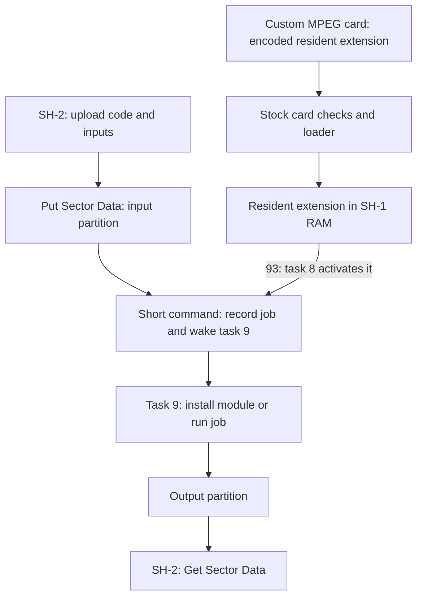

# Firmware mechanisms

The CD-block firmware can load native SH-1 code from an MPEG card and call it from its existing
tasks. A custom card extension could use those calls to accept computation jobs from the SH-2,
process data in CD-block RAM and return results through the sector buffer. A resident extension
could also load further SH-1 programs uploaded by the game.

This page describes the firmware mechanisms and the proposed use of them. Addresses refer to
CDB105 (SHA-1 `eb8393058f324e922c11b43709b64fc6ca94ab86`). A general-purpose module loader,
sustained computation alongside disc reads and the required custom card hardware are not
established on a console. No CPU budget or performance gain is known.

## Execution model

The SH-2 submits commands and transfers bytes. The SH-1 executes the extension in its own address
space, under the CD firmware's kernel. The host has no direct access to CD-block RAM, and Put
Sector Data does not provide an arbitrary-address write or an execute command.

The proposed arrangement has two parts:

- A resident extension supplied by MPEG-slot hardware. The stock loader decodes it, calls its
  initialization entry and later dispatches host commands and task work through its function table.
- A module loader within that extension. It accepts native SH-1 code and data from the host,
  installs them in owned RAM and calls a selected entry when a job is submitted.
  [module-extension.s][emulator-module-extension.s] defines one such format and protocol.

A card extension replaces table entries called by the firmware. It does not need to replace the
kernel or an entire task. Task 9's card work loop supplies a place to run the worker, while the
drive and sector services keep their existing tasks.

## Loading and activation

The card supplies an encoded extension at SH-1 address `0x0e000000`. The first longword is its
length, followed by the encoded bytes. The loader accepts a length up to `0x5000` and decodes into
`0x0907b000..0x0907ffff`. The transform is reversible and uses a trailer check without a secret
key, so a new extension can be encoded for it
([decoder](../cdblock/decoder.md#encoding)).

1. `E0` subcode 1 asks task 9 to check the card and load its extension. The checks require video
   and audio data-request behavior and a writable card-memory window. Reset-time card detection
   is a separate requirement.
2. The loader calls the entry pointer at decoded offset `+4`, in task 9. The extension initializes
   its table at `+8` and returns. The known cards fill empty entries from the ROM table at `0xf938`.
3. `93` with CR2 bit 0 set asks task 8 to activate the loaded extension. Its entry 34 performs
   activation and sets the card bit, bit 7 of the card flags `0x0f000892`. A loaded version byte
   alone does not enable ordinary MPEG command dispatch.
4. Once the card bit is set, and with bit 1 of the hardware flag `0x0f00027d` (MPEG card present),
   which startup sets when its own card test passes, most commands in `90..AF` reach entries 0..31
   through the interface page at `0xf800`.

The initialization entry must return so the load request can finish. While `E0` is busy, only
command `05` is accepted. Loading a permanent compute loop inside that entry would leave the
host unable to use the normal upload commands.

This route requires hardware or a cooperating device that exposes the extension and the expected
card interface. An MPEG movie is not an executable bootstrap. The checks' use of request lines,
DMA completion and memory does not establish the minimum electrical implementation of a custom
card. See [card checks](../cdblock/extensions.md#mpeg-card-requests),
[activation](../cdblock/extensions.md#card-activation) and [board wiring](../board.md#mpeg-card).

## Submitting work to task 9

MPEG command handlers run inside IRQ6. They receive CR1:CR2 in r1 and CR3:CR4 in r2, answer in
r12 and r13, and leave a message in r11 for the handler to post, or zero for no message. A submit
handler can record a job, set a work bit and return a wakeup message. Computation belongs in the
task reached by that message, outside the interrupt handler. The known cards' `A7` to `AA` work
this way ([image and sector jobs](../mpeg-card/commands.md#image-and-sector-jobs)).

With the card active, task 9 sends any nonzero message payload to its work loop at
`task9_card_work` (`0xba5e`):

| Work byte | Bits 0..3 select | Call convention |
| --- | --- | --- |
| `0x09075388` | Entries 54, 53, 69, 70 | Called with a return address, in that order |
| `0x09075389` | Entries 78, 77, 80, 79 | Lowest set bit selected, jumped to without a return address |

The worker must clear its request bit. Entry 76 rechecks the bytes, repeats the loop if work
remains and otherwise lets task 9 wait. A worker using entry 54 could set bit 0 of the first byte
and post `09810001`. The ROM's `9A` already uses that bit and message for a video connection, so
the extension must reserve the path or distinguish the two uses. It cannot silently share the bit
with normal MPEG playback.

On the known cards, `AB`, `AC` and `AD` return all-one response words and post nothing. A custom
extension could assign submit and status operations to those entries, but those meanings would
be its own protocol, not firmware commands.
[lifecycle-extension.s][emulator-lifecycle-extension.s] does this with one job at a time. See the
[card work loop](../cdblock/extensions.md#card-work-loop) and
[card command table](../mpeg-card/commands.md#routing).

Firmware mailboxes hold one word per message class. A second message of the same class overwrites
an unconsumed first message. Use the message as a wakeup, with a separate bounded job queue, or
reject a submission while a job is outstanding. Completion needs a job identifier and a defined
status or notification, including failure and cancellation.

## Scheduling alongside disc reads

The kernel supports interrupt-driven preemption. A running task keeps the CPU until it waits,
blocks on a lock or is interrupted. Interrupt paths can save its context, wake another task and
enter the scheduler. Selection at `task_select_ready` (`0x10a8`) chooses the first nonempty queue
in a fixed priority order. There is no identified round-robin quantum or per-task CPU allowance.

After startup, the relevant order is:

| Higher priority first | Work |
| --- | --- |
| 4, 6, 5, 12, 7 | Buffer setup, drive control, sector reads, host transfers, disc requests |
| 8 | MPEG activation and events |
| 2, 1, 13 | Subcode, sector correction, sector copy/move |
| 9 | Card requests and extension work |
| 14 | Idle |

Task 9 is therefore the preferred worker context. All the listed CD services outrank it. A
continuously ready worker in task 8 could instead starve subcode, correction and task 13.

The sector path already provides the required scheduling event. Decoder IRQ7 and DMA channel 0
completion defer messages to compare match B of ITU4, channel 4 of the SH-1's integrated timer
pulse unit (ITU). That handler saves the interrupted context, posts the messages and reschedules
through `task_requeue_current` (`0x102e`). A higher-priority task runs before the interrupted
worker, which can resume when higher-priority work waits. IRQ6 and due software timers also have
rescheduling paths. The four software timers deliver delayed messages, not CPU budgets. See
[scheduling](../cdblock/kernel.md#scheduling),
[interrupt messages](../cdblock/kernel.md#posting-from-interrupts) and
[timers](../cdblock/kernel.md#timers).

This supports using otherwise available processor time for computation. It does not establish
disc-service latency or an available percentage of the CPU. The worker must:

- Keep interrupts enabled under the firmware's mask convention.
- Keep sector-lock sections short. A higher-priority reader can be blocked by a lock the worker
  still owns, even though that reader can preempt it.
- Return between bounded batches to handle stop requests and other work in task 9. Higher-priority
  CD work does not need to wait for a batch to finish.
- Limit buffer consumption, so uploads and results leave space for incoming sectors.

Posting a message does not itself switch tasks. Requeueing a still-ready task also does not grant
time to lower-priority work. A timer-backed pause is a possible extension policy, but it requires
an actual wait, a valid mailbox class and a free timer slot. The four slots are shared with the
firmware. Continuous occupation of task 9 also excludes the idle task, whose requirements must be
accounted for before treating every idle cycle as available.

## Code, data and buffer ownership

A proposed host sequence is `64` (Put Sector Data), transfer, `06` (End Data Transfer), submit,
completion, then `61` (Get Sector Data) or `63` (Get and Delete Sector Data), transfer and `06`.
Puts arrive in sector slots through a filter. They do not land directly at a module's load address.
The resident loader must locate the uploaded bytes and install the module itself.

Code can also come from the card ROM with no transfer at all. The ROM appears at `0x0e000000`
through CS6 and repeats every 512 KB ([MPEG card](../board.md#mpeg-card)), and the expansion
loader decodes only the length its first longword gives. Whatever the ROM holds after that stays
readable, so the resident can copy a module from there into its own RAM whenever a job needs it.
The known cards never read the ROM themselves ([card code](../mpeg-card/sh1-code.md)), and `E2`
copies card ROM into sector slots instead. CS6 read timing on a console is not known.

Input can also come from the disc. A read connected to a filter files its sectors into a partition,
and the job reads them there, so only the output crosses to the host. Where a sector's data starts
depends on its mode byte, as for `61` ([sector spans](../cdblock/data-transfer.md#sector-spans)):
`+16` for mode 1, and `+24` for every other mode and for sectors put with `64`. Mode 2 form 2 data
is 2324 bytes rather than 2048. [disc-decompress-extension.s][emulator-disc-decompress-extension.s]
decodes a stream read this way and refuses form 2 input.

The interface page supplies services for finding partition slots, taking and returning free slots,
and changing connections. These make it possible to consume input and publish output through the
existing buffer system. They still require the firmware's locks and ownership rules. Releasing
the lock while computing is safe only if the input remains owned and cannot be deleted, reused
or changed by another command. See [interface services](../cdblock/extensions.md#rom-table) and
[data transfers](../cdblock/data-transfer.md).

The 512 KB CD buffer is not free module memory. It contains firmware state, extension areas and
the sector pool. A module loader needs a reserved code/data area, stack space and limits for
inputs and outputs. Retaining buffers reduces the capacity available for disc reads. Empty input,
pool exhaustion, partial output and rejected jobs all need defined cleanup.

Modules contain native SH-1 instructions. SH-2 binaries, pointers to SH-2 work RAM and SH-2
function addresses are not interchangeable with SH-1 code and addresses.
[module-extension.s][emulator-module-extension.s] loads a module into one fixed slot after its own
image in the expansion area, `0x0907c000..0x0907ffff`. A package's header gives its ABI version,
image and BSS sizes, stack use, entry and import table, and its last longword is a CRC-32. The load
checks all of them before it writes the slot, then binds each import to a service by number and
clears the BSS.
A reload of the extension decodes only the extension's own bytes, so the slot keeps a module's bytes
until a disc is accepted or a card load fails, either of which clears the expansion area.
The extension's record of the module is in its image, so a reload resets it. Relocation and
multiple resident modules are separate choices. Keeping code and reusable inputs resident could
reduce transfers, but the benefit needs measurement.

## Register and stack constraints

The kernel's interrupted-context restore handles r0..r13, PR, GBR, MACH, MACL, PC and SR. It does
not restore r14 or VBR. Those registers cannot be treated as ordinary task-local state without
an explicit convention shared with the firmware.

Message waits and contended lock acquisition preserve less than an interrupted-context save.
A contended acquire resumes with PC and SR, without restoring general registers or PR. Ordinary
compiled calls therefore need suitable wrappers and saved state around these services. A helper
that works with an uncontended lock is not necessarily safe when the lock is held.

Task 9's stack top is `0x0f000e88`, only 168 bytes above task 8's stack top at `0x0f000de0`.
An interrupted-context frame consumes 80 bytes. This is a tight limit for compiled functions,
library helpers and nested calls. A larger private stack would require a reserved RAM range and
a defined switch and return convention. Compiler register use, instruction selection and helper
routines must all match SH-1 and the firmware's conventions.

- Room. The expansion area after the extension's own image is RAM the extension owns. An entry
  can keep the caller's SP there, switch to a stack of its own, and switch back before it returns
  or jumps on to a ROM routine.
- One stack per entry context. An interrupt stacks its frame on whichever stack is current, and
  task 8 and IRQ6 can preempt task 9. Task 9's work loop, task 8's activation and the IRQ6 command
  handlers therefore each need their own, each with room for an interrupt frame.
- Waits. A task that waits on a message or a contended lock saves its exception SP and resumes
  from it ([waiting](../cdblock/kernel.md#waiting), [contention](../cdblock/kernel.md#contention)).
  The stack survives the wait even though the registers do not, so a wrapper around the lock
  traps can keep r8..r13 and PR on the stack and restore them after the trap.
- Compiler. GCC emits SH-1 code with `-m1` when it is configured for `sh-elf` with an SH-1
  library. A GCC configured for SH-2 alone rejects `-m1`, and its code uses instructions the SH-1
  lacks, such as `mul.l`, `dt`, `bt/s` and `bf/s`. `-ffixed-r14` keeps r14 out of generated code.
  The 32-bit multiply and divide come from libgcc's SH-1 helpers. `-ffreestanding` alone still lets
  GCC turn copy and fill loops into `memcpy` and `memset` calls, which
  `-fno-tree-loop-distribute-patterns` prevents.
- Entry conventions. The loader's entry gets the header in r1, and the MPEG command handlers get
  CR1:CR2 in r1 and CR3:CR4 in r2 and answer in r11..r13
  ([submitting work](#submitting-work-to-task-9)). Compiled code needs a short assembly entry for
  each, and wrappers for the interface page's stubs, which take their arguments in r1 to r3, and in
  r5 for entry 82.

Native modules run with the firmware's access to memory and devices. Bounds checks on a package
do not isolate its executing code. A bad pointer or changed interrupt mask can break CD operation.
See [task stacks](../cdblock/kernel.md#tasks), [waiting](../cdblock/kernel.md#waiting) and
[lock contention](../cdblock/kernel.md#contention).

## Stop, reset and disc changes

`93` stops or resets the card by changing state and posting messages. A stop message to task 9
does not abort a function already executing there. Cancellation needs a flag checked by the worker
or bounded batches that return to message handling. Buffers and module memory cannot be reclaimed
while the worker still uses them. [decompress-extension.s][emulator-decompress-extension.s] runs one
output sector per call of entry 54 and keeps its request bit set until the job ends, so the clear
by `93` ends the job between calls.

While the card is active, `E0`, `E1` subcode 1 and `E2` are rejected. A new card load needs a stop
first. A later card load can replace the extension, and failed checks or decode can clear it.
Accepted-disc handling at `disc_auth_accepted` (`0x8d00`) also clears the expansion area. The host
must therefore account for disc acceptance, not just explicit card reloads. `04` with its reset bit
keeps a loaded card extension but turns the card off, and abandons work task 9 was running.

A usable protocol needs an initialization generation or equivalent way to reject stale module
and job handles, abort outstanding work and rediscover the extension after state changes.
[Card extension lifecycle](lifecycle.md) lists what each event leaves. See also
[disc acceptance](../cdblock/disc-authentication.md#acceptance) and
[extension lifetime](../cdblock/extensions.md#lifetime).

## Remaining requirements

- Card hardware must satisfy reset-time detection, load checks, parallel ROM reads and subsequent
  register accesses, with correct electrical levels and timing. Passing the decoder's trailer
  check establishes neither card detection nor hardware compatibility.
- [module-extension.s][emulator-module-extension.s] defines a load, call and unload contract for
  assembly modules on task 9's stack. Compiled modules also need r14 left alone, a stack larger
  than task 9's and helpers for the 32-bit multiply and divide the SH-1 lacks
  ([register and stack constraints](#register-and-stack-constraints)).
- Preemption must preserve computation state across sector, drive and host events, including
  multiply results and compiled-code register use. Lock contention and interrupt stack space
  need the same treatment.
- Disc coexistence must cover sustained reads, correction, subcode, full buffers, repeated jobs,
  cancellation and reset. Fixed priority alone does not settle those cases.
- The interface page's stubs are identical in the known revisions
  ([ROM layout](../firmware-revisions.md#rom-layout)). An extension that reaches the ROM only
  through them and uses only the RAM addresses, traps and messages the known cards use, as the
  examples do, can run from one image on all four. In emulation `module-extension.s` and its
  modules have run so on all four, and the other examples' card ROMs load and turn on with each
  ([example status][emulator-examples-status]). Internal routines and other firmware state still
  need revision-specific treatment.
- Transfer cost, available compute time and effects on disc latency require hardware measurements.
  A compute-heavy job with reusable inputs may be suitable, but no workload speedup is established.

The separate disc-extension loader can also introduce SH-1 code, but requires accepted-disc
handling. It is not needed for the custom-card route described here. `E2` retrieves card ROM into
sector buffers and is not an upload-and-execute operation.

[emulator-decompress-extension.s]: https://github.com/LysergicWarp/Sega-Saturn-CDB-Emulator/blob/main/examples/decompress-extension.s
[emulator-disc-decompress-extension.s]: https://github.com/LysergicWarp/Sega-Saturn-CDB-Emulator/blob/main/examples/disc-decompress-extension.s
[emulator-examples-status]: https://github.com/LysergicWarp/Sega-Saturn-CDB-Emulator/blob/main/examples/README.md#status
[emulator-lifecycle-extension.s]: https://github.com/LysergicWarp/Sega-Saturn-CDB-Emulator/blob/main/examples/lifecycle-extension.s
[emulator-module-extension.s]: https://github.com/LysergicWarp/Sega-Saturn-CDB-Emulator/blob/main/examples/module-extension.s
